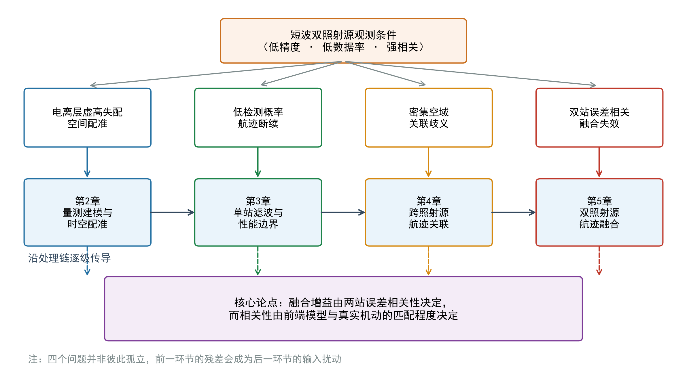

# 第1章 绪论

## 1.1 课题研究背景与意义

对超视距、强隐蔽目标的广域监视需求，长期受制于雷达体制的物理边界。微波雷达依靠视距传播，单站作用距离仅数十至数百公里，且受地球曲率遮挡；自建发射阵地的短波超视距雷达虽可覆盖数千公里，却因阵地固定、辐射特征明显而生存能力受限。短波外辐射源雷达提供了另一条路径：它不主动辐射，以广播、通信等已有的短波信号为照射源，借助电离层折射实现超视距照射，接收站只负责接收目标散射回波。

其优势是结构性的。发射源属于第三方，接收站无需申请专用频率、无需建设发射设施，成本与部署周期大幅压缩；全程被动工作，难以被电子侦察发现与定位，也不存在可被反辐射武器攻击的阵地；短波波长远大于吸波材料的适用尺度，加之双基地几何下前向散射增强，具备一定的反隐身潜力[39]。

然而，其效能被物理链路严重制约。信号须两次穿越电离层，由此带来三重困难。其一，电离层是时变、非均匀的随机介质，行波扰动引起相位污染、多普勒展宽与群路径抖动，等效虚高在数十分钟内即可漂移数公里。其二，非合作信号并非为雷达设计，调幅广播与DRM信号的带宽仅十千赫兹量级，模糊函数沿时延轴的主瓣极宽，距离分辨单元可达数十公里。其三，双跳路径损耗比直达波高出上百分贝，回波淹没于噪声与残余杂波。

上述条件最终转化为苛刻的量测条件：群距离误差十公里量级，方位误差零点几度，检测概率约零点六，更新周期三十秒。在1500 km地面距离上，零点三五度方位误差对应约9 km横向误差，与群距离误差同量级；三十秒内巡航速度230 m/s的目标已移动近7 km。量测误差与帧间位移同量级，意味着相邻两帧的点迹几乎不可区分，航迹起始、点迹关联与状态滤波都失去了经典方法赖以成立的前提。

为突破这一边界，利用多个照射源同时照射同一区域、以空间与频率分集获取额外信息，是被广泛看好的路径。分集的价值在于误差互补：同一目标相对两源的双基地几何不同，误差椭球长轴方向亦不同，一个源上主要表现为群距离误差的方向，在另一源上可能恰是方位约束较强的方向；两源载频不同，衰落近似不相关，一源漏检时另一源仍可能给出有效点迹。

然而，分集增益不会自动兑现。两条航迹放在一起，先要判断是否指向同一目标，再要判断如何把两个低精度估计合成更好的估计。时间上，两源帧时刻存在秒级偏移，需将异步航迹点外推到统一时间戳；空间上，两条射线的电离层路径不同，等效虚高不一致，形成与目标位置强耦合的系统偏差；关联上，低精度使不同目标的航迹在状态空间中相互交叠，低数据率又使可用判决样本极少；融合上，两源共视同一目标与同一片电离层，局部估计误差不再独立，独立性假设随之失效。四个问题层层相扣，构成本文的研究对象。

从理论层面看，经典航迹融合假设传感器精度足够高、数据率足够密、局部估计误差相互独立且统计特性已知，而短波双照射源场景同时打破这三条，因而无法靠套用现有算法获得提升，必须回到误差从何而来、相关性如何形成这一层面重新审视融合的有效性。从工程层面看，所形成的方案可支撑海空态势感知与远程目标监视，使短波被动探测从能发现走向能连续跟踪。

## 1.2 国内外研究现状及分析

### 1.2.1 短波外辐射源雷达发展历程

外辐射源探测的思想几乎与雷达同时诞生。1935年，Watson-Watt利用BBC短波广播信号探测到12 km外的轰炸机，验证了借用第三方照射源探测目标的可行性[1]。二战期间，德国研制出Klein Heidelberg系统，通过接收英国Chain Home雷达网的信号实现机群预警，成为最早的实战化双基地雷达[2]。此后因收发隔离困难与信号处理能力不足，研究重心转向单基地雷达，该体制停滞近半个世纪。

20世纪末，电子对抗对隐蔽探测的需求使其重新受到重视。1998年美国洛克希德·马丁公司推出Silent Sentry系统，利用调频广播与电视信号实现200 km量级探测，标志其进入实用化阶段[3]。21世纪初，DAB、DVB-T与DRM等数字广播信号普及，带宽与载频稳定性优于模拟广播；德国Cassidian公司的PARADE系统综合运用多种广播信号，探测距离超过150 km，定位精度优于500 m[4]。国内起步较晚但进展迅速，武汉大学万显荣团队研制多波段MIPAR系统并基于DRM信号开展外场实验[5,6]，多所高校与院所也相继开展研究[39]。

纵观这一脉络，可见一条清晰取舍：成熟系统多工作于米波或分米波段，依靠视距传播，作用距离百公里量级、精度可达百米量级；短波波段借助电离层反射可覆盖数千公里，代价是精度下降一个数量级以上。且已公开的短波天波研究多采用自建发射站，以非合作广播为照射源、多源并用的工作尚不多见。距离与精度的这一矛盾，正是短波外辐射源雷达信息处理的起点。

### 1.2.2 短波外辐射源雷达信息处理技术

信息处理的第一道关口是信号级处理。外辐射源雷达的直达波功率通常比目标回波高出数十至上百分贝，多径与杂波残留严重污染距离多普勒平面，故杂波抑制是检测的前提。Colone等人提出的扩展相消算法以批处理投影消除强直达波与多径分量[8]，其滑窗改进版本进一步适应了信道时变与目标机动[9]。这类方法决定了有没有点迹，却不能决定点迹准不准。

在单站航迹滤波方面，非线性滤波是主线。Julier与Uhlmann提出的无迹卡尔曼滤波以无迹变换传播状态分布，避免了线性化截断误差，成为处理极坐标量测的标准工具[7,54]。围绕外辐射源雷达的具体困难，国内学者做了针对性改进：文献[12]设计去相关无偏转换量测卡尔曼滤波以应对观测误差大、非线性强的问题；文献[13]将自适应扩展卡尔曼滤波与交互多模型结合；文献[40]以迭代扩展卡尔曼滤波处理天波路径下的强非线性；文献[14]在SORT框架下并联多个无迹卡尔曼滤波器，借助马氏距离完成数据关联。深度学习亦被引入，文献[15]构建端到端关联网络，文献[16]从运动特征入手区分无人机与飞鸟。

低检测概率下的航迹维持是另一条线索。检测概率仅为零点六时，平均每五帧就有两帧无有效量测，常规航迹删除逻辑会使真实航迹被过早终止。文献[10]在LTE体制的被动雷达中采用针对性的跟踪策略，证明了非合作信号下连续跟踪的可行性；文献[11]研究了无迹卡尔曼滤波器组网中的序贯融合，以递归传播互协方差降低计算量。由此可见，低数据率下的滤波性能不仅取决于算法本身，更取决于运动模型与真实机动的匹配程度。然而，现有方法大多假设检测概率较高、噪声统计特性平稳，对电离层扰动引起的非平稳噪声缺乏系统处理；自适应过程噪声策略的有效性依赖新息统计量与机动程度的可分辨性，而这一前提在三十秒采样间隔下并不稳固。

### 1.2.3 多照射源航迹关联与融合研究现状

航迹关联判断来自不同传感器的两条局部航迹是否源于同一目标，是融合的前置环节。基于统计检验的方法历史最久：最近邻法仅比较当前时刻的统计距离，密集目标下极易误判[17]；K-最近邻法引入历史判决次数以提升鲁棒性[18]；双门限法设置距离与次数两级门限，仅当统计距离持续小于门限且累计次数足够时才确认关联[19]；序贯法利用航迹历史状态估计差的联合似然比检验，充分挖掘时间维信息[50,51]。基于模糊数学的方法则以隶属度刻画相似性，构造模糊相关矩阵后按最大相似度判决[52,53]。Bar-Shalom与何友分别在专著中系统总结了上述方法[20,25]，文献[49]给出了更宽泛的综述。

近年来，关联方法向利用结构信息与利用学习能力两个方向演进。前者着眼于航迹间的拓扑关系：文献[21]以参考拓扑特征与广义子模式分配距离度量拓扑相似度，以抵抗系统误差；文献[29]采用上层灰色理论、下层拓扑相似的分层结构，在补偿系统偏差的同时降低计算量；文献[31]以航迹点的绝对与相对位置构建图谱特征，在密集场景下区分能力较好。后者借助神经网络提取时空特征：文献[26]以卷积与双向长短期记忆网络提取时空特征，文献[22]将自注意力与对比学习结合，文献[24]与文献[28]分别以密度峰值聚类与改进的聚类初始化应对小样本与高密度条件。文献[23]指出定位精度与几何构型密切相关，为门限设计提供了物理依据。

航迹融合把关联成功的局部航迹合成为全局一致的航迹，分布式结构因通信量小、鲁棒性强而成为主流[20]。简单凸组合融合按误差协方差的反比分配权重，计算量极小，但最优性依赖局部估计误差相互独立。为处理相关性，Bar-Shalom与Campo引入互协方差的递推估计[32]；互协方差难以获得时，协方差交叉融合构造包含各局部椭球交集的保守解以保证一致性[32]，其快速形式以协方差迹确定权重[33]。国内研究亦有积累：文献[35]回顾了两类概率密度均值融合方法；文献[36]解决了有限视域下的标签一致性问题；文献[37]针对断裂航迹提出双向预测加权融合；文献[34]与文献[38]探索了深度学习的应用；文献[42]与文献[43]讨论了组网与多站探测的工程约束。

综合来看，两个方向的理论体系都已完备，但假设前提与短波双照射源场景存在系统性错位。关联方法假定航迹连续、数据率高、误差远小于目标间距，而短波条件下误差与目标间距同量级、航迹片段化严重；融合方法假定局部估计误差独立或互协方差可计算，而双照射源共视同一目标与同一片电离层，相关性恰恰不可忽略。更关键的是，现有研究很少把配准误差、航迹断续、关联歧义与误差相关放在同一场景中考察其相互放大的机制，因而难以回答一个更基本的问题：在这种量测条件下，融合究竟能带来多少增益，增益又由什么决定。

## 1.3 现有研究存在的问题

将上述分析落到具体环节，本文认为短波双照射源航迹关联与融合存在四个必须正面回答的痛点，它们分别位于配准、滤波、关联与融合，并沿处理链逐级传导。

第一是电离层等效虚高失配引起的空间配准问题。天波量测得到的是收发总群距离，需借助等效虚高才能反演目标的地面距离，而等效虚高本身未知且缓变。当标称值与真值相差二十公里时，单跳路径下的地面距离反演会产生数十公里的系统性偏差，且该偏差随目标距离与射线仰角变化，并非常值偏移。传统配准方法多针对测距、测角环节的常值偏差设计[47,48]，难以刻画虚高经非线性几何映射后形成的位置偏差。若不解决这一环节，后续关联将在被系统偏差整体平移的坐标中进行，任何门限设计都失去意义。

第二是低检测概率与低数据率共同导致的航迹断续问题。检测概率零点六意味着单站每五帧丢失两帧，三十秒的数据率又使目标在相邻帧间移动近七公里，预测协方差在连续漏检时迅速膨胀。传统航迹管理以连续多帧确认起始、以连续多帧丢失终止，在这种条件下要么过早终止真实航迹，要么因门限放宽而接纳大量虚假航迹。航迹一旦断裂，跨照射源关联便失去可供比较的重叠时段，融合更无从谈起。因此，设计合理的漏检续存机制与滤波结构，使单站航迹在自身精度极限内尽可能连续，是后续所有环节的基础。

第三是密集空域下的关联歧义问题。同时在场目标增至数十架时，候选航迹对数量随目标数近似平方增长，而可区分度随量测误差增大而下降。当位置误差达到十公里量级、目标间距与之相当时，最近邻准则退化为近似随机指派；即便引入多帧累积，门限的收紧与放松也会在误配与漏配之间形成明显的跷跷板效应。更棘手的是残余误配的形态：平行航路或编队飞行下，两条航迹互相配反之后各自的位置序列仍然平滑合理，单帧统计检验无法察觉，只有从全局指派的角度才能识别。这类交换型误配一旦进入融合，会把两个目标的航迹长期污染。

第四是双站误差相关导致的融合失效问题。两个照射源跟踪同一目标，共享同一段真实机动过程与同一套运动模型；当模型与真实机动不匹配时，两站会在同一时刻、朝同一方向产生同号预测误差，局部估计误差因而正相关。此时简单凸组合融合仍按独立假设分配权重，结果既过度自信又偏离最优，融合精度甚至可能劣于较好的单站航迹；引入互协方差的算法理论上更合理，但互协方差难以从数据可靠估计；协方差交叉融合虽保证一致性，却以保守性为代价，在相关性本可改善时反而抑制了可用增益。由此可知，融合上限并不单纯由融合算法决定，而更多取决于误差相关性这一前端属性。

这四个痛点并非彼此孤立。配准残差使量测带有缓变偏差，降低关联区分度；航迹断续使可用公共帧减少，加剧歧义；误配把错误配对送入融合；误差相关则决定即便配对完全正确，融合也未必带来增益。现有研究很少沿这条传导链考察各环节的耦合关系，这正是本文试图填补的空白。

## 1.4 本文主要研究内容与结构安排

本文的研究定位不是提出新的雷达体制或信号形式，而是在既有的短波双照射源观测条件下，回答三个递进的问题：航迹级融合在什么条件下有用，为什么有用，如何让它有用。本文不追求单项指标全面最优，而力求把每一环节的性能边界、失效机理与适用条件交代清楚。全文的研究框架与章节对应关系如图[@fig:ch1_framework]所示。

{#fig:ch1_framework}

图中上层为观测条件派生的四个技术痛点，中层为本文四个技术章节，下层为贯穿全文的核心论点。可以看出，四个痛点沿处理链串行排列而非并列：配准残差进入滤波，滤波输出的航迹质量决定关联难度，关联结果再进入融合，因此任一环节的残差都会成为下一环节的输入扰动。这一串行结构决定了本文的章节顺序，也决定了核心论点只能在全链路打通之后才能成立——融合增益并不由融合算法单独决定，而是由前端模型与真实机动的匹配程度经误差相关性这一中间量传导而来。

第2章建立量测模型与时空基准：从双基地群距离几何出发，将电离层等效虚高显式参数化，推导群距离、方位与多普勒量测的非线性映射；讨论两源异步下的时间对齐，并以三参数极大似然配准完成系统偏差标定。

第3章研究单站航迹滤波与性能边界：采用交互多模型无迹卡尔曼滤波处理强非线性量测，针对检测概率零点六设计漏检纯预测续存机制，推导稳态定位精度的理论下界并检验滤波器是否逼近该下界；进而考察模型集与真实机动的匹配程度如何影响误差相关性，建立模型匹配度、误差相关性与融合增益的传导关系。

第4章研究跨照射源航迹关联：分析候选航迹对数量随目标密度增长的规律，指出多帧判决中误配与漏配的跷跷板效应；把关联拆分为判定与指派两层，判定层以多证据加权融合综合位置、速度与连续性信息，指派层以全局最优代替逐点贪心；并在稀疏与密集场景下与最近邻法、序贯法对比。

第5章研究航迹融合：在统一配对集合下比较简单凸组合、Bar-Shalom-Campo、协方差交叉及其快速算法，分析误差相关系数对增益的定量影响；讨论融合极限如何随相关性移动，给出增益为正的适用条件。

第6章总结全文，归纳结论与创新点，说明局限并展望后续方向。全文以ADS-B实测航迹驱动的半实物仿真为验证基础，场景从同时六架目标的稀疏空域延伸至六十余架的高密集空域。
