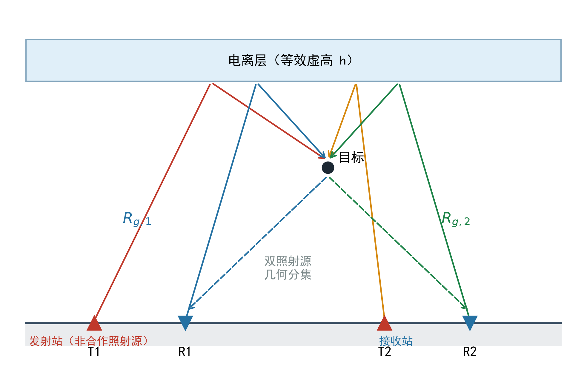
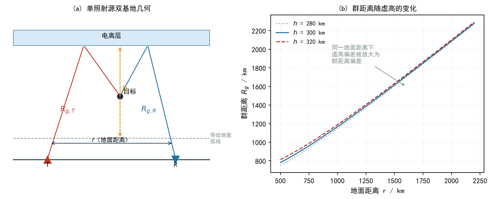
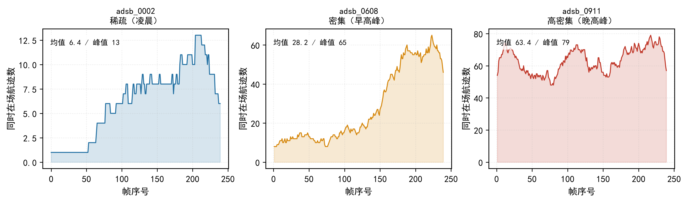
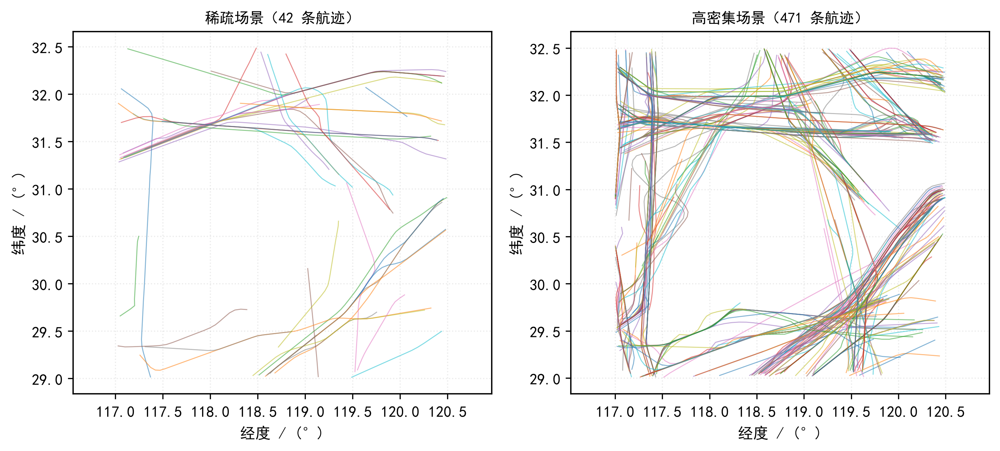
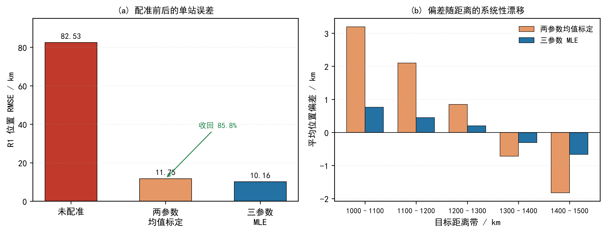
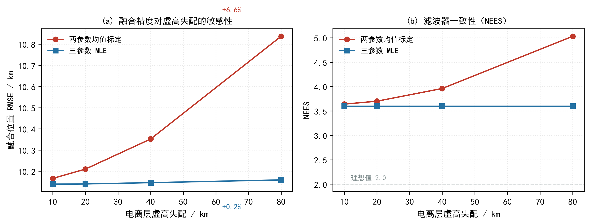

# 第2章 天波双基地量测模型与时空配准

第1章指出，短波外辐射源雷达的单站定位误差可达数十公里，不同照射源的航迹在地理空间中系统性错开，直接关联必然失败。其根源不在随机噪声，而在量测方程中隐藏的三个系统量：电离层等效虚高、链路时间基准偏差与阵列方位偏差。若不在建模阶段把它们写进方程，后续滤波与关联都只是在错误基准上做最优估计。本章先建立双照射源几何与天波双基地群距离模型，并以实测 ADS-B 数据构造场景；再把三类系统量作为待估参数联合反演，给出可辨识性条件、几何设计准则与配准效果的量化验证。

## 2.1 双照射源系统几何配置

双照射源的价值来自空间分集：一条链路被电离层吸收时另一条仍可给出点迹。但分集要求两条链路在空域、距离窗与观测时刻上足够重叠，否则两站航迹没有可比较的公共目标，故先固定几何。

系统由两台接收站与两个短波广播照射源构成。R1 位于 104.0°E、30.7°N，其照射源 Tx1 位于 100.0°E、30.7°N；R2 位于 106.5°E、29.6°N，其照射源 Tx2 位于 102.5°E、29.6°N。两对收发站同纬度东西向布置，经度相差 4°，在 30°N 附近对应地面基线约 380 km。采用以接收站为原点的局部平面坐标，x 轴指东、y 轴指北，方位角 $\phi_{az}=\operatorname{atan2}(x,y)$ 以北偏东为正；平面形变远小于量测噪声，地心地固坐标留作多站统一基准。

两站波束中心指向 93°、全宽 45°，单跳地面距离窗取 1000–2000 km。该窗口既是几何可达范围，也是传播模式单一性的保证：下限对应仰角过高、接近电离层穿透的区域，上限对应多跳传播与单跳回波混叠的区域。两站波束与距离窗求交，得共视区 116.0–122.2°E、26.5–34.0°N，目标至 R2 的地面距离覆盖 1004–1736 km，至 R1 覆盖 1240–1900 km。

两条链路并不对称，R1 链路的目标距离整体比 R2 远 200 km 以上，双基地角与群距离对虚高的灵敏度也不同。这种不对称恰是可辨识性的来源，但也意味着两条链路的系统误差参数必须分别估计。主要参数如表[@tbl:ch2_sysparam]所示。

| 参数 | 符号 | 取值 |
| ---- | ---- | ---- |
| 采样周期 | $dt$ | 30 s |
| R2 相对 R1 的起始时间偏移 | $\Delta\tau_0$ | 13 s |
| 检测概率 | $P_d$ | 0.6 |
| 虚警率 | $P_{fa}$ | $10^{-3}$ |
| R1 群距离噪声标准差 | $\sigma_{R1}$ | 10 km |
| R2 群距离噪声标准差 | $\sigma_{R2}$ | 20 km |
| R1 方位噪声标准差 | $\sigma_{az1}$ | 0.35° |
| R2 方位噪声标准差 | $\sigma_{az2}$ | 0.60° |
| 多普勒噪声标准差 | $\sigma_{vd}$ | 0.5 m/s |
| 单跳地面距离窗 | $\rho$ | 1000–2000 km |
| 电离层等效虚高（真值/标称） | $h$ | 320 / 300 km |
| 目标巡航速度 | $v$ | 230 m/s |

: 双照射源系统与场景参数 {#tbl:ch2_sysparam}

{#fig:ch2_geometry}

如图[@fig:ch2_geometry]所示，两站波束在中间空域大面积重叠，共视区呈东西向带状，宽度随距离增大而扩张，因波束以角度定义、地面投影与距离成正比。差异在于两条链路的距离窗并非同心地落在共视区上，R2 的近端边界直接构成共视区西界，R1 的远在其外，说明共视区形状主要由 R2 决定。原因是 R2 更靠西南，其 1000 km 圆最先切入目标区；后果是共视区内目标对 R1 普遍处于中远距，R1 的精度分布反而更均匀。

## 2.2 天波双基地群距离量测模型

### 2.2.1 电离层等效虚高与群距离

短波信号不沿直线传播。信号在电离层中被连续折射，路径呈弧线，光程大于两点直线距离，按直线几何反演会系统性低估目标距离。严格求解需电子密度剖面，而剖面时空变化不可预报，工程上改用等效参数把弯曲路径折算为折线：假设电离层在某一高度作镜面反射，该高度称为电离层等效虚高，它把不可观测的剖面信息压缩为一个可估标量。

设目标与站点的地面距离为 $\rho$，反射点位于该段中点正上方、高 $h$，则上下行两段各长 $\sqrt{(\rho/2)^2+h^2}$，单程等效路径为

$$L(\rho,h)=\sqrt{\rho^2+4h^2}$$ {#eq:ch2_oneway}

系数 4 而非 2 的来源在于路径由两段斜距拼接，每段的地面投影只有 $\rho/2$，合并后虚高项被放大四倍。双基地体制下两段地面距离为 $\rho_0$ 与 $\rho_1$，总群距离为

$$R_g=\sqrt{\rho_0^2+4h^2}+\sqrt{\rho_1^2+4h^2}$$ {#eq:ch2_group_range}

地球曲率不可完全忽略。以弦长代替平面距离，取地球半径 $R_e=6371\text{ km}$，则 $\rho_c=2R_e\sin(\rho/2R_e)$；1000 km 处弦长比弧长短约 0.9 km，2000 km 处约 8.4 km。该差异小于 $\sigma_R$，但它是确定性的，会随反演累积为系统偏差，故主链路一律采用球面弦长模型。

由群距离反演位置需解一个关于 $\rho_1$ 的标量方程。设 $\psi$ 为目标方向与基线方向的夹角，由余弦定理 $\rho_0^2=\rho_1^2+L^2-2\rho_1L\cos\psi$，代入[@eq:ch2_group_range]得

$$\sqrt{\rho_1^2+L^2-2\rho_1L\cos\psi+4h^2}+\sqrt{\rho_1^2+4h^2}-R_g=0$$ {#eq:ch2_inverse}

左端关于 $\rho_1$ 严格单调，故根唯一，用牛顿迭代求解，初值取单基地近似 $\sqrt{(R_g/2)^2-4h^2}$，再按 $x=\rho_1\sin\phi_{az}$、$y=\rho_1\cos\phi_{az}$ 定位。单基地近似仅在基线远小于目标距离时成立，本文基线约 380 km、目标距离 1000–1900 km，基线占比达 20%–38%，双基地角引起的路径差与 $\sigma_R$ 同量级，故主链路一律调用严格的双基地反演求解器。单程路径恒不小于 $2h$，方程必有解；一旦出现 $R_g/2<2h$，只说明该点已被粗差污染。

{#fig:ch2_group_range}

如图[@fig:ch2_group_range]所示，群距离随地面距离近似线性增长，但斜率始终大于 2，且在近距段更陡。差异在于两条曲线的间距并非常数，同一虚高偏差在近端造成的群距离偏差大、在远端小，曲线在远距处靠拢。原因是 $\partial L/\partial h=4h/\sqrt{\rho^2+4h^2}$ 随 $\rho$ 单调衰减，虚高误差在群距离上留下距离相关的印记，而非可整体扣除的常数，这构成 2.4 节全部论证的出发点。

### 2.2.2 三维量测向量与噪声特性

单条链路在每个采样时刻输出群距离、方位角与多普勒速度，量测向量为 $\mathbf z=[R_g,\phi_{az},v_d]^T+\boldsymbol\varepsilon_z$。其中多普勒是群距离变化率，按链式法则为两段路径变化率的加权和

$$v_d=\frac{\rho_0}{\sqrt{\rho_0^2+4h^2}}(\mathbf e_0\cdot\mathbf v)+\frac{\rho_1}{\sqrt{\rho_1^2+4h^2}}(\mathbf e_1\cdot\mathbf v)$$ {#eq:ch2_doppler}

式中 $\mathbf e_0$、$\mathbf e_1$ 分别为照射源与接收站指向目标的单位向量，目标远离时 $v_d$ 为正。两个权重在 1000–1900 km 内取 0.84–0.95，故多普勒近似为速度在两条传播方向上的投影之和；该权重对虚高依赖很弱，意味着多普勒几乎不携带虚高信息，无法用来解耦虚高与距离偏差。三通道噪声相互独立且近似零均值高斯，协方差为对角阵

$$\mathbf R=\operatorname{diag}(\sigma_R^2,\sigma_{az}^2,\sigma_{vd}^2)$$ {#eq:ch2_cov}

对角假设的依据是三者物理来源分离：群距离误差来自电离层相位污染与脉冲压缩峰值抖动，方位误差来自阵列幅相不一致与波束指向标定残差，多普勒误差来自相干积累期间的相位噪声。量级上，群距离噪声按链路异构性设定，R2 取 R1 的两倍即 20 km，以覆盖照射源功率与传播条件的差异，20 km 相对 2000 km 群距离为 1%，与短波公里级的距离分辨单元相称。方位噪声取 0.35° 与 0.60°，可由孔径判断：10 MHz 对应波长 30 m，数十米基线的波束宽度本身即为数度。多普勒噪声 0.5 m/s 由分辨力推出，若相干积累时间取一个采样周期 30 s，多普勒分辨为 0.033 Hz，在 30 m 波长下恰对应 0.5 m/s。

三个通道的量级相差三个数量级。这一事实直接决定 2.4.2 节代价函数的形式：若不加归一化而对原始残差平方求和，距离项量级为 $10^2$、方位项为 $10^{-1}$，优化会被距离通道完全支配。

## 2.3 数据驱动的场景构建

### 2.3.1 基于 ADS-B 实测数据的场景生成

若用人工合成航迹，航迹交叉、转弯时机与目标密度全由设计者指定，算法在真实交通流下的表现便无从判断，而这三项恰是跨照射源关联最敏感的因素。本节因此改用实测广播式自动相关监视数据构造场景，把航迹的真实性交给真实数据，只保留雷达量测由物理模型生成。

数据源为 2026 年 10 月 24 日全天中国全境的 ADS-B 记录，原始 776 MB、约 670 万行，剔除越界与缺项后有效约 590 万行。筛选条件为：区域限定 117–120.5°E、29–32.5°N；高度不低于 20000 ft 以只保留巡航段；每段不少于 10 帧；地速 120–620 kt；相邻点间隔超过 120 s 即断开为两条航迹，避免插值在缺口处凭空生成目标。通过筛选的航迹重采样到严格 30 s 网格，其原始采样间隔中位数恰为 30 s，与本文采样周期天然匹配。

本文没有真实回波，故不称实测验证，而称数据驱动半实物仿真：目标状态取自真实 ADS-B 报告，群距离、方位与多普勒由 2.2 节模型仿真生成。以 ADS-B 位置作参考真值是可接受的，其水平精度约 30 m，相对 10 km 量级的雷达误差仅 0.3%。适用边界亦须声明：本文聚焦巡航段，起降段高度变化剧烈、地速不恒定，超出二维平面模型的能力；巡航高度 6–10 km 对群距离的影响约 33 m，相对 $\sigma_R$ 可忽略。

### 2.3.2 密度梯度场景设计

同一套算法在稀疏与密集下的行为差异，是关联鲁棒性最有力的证据，而人造场景很难给出可信的密度梯度。实测数据在这一点上有天然优势：一天之内的航班波本身构成从个位数到近百架的在空目标数变化。按不同时段切分，得四个规模递进的场景，如表[@tbl:ch2_scene]所示。

| 场景 | 总航迹数 | 并发均值 | 并发峰值 | 时段(UTC) | 档位 |
| ---- | ---- | ---- | ---- | ---- | ---- |
| adsb_0002 | 42 | 6.2 | 13 | 00–02 | 稀疏 |
| adsb_span | 15 | 4.2 | 10 | 00–02 | 稀疏，距离分层 |
| adsb_0608 | 204 | 28.1 | 65 | 06–08 | 密集 |
| adsb_0911 | 471 | 63.1 | 79 | 09–11 | 高密集 |

: 四个 ADS-B 场景的规模 {#tbl:ch2_scene}

adsb_span 是为验证配准而专门设计的距离分层场景：按目标至 R2 的地面距离划分 1000–1100、1100–1200、1200–1300、1300–1400、1400–1560 km 五个带，每带挑选跨度最大的航迹，得 15 条航迹、距离覆盖 1001–1526 km、跨度 525 km，各带帧数均匀。相比之下 adsb_0002 跨度只有 346 km，且近半数帧挤在 1200–1300 km 单带内。这一差别在 2.4 节具有决定性意义：两参数标定的缺陷只在距离跨度足够大时才暴露，若仅在 adsb_0002 上评估，会把该缺陷误判为不存在。

{#fig:ch2_density}

如图[@fig:ch2_density]所示，四个场景的并发数曲线呈阶梯状，峰值分别为 13、10、65 与 79。差异不在峰值本身，而在曲线平坦程度：稀疏场景的并发数在 0 到 13 间大幅起伏，存在无目标的帧；高密集场景长期维持 60 架以上，曲线近乎水平。原因是民航航班波的时间结构，早间与午后为出港高峰、深夜为低谷，目标进出覆盖区又叠加一层随机性；对后续处理而言，前者困难在航迹短，后者在候选配对数随并发数平方增长。

{#fig:ch2_tracks}

如图[@fig:ch2_tracks]所示，稀疏场景航迹稀疏、方向单一，交叉点屈指可数；高密集场景东西向干线与南北向航路交织，形成大量近似同时的交叉。差异在交叉的几何形态：稀疏场景多为两条航迹以大角度穿越，密集场景则存在大量小角度接近的平行航段。原因是干线航班沿固定航路飞行，同向航段横向间隔只有几十公里，与本文 10–20 km 的量测噪声同量级，故密集场景的关联困难不仅来自目标数量，更来自几何可分性的下降，这构成第4章算法设计的直接动因。

## 2.4 时空配准

配准含时间与空间两个层面。时间层面解决采样时刻不一致，即两条链路比较的是不同时刻的状态；空间层面解决测量本身已偏离真实位置，即坐标变换无法消除的传播参数误差与系统偏差。前者属前处理，后者才是配准的核心。

### 2.4.1 时间对齐

两条链路数据率相同，均为 30 s，但起始时刻相差 13 s。若直接比较 $t$ 与 $t+13$ 时刻的状态，比较的就不是同一时刻的目标位置。对 230 m/s 的巡航目标，13 s 对应位移约 3.0 km，该数值不大，却会以确定性偏差进入关联判据，且无法通过增加观测次数消除。

本文采用匀速模型状态外推完成时间对齐。设链路在 $t_k$ 时刻的状态估计为 $\mathbf x_k$，则统一时刻 $t$ 的状态由状态转移矩阵给出

$$\mathbf x(t)=\mathbf F(\Delta\tau)\mathbf x_k, \mathbf F(\Delta\tau)=\begin{bmatrix}\mathbf I&\Delta\tau\mathbf I\\\mathbf 0&\mathbf I\end{bmatrix}$$ {#eq:ch2_time_align}

其中 $\Delta\tau=t-t_k$，$|\Delta\tau|\le dt/2$。选择外推而非插值，理由有二：插值需目标时刻两侧各有一帧，而检测概率仅 0.6，连续两帧齐全的概率不足 0.4；外推只需当前帧，且所用匀速模型与第3章滤波器内部模型一致，不引入额外假设。二者在配准框架中属等价实现，差别仅在可用性。

时间对齐误差是否主导整体精度，可用量级比较回答。3.0 km 位移相对单站随机误差 10–20 km 已不显著，相对未配准时的系统误差 82.53 km 仅 3.6%，故不是主导项。但该结论有前提：若 13 s 属时钟基准偏差而非采样时刻偏移，其效应不会随对齐消失，而会以 $\Delta R_{sync}=c\Delta t_{sync}$ 的形式整体平移群距离，必须作为待估参数进入空间配准模型。

### 2.4.2 空间配准的三参数联合最大似然模型

2.2 节的模型在生成量测时用真实虚高 320 km，在反演与滤波中用标称 300 km。这 20 km 失配不是标定疏忽，而是物理必然：虚高随昼夜与季节在 250–350 km 间漂移，标称值只能是某一时刻的平均。更关键的是，其造成的群距离偏差随距离单调衰减，1000 km 处约 37 km、1700 km 处约 25 km，不能被任何常数吸收。

现有工程做法是两参数均值标定，用标校航迹的残差均值估计一个距离偏置与一个方位偏置，虚高固定为标称值。该方法在标校集与评估集距离分布一致时精确，因为常数偏置恰等于失配在该距离上的平均效应；一旦评估目标落到该分布之外，就会过校正或欠校正，误差随距离线性增长。要消除这一缺陷，只能把虚高本身作为待估参数。据此建立含三参数的观测方程

$$R_{g,k}^{obs}=\sqrt{\rho_{0,k}^2+4h^2}+\sqrt{\rho_{1,k}^2+4h^2}+\Delta R_{sync}+\varepsilon_{R,k}$$ {#eq:ch2_obs_range}

&#8203;

$$\phi_{az,k}^{obs}=\operatorname{atan2}(x_k,y_k)+\Delta\theta+\varepsilon_{\theta,k}$$ {#eq:ch2_obs_az}

待估参数为 $\boldsymbol\eta=[h,\Delta R_{sync},\Delta\theta]^T$，三者作用方式互不相同：虚高非线性进入群距离，作用强度随距离变化；$\Delta R_{sync}$ 对群距离整体平移，线性且与几何无关；$\Delta\theta$ 对方位整体旋转，只影响切向位置，与距离通道解耦。三者中只有前两个耦合，这一结构性质是 2.4.3 节全部推导的基础。

以先验参考航迹给出的目标位置为参考量，构造距离残差与方位残差

$$r_{R,k}^{(m)}=R_{g,k}^{obs,(m)}-\sqrt{\rho_{0,k}^{(m)2}+4h^2}-\sqrt{\rho_{1,k}^{(m)2}+4h^2}-\Delta R_{sync}$$ {#eq:ch2_res_r}

&#8203;

$$r_{\theta,k}^{(m)}=\phi_{az,k}^{obs,(m)}-\phi_{az,k}^{ref,(m)}-\Delta\theta$$ {#eq:ch2_res_theta}

按噪声标准差归一化后求和，得加权残差代价函数

$$J(\boldsymbol\eta)=\sum_{m=1}^{M}\sum_{k=1}^{N_m}\left[\frac{(r_{R,k}^{(m)})^2}{\sigma_R^2}+\frac{(r_{\theta,k}^{(m)})^2}{\sigma_\theta^2}\right]$$ {#eq:ch2_cost}

在噪声为零均值高斯且方差已知时，该函数与观测似然函数等价，其极小点即为最大似然估计 $\hat{\boldsymbol\eta}=\arg\min_{\boldsymbol\eta}J(\boldsymbol\eta)$。归一化的必要性已由 2.2.2 节说明，此处分母分别取各自链路的值：R1 取 10 km 与 0.35°，R2 取 20 km 与 0.60°；若两条链路共用一组噪声参数，噪声较大链路的残差会被过度加权，估计结果向该链路偏移。

求解采用列文伯格-马夸尔特算法，并对参数设物理可行区间：$h\in[100,400]\text{ km}$，$\Delta R_{sync}\in[-50,50]\text{ km}$，$\Delta\theta\in[-10,10]^\circ$。边界直接决定估计是否可信：实测中方位偏差上界原设 ±3°，而 R2 真实偏差为 3.5°，参数被截断后优化器为补偿方位残差而连带把虚高拉偏，估成 327 km；放宽至 ±10° 后，同一数据的虚高估计回到 321.1 km，与真值相差 1.1 km。

得到估计后，对观测量实施系统偏差扣除，并按更新后的虚高重新反演位置

$$\widehat R_{g,k}=R_{g,k}^{obs}-\widehat{\Delta R}_{sync}, \widehat\phi_{az,k}=\phi_{az,k}^{obs}-\widehat{\Delta\theta}$$ {#eq:ch2_correct}

&#8203;

$$r_k=\sqrt{\left(\frac{\widehat R_{g,k}}{2}\right)^2-4\hat h^2}, x_k=r_k\sin\widehat\phi_{az,k}, y_k=r_k\cos\widehat\phi_{az,k}$$ {#eq:ch2_reinvert}

配准由此明确：它不是给航迹叠加固定平移量，而是系统偏差扣除、传播参数更新、位置重解算三步的合成。前两步作用于观测量，第三步才作用于位置，故残差回落至随机噪声水平，这正是 2.4.4 节观察到偏差极差压缩的机理。

### 2.4.3 参数可辨识性与几何设计准则

三参数模型能否求解，取决于一个结构性困难：虚高与距离偏置在群距离方程中几乎同向作用，虚高增大 1 km 与距离偏置增大 1 km 所产生的群距离增量在数值上接近。若所有样本的几何条件相同，二者作用完全重合，任何估计方法都无法把它们分开。

对[@eq:ch2_group_range]求偏导，得群距离对虚高的灵敏度

$$s_k=\frac{\partial R_g}{\partial h}=\frac{4h}{\sqrt{\rho_{0,k}^2+4h^2}}+\frac{4h}{\sqrt{\rho_{1,k}^2+4h^2}}$$ {#eq:ch2_sens}

当 $\rho\gg h$ 时 $s_k\approx 4h/\rho$，灵敏度与距离近似成反比：取 $h=300\text{ km}$，300 km 处 $s_k\approx 4.0$，1000 km 处降至 1.2，1900 km 处仅 0.63。群距离的一阶增量为

$$\delta R_{g,k}\approx s_k\delta h+\delta(\Delta R_{sync})$$ {#eq:ch2_first_order}

若所有样本的 $s_k$ 相同，该式退化为两个未知数的一个线性组合，参数不可辨识；只有 $s_k$ 具有足够离散度，二者才可分离。记 $s_k$ 的均值与二阶矩为 $\overline s$ 与 $\overline{s^2}$，距离通道的 Fisher 信息矩阵为

$$\mathbf F_R=\frac{1}{\sigma_R^2}\begin{bmatrix}N_{tot}\overline{s^2}&N_{tot}\overline s\\N_{tot}\overline s&N_{tot}\end{bmatrix}$$ {#eq:ch2_fisher}

其中 $N_{tot}$ 为参与联合估计的独立样本总数。求逆即得两个参数的克拉美-罗下界与相关系数

$$\sigma_h=\frac{\sigma_R}{\sqrt{N_{tot}}}\frac{1}{\sqrt{\overline{s^2}-\overline s^2}}, \sigma_{\Delta R}=\frac{\sigma_R}{\sqrt{N_{tot}}}\frac{\sqrt{\overline{s^2}}}{\sqrt{\overline{s^2}-\overline s^2}}$$ {#eq:ch2_crlb}

&#8203;

$$\rho_{h,\Delta R}=-\frac{\overline s}{\sqrt{\overline{s^2}}}=-\frac{1}{\sqrt{1+\operatorname{CV}^2(s)}}$$ {#eq:ch2_corr}

这三式给出明确结论：精度由两项因素共同决定，一是独立样本总数，带来 $1/\sqrt{N_{tot}}$ 的算术改善；二是灵敏度的离散度 $\overline{s^2}-\overline s^2$，决定耦合能否被打破。前者是量的积累，后者是质的改变。由于 $s_k$ 只依赖目标至两站的地面距离、与航向无关，异构的准确含义是距离分层丰富，而非航向多样。实测中四档混合航向与统一 45° 航向的 $\sigma_{\Delta R}$ 分别为 2.97 km 与 2.76 km（$N_{tot}=652$）、1.19 km 与 1.21 km（$N_{tot}=3534$），差异落在蒙特卡洛噪声内，故工程上可放心使用同向平行航线。

距离分层的价值可定量估计。全部航迹集中于同一距离层时 $s_k$ 近似为常数，$\operatorname{CV}(s)$ 由 0.1424 降至 0.0662，条件数由 468 升至 2265；等样本量 898 时，分层集合与单层集合的 $\sigma_{\Delta R}$ 分别为 2.370 km 与 5.053 km，相差 2.13 倍。另一极端同样有害，单条等距离圆弧上 $\rho_1$ 严格恒定，两列完全线性相关，参数彻底不可辨识。单条航迹的 $\kappa=\sigma_{\Delta R}\sqrt{N_{tot}}/\sigma_R$ 在 7.9–19.4 之间，典型估计标准差为 12.08 km；20 条分层航迹联合估计可把 $\kappa$ 压到 7.09、$\sigma_{\Delta R}$ 降至 1.208 km。改善来自样本总数与距离跨度，与航迹条数无关：把同一条航迹切成多段，$\sigma_{\Delta R}$ 恒为 1.770 km。

以上讨论的是估计精度，还需回答什么条件下值得做三参数配准。设均值标定后的群距离残余为虚高失配在观测距离区间上的起伏，按均匀分布估计其标准差为 $\delta R_g=(\Delta_{max}-\Delta_{min})/(2\sqrt3)$，除以双基地群距离系数 1.98 得位置残余 $\delta p$；叠加到单站位置均方根误差 $R$ 上，相对改善为

$$\eta=\frac{\delta p^2}{2R^2}$$ {#eq:ch2_second_order}

该式表明改善是二阶小量，当 $\delta p\ll R$ 时配准精度再高也换不来总体精度的明显提升。取 $R=13.4\text{ km}$，失配 10 km 时 $\delta p=0.72\text{ km}$、$\eta\approx 0.15\%$，失配 80 km 时 $\delta p=6.04\text{ km}$、$\eta\approx 9.96\%$。据此给出适用边界：失配小于 20 km 且跨度小于 300 km 时两参数已足够；失配大于 50 km 或跨度大于 500 km 时必须采用三参数。该判据有现实意义，因为虚高在 250–350 km 间漂移，相对 300 km 标称值的失配可达 50 km 以上，正落在三参数有优势的区间。

### 2.4.4 配准效果验证

配准是否必需，可用不校正的基线回答。在 adsb_0002、5 个随机种子下，不校正时 R1 位置均方根误差为 82.53 km，归一化误差平方和 468.6 远超一致性检验的合理上界，说明滤波器已完全发散，此时协方差与真实误差毫无对应关系，融合权重也失去意义。三种模式的端到端结果如表[@tbl:ch2_regmode]所示。

| 配准模式 | R1 RMSE / km | R2 RMSE / km | SCC RMSE / km | NEES(R1) |
| ---- | ---- | ---- | ---- | ---- |
| 不校正 | 82.53 | 71.80 | — | 468.6 |
| 两参数均值标定 | 11.75 | 13.65 | 10.57 | 3.90 |
| 三参数最大似然 | 11.74 | 13.58 | 10.51 | 3.82 |

: 三种配准模式的端到端性能对比 {#tbl:ch2_regmode}

仅做均值标定即把 R1 误差从 82.53 km 降至 11.75 km，收回 85.8%，归一化误差平方和从 468.6 回落至 3.90。可见配准的必要性不容置疑，主要收益来自扣除系统偏差这一动作本身，而非参数精细程度。三参数相对两参数在 20 km 失配下仅改善 0.08%（R1，$p=0.501$ 不显著）与 0.57%（SCC，$p=0.008$ 显著但幅度小），原因见下文。

{#fig:ch2_reg_ba}

如图[@fig:ch2_reg_ba]所示，两参数标定的偏差随距离带单调下降，从近端 +3.20 km 降到远端 −1.83 km；三参数标定的偏差在各带基本持平，始终在 ±0.8 km 内波动。差异出现在两端距离带，近端相差 2.44 km、远端相差 1.17 km，且符号相反。原因是常数偏置只能对准某一个距离，而虚高失配造成的偏差随距离衰减，故必然近端欠补偿、远端过补偿，形成一条穿越零点的斜线；三参数把虚高作为待估量，偏差的距离依赖被模型本身吸收。

{#fig:ch2_h_mismatch}

如图[@fig:ch2_h_mismatch]所示，随失配增大两参数曲线持续上升，三参数曲线近乎水平。差异在失配 80 km 处达到最大，两者相差 0.68 km、相对改善 6.25%；失配 10 km 处仅差 0.03 km、相对改善 0.26%。原因是两种方法校正的物理量不同：两参数校正偏差的均值，残余正比于失配本身；三参数校正产生偏差的物理参数，只要估计准确，残余便与失配无关。这一失配免疫性质给出了明确的适用边界，完整数据如表[@tbl:ch2_mismatch]所示。

| 虚高失配 / km | 两参数 SCC / km | 三参数 SCC / km | 两参数 NEES | 三参数 NEES |
| ---- | ---- | ---- | ---- | ---- |
| 10 | 10.166 | 10.139 | 3.64 | 3.60 |
| 20 | 10.210 | 10.140 | 3.70 | 3.60 |
| 40 | 10.352 | 10.146 | 3.96 | 3.60 |
| 80 | 10.837 | 10.159 | 5.03 | 3.60 |

: 电离层虚高失配下两种配准模式的性能对比 {#tbl:ch2_mismatch}

表中还揭示另一层信息：两参数方法的归一化误差平方和从 3.64 升至 5.03，说明随失配增大其协方差越来越不可信，而三参数恒定在 3.60。对融合而言协方差可信度与估计精度同等重要，因为权重由协方差决定，协方差失真会使融合结果劣于任一单站。

为何 20 km 失配下两者几乎等价，可由一个代数关系解释。实测中两参数估计的距离偏置为 48.75 km、虚高固定 300 km，三参数估计的偏置为 20.40 km、虚高 319.7 km，两者给出的 R1 误差完全相同。原因是在评估距离上 $R_g(320)-R_g(300)\approx 28.3\text{ km}$，故两参数等价于用 300 km 反演但先扣掉虚高的平均偏差，三参数等价于用 319.7 km 反演且不扣该偏差，二者在评估距离等于标校集平均距离时是同一个校正量。由此得一条方法论结论：两参数均值标定隐含假设标校集与评估集距离分布相同，三参数的价值在于消除这一假设，而非提高平均精度。

最后以距离分层场景检验漂移量级。在 adsb_span（R2 距离跨度 525 km）上按距离带统计径向偏差，结果如表[@tbl:ch2_band]所示。

| 距离带 / km | 两参数偏差 / km | 三参数偏差 / km |
| ---- | ---- | ---- |
| 1000–1100 | +3.197 | +0.762 |
| 1100–1200 | +2.438 | +1.085 |
| 1200–1300 | +1.365 | +1.040 |
| 1300–1400 | −0.367 | +0.114 |
| 1400–1500 | −1.830 | −0.664 |
| 偏差极差 | 5.03 | 1.75 |

: 距离分层场景下两种配准模式的径向偏差 {#tbl:ch2_band}

两参数方法的偏差极差为 5.03 km，三参数压缩至 1.75 km，降幅 65%；在 R1 链路上该极差由 2.96 km 压缩至 0.33 km，降幅 89%。该量级仍小于 $\sigma_R$，故总体均方根误差只改善 1.3%，与[@eq:ch2_second_order]的预测一致。换言之，漂移在总体指标上只是二阶小量，但它是系统性的、可复现的、随距离单调的，一旦目标距离分布超出标校集范围就会放大。这正是本文坚持三参数配准的理由：不是它在当前场景下指标更好，而是它不依赖一个工程上难以保证的前提。

## 2.5 本章小结

本章围绕双照射源量测不可直接使用这一问题，完成了建模、场景构建与配准三个环节。建模方面，建立了含电离层等效虚高的天波双基地群距离模型，给出单程等效路径 $\sqrt{\rho^2+4h^2}$ 的几何来源与系数 4 的物理含义，采用球面弦长修正并以严格的双基地反演方程求解位置，避免了基线占比达 20%–38% 时单基地近似的系统偏差；同时给出三维量测向量与对角噪声协方差的物理依据。场景方面，以实测 ADS-B 数据构造四个密度递进场景与一个距离分层场景，明确了数据驱动半实物仿真的定位与二维巡航段模型的边界。配准方面，推导了虚高灵敏度 $s_k\approx 4h/\rho$ 的距离依赖性质，据此揭示虚高与距离偏置的耦合机理，建立三参数联合最大似然模型，导出 Fisher 信息矩阵、克拉美-罗下界与耦合系数的闭式表达，并给出以灵敏度离散度为核心的可辨识性判据与距离分层准则。

实验验证得到三条结论。其一，配准是必需的，不校正时 R1 误差达 82.53 km、归一化误差平方和 468.6，滤波器完全发散，均值标定即可收回 85.8% 的误差。其二，两参数均值标定存在结构性缺陷，它以常数补偿距离相关偏差，在 525 km 跨度上产生 +3.20 km 至 −1.83 km 的单调漂移，极差 5.03 km，三参数将其压缩至 1.75 km。其三，三参数的核心价值是失配免疫而非平均精度提升，失配由 10 km 增至 80 km 时，两参数方法的融合误差上升 6.6%、协方差可信度由 3.64 恶化至 5.03，三参数分别仅变化 0.2% 与 0，并由此给出失配大于 50 km 或跨度大于 500 km 时必须采用三参数的适用边界。

本章的产出是一套经配准校正、统一到同一地理空间基准的量测与航迹，残余误差已回落至随机噪声水平。第3章将在此之上讨论单站航迹滤波：配准解决量测有无系统性偏离，滤波要解决在检测概率仅 0.6、量测噪声达 10–20 km 的条件下如何从断续点迹维持稳定航迹，两者共同构成后续跨照射源关联的输入条件。
