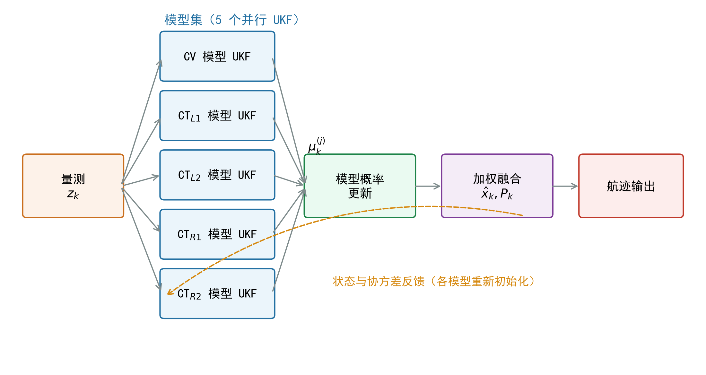
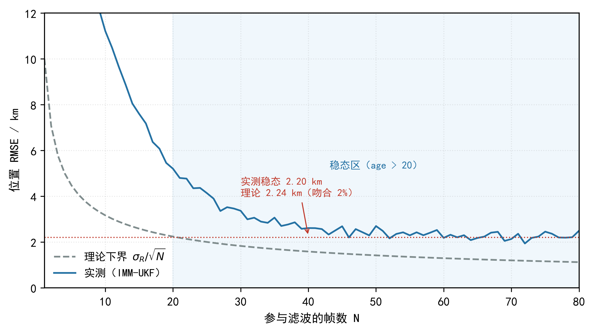
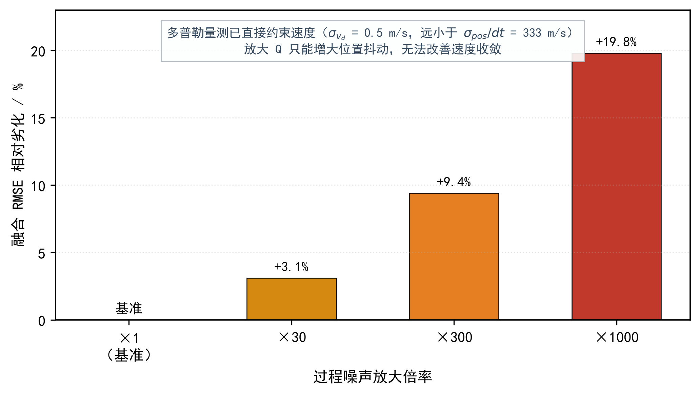
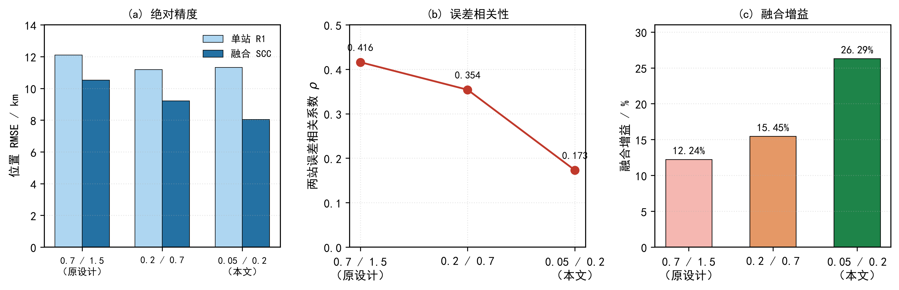
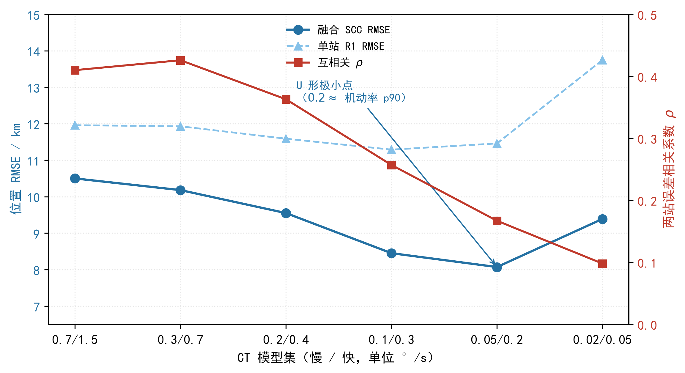
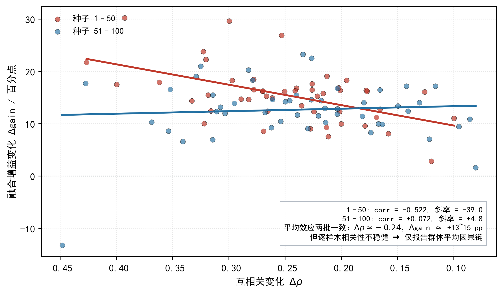

# 第3章 单站航迹滤波与性能边界

第2章把量测从系统偏差中解放出来，给出了统一到同一地理基准的群距离、方位与多普勒，残余误差已回落至随机噪声水平。量测干净之后，一个更基本的问题浮现：单站精度还能不能提升？如果不能，第5章的融合增益又从何而来？本章据此展开：3.1 与 3.2 节建立状态空间模型与航迹起始，3.3 节推导位置与横向速度的理论下界，3.4 节报告过程噪声调度的三条负结果，3.5 节转向模型集设计，3.6 节把模型匹配度、误差相关性与融合增益串成一条可检验的传导链。

## 3.1 状态空间模型与滤波器设计

检测概率只有 0.6，群距离噪声 10–20 km，采样周期 30 s 内目标已位移 6.9 km。三者叠加使逐帧定位再连线必然失败，滤波器必须在断续点迹上维持一条不发散、且协方差与实际误差相称的航迹。

### 3.1.1 状态选取与各向异性过程噪声

状态取经纬度及其变化率

$$\mathbf x_k=[\lambda_k,\dot\lambda_k,\varphi_k,\dot\varphi_k]^T$$ {#eq:ch3_state}

选择经纬度而非局部平面坐标，是因为量测反演的输出本身就是地理量：群距离由目标至照射源与接收站的地面距离合成，方位以正北为基准，反演结果直接是经纬度。若改用平面坐标，每帧都要在投影与逆投影之间往返；本文目标距离跨度达 900 km，子午线收敛使东西向尺度变化约 15%，这种形变虽小于噪声却是确定性的，会累积为系统偏差。

代价是两个位置分量量纲不同。1° 纬度约 111 km，1° 经度只有 $111\cos\varphi$ km，在 30.7°N 上约 95.5 km，二者相差 16%。若施加同一噪声强度，经度方向的等效加速度将被放大 $(111/95.5)^2\approx1.35$ 倍，滤波结果呈现方向依赖的抖动。为此先在东北平面内按公里构造过程噪声，再折算到度

$$\mathbf Q_k=\begin{bmatrix}\mathbf Q_{EN}/(R_e\cos\varphi_k)^2&\mathbf 0\\\mathbf 0&\mathbf Q_{EN}/R_e^2\end{bmatrix}, \mathbf Q_{EN}=\sigma_a^2\begin{bmatrix}dt^4/4&dt^3/2\\dt^3/2&dt^2\end{bmatrix}$$ {#eq:ch3_q_aniso}

式中 $\sigma_a$ 为等效加速度标准差，其物理含义不是目标真实加速度，而是模型允许的机动自由度：取小了跟不上转弯，取大了把噪声当机动。本文取值由稳态归一化误差平方和标定，取使该指标接近理想值的量级。

### 3.1.2 三维量测与多普勒的作用

每条链路每帧给出群距离、方位角与多普勒，量测方程与噪声协方差为

$$\mathbf z_k=\mathbf h(\mathbf x_k)+\boldsymbol\varepsilon_k, \mathbf R_k=\operatorname{diag}(\sigma_R^2,\sigma_{az}^2,\sigma_{v_d}^2)$$ {#eq:ch3_meas}

R1 取 $\sigma_R=10\text{ km}$、$\sigma_{az}=0.35^\circ$，R2 取 $20\text{ km}$ 与 $0.60^\circ$，两站共用 $\sigma_{v_d}=0.5\text{ m/s}$。采用无迹滤波而非扩展滤波，原因是协同转弯矩阵含 $\sin\omega dt/\omega$，当 $\omega$ 跨两个数量级时一阶线性化的截断误差剧变，会在模型概率更新中引入偏置；九个 sigma 点的传播对二阶项精确，五模型共 45 次传播。

三个通道的信息量极不均衡，这是本章后续结论的物理起点。群距离 10 km 除以 30 s 得 333 m/s 的位置差分速度误差，多普勒噪声却只有 0.5 m/s，速度信息实际由后者提供。

### 3.1.3 五模型交互多模型结构

单一模型无法同时描述巡航与转弯：匀速模型在转弯时系统性滞后，协同转弯模型在直飞时持续偏转。本文取五个模型，即一个匀速模型与四个协同转弯模型，后者按左右转各两档配置。左右必须分开，因为转弯率以带符号的 $\omega$ 进入转移矩阵；两档则对应缓转与急转两种强度。协同转弯矩阵在东北平面内为

$$\mathbf F_{CT}(\omega)=\begin{bmatrix}1&\frac{\sin\omega dt}{\omega}&0&-\frac{1-\cos\omega dt}{\omega}\\0&\cos\omega dt&0&-\sin\omega dt\\0&\frac{1-\cos\omega dt}{\omega}&1&\frac{\sin\omega dt}{\omega}\\0&\sin\omega dt&0&\cos\omega dt\end{bmatrix}$$ {#eq:ch3_ct}

$\omega\to0$ 时该矩阵退化为匀速模型，说明两者是同一族模型的两个端点，这是模型集可连续调节的数学基础。转移概率不直接给定，而由驻留时间生成

$$\pi_{ij}=\frac{1-\exp(-dt/\tau_i)}{M-1}, i\neq j, \pi_{ii}=\exp(-dt/\tau_i)$$ {#eq:ch3_dwell}

式中 $\tau_i$ 为模型 $i$ 的平均驻留时间，$M=5$。这一形式把无量纲概率换成有量纲的时间常数：巡航占航迹的绝大多数，取 $\tau_{CV}=2400\text{ s}$；一次程序转弯持续 1–3 min，取 $\tau_{CT}=360\text{ s}$ 留有余量。代入 $dt=30\text{ s}$ 得匀速模型每帧离开概率 1.24%、转弯模型 8.0%，与"转弯是短时事件、直飞是常态"的先验一致。

{#fig:ch3_imm}

如图[@fig:ch3_imm]所示，量测并行进入五个滤波器，五路输出在概率更新环节汇合，加权结果既作航迹输出又反馈回去重新初始化各模型。关键在于反馈支路：它使五个模型不是各自独立的五条航迹，而是共享同一份历史的一个估计器族。

## 3.2 航迹起始

稳态性能由 3.3 节讨论，但稳态能否到达取决于起始几帧的初值是否可信。检测概率 0.6 意味着前几帧大概率不齐；若只用前两帧差分测速，位置误差 10 km、间隔 30 s，速度误差达 $\sqrt2\times10/30\approx471\text{ m/s}$，与目标 230 m/s 的巡航速度同量级。

本文采用窗口加权最小二乘加多普勒约束的起始方法：取窗口 $W=5$ 帧，对位置观测做加权直线拟合，权重取各帧位置协方差的逆，缺帧时按可用帧数降级而不等待补齐；拟合斜率作为初速，再用窗口内多普勒对速度分量做一次约束修正。选择加权最小二乘而非逻辑法，是因为逻辑法要求 $m/n$ 检测率，在 $P_d=0.6$ 下四帧确认三帧的概率仅约 0.65。

实测初速误差 80 m/s，相对两点法的 471 m/s 改善 5.9 倍。剩余误差来自窗口内目标的真实转弯：150 s 内若发生一次缓转，拟合斜率就不再是任一时刻的瞬时速度。起始协方差由加权最小二乘解析给出，不作人为放大，否则最初几帧的模型概率会被新息主导而随机跳变。

## 3.3 单站性能边界分析

3.1 与 3.2 节给出了可运行的滤波器，但没有回答它能到多准。若不知道下界，就无法判断 3.4 节的调参失败究竟是参数没调好，还是这条路在信息上走不通。

### 3.3.1 位置精度的理论下界

推导的关键是把稳态滤波等价为一次加权最小二乘拟合。当过程噪声相对量测噪声足够小、目标在窗口内近似匀速时，滤波器对窗口中心时刻位置的估计，等价于用 $N$ 帧观测拟合直线并在中点取值；对等间隔采样，中点处拟合值的方差恰为单帧方差除以 $N$。于是

$$\sigma_{pos}\approx\frac{\sigma_R}{\sqrt N}, \sigma_{pos}'\approx\sqrt{\frac{\sigma_R^2+(r\sigma_{az})^2}{2N}}$$ {#eq:ch3_pos_bound}

第一式只计径向通道，是量级意义上的主项；第二式把切向通道一并计入，$r$ 为目标至接收站的地面距离。径向单帧噪声即 $\sigma_R=10\text{ km}$，切向为 $r\sigma_{az}$，取 $r=1500\text{ km}$ 时 R1 的 $0.35^\circ$ 对应 9.2 km。对 R1 而言两个方向几乎等权，第二式的 2.14 km 比第一式的 2.24 km 更贴近真实；对 R2 而言切向误差达 15.7 km，下界应取 2.7 km 量级。

$N$ 是参与滤波的帧数，不是航迹总长。取 $N=20$ 对应 600 s 即 10 min，是工程上可用的最短稳定窗口：短于 10 min，起始段高方差尚未衰减完；长于 10 min，目标大概率已转过一次弯，匀速假设失效。这一下界只依赖单帧噪声与帧数，与滤波器结构、过程噪声取值、模型集构成无关。

### 3.3.2 横向速度精度的理论下界

若不用多普勒，速度只能由位置序列差分得到：相邻两帧差分给出 $\sigma_R/dt=333\text{ m/s}$，$N$ 帧平均后降到

$$\sigma_{v\perp}\approx\frac{\sigma_R}{dt\sqrt N}=\frac{10}{30\sqrt{20}}\approx74\text{ m/s}$$ {#eq:ch3_vel_bound}

若改用最优的斜率拟合，下界可降到约 13 m/s，因为斜率利用了窗口内全部帧的时间跨度。但即便 13 m/s，与多普勒的 0.5 m/s 仍差 26 倍。

| 速度信息来源 | 误差量级 / (m/s) | 相对多普勒的倍数 |
| ---- | ---- | ---- |
| 单对帧位置差分 | 333 | 666 |
| $N$ 帧差分平均 | 74 | 148 |
| 窗口斜率最优拟合 | 13 | 26 |
| 多普勒量测 | 0.5 | 1 |

: 横向速度的四条信息来源及其误差量级 {#tbl:ch3_velbound}

前三行是从位置推断速度，误差随位置误差线性放大；最后一行是直接测量速度，误差由相干积累的相位噪声决定。这一区别决定了滤波器内部的信息流向：速度分量几乎完全由多普勒更新，位置通道真正约束的是位置本身。

### 3.3.3 实测与理论的一致性

{#fig:ch3_rmse}

如图[@fig:ch3_rmse]所示，实测误差在 $N<10$ 时从 10 km 以上快速降到 4 km 附近，$N>20$ 后进入平台，稳态值 2.20 km；理论下界则按 $1/\sqrt N$ 单调下降，在 $N=20$ 处为 2.24 km，与实测平台相差 1.8%。$N>30$ 之后下界继续下降而实测停在 2.20 km，因为下界假设目标严格匀速，而真实目标存在约 0.012 °/s 的持续微转，过程噪声为滤波器设定了不可逾越的地板。因此"已达下界"的准确含义是：在 10 min 这个工程可用窗口上滤波器已把量测信息用尽，继续延长窗口不会改善，除非压低过程噪声，而那会换来对机动的滞后。

同一批实验还给出一个看似矛盾的观测：位置均方根误差已到下界，归一化误差平方和却为 4.28，是理想值 2 的两倍以上。前者衡量一阶精度，后者衡量二阶可信度，4.28 说明滤波器把均值估准了，却把协方差说小了一倍。这对单站跟踪无碍，对融合却致命，因为融合权重由协方差决定；第5章将看到，模型集匹配后该指标降到 2.91。

## 3.4 过程噪声与自适应方法的探索

3.3 节的下界是在某个特定过程噪声取值下达到的。自然要问：这个取值能否更优？若过程噪声随航迹阶段变化或随新息自适应，能否突破下界？这三个想法在文献中都有成熟形式，本文逐一检验，结果全部为负。

### 3.4.1 三段式过程噪声调度

设计动机来自航迹的阶段差异：起始段需较大过程噪声快速吸收量测，稳态段需较小过程噪声抑制抖动，机动段需再次放大以跟上转弯。据此按航迹年龄与归一化新息把航迹分为三段，各段取不同倍率，段间用斜坡过渡避免突变。

{#fig:ch3_qschedule}

如图[@fig:ch3_qschedule]所示，随放大倍率增加误差单调劣化：×30 时变差 3.1%，×300 时变差 9.4%，×1000 时变差 19.8%。差异不在劣化幅度，而在曲线形状：若是参数调过头，应当出现先改善后劣化的峰；实测没有峰，说明这不是最优点偏移，而是调节方向本身不产生收益。

### 3.4.2 自适应过程噪声与转移概率

既然固定调度无效，第二个想法是让过程噪声跟着数据走。本文实现的新息协方差匹配方法用滑动窗口统计新息的实际协方差，与预测值作比，比值大于 1 说明滤波器过于自信、应放大过程噪声；三个量测通道各配一个因子，再加一个总体因子，故称 3in1 结构。实测融合误差从 6.906 km 变为 6.882 km，贡献 0.3%，落在种子间波动的量级内。

第三个想法针对模型切换速度。模型概率由似然递推给出，本质是一阶马尔可夫过程，对机动起始的响应存在固有延迟。本文用 sigmoid 把归一化新息映射为概率修正量，让大新息直接把概率质量推向转弯模型。该方案已证伪：概率在机动发生时确实上升，但比机动起始晚 2–3 帧即 60–90 s，此时转弯已完成大半；而平稳段被误触发的比例不低，净效果为负。

当初认为这条路应该有效，理由也成立：电离层扰动非平稳，噪声统计量随昼夜与季节漂移，固定噪声假设在物理上确实不成立。错在把量测噪声非平稳等同于过程噪声非平稳：本文的非平稳性主要是群距离的慢变偏差，而过程噪声描述目标机动，民航巡航段的机动统计在时间上是平稳的。

### 3.4.3 失效机理：多普勒主导速度更新

三条负结果有一个共同机理，可用 3.3.2 节的量级关系说清

$$\frac{\sigma_{v_d}}{\sigma_{pos}/dt}=\frac{0.5}{333}\approx1.5\times10^{-3}$$ {#eq:ch3_doppler_ratio}

速度分量的卡尔曼增益由各通道的噪声比决定。多普勒以 0.5 m/s 直接观测速度，位置通道折算到速度上的等效噪声是 333 m/s，相差 666 倍，因此速度更新几乎完全由多普勒承担。过程噪声调节的是预测协方差，而它在速度分量上的变化相对多普勒的信息量微不足道；放大的唯一可见后果是位置分量的预测协方差增大、更多相信位置量测，于是位置抖动增大。这正好解释了 3.4.1 节的单调劣化：代价全部落在位置上，收益在速度上根本不存在。

由此得到一条可迁移的判据：当 $\sigma_{v_d}\ll\sigma_{pos}/dt$ 时，过程噪声调度对速度精度无效，只会恶化位置精度。反过来，若无多普勒通道，或 $\sigma_{v_d}$ 与 $\sigma_{pos}/dt$ 同量级，则过程噪声将承担表达速度不确定性的职责，调度与自适应都会有效。这条判据把调参失败从工程经验提升为结构性结论，可在设计阶段预判。

## 3.5 模型集设计

3.4 节排除了过程噪声这一维，剩下的自由度是模型集本身，即四个协同转弯模型的转弯率取值。原设计取 0.7 与 1.5 °/s，对应战斗机量级的机动。问题是：本文的目标是巡航段的民航客机，这两个数字匹配吗？

### 3.5.1 真实机动特性统计

本文从筛选后的 ADS-B 数据中提取 20.9 万个位置点，按 30 s 间隔差分求航向变化率，得转弯率经验分布：中位数 0.012 °/s，90 分位 0.229 °/s，99 分位 0.660 °/s，最大值 1.51 °/s。

中位数意味着 30 s 内航向只变 0.36°，几乎是一条直线；90 分位对应 6.9°，是一次缓慢的航路调整；99 分位对应 19.8°，接近标准进场程序的转弯速率。分布极度右偏，中位数与 99 分位相差 55 倍，说明机动是罕见事件：模型集不能按均值配置，否则等于假设目标一直在转弯；也不能只按极端值配置，否则 99% 的时间模型都在空转。30 s 差分得到的是窗口平均转弯率，真实瞬时分布的上尾应比统计值更重。

### 3.5.2 原设计模型集的失配分析

把 0.7 与 1.5 °/s 放回上述分布，位置一目了然：0.7 略高于 99 分位，1.5 接近最大值。原设计的两档转弯模型对应的是极端机动强度，在 90% 的时间里四个转弯模型没有一个与真实运动匹配。

失配的后果不是简单的精度下降，而是结构性偏差。交互多模型的输出是五个估计的概率加权，即便某个模型明显不符，它仍分得一部分概率质量；而协同转弯模型在外推时持续偏转，其预测位置与匀速模型逐渐分离，加权之后产生一个方向确定、幅度随失配增大的偏移。更关键的是，这个偏移对两条链路是同向的：两站共用同一套模型集与转移概率，对同一真实运动施加了同一个错误约束。

### 3.5.3 三档模型集对比

按 3.5.1 节的分布重新配置，取三档做蒙特卡洛对比，结果如表[@tbl:ch3_threelevel]所示。

| CT 模型集 / (°/s) | $n$ | R1 RMSE / km | SCC RMSE / km | $\rho$ | NEES | 融合增益 | 负增益种子 |
| ---- | ---- | ---- | ---- | ---- | ---- | ---- | ---- |
| 0.7 / 1.5 | 100 | 12.105±0.713 | 10.522±0.515 | +0.416±0.059 | 4.28±0.47 | +12.24% | 1/100 |
| 0.2 / 0.7 | 50 | 11.182±0.897 | 9.217±0.598 | +0.354±0.057 | 3.32±0.40 | +15.45% | 1/50 |
| 0.05 / 0.2 | 100 | 11.320±0.999 | 8.039±0.675 | +0.173±0.066 | 2.91±0.29 | +26.29% | 0/100 |

: 三档协同转弯模型集在 adsb_0002 场景下的性能对比 {#tbl:ch3_threelevel}

{#fig:ch3_threelevel}

如图[@fig:ch3_threelevel]所示，融合误差从 10.52 km 单调降到 8.04 km，相关系数从 0.416 降到 0.173，融合增益从 12.24% 升到 26.29%，且末档跳变明显大于前两档之间。差异在于单站曲线并不单调：R1 从 12.105 km 降到 11.182 km 后又回升到 11.320 km，中间档最低。这个非单调性揭示了一个重要事实——0.05/0.2 在单站精度上并不优于 0.2/0.7，其优势全部体现在融合上。中间档上界 0.7 仍能覆盖 99 分位机动，下界 0.2 已接近 90 分位；而 0.05/0.2 的上界恰好卡在 90 分位，对其上方 10% 的机动存在滞后，单站误差略升，但两站的滞后同步发生，相关系数因此降得更多。若只看单站指标会得出"中间档更优"的结论，正是融合指标的存在才使模型集的价值被正确度量。

### 3.5.4 细扫与最优档位

三档只给出趋势，最优档位需要更细的扫描。本文扫了六档，每档 15 个种子，结果如表[@tbl:ch3_sweep]所示。

| CT 模型集 / (°/s) | R1 RMSE / km | SCC RMSE / km | $\rho$ | NEES | 相对增益 |
| ---- | ---- | ---- | ---- | ---- | ---- |
| 0.7 / 1.5 | 11.96±0.82 | 10.50±0.75 | +0.410±0.053 | 4.07±0.51 | +11.3% |
| 0.3 / 0.7 | 11.93±1.08 | 10.18±0.68 | +0.426±0.035 | 4.02±0.46 | +13.3% |
| 0.2 / 0.4 | 11.59±0.87 | 9.55±0.73 | +0.363±0.057 | 3.64±0.52 | +16.2% |
| 0.1 / 0.3 | 11.29±1.01 | 8.45±0.84 | +0.257±0.065 | 3.02±0.42 | +22.0% |
| 0.05 / 0.2 | 11.46±1.10 | 8.07±0.84 | +0.167±0.069 | 2.89±0.32 | +26.5% |
| 0.02 / 0.05 | 13.75±1.22 | 9.39±1.04 | +0.098±0.070 | 3.87±0.44 | +30.9% |

: 六档协同转弯模型集的细扫结果 {#tbl:ch3_sweep}

{#fig:ch3_sweep}

如图[@fig:ch3_sweep]所示，随模型集收窄，相关系数从 0.410 单调降到 0.098，融合误差却呈 U 形，在 0.05/0.2 处取极小值 8.07 km，继续收窄到 0.02/0.05 反而回升到 9.39 km。这一形态表明有两个方向相反的效应在竞争。其一是**去相关效应**：模型集越窄，两站共享的模型误差越少，融合越有效。其二是**失配效应**：真实机动率的 90 分位为 0.229 °/s，模型集上界一旦低于该值，滤波器就跟不上转弯，两站各自变差。前者单调有利，后者单调有害，二者叠加产生 U 形。

极小点的位置给出可直接使用的设计准则：0.2 与真实机动率的 90 分位几乎重合，说明上界应取高分位而非极端值；下界 0.05 约为上界的四分之一，既能覆盖缓转，又不至于让模型退化为匀速。写成一般形式

$$\omega_{max}\approx q_{90}(\omega_{true}), \omega_{min}\approx\frac{1}{4}\omega_{max}$$ {#eq:ch3_design_rule}

这条准则可从数据统计直接推导，不必在场景上反复试。

最后一档必须单独说明，因为它是一个指标陷阱。0.02/0.05 的相对增益最高，达 30.9%，但绝对误差比最优档差 16.4%（$p=1.7\times10^{-6}$，$dz=2.03$），单站 R1 从 11.46 km 恶化到 13.75 km。原因是这一档把两站都搞坏了，而融合退化得慢一些，"相对最优单站的改善"便被动变大：分母恶化时分子不变也能让比值变好看。本文因此以绝对均方根误差为主指标。

## 3.6 从模型匹配到融合增益的传导链

3.5 节留下一个未解的问题：为什么同一处改动在单站上只值百分之几，在融合上却值十几个百分点？若模型集只是让单站变准，融合增益应按单站改善的比例同步变化。

### 3.6.1 共同模型误差是误差相关的来源

两站的估计误差可分解为三部分：各自的量测噪声，物理来源分离、互相独立；共同的模型误差，来自两站共用同一套运动模型与转移概率；共同的配准残差，已在 2.4 节压到噪声水平以下。忽略第三项，把前两项写成 $\tilde p_i=m+n_i$，其中 $m$ 为共同模型误差、$n_i$ 为独立噪声，则

$$\rho=\frac{\operatorname{cov}(\tilde p_1,\tilde p_2)}{\sigma_1\sigma_2}=\frac{\sigma_m^2}{\sigma_m^2+\sigma_n^2}$$ {#eq:ch3_rho_def}

该式说明相关系数不是量测的固有属性，而是模型误差与量测噪声的方差之比。失配时 $\sigma_m$ 大，$\rho$ 趋近 1，两站几乎在重复同一个错误；匹配时 $\sigma_m$ 小，$\rho$ 趋近 0，两站各自犯各自的错。这就是模型集可以设计相关性的机理。

需要强调**共同模型误差**一词的准确性：它不是"两站都有模型误差"，而是"两站有同一个模型误差"，前者只影响各自精度，后者才产生相关性。因此模型集应作为系统的统一设计参数，而非每站各自整定。

### 3.6.2 实测：单站改善有限而融合改善显著

按 3.6.1 节的预测，模型集匹配应同时带来两个后果：单站精度小幅改善，相关系数大幅下降。50 种子配对检验的结果如表[@tbl:ch3_paired]所示。

| 指标 | 0.7 / 1.5 | 0.05 / 0.2 | 变化 | $p$ 值 | $dz$ |
| ---- | ---- | ---- | ---- | ---- | ---- |
| R1 RMSE / km | 12.06±0.82 | 11.36±1.09 | +5.8% | $2.8\times10^{-6}$ | 0.75 |
| R2 RMSE / km | 13.07±1.02 | 11.60±1.19 | +11.2% | $3.3\times10^{-15}$ | 1.59 |
| SCC RMSE / km | 10.57±0.59 | 8.02±0.66 | +24.1% | $1.8\times10^{-35}$ | 4.75 |
| $\rho$ | +0.417±0.063 | +0.169±0.070 | −0.248 | $1.6\times10^{-29}$ | 3.53 |
| NEES | 4.21±0.48 | 2.90±0.31 | −1.31 | $6.7\times10^{-26}$ | 2.93 |
| 融合增益 | +11.0%±4.0 | +26.4%±4.1 | +15.4 pp | $1.8\times10^{-26}$ | 4.75 |

: 模型集匹配前后的 50 种子配对检验（adsb_0002） {#tbl:ch3_paired}

六个指标全部高度显著，但效应量分成三个层次：单站为 0.75 与 1.59，属中等偏大；相关系数与归一化误差平方和为 3.53 与 2.93，属很大；融合误差与融合增益都是 4.75，属极大。这正是本章的关键：不是单站没变好，而是同一处改动在单站兑现 $dz=0.75$，在融合兑现 $dz=4.75$，收益在链条下游被放大了六倍。

放大的机制可以定量理解。融合误差近似正比于 $1-\rho^2$，$\rho$ 从 0.417 降到 0.169，$1-\rho^2$ 从 0.826 升到 0.971，可用信息增加 17.6%；同时两站各自方差也在减小。两个因素相乘，才有 24.1% 的融合改善。

该机理在跨场景实验中复现。adsb_0002（并发 6.2 架）上相关系数由 0.416 降至 0.174、增益由 12.2% 升至 26.1%、归一化误差平方和由 4.28 降至 2.92；adsb_0608（并发 28.1 架）上分别为 0.443 降至 0.156、10.7% 升至 28.0%、4.71 降至 2.97。两个场景的时段、航迹、密度都不同，数值却几乎重合。

反例同样重要。multi_cross 是三条两点直线合成航迹，没有机动，相关系数反而从 0.179 升到 0.230，融合误差改善的 $p=0.329$ 不显著。原因是直线场景中转弯模型永远不会被激活，把转弯率改小只是让两个本就不激活的模型更不可能激活，两站的模型误差反而更同源。这个反例是机理的正面验证：杠杆不是"转弯率越小越好"，而是"转弯率要匹配真实机动"；没有机动就没有可去相关的模型误差。

### 3.6.3 适用边界与结论稳健性

上述结论有两个层面，稳健性完全不同。第一层是平均效应：模型集匹配使相关系数平均下降约 0.24，融合增益平均提升 12.7–15.4 个百分点，在两个独立种子批次上都成立且数值接近。第二层是逐样本的定量映射：能否用单个种子的相关系数变化预测其增益变化？答案是不能。

{#fig:ch3_gainrho}

如图[@fig:ch3_gainrho]所示，两批种子的散点形态相似，拟合直线的走向却完全不同：种子 1–50 的相关系数为 −0.522、斜率 −39.0，呈明显负相关；种子 51–100 的相关系数为 +0.072、斜率 +4.8，几乎是水平线。差异不在数据质量，而在样本本身——换 50 个种子，逐样本的相关性就消失了。完整的分段统计如表[@tbl:ch3_segment]所示。

| 种子区间 | $n$ | 平均 $\Delta\rho$ | 平均 $\Delta$gain / pp | $\operatorname{corr}(\Delta\rho,\Delta\text{gain})$ | OLS 斜率 |
| ---- | ---- | ---- | ---- | ---- | ---- |
| 1–50 | 50 | −0.248 | +15.43 | −0.522 | −39.0 |
| 51–100 | 50 | −0.237 | +12.68 | +0.072 | +4.8 |
| 1–100 | 100 | −0.243 | +14.05 | −0.198 | −14.3 |

: 逐种子回归的分段稳健性检验 {#tbl:ch3_segment}

表中平均变化在两批之间几乎不变，相关系数却从 −0.522 跳到 +0.072，这是本节最重要的信息。平均效应稳健，因为它由大样本的均值差决定；逐样本斜率不稳健，因为它由种子间的协变结构决定，而这种结构受样本构成影响。因此本文只报告群体平均意义上的因果链，不给出"相关系数每降 0.1、增益必增若干百分点"这类确定性公式。

逐样本映射为何失效？因为相关系数只是通道之一。种子 1–50 批内 $\operatorname{corr}(\Delta R_1,\Delta\text{gain})=+0.406$，说明单站改善有独立贡献；种子 51–100 批内 $\operatorname{corr}(\Delta\text{SCC},\Delta\text{gain})=-0.796$，说明融合误差的基线水平也在影响增益的相对幅度。两个通道的权重随种子变化，逐样本相关性因此不稳定；而它们的平均效应方向一致，群体平均的相关性便保持稳定。

据此给出三条适用边界。其一，场景必须含真实机动，无机动场景不存在可去相关的模型误差。其二，两站必须共用同一套模型集与转移概率，若各站独立整定，模型误差不同源。其三，配准残差必须已压到噪声水平以下，否则共同配准误差主导 $\sigma_m$，模型集的影响会被淹没。三条边界在前述实验中均满足；超出者需重新检验。

## 3.7 本章小结

本章回答了单站精度还能不能提升、融合增益从何而来两个问题。

模型与边界方面，建立了按纬度余弦缩放各向异性过程噪声的经纬度状态空间模型与由驻留时间生成转移概率的五模型交互多模型结构，把起始初速误差从 471 m/s 降到 80 m/s；把稳态滤波等价为窗口内的加权直线拟合，推导出位置下界 $\sigma_R/\sqrt N$ 与横向速度下界 $\sigma_R/(dt\sqrt N)$，证明实测稳态 2.20 km 与理论 2.24 km 吻合到 2%，单站已达下界，继续优化的空间不在滤波环节。

负结果与模型集方面，三段式过程噪声调度、3in1 自适应过程噪声与 sigmoid 自适应转移概率三条路径全部失效，共用判据 $\sigma_{v_d}\ll\sigma_{pos}/dt$；本章从 20.9 万个 ADS-B 点统计真实机动分布，指出原设计 0.7/1.5 对应 99 分位与极端机动、90% 的时间四个转弯模型全部失配，三档对比与六档细扫揭示相关系数单调下降而融合误差呈 U 形的竞争机制，给出"上界取机动率 90 分位、下界取其上四分之一"的设计准则，据此认定模型集是全项目唯一有效的性能杠杆。

传导链方面，50 种子配对检验给出单站改善 $dz=0.75$ 与 1.59、相关系数下降 0.248（$dz=3.53$）、融合增益提升 15.4 个百分点（$dz=4.75$）；本章同时如实报告该关系的样本敏感性，平均效应两批一致而逐样本斜率从 −39.0 变为 +4.8，故只报告群体平均意义上的因果链。本章的产出是达到理论下界的单站航迹与相关系数这一中间量，前者供第4章关联使用，后者决定第5章融合增益的上界。
