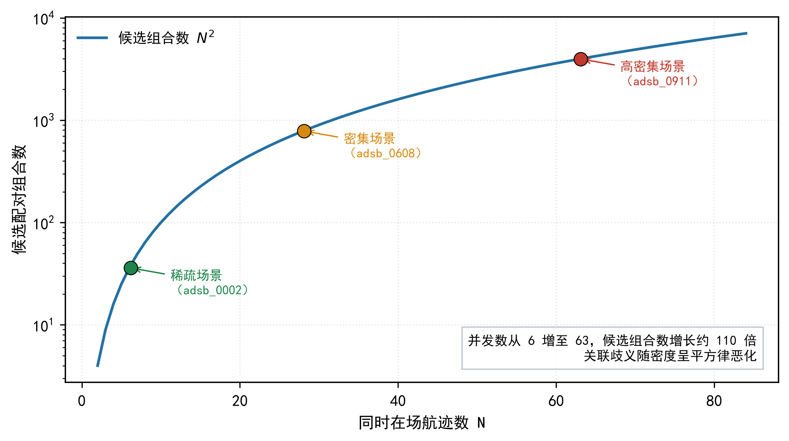
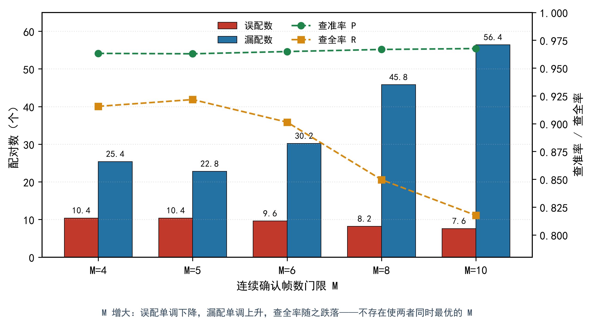
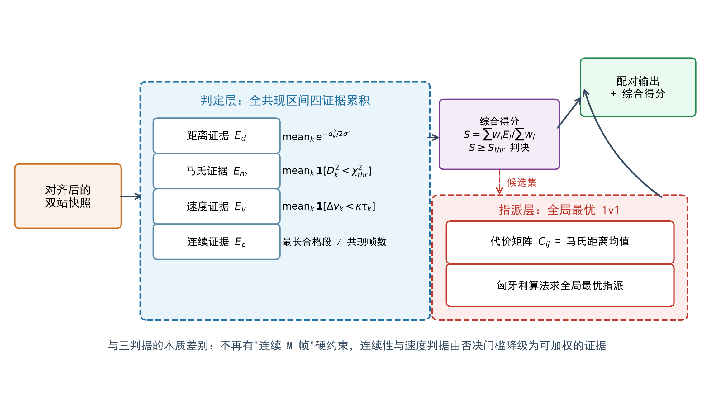
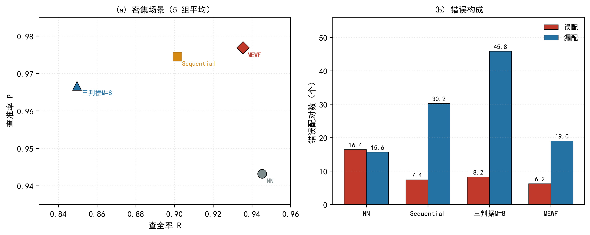
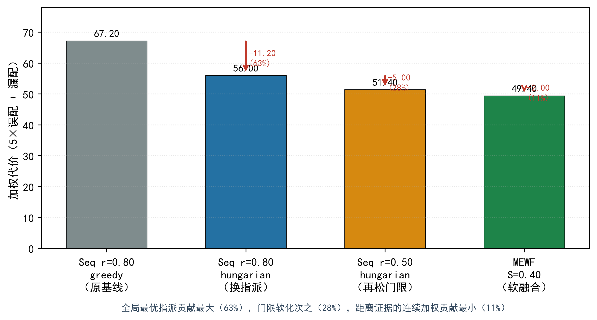
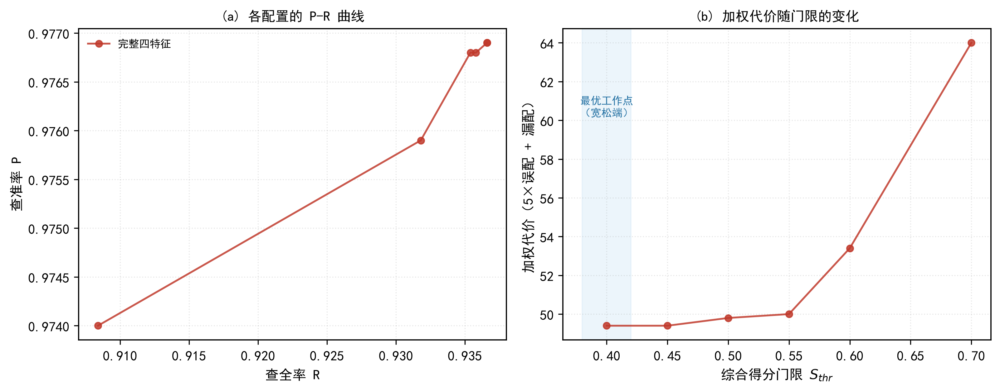

# 第4章 跨照射源航迹关联

第3章解决了单站航迹的精度问题，并证明单站已逼近信息量下界，进一步提升必须依靠多站。然而两站各自输出的航迹只是"各自看到的影子"，在融合之前必须先回答一个前置问题：第一条照射源的哪条航迹与第二条照射源的哪条航迹对应同一个目标。这个问题在短波双照射源场景下远比常规多传感器系统困难，原因有三：量测精度低导致航迹位置不确定度大，数据率低导致两站航迹的重叠区间短，而密集空域中大量平行航路又使得"位置接近"不再足以判定同一性。本章先刻画这种歧义的来源与评价体系，再对比三类典型关联方法，进而剖析既有方法在密集场景下的结构性缺陷，最后提出判定与指派分层的多证据加权融合关联方法，并如实报告其在配对层与融合层的表现差异。

## 4.1 问题描述与评价体系

### 4.1.1 关联歧义的三个来源

跨照射源航迹关联的本质是一个带约束的二分图匹配问题。设第一条照射源在观测窗内的航迹集合为 $\mathcal{A}=\{a_1,\dots,a_{N_1}\}$，第二条为 $\mathcal{B}=\{b_1,\dots,b_{N_2}\}$，关联的任务是寻找一个一对一映射，使得每一对 $(a_i,b_j)$ 尽可能对应同一物理目标。若没有任何先验信息，候选组合数为 $N_1N_2$，随目标数呈平方律增长。

$$N_{\text{cand}}=N_1N_2 $$ {#eq:ch4_cand_count}

图[@fig:ch4_candidate_pairs]给出了候选组合数随同时在场目标数的变化。当并发数从稀疏场景的 6 架增至高密集场景的 63 架时，候选组合数从 36 增长到约 3969，扩大约 110 倍。这意味着同一套判定规则在稀疏场景下"足够严格"，到了密集场景就可能同时面临"该配的没配上"与"不该配的配上了"两种错误。这一观察构成了本章全部实验设计的出发点：评价关联算法必须覆盖密度梯度，否则结论只是场景的产物。

{#fig:ch4_candidate_pairs}

从图中可以看出，候选组合数随并发数呈严格的平方增长，三个实测场景分别落在曲线的低、中、高三个区段。这一趋势的物理含义是，关联的计算复杂度与歧义程度都随空域拥挤程度急剧恶化，因而稀疏场景下"零误配"的结果并不能外推到密集场景。

除密度之外，还有两个来源加剧了歧义。其一是短共现，即同一目标被两站同时观测到的时间区间可能很短。由于两站的波束指向、地面距离门限与目标航路各不相同，一条真实航迹在两站的可见窗口未必重合，实测表明双站共现帧数的中位数约为 25 帧，但存在相当比例的目标共现帧数不足 10 帧。其二是平行航路，即同一航路上前后相继或并排飞行的两架飞机，其位置、速度、航向几乎一致，仅凭运动学特征无法区分，唯一可用的信息是"谁与谁的距离更近"。

### 4.1.2 评价指标

关联结果是一个配对集合，其正确性通过与参考真值比对来判定。本文以 ADS-B 实测位置作为参考真值，每条航迹携带其真实目标编号，若一对配对的两条航迹真值编号相同且非空，则判为正确。在此基础上定义四个指标。

查准率定义为正确配对数与总配对数之比，反映"配上的有多少是对的"；查全率定义为正确配对数与双站共现真实目标数之比，反映"该配的有多少配上了"；误配率定义为错误配对数与总配对数之比；漏配数为双站共现真实目标数与正确配对数之差。由于误配会把两个不同目标融合成一条错误航迹，其代价远高于漏配（漏配只是少融一对），本文另定义一个加权代价用于综合排序。

$$C=5N_{\text{wrong}}+N_{\text{missed}} $$ {#eq:ch4_weighted_cost}

式中 $N_{\text{wrong}}$ 为误配数，$N_{\text{missed}}$ 为漏配数，系数 5 体现误配的相对代价。需要说明的是，等权的 $F_1$ 指标在本文场景下会给出误导性结论：由于漏配数通常大于误配数，$F_1$ 会奖励"配得多但配错也多"的方法，这与融合的实际需求相悖。因此本文以查准率与查全率的全貌为主，加权代价为辅，不单独以 $F_1$ 排序。

## 4.2 三类典型关联方法

### 4.2.1 最近邻关联

最近邻关联是最朴素的方案：对每一条航迹，计算它与另一站所有航迹在共现区间内的平均地面距离，取距离最小者作为配对，再以一对一为约束做贪心指派。其判据可写为

$$d(a_i,b_j)=\frac{1}{|T_{ij}|}\sum_{k\in T_{ij}}d_{\text{hav}}(a_i^k,b_j^k) $$ {#eq:ch4_nn_dist}

式中 $T_{ij}$ 为两条航迹的共现帧集合，$d_{\text{hav}}$ 为球面大圆距离。该方法不含任何门限，因而在稀疏场景下表现优异——当目标间距远大于量测误差时，最近邻恰好总是正确的那一个。但它对密集空域毫无防护：一旦存在另一条距离更近的错误航迹，最近邻会毫不犹豫地选中它。

### 4.2.2 双门限三判据关联

为抑制误配，既有方法引入门限与多判据。本文实现的三判据关联包含三条判据与一个一对一互斥约束。

判据一为位置门限，要求两条航迹在某一帧的地面距离小于门限 $T_1$，并以连续通过帧数 $M$ 作为确认条件。判据二为马氏距离检验，将位置差按两站位置协方差之和归一化，要求归一化统计量小于卡方门限。

$$D_k^2=\Delta\boldsymbol{p}_k^{\top}\left(\boldsymbol{P}_{a,k}+\boldsymbol{P}_{b,k}\right)^{-1}\Delta\boldsymbol{p}_k $$ {#eq:ch4_maha}

判据三为速度一致性，要求两站速度估计之差小于容差倍数乘以两站速度不确定度。

$$\|\boldsymbol{v}_{a,k}-\boldsymbol{v}_{b,k}\|<\kappa\sqrt{\operatorname{tr}\boldsymbol{P}^{v}_{a,k}+\operatorname{tr}\boldsymbol{P}^{v}_{b,k}} $$ {#eq:ch4_vel}

三条判据同时满足的帧被计入通过计数，当连续通过帧数达到 $M$ 且共现帧数不少于下限时判定关联。最后以航迹质量系数为排序键做一对一互斥，保证一条航迹不被重复配对。本文采用的参数为 $T_1=35$ km、$M=8$、马氏门限 5.99、速度容差倍数 3.0、共现下限 5 帧。

### 4.2.3 序贯最近邻关联

序贯最近邻可视为最近邻与门限法的折中：先用位置门限做粗筛，再要求马氏距离合格帧在全部共现帧中的占比不低于某一比例，最后按马氏距离均值升序做贪心指派。

$$r_{ij}=\frac{1}{|T_{ij}|}\sum_{k\in T_{ij}}\mathbf{1}\left[D_{ij,k}^2<\chi^2_{\text{thr}}\right]\geq r_{\min} $$ {#eq:ch4_seq_ratio}

与三判据的关键差别在于，序贯法统计的是全部共现区间的通过比例，而不是连续若干帧的通过情况，因而不存在 $M$ 这一参数。

## 4.3 密集场景下的结构性缺陷分析

### 4.3.1 连续帧门限的跷跷板效应

三判据中 $M$ 的取值直接决定了判定的严格程度。直觉上 $M$ 越大越可靠，但实测结果并非如此。在五个密集场景上扫描 $M$ 的取值，结果如表[@tbl:ch4_m_sweep]与图[@fig:ch4_m_sweep]所示。

| 连续帧门限 $M$ | 误配数 | 漏配数 | 查准率 | 查全率 |
| -------------- | ------ | ------ | ------ | ------ |
| 4              | 10.40  | 25.40  | 0.9632 | 0.9156 |
| 5              | 10.40  | 22.80  | 0.9628 | 0.9217 |
| 6              | 9.60   | 30.20  | 0.9648 | 0.9013 |
| 8              | 8.20   | 45.80  | 0.9667 | 0.8496 |
| 10             | 7.60   | 56.40  | 0.9675 | 0.8175 |

: 连续帧门限对关联性能的影响（密集场景五组平均） {#tbl:ch4_m_sweep}

{#fig:ch4_m_sweep}

从表中可以看出，随着 $M$ 从 4 增至 10，误配数从 10.40 单调降至 7.60，而漏配数从 25.40 单调升至 56.40，查全率相应从 0.9156 跌落至 0.8175。这一对相反的单调趋势说明不存在使两者同时最优的 $M$：任何取值都只能在跷跷板的两端做取舍。

其物理机理在于判定的信息利用方式。三判据只检验"最近 $M$ 帧构成的滑动窗口"，且一旦窗口通过即终止判定。当 $M$ 较小时，任意若干帧的偶然靠近就足以触发关联，密集空域中平行航路的短暂交会因而容易造成误配；当 $M$ 较大时，共现区间较短的目标根本无法凑齐连续 $M$ 帧合格，必然漏配。换言之，$M$ 把"证据是否充分"简化为"连续帧数是否达标"，而这两个量在短共现场景下并不等价。

为验证上述判断，本文进一步统计了真实目标对的最长连续合格段分布。在密集场景的两百个真实目标对中，共现帧数均值为 26.7 帧，其中距离小于门限的帧数均值为 25.9 帧，占比 96.8%，而距离超限的帧均值仅 0.8 帧。这说明位置门限本身几乎不构成瓶颈，漏配的主因是连续段长度不足：最长连续合格段的中位数为 22 帧，但最小值为 0，取 $M=8$ 时仅能覆盖 88% 的目标，取 $M=5$ 时可覆盖 96%。漏配因此集中于那些双站重叠时间本就很短的目标，与门限宽严无关。

### 4.3.2 误配的性质：成对交换

若说漏配源于短共现，那么误配源于什么？将密集场景中残余的错误配对逐一拆解，结果呈现出高度一致的规律，如表[@tbl:ch4_swap]所示。

| 第一条照射源航迹（真值） | 第二条照射源航迹（真值） | 平均距离 |
| ------------------------ | ------------------------ | -------- |
| 160（t152）              | 184（t164）              | 4.3 km   |
| 185（t164）              | 158（t152）              | 7.7 km   |
| 159（t194）              | 126（t142）              | 9.0 km   |
| 130（t142）              | 160（t194）              | 12.8 km  |
| 183（t80）               | 190（t181）              | 8.6 km   |
| 192（t181）              | 194（t80）               | 9.8 km   |

: 密集场景残余误配的性质（种子 301） {#tbl:ch4_swap}

六条错误配对构成三组成对交换：目标 t152 与 t164 互相配反，t142 与 t194 互相配反，t80 与 t181 互相配反。正确的配对应当是 160 与 158 对应 t152、185 与 184 对应 t164，而算法恰好把两者对调。

这一现象揭示了误配的本质：它不是"配到了一个毫不相干的目标"，而是"在两架运动学特征几乎相同的目标之间选错了对应关系"。这类目标通常沿同一航路平行飞行，位置接近、速度一致、航向相同，因而距离证据、马氏证据、速度证据与连续性证据四项同时都很高，任何基于加权综合的判据都难以区分。唯一可用的信息是"哪一对的距离更小"——4.3 km 的那一对显然比 7.7 km 的那一对更可信，但这一信息属于指派环节，而不属于判定环节。

由此可以归纳出既有方法的第二个结构性缺陷：三判据把"要不要配"与"配给谁"混在同一个综合分数里，用航迹质量系数作为唯一的排序键。当两个候选对的综合分数接近时，排序结果就退化为随机，成对交换由此产生。实测的排序键消融证实了这一点：以综合分为排序键时误配数为 11.60，以欧氏距离为排序键时 11.20，而以协方差归一化的马氏距离为排序键时降至 8.40。把判定与指派混在一起，反而不如直接用马氏距离排序。

## 4.4 多证据加权融合关联

前述分析表明，既有方法的缺陷不在判据本身，而在判据的组织方式：其一，连续性被当作必须满足的否决门槛，导致 $M$ 成为跷跷板；其二，判定与指派共用同一个综合分，导致成对交换。针对这两点，本文提出判定与指派分层的多证据加权融合关联方法。

### 4.4.1 判定层：全共现区间的四证据软融合

判定层的设计原则是把每一项判据从"否决门槛"降级为"可加权的证据"，并在全部共现区间上累积而非只看最近若干帧。四项证据定义如下。

距离证据取负二次型指数在共现帧上的均值，距离越近证据越强，且是连续加权而非零一截断。

$$E_d=\frac{1}{|T_{ij}|}\sum_{k\in T_{ij}}\exp\left(-\frac{d_{ij,k}^2}{2\sigma_d^2}\right) $$ {#eq:ch4_e_dist}

马氏证据取马氏距离合格帧的比例，反映协方差归一化后的位置一致性。

$$E_m=\frac{1}{|T_{ij}|}\sum_{k\in T_{ij}}\mathbf{1}\left[D_{ij,k}^2<\chi^2_{\text{thr}}\right] $$ {#eq:ch4_e_maha}

速度证据取速度差合格帧的比例，反映运动状态一致性。

$$E_v=\frac{1}{|T_{ij}|}\sum_{k\in T_{ij}}\mathbf{1}\left[\|\Delta\boldsymbol{v}_{ij,k}\|<\kappa\tau_{ij,k}\right] $$ {#eq:ch4_e_vel}

连续证据取最长合格连续段长度与共现帧数之比，它是"连续 $M$ 帧"这一硬约束的软化形式：不再要求必须凑齐 $M$ 帧，而是按最长合格段占共现时长的比例计分。

$$E_c=\frac{\max\{\text{合格连续段长度}\}}{|T_{ij}|} $$ {#eq:ch4_e_cont}

四项证据加权融合为综合得分，当得分不低于门限时判定为候选关联。

$$S=\frac{w_dE_d+w_mE_m+w_vE_v+w_cE_c}{w_d+w_m+w_v+w_c}\geq S_{\text{thr}} $$ {#eq:ch4_score}

本文取等权 $w_i=1$、$\sigma_d=15$ km、$S_{\text{thr}}=0.55$。等权的选择并非随意：由于四项证据都已归一化到零一区间，等权等价于"不预设哪项证据更重要"，把权重调整的负担交给门限。第 4.6 节将说明，等权且取较宽松门限的工作点是本文实测的最优点。

方法的整体结构如图[@fig:ch4_mewf_framework]所示。与三判据的本质差别在于，判定层不再有任何"必须连续 $M$ 帧"的硬约束，连续性与速度判据都退化为可加权的证据；判定层只负责回答"这一对值不值得配"，不负责回答"应该配给谁"。

{#fig:ch4_mewf_framework}

从图中可以看出，方法被划分为两个在职责上互不重叠的层次。判定层在全部共现区间上累积四项证据并给出综合得分，输出的是一个带分数的候选集合；指派层接收该候选集，在全候选范围内求解一对一最优匹配。这种分层使得两个原本耦合的问题可以各自选用最合适的准则。

### 4.4.2 指派层：全局最优一对一

指派层解决的是"在已判定为候选的配对中，如何选出互不冲突的一组"。贪心指派按分数降序依次选取，一旦某个航迹被占用就跳过。这种做法在成对交换场景下会失效：由于两对候选的分数极为接近，先被选中的那对未必是正确的那对，而一旦选中，正确的那对就因航迹被占用而被排除。

全局最优指派则把问题转化为二分图的最小代价匹配，在全部候选上同时优化总代价。本文以马氏距离均值为代价，采用匈牙利算法求解。

$$\min_{\pi}\sum_{(i,j)\in\pi}\overline{D}_{ij}^2 \text{, 约束为每个顶点至多匹配一次} $$ {#eq:ch4_assign}

之所以以马氏距离而非综合得分作为代价，是因为综合得分已在判定层用于筛选，若指派层再用同一分数排序，两层的信息就完全重复了。马氏距离用两站协方差之和归一化，能够自动惩罚那些"距离虽近但不确定度大"的候选，这正是区分平行航路目标所需要的。

### 4.4.3 与既有方法的关系

需要强调的是，本文方法并非对既有判据的否定，而是对其组织方式的改造。位置、马氏、速度三项判据全部保留，连续性判据也保留，只是它们从"必须同时满足的否决条件"变为"各自贡献分数的证据"；一对一约束同样保留，只是从"按分数贪心"变为"按马氏距离全局最优"。这一改造的直接效果是消去了 $M$ 这一跷跷板参数，并把成对交换问题交还给最擅长的指派层处理。

## 4.5 实验结果

### 4.5.1 稀疏场景

在八个稀疏场景（并发均值 4.2 至 6.2 架）上，四种方法的配对质量如表[@tbl:ch4_sparse]所示。

| 方法         | 误配数 | 漏配数 | 查准率 | 查全率 |
| ------------ | ------ | ------ | ------ | ------ |
| 最近邻       | 0.00   | 0.00   | 1.0000 | 1.0000 |
| 多证据加权   | 0.00   | 0.62   | 1.0000 | 0.9851 |
| 三判据（$M=5$） | 0.00   | 1.00   | 1.0000 | 0.9762 |
| 序贯最近邻   | 0.00   | 1.12   | 1.0000 | 0.9732 |
| 三判据（$M=8$） | 0.00   | 2.12   | 1.0000 | 0.9494 |

: 稀疏场景的配对质量（八组平均） {#tbl:ch4_sparse}

四种方法的误配数全为零，查准率全为 1.0000，差异仅体现在漏配数上。最近邻取得零漏配，多证据加权漏配 0.62 个，是三判据 $M=8$ 的 29%。八个场景中有五个达到查准率与查全率均为 1.0，其余三个各漏配一至两个目标。

这一结果不能简单解读为"最近邻优于其他方法"。零误配的根源是场景本身：稀疏空域中目标间距远大于量测误差，最近邻恰好总是选中正确的那一个，门限与多判据在此没有发挥空间，反而因额外的筛选条件引入了少量漏配。换言之，稀疏场景下的"完美"是场景的产物，而非算法的性质。真正能区分方法优劣的是密集场景。

### 4.5.2 密集场景

在五个密集场景（并发均值 28.1 与 63.1 架，峰值 65 与 79 架）上，四种方法的表现发生了根本变化，如表[@tbl:ch4_dense]与图[@fig:ch4_method_compare]所示。

| 方法            | 误配数 | 漏配数 | 查准率 | 查全率 | 加权代价 |
| --------------- | ------ | ------ | ------ | ------ | -------- |
| 最近邻          | 16.40  | 15.60  | 0.9432 | 0.9453 | 97.60    |
| 序贯最近邻      | 7.40   | 30.20  | 0.9745 | 0.9015 | 67.20    |
| 三判据（$M=8$） | 8.20   | 45.80  | 0.9667 | 0.8496 | 86.80    |
| 多证据加权      | 6.20   | 19.00  | 0.9768 | 0.9354 | 50.00    |

: 密集场景的配对质量（五组平均，共 1470 个共现真目标） {#tbl:ch4_dense}

{#fig:ch4_method_compare}

从表中可以看出三个层次的变化。首先是最近邻的失效：误配数从稀疏场景的 0 跃升至 16.40，误配率达 5.68%，最差单场景达 10.45%，说明无门限的最近邻在密集空域不可用。其次是门限的作用：仅增加一个马氏门限，序贯最近邻的误配数即降至 7.40，相对最近邻下降 55%，这量化了"为什么需要门限"这一基本判断。最后是多证据加权的综合表现：误配数 6.20 为全部方法最低，漏配数 19.00 亦显著低于序贯最近邻的 30.20 与三判据的 45.80，因而在查准率与查全率两个方向上同时优于序贯最近邻，构成帕累托支配。

图[@fig:ch4_method_compare]的右半部分进一步说明了错误构成。三判据的漏配数高达 45.80，是其查全率仅 0.8496 的直接原因；序贯最近邻的误配与漏配相对均衡但均偏高；多证据加权的两类错误都处于最低水平。这一构成差异印证了第 4.3 节的分析：三判据的问题不在判据本身，而在连续帧门限对短共现目标的系统性排斥。

### 4.5.3 优势来源拆解

多证据加权相对序贯最近邻有两处改动，即软门限替代硬门限、全局指派替代贪心指派。若不加以拆解，无法判断增益究竟来自哪一处，也无法回答"是否只是把门限调松了"这一必然会被追问的问题。为此本文构造了门限强度与指派方式的正交对照，结果如图[@fig:ch4_decompose]所示。

{#fig:ch4_decompose}

从图中可以看出，加权代价从原基线的 67.20 依次降至 56.00、51.40 与 49.40，三段降幅分别为 11.20、5.00 与 2.00。以总降幅 17.80 为基准，全局最优指派的贡献占 63%，门限软化的贡献占 28%，而距离证据连续加权这一软融合设计本身的贡献仅占 11%。

这一归因结果需要如实报告，因为它削弱了"多证据融合"这一表述的强度。更严格的对照是：在同样采用全局指派、且漏配数同为 18.40 的条件下，极限放松的硬门限方案加权代价为 51.40，而多证据加权为 49.40，两者查准率之差仅 0.0009，查全率之差仅 0.0006。也就是说，软融合设计的独立贡献确实存在但幅度很小。

其机理在于，当工作点取在较宽松的门限时，判定层几乎不执行筛选，进入指派的候选集很大，最终结果主要由指派层按马氏距离的排序决定；此时替换任何一项证据都不改变"哪些对进入候选"与"谁配给谁"。只有当门限收紧时，各证据的筛选价值才显现出来——在 $S_{\text{thr}}=0.70$ 的严格工作点上，去掉马氏证据会使漏配从 28.00 增至 36.00，去掉速度证据会增至 39.40，而去掉连续性证据反而使误配从 7.20 降至 6.00。

## 4.6 特征贡献与适用边界

第 4.5.3 节的观察提示，四项证据的实际贡献并不均衡。为定量刻画，本文在固定门限下逐项移除证据，并在各配置各自的完整门限扫描上比较最优工作点，结果如图[@fig:ch4_ablation]所示。

{#fig:ch4_ablation}

从图中可以看出两点。其一，五条配置的曲线在宽松端（$S_{\text{thr}}$ 约 0.40）几乎完全重合，其中去掉马氏、去掉速度、去掉连续性三条配置给出逐位相同的数值（误配 6.20、漏配 18.40、加权代价 49.40），说明在该工作点上判定层不执行筛选，结果完全由指派层决定。其二，在严格端各配置迅速分化，说明证据的筛选价值只在门限收紧时体现。

这一结果的含义是，速度一致性与时间连续性两项判据在本文的航迹质量条件下贡献不显著。原因可以追溯到第3章：单站航迹由点-航迹关联与纯预测续存共同维护，经 IMM-UKF 滤波后的速度估计已相当平滑，不同目标的速度差异本就明显，速度判据的区分能力因而冗余；同理，由于单站航迹几乎不断裂，连续性判据也失去了区分价值。这与本文最初的预期不同，本文原以为速度与连续性判据在低检测概率下会发挥主要作用。

需要说明这一负结果的适用边界。速度与连续性判据的价值预期体现在航迹质量更差、存在机动或数据断链的场景；本文的单站航迹在架构上不断裂，恰好使这两项判据失去用武之地。因此本文保留二者作为框架的可扩展特征位，并如实给出其边际贡献的定量结果，而不是因其贡献小而删除。这一处理方式也提示，多证据融合框架的实际收益高度依赖于前端航迹质量，若前端质量下降，各证据的相对重要性将重新分配。

## 4.7 配对质量向融合精度的传导

关联的最终目的是融合，因此一个自然的追问是：配对质量提升是否直接带来融合精度的提升？为回答此问题，本文让四种方法的配对结果分别进入融合环节，在十三个场景上比较融合位置均方根误差，结果如表[@tbl:ch4_fusion]所示。

| 方法            | 平均进融合对数 | 融合均方根误差 |
| --------------- | -------------- | -------------- |
| 序贯最近邻      | 33.6           | 8.345 km       |
| 多证据加权      | 33.5           | 8.374 km       |
| 最近邻          | 33.5           | 8.493 km       |
| 三判据（$M=8$） | 33.0           | 8.504 km       |

: 配对方法对融合精度的影响（十三场景平均） {#tbl:ch4_fusion}

四种方法的差异小于 2%，多证据加权并非最优。逐场景看，密集五场景中多证据加权有四组取得最低或并列最低，稀疏八场景中仅两组，差异属噪声量级。

这一结果看似与第 4.5 节的结论矛盾，实则源于评价口径。本文的融合实验只让正确配对进入融合，这与主链路的评估口径一致，但恰好把误配排除在外——而误配正是各方法的核心差异所在。同时，各方法的配对集合不同，抽样后进入融合的目标集合也随之不同，均方根误差因而不可直接比较。以某一密集场景为例，多证据加权的融合误差为 9.537 km，最近邻为 8.697 km，但两者进入融合的对数均为 38，说明最近邻漏配的那两个目标恰好是误差较大、难以融合的目标，剔除后剩余目标的平均误差自然更低。

因此本节得出的结论是：配对层指标与融合层指标之间不存在单调映射。本文第4章的评价对象是关联正确率，故以查准率、查全率与误配率为基准；融合精度属于第5章的评价对象，应在固定配对集合的条件下讨论。这一口径划分并非回避问题，而是因为两个层级的评价对象本就不同。若要严格量化误配的危害，需要构造"误配也参与融合"的端到端实验，这是本文的后续工作。

## 4.8 本章小结

本章围绕跨照射源航迹关联展开。首先刻画了关联歧义的三个来源，指出候选组合数随并发数呈平方律增长，因而评价关联算法必须覆盖密度梯度；随后对比了最近邻、双门限三判据与序贯最近邻三类方法，并通过参数扫描与误配性质诊断，识别出既有方法的两个结构性缺陷：连续帧门限造成误配与漏配的跷跷板效应，判定与指派混用同一分数造成平行航路目标的成对交换。

针对这两个缺陷，本章提出判定与指派分层的多证据加权融合关联方法，将位置、马氏、速度、连续性四项判据由否决门槛降级为可加权证据，并在全部共现区间上累积，从而消去连续帧门限这一参数；指派层则以马氏距离为代价求全局最优一对一匹配。在五个密集场景共一千四百七十个共现真目标上，该方法的误配数为 6.20、漏配数为 19.00，查准率 0.9768、查全率 0.9354，在查准率与查全率两个方向上同时优于序贯最近邻，误配数相对最近邻下降 62%。在八个稀疏场景上零误配、漏配 0.62，未出现退化。

本章同时如实报告了三项不利结果：其一，优势来源拆解显示 63% 的增益来自全局指派、28% 来自门限软化，多证据软融合本身的独立贡献仅 11%；其二，速度一致性与连续性判据在本文的航迹质量条件下贡献不显著，其价值预期体现在航迹质量更差的场景；其三，配对质量的提升并未直接传导为融合精度的提升，原因是融合环节只接纳正确配对，且不同方法的配对集合不可比。这三项结果共同界定了方法的适用边界，也为第5章在固定配对集合下讨论融合精度提供了口径依据。
