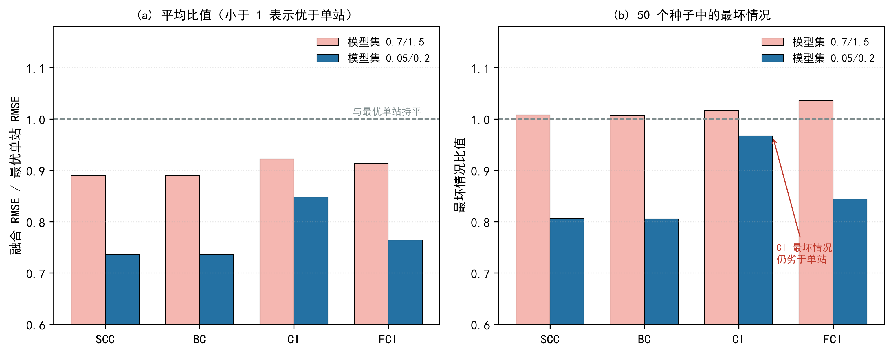
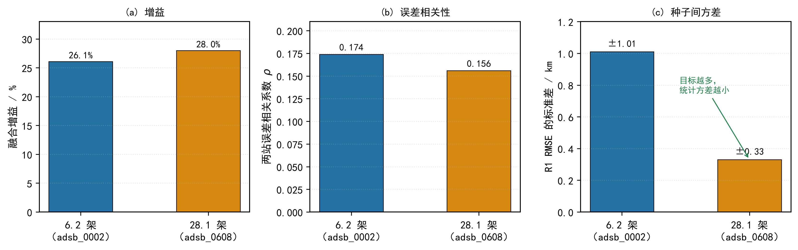
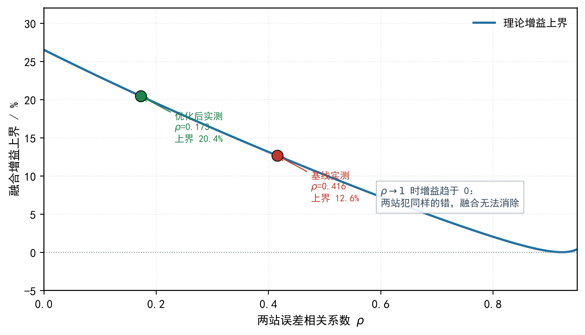
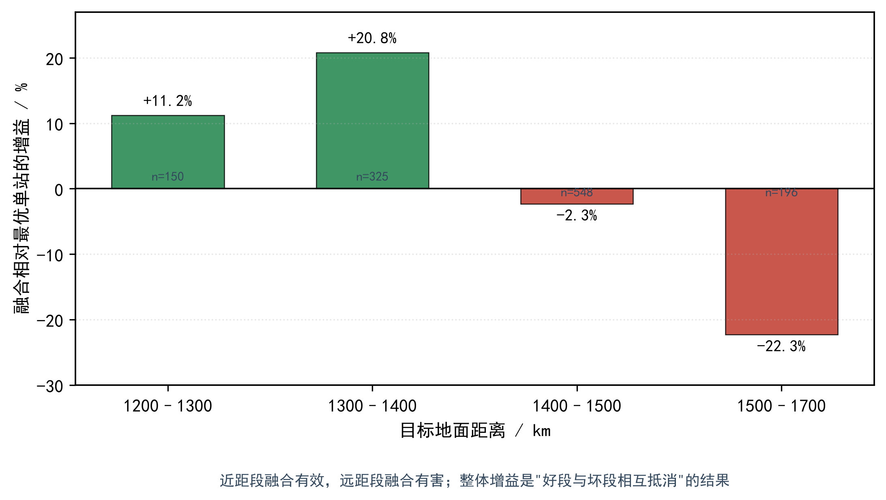

# 第5章 双照射源航迹融合

第4章给出了可信的跨照射源配对，同一目标在两站的航迹由此建立对应。配对回答的是"谁是同一个目标"，没有回答"连起来之后精度能提高多少"。前者是离散判定，后者是连续估计，且依赖两个只能靠统计检验确认的前提。本章据此展开：5.1 节把四种融合算法还原为对互协方差的四种处理方式，5.2 节给出实测增益，5.3 与 5.4 节检验两个前提，5.5 节报告两条修复路径的失效，5.6 节给出可操作判据。

## 5.1 融合结构与四种基础算法

配对完成之后，同一目标在同一帧上有两组估计，各带一个状态向量与一个协方差矩阵。融合形式上只是一次加权平均，但权重如何确定、定错之后后果如何，取决于一个不写在融合公式里却决定全部结果的量：两站估计误差的互协方差。

### 5.1.1 航迹级融合的信息形式

设第 $k$ 帧两站对同一目标的位置估计为 $\mathbf x_1$ 与 $\mathbf x_2$，协方差为 $\mathbf P_1$ 与 $\mathbf P_2$。两站采样时刻相差 13 s，第2章已按航迹状态外推完成时间对齐，此处不再重复。线性融合取

$$\mathbf x_f=\mathbf W_1\mathbf x_1+\mathbf W_2\mathbf x_2, \mathbf W_1+\mathbf W_2=\mathbf I$$ {#eq:ch5_fuse_linear}

无偏约束把两个权重矩阵的自由度压缩为一个，记 $\mathbf W=\mathbf W_1$、$\mathbf W_2=\mathbf I-\mathbf W$。设两站误差为 $\tilde{\mathbf x}_1$ 与 $\tilde{\mathbf x}_2$，融合误差即 $\mathbf W\tilde{\mathbf x}_1+(\mathbf I-\mathbf W)\tilde{\mathbf x}_2$，其协方差为

$$\mathbf P_f=\mathbf W\mathbf P_1\mathbf W^T+(\mathbf I-\mathbf W)\mathbf P_2(\mathbf I-\mathbf W)^T+\mathbf W\mathbf P_{12}(\mathbf I-\mathbf W)^T+(\mathbf I-\mathbf W)\mathbf P_{21}\mathbf W^T$$ {#eq:ch5_fuse_cov}

式中 $\mathbf P_{12}=\operatorname E[\tilde{\mathbf x}_1\tilde{\mathbf x}_2^T]$ 为互协方差，其物理意义是两站误差中同向同幅的那一部分。式[@eq:ch5_fuse_cov]的四项里，前三项由各站自报的协方差给出，第四项没有观测量与之对应。四种算法的全部差别，就是对这个未知项采取四种态度：置零、显式建模、视为最坏、以迹比近似。这一观察是本章的组织原则。

### 5.1.2 简单凸组合与互协方差融合

最简单的态度是置零。令 $\mathbf P_{12}=\mathbf 0$，对式[@eq:ch5_fuse_cov]关于 $\mathbf W$ 求极小，得权重与融合协方差

$$\mathbf W_i=\left(\mathbf P_1^{-1}+\mathbf P_2^{-1}\right)^{-1}\mathbf P_i^{-1}, \mathbf P_f=\left(\mathbf P_1^{-1}+\mathbf P_2^{-1}\right)^{-1}$$ {#eq:ch5_scc_w}

这就是简单凸组合。其形式有信息论解释：$\mathbf P_i^{-1}$ 是第 $i$ 站估计的费舍尔信息矩阵，两站独立时信息可加。标量情形下 $\sigma_f^2=\sigma_1^2\sigma_2^2/(\sigma_1^2+\sigma_2^2)$，两站等方差时 $\sigma_f=\sigma/\sqrt2$，误差降到单站的 70.7%。计算量只有两次矩阵求逆，无需相关性先验，这是它被普遍采用的原因。

代价是它把"未知"当成"为零"。两站正相关时，式[@eq:ch5_scc_w]给出的 $\mathbf P_f$ 小于真实误差协方差，滤波器过度自信；更严重的是权重本身也错，因为正相关意味着两站信息有重复，重复部分不应被二次计入。

保留互协方差的是 Bar-Shalom 与 Campo 给出的显式解

$$\mathbf P_f=\mathbf P_1-\left(\mathbf P_1-\mathbf P_{12}\right)\left(\mathbf P_1+\mathbf P_2-\mathbf P_{12}-\mathbf P_{21}\right)^{-1}\left(\mathbf P_1-\mathbf P_{21}\right)$$ {#eq:ch5_bc}

其标量权重为

$$w_1=\frac{\sigma_2^2-\rho\sigma_1\sigma_2}{\sigma_1^2+\sigma_2^2-2\rho\sigma_1\sigma_2}$$ {#eq:ch5_bc_w}

$\rho=0$ 时式[@eq:ch5_bc_w]退化为 $\sigma_2^2/(\sigma_1^2+\sigma_2^2)$，与简单凸组合一致，后者是前者的特例。$\rho>0$ 时 $w_1$ 单调减小：两站越相关，越应把权重让给精度较高的一站，因为较差那站的信息大部分已被包含。$\rho\to1$ 时 $w_1$ 越过 1、$w_2$ 变负，融合退化为对差值的外推，数值极不稳定，这一性质在 5.5.2 节决定了互协方差分支的命运。

工程权衡由此清晰。互协方差融合理论上最优，但要求 $\mathbf P_{12}$ 已知；实际系统既无先验也无法直接测量，只能在线辨识。辨识失败时权重越界必须截断，截断后即退化为简单凸组合。本文以简单凸组合为主链路，正因为它不引入无法验证的中间量。

### 5.1.3 协方差交叉及其快速算法

第三种态度是承认相关性完全未知，并在此前提下求一个保证一致的解。协方差交叉取

$$\mathbf P_{cc}=\left(\omega\mathbf P_1^{-1}+(1-\omega)\mathbf P_2^{-1}\right)^{-1}, \omega\in[0,1]$$ {#eq:ch5_ci}

$\omega$ 由最小化 $\operatorname{tr}(\mathbf P_{cc})$ 或 $\det(\mathbf P_{cc})$ 确定。其性质是：对任意未知的 $\mathbf P_{12}$，$\mathbf P_{cc}$ 都不小于真实误差协方差，估计不会过度自信。代价是把权重压向方差较大的一侧。

快速协方差交叉用迹比给出解析权重

$$\omega=\frac{\operatorname{tr}(\mathbf P_2)}{\operatorname{tr}(\mathbf P_1)+\operatorname{tr}(\mathbf P_2)}$$ {#eq:ch5_fci_w}

省去一维搜索，计算量与简单凸组合同阶。它隐含假设迹之比可代表相关结构的全部影响，而本文两站协方差各向异性明显，这一假设只是近似。

选择协方差交叉的理由是不依赖 $\mathbf P_{12}$，这在相关性未知时是唯一的严格选择。不选它的理由同样明确：它优化最坏情况，而实际相关性既非最坏也非为零，保守代价在平均意义上无法收回。

### 5.1.4 四种算法的前提假设对照

四种算法可以放在同一张表里比较，比较的维度不是精度而是前提。如表[@tbl:ch5_assume]所示。

| 算法 | 权重形式 | 对互协方差的处理 | 成立前提 | 前提破坏后的表现 |
| ---- | ---- | ---- | ---- | ---- |
| 简单凸组合 | $\mathbf P_i^{-1}$ 归一 | 置零 | 两站误差独立、协方差可信 | 正相关时过度加权，融合被较差站拖累 |
| 互协方差融合 | $(\mathbf P_1-\mathbf P_{12})\mathbf S^{-1}$ | 显式使用，需已知或可辨识 | 协方差可信、互协方差可辨识 | 互协方差错号时权重越界，截断后退化为简单凸组合 |
| 协方差交叉 | 最小化迹的 $\omega$ | 视为完全未知，取最坏 | 仅需协方差可信 | 一致但保守，精度损失 |
| 快速协方差交叉 | 迹比解析 | 同协方差交叉 | 迹比可代表相关结构 | 计算最省，保守性略弱 |

: 四种航迹级融合算法的前提假设对照 {#tbl:ch5_assume}

表中前三列是算法定义，后两列才是工程上要判断的内容。四个前提可归并为两条：协方差是否可信，误差是否独立。前者四者全部需要，后者只有简单凸组合显式写成 $\rho=0$，其余三个用不同方式回避，但回避不等于解决——协方差交叉在 $\mathbf P$ 不可信时同样失效，互协方差融合辨识出的 $\mathbf P_{12}$ 连符号都是错的。5.3 与 5.4 节检验的是四个算法的共同前提。

## 5.2 融合增益的实测结果

5.1 节给出了算法与前提的对应关系，却没有给出量。融合能带来多少精度、这个量是否稳定，仍需实测回答。

### 5.2.1 主结果：模型集优化前后的增益

表[@tbl:ch5_main]给出 adsb_0002 场景下 100 个种子的结果，两列对应第3章确定的基线与优化两档模型集。

| 指标 | 0.7 / 1.5 | 0.05 / 0.2 |
| ---- | ---- | ---- |
| R1 RMSE / km | 12.105±0.713 | 11.320±0.999 |
| SCC RMSE / km | 10.522±0.515 | 8.039±0.675 |
| $\rho$ | +0.416±0.059 | +0.173±0.066 |
| NEES | 4.28±0.47 | 2.91±0.29 |
| 融合增益 | +12.24% | +26.29% |
| 负增益种子 | 1/100 | 0/100 |

: 模型集优化前后的融合性能（adsb_0002，100 种子） {#tbl:ch5_main}

基线配置下 R1 为 12.105 km、融合误差 10.522 km、增益 12.24%，100 个种子中有 1 个负增益。改为 0.05/0.2 后 R1 降到 11.320 km，融合降到 8.039 km，增益 26.29%，无一为负。单站只改善 6.5%，融合改善 23.6%，放大 3.6 倍。

50 种子配对检验给出更严格的区间：增益由 11.0%±4.0 升到 26.4%±4.1，提升 15.4 个百分点，$p=1.8\times10^{-26}$，$dz=4.75$，95% 置信区间 [25.2, 27.5]。50 个种子全部为正，48 个超过 20%，最差 19.4%。区间下界仍高于基线上界 12.1%，两组分布不重叠。

有一个数值需单独说明。5.3 至 5.6 节的分段诊断使用 adsb_0002 的一次确定性实现（1219 个共同帧、全段融合），该次统计的增益只有 0.5%。它低于 100 种子均值，原因不在融合退化，而在最优单站由谁担任：该次 R2 为 10.30 km，优于 R1 的 12.03 km，融合 10.25 km 与之持平；而 100 种子平均下最优单站是 R1（12.105 km），融合 10.522 km 相对它有 12.24% 的改善。

四种算法在同一批数据上的对比如图[@fig:ch5_4algo]所示。

{#fig:ch5_4algo}

如图[@fig:ch5_4algo]所示，四种算法的平均比值全部小于 1，但排序与理论预期不一致。简单凸组合为 0.890 与 0.736，快速协方差交叉为 0.913 与 0.764，协方差交叉为 0.922 与 0.848，后者在两档下都最差；互协方差融合与简单凸组合三位小数全同。右图的最坏情况把差距放大：简单凸组合基线为 1.008，即个别种子融合反而劣于单站，与 1/100 的负增益种子对应；协方差交叉为 1.016，优化后仍有 0.967。

三点解释。其一，协方差交叉的权重由最坏相关假设确定，被压向方差大的一侧，平均损失 7% 至 15% 的精度，而这一保守未换来鲁棒性——它挡不住协方差失配引起的权重错配，最坏情况也一起变差。其二，互协方差融合与简单凸组合完全等同，不是并列最优，而是前者的分支未生效：辨识出的 $\mathbf P_{12}$ 越界后被截断为零。其三，模型集优化对四者同时有效，最坏比值从 1.008 降到 0.806，说明灾难性失效的消除来自相关性下降而非算法改进。

### 5.2.2 跨场景复现与密度鲁棒性

单一场景的结论不足以支撑机理，需要看它在别的时段、别的密度下是否重现。表[@tbl:ch5_cross]给出三个场景的结果。

| 场景 | 并发 | $\rho$ 基线 → 优化 | 增益 基线 → 优化 | NEES 基线 → 优化 |
| ---- | ---- | ---- | ---- | ---- |
| adsb_0002 | 6.2 | 0.416 → 0.174 | 12.2% → 26.1% | 4.28 → 2.92 |
| adsb_0608 | 28.1 | 0.443 → 0.156 | 10.7% → 28.0% | 4.71 → 2.97 |
| multi_cross | 3 | 0.179 → 0.230 | 8.6% → 7.6% | 1.39 → 1.81 |

: 三个场景的机理复现（100 种子，multi_cross 为 50 种子） {#tbl:ch5_cross}

两个真实场景的三个指标几乎重合：相关系数由 0.416 与 0.443 降到 0.174 与 0.156，增益由 12.2% 与 10.7% 升到 26.1% 与 28.0%，NEES 由 4.28 与 4.71 降到 2.92 与 2.97。两个场景的时段、航迹、密度与帧数都不同，数值却几乎一致，这是机理可复现最直接的证据。multi_cross 完全在另一侧：相关系数本就不高，改模型集后反升到 0.230，增益由 8.6% 微降到 7.6%。三条直线航迹没有机动，不存在共同模型误差，也就没有可去相关的空间。杠杆不是"转弯率越小越好"，而是"转弯率要匹配真实机动"。

密度的影响如图[@fig:ch5_density]所示。

{#fig:ch5_density}

如图[@fig:ch5_density]所示，并发数从 6.2 架增至 28.1 架、涨了 4.5 倍，增益却从 26.1% 微升到 28.0%，相关系数从 0.174 降到 0.156。真正值得注意的是右图：R1 的种子间标准差从 ±1.01 km 降到 ±0.33 km，融合误差从 ±0.69 km 降到 ±0.28 km。原因是样本量而非算法，帧数成倍增加使随机涨落被平均掉。其工程含义与直觉相反：高密度场景的结论更可靠。两场景覆盖率 90.6% 与 90.5%，几乎不变。

63 架并发场景未完成全量蒙特卡洛，两次尝试分别因内存不足与耗时过长中止，根因是算力而非方法。按耗时标度关系外推预期增益不低于 28%，但未经实测，本文不计入结论。

## 5.3 前提一：协方差可信度

5.2 节确认了融合有效，但没有解释为什么基线配置下几乎无效。简单凸组合的权重是 $\mathbf P^{-1}$，第一个可疑对象便是 $\mathbf P$ 是否可信。这一检验不必知道真值，可用归一化误差平方和完成

$$\epsilon_k=\boldsymbol\nu_k^T\mathbf S_k^{-1}\boldsymbol\nu_k, \operatorname E[\epsilon_k]=m=2$$ {#eq:ch5_nees}

式中 $\boldsymbol\nu_k$ 为新息，$\mathbf S_k$ 为新息协方差，$m$ 为位置维数。它只用滤波器自报的量，可以在线计算，这使"协方差是否可信"从离线诊断变成可运行的自检指标。理想值为 2；显著大于 2 说明协方差被低估，显著小于 2 说明偏保守。

实测结果如表[@tbl:ch5_nees]所示。

| 场景 | 站 | NEES 均值 | 报告方差 / km² | 实际方差 / km² | 判定 |
| ---- | ---- | ---- | ---- | ---- | ---- |
| adsb_0002 | R1 | 4.76 | 36.7 | 72.4 | 低估约 2 倍 |
| adsb_0002 | R2 | 1.80 | — | — | 一致 |
| multi_cross | R1 | 1.21 | 37.7 | 23.7 | 偏保守 |
| multi_cross | R2 | 0.58 | — | — | 保守 |

: 两站位置估计的归一化误差平方和检验（单次实现） {#tbl:ch5_nees}

真实场景 R1 的 NEES 为 4.76，报告方差 36.7 km²，实际方差 72.4 km²，低估近一半。R2 的 1.80 落在理想值附近。合成场景两站分别为 1.21 与 0.58，方向一致地偏保守。

低估的后果落在权重上。R1 的实际误差 12.03 km 比 R2 的 10.30 km 差 17%，按报告协方差却应得近一半权重；融合 10.25 km 几乎等于 R2 单独工作，说明 R1 的边际贡献为零甚至为负。这不是算法不好，而是权重给错了站。合成场景融合 4.21 km，与独立假设的理论值 4.24 km 吻合到 0.7%，说明前提成立时简单凸组合可达理论精度。

这里需与第3章的观测对上。3.3 节指出位置均方根误差已达下界而 NEES 为 4.28，二者并不矛盾：前者是一阶精度，后者是二阶可信度。对单站跟踪，协方差偏小只影响增益的保守程度；对融合，协方差直接就是权重。同一处缺陷在两个环节严重程度不同，原因即在于此。

模型集匹配后，100 种子平均的 NEES 由 4.28 降到 2.91，协方差变得可信。需强调这是结果而非原因：转弯率匹配真实机动后，两站预测偏差同步减小，新息与预测协方差的比例自然回到理想值。这条因果方向在判断修复路径时要用到。

## 5.4 前提二：误差独立性

即便协方差完全可信，简单凸组合仍假设 $\rho=0$。第二个前提是否成立，需要用另一套证据回答。

### 5.4.1 互相关的物理来源

第3章已把两站误差分解为共同模型误差与独立量测噪声，并给出 $\rho=\sigma_m^2/(\sigma_m^2+\sigma_n^2)$。本节补充这一分解在双照射源系统中的具体来源。

共同模型误差来自设计上的共享。按 3.5 节的准则，模型集须作为系统的统一参数整定，两站共用同一套转弯率、转移概率与过程噪声；这是航迹可比的必要条件，却使两站对同一段运动施加了同一个错误约束。真实转弯率中位 0.012 °/s、90 分位 0.229 °/s，基线模型集取 0.7 与 1.5 °/s，对应 99 分位与最大值，九成时间里四个转弯模型无一匹配。失配产生的偏移方向确定、对两站同向，无法靠加权消除。配准残差已由 2.4 节压到噪声以下，故实测相关系数主要反映模型误差占比：基线 100 种子为 +0.416、单次为 +0.427，匹配后降到 +0.173 与 +0.169。

反证来自合成场景。multi_cross 是三条两点直线航迹，单次实现的相关系数为 −0.227、增益 21.9%，多种子平均为 +0.179、增益 8.6%，两个统计量都在零附近且符号不稳，说明两站误差接近独立甚至互补。没有机动就没有共同模型误差，两站各自犯各自的错，融合自然接近独立假设的理论值。可去相关的部分只来自共同的模型误差，这条反证从反面确认了机理。

### 5.4.2 给定互相关的增益上界

把式[@eq:ch5_bc_w]的权重代回标量协方差，可得两站估计在给定相关系数下的最优融合误差

$$\sigma_f^2=\frac{\sigma_1^2\sigma_2^2(1-\rho^2)}{\sigma_1^2+\sigma_2^2-2\rho\sigma_1\sigma_2}$$ {#eq:ch5_gain_rho}

这一式子把相关性从定性概念变成可换算的性能量，是本章的定量支点。$\rho=0$ 时它退化为 $\sigma_1^2\sigma_2^2/(\sigma_1^2+\sigma_2^2)$，两站等方差时 $\sigma_f=\sigma/\sqrt2$，增益 29.3%；两站不等时按各自方差取值。$\rho>0$ 时增益单调下降；$\rho\to1$ 时 $\sigma_f$ 趋于零，但这是模型退化而非真实精度——两站已退化为同一估计的两种缩放，差值通道方差为零，共同误差不在这条式子的表达范围内。工程上应读作：可被融合消除的独立分量随 $\rho$ 增大而枯竭。

以本文基线两站方差代入，得表[@tbl:ch5_gainrho]。

| $\rho$ | $\sigma_f$ / km | 相对最优单站的增益 |
| ---- | ---- | ---- |
| 0（两站等方差） | $\sigma/\sqrt2$ | 29.3% |
| 0 | 8.86 | 26.5% |
| 0.173 | 9.60 | 20.4% |
| 0.416 | 10.57 | 12.4% |
| 0.600 | 11.18 | 7.3% |
| 0.800 | 11.82 | 2.0% |
| 0.900 | 12.05 | 0.1% |

: 给定互相关下的融合误差与增益上界（$\sigma_1=12.06$ km，$\sigma_2=13.07$ km） {#tbl:ch5_gainrho}

表中前两行说明一件事：即便两站完全独立，只要精度不等，增益也达不到 29.3%，本文两站方差下只有 26.5%，这一细节在 5.6.2 节会被放大成判据。以单次实现的方差（12.03 km 与 10.30 km）代入，$\rho=0.427$ 给出 $\sigma_f=9.31$ km 与 9.7% 的增益，这就是基线配置下融合的理论天花板。

{#fig:ch5_gainrho}

如图[@fig:ch5_gainrho]所示，曲线在 $\rho<0.3$ 的区间陡降，$\rho>0.6$ 之后贴近零轴；两个实测点落在中部与上部，基线对应 12.4%，优化后对应 20.4%。低相关区每降 0.1 换来的增益远大于高相关区，去相关的努力应投在 $\rho$ 尚未很高的阶段。

这里必须交代标尺与实测的偏差。把优化后的相关系数与方差代入式[@eq:ch5_gain_rho]得 20.4%，实测增益却为 26.29%。原因有二：式中 $\sigma$ 取全段均方根，被少量大误差帧抬高，而逐帧权重用的是该帧预测协方差；$\rho$ 同样是全段平均，逐帧相关性并不同质。该式应理解为"同等条件下可期望的增益标尺"，其结论——$\rho$ 是一阶决定量、$\rho\to1$ 时增益归零——不受影响，但不应当作逐帧硬界。

## 5.5 修复路径的探索与失效

5.3 与 5.4 节把增益不足归因于两个前提。自然的思路是分别修复：先校准协方差，再辨识互协方差。两条路径均告失效，而失效方式各不相同，恰好把瓶颈的位置钉死。

### 5.5.1 基于新息统计的协方差校准

既然 NEES 为 4.76 说明协方差低估，最直接的办法是按新息统计估计一个尺度因子，把协方差整体放大

$$\kappa_i=\frac{1}{N}\sum_k\frac{\boldsymbol\nu_{i,k}^T\mathbf S_{i,k}^{-1}\boldsymbol\nu_{i,k}}{m}, \mathbf P_i\leftarrow\kappa_i\mathbf P_i$$ {#eq:ch5_ccf}

按 NEES 的读数，$\kappa_1$ 应接近 2.4。实测的 $\kappa$ 扫描呈完美单峰，但峰位于 $\kappa=1$，即最优解是不校准。执行校准后融合误差由 10.25 km 变为 10.05 km，增益由 0.5% 升到 2.4%，仍远低于该配置 9.7% 的天花板。

单峰说明这不是"参数没调好"，而是目标函数在 $\kappa=1$ 处取极值。校准是全局尺度，权重错配却是分段现象：近距段 R1 不差于 R2，远距段明显更差，全局 $\kappa$ 无法只修正远距段，放大 $\mathbf P_1$ 会同时削弱 R1 在近距段的权重，两者在全局目标上抵消。方法学含义比数值更重要：NEES 度量协方差的绝对一致性，融合需要的是两站协方差之比的相对正确性。一致性不等于权重正确。

### 5.5.2 互协方差的在线辨识

第二条路径是辨识 $\mathbf P_{12}$。若能在线得到它，互协方差融合即可生效。实现上采用位置差反演，其依据是两站位置差的方差可写成

$$\operatorname{Var}(\mathbf x_1-\mathbf x_2)=\mathbf P_1+\mathbf P_2-\mathbf P_{12}-\mathbf P_{21}$$ {#eq:ch5_p12_var}

在 $\mathbf P_{12}=\mathbf P_{21}^T$ 的对称假设下解出

$$\mathbf P_{12}=\frac{1}{2}\left(\mathbf P_1+\mathbf P_2-\operatorname{Var}(\mathbf x_1-\mathbf x_2)\right)$$ {#eq:ch5_p12_diff}

再按 $\hat\rho=\operatorname{tr}(\mathbf C_{12})/\sqrt{\operatorname{tr}(\mathbf C_{11})\operatorname{tr}(\mathbf C_{22})}$ 折算为相关系数。实测结果如表[@tbl:ch5_icbc]所示。

| 场景 | 真值 $\rho$ | 未校准 $\mathbf P$ 的估计 | 判定 |
| ---- | ---- | ---- | ---- |
| multi_cross | −0.227 | −0.239 | 符号与量级均正确 |
| adsb_0002 | +0.427 | −0.607 | 符号错误 |

: 位置差反演法的互相关辨识结果 {#tbl:ch5_icbc}

合成场景估出 −0.239，与真值只差 0.012；真实场景估出 −0.607，而真值为 +0.427，量级与符号都错。原因在式[@eq:ch5_p12_diff]要求 $\mathbf P_1$ 与 $\mathbf P_2$ 准确：R1 的协方差低估约 2 倍，使 $\operatorname{Var}(\mathbf x_1-\mathbf x_2)$ 被高估，反解出的 $\mathbf P_{12}$ 必然偏负。合成场景的 $\mathbf P$ 本就偏保守，反演式近似成立，正好构成对照。

符号错误的后果不是精度下降而是算法失效。负的 $\mathbf P_{12}$ 使式[@eq:ch5_bc_w]的权重越出 $[0,1]$，实现中为避免发散将其截断为零，互协方差融合随即退化为简单凸组合。这是 5.2.1 节两者三位小数全同的原因，也是一条必须交代的负结果：该分支实际未生效。

### 5.5.3 为什么必须先校准再辨识

5.5.1 与 5.5.2 节合起来给出一条方法学结论：顺序不能颠倒。式[@eq:ch5_p12_diff]以 $\mathbf P$ 准确为前提，故必须先校准再辨识；而校准在全局意义上无收益，$\kappa$ 的最优值就是 1。三步链条中前两步各有一处断裂。

更值得追问的是：即便顺序执行成功，收益有多大？把真值相关系数与真实方差一并代入（任何辨识算法都无法超越的上界），基线配置下融合误差 9.30 km、增益 9.7%。也就是说，$\rho=0.43$ 时无论辨识多精确，天花板都只有 9.7%；而模型集匹配把 $\rho$ 降到 0.17 后，不做任何校准与辨识，简单凸组合即得 26.29%，是该上界的 2.7 倍。

两条路径的对比固定了本章的核心判断：尺度不是主因，相关性才是。协方差低估的影响可通过权重截断、保守化缓解，相关性却是硬约束，它决定可被消除的独立分量还剩多少。两条修复路径注定收益有限——它们在优化二阶量，而瓶颈在一阶量上。

## 5.6 融合的适用条件

5.5 节说明在算法层面修不动。于是换一个问法：不是"如何让融合处处有效"，而是"在哪些条件下融合本来就有用"。这个问题可用可观测量回答，答案直接构成工程判据。本节三组分段统计均基于 adsb_0002 的基线配置与 1219 个共同帧。

### 5.6.1 按目标距离分段

{#fig:ch5_dist}

如图[@fig:ch5_dist]所示，增益随距离单调恶化并在 1400 km 附近变号：1200–1300 km 段为 +11.2%，1300–1400 km 段升到 +20.8%，1400–1500 km 段转为 −2.3%，1500–1700 km 段跌到 −22.3%。前两段融合明确有益，后两段明确有害，中间不存在平缓过渡区。分段明细如表[@tbl:ch5_dist]所示。

| R1 距离 / km | $n$ | R1 / km | R2 / km | 融合 / km | 增益 |
| ---- | ---- | ---- | ---- | ---- | ---- |
| 1200–1300 | 150 | 8.87 | 8.89 | 7.88 | +11.2% |
| 1300–1400 | 325 | 8.29 | 8.68 | 6.57 | +20.8% |
| 1400–1500 | 548 | 13.53 | 11.83 | 12.11 | −2.3% |
| 1500–1700 | 196 | 14.61 | 9.12 | 11.15 | −22.3% |

: 按目标距离分层的融合增益（adsb_0002 基线配置） {#tbl:ch5_dist}

物理解释有三层。其一，距离越远方位误差的杠杆臂越长，$r\sigma_{az}$ 线性增长，1500 km 处 R1 的 0.35° 对应 9.2 km，已与群距离噪声同量级。其二，两站电离层穿透几何不同，虚高残差按各自几何因子放大且放大率不同，远距段精度排序反转——1500–1700 km 段 R1 为 14.61 km 而 R2 为 9.12 km。其三，排序反转而权重仍按报告协方差分配，错配被放大，融合把结果拉向较差的一站。

这一分层纠正了一个误解。全段 0.5% 常被读作"融合增益普遍很低"，实际它是近距段 +20.8% 与远距段 −22.3% 在均方根意义上相互抵消的结果。两个分段的绝对值都远大于整体值，说明融合不是均匀地弱，而是分段地有效与分段地有害。

### 5.6.2 按两站精度比分段

距离只是代理变量，真正起作用的是两站精度之比。按逐帧误差比 $e_1/e_2$ 分段，结果如表[@tbl:ch5_ratio]所示。

| $e_1/e_2$ | $n$ | R1 / km | R2 / km | 融合 / km | 增益 |
| ---- | ---- | ---- | ---- | ---- | ---- |
| 0.0–0.8（R1 明显更准） | 406 | 6.44 | 14.23 | 8.88 | −37.9% |
| 0.8–1.0（两站相当） | 101 | 9.67 | 10.83 | 9.73 | −0.7% |
| 1.0–1.3（R2 略准） | 137 | 12.04 | 10.49 | 11.32 | −7.9% |
| 1.3–3.0（R2 明显更准） | 337 | 13.35 | 7.15 | 10.44 | −46.1% |

: 按两站逐帧误差比分层的融合增益（adsb_0002 基线配置） {#tbl:ch5_ratio}

两端的数字最有说服力。R1 明显更准时（6.44 km 对 14.23 km），融合把 6.44 km 恶化到 8.88 km，损失 37.9%；R2 明显更准时（13.35 km 对 7.15 km），融合把 7.15 km 恶化到 10.44 km，损失 46.1%。两端对称地坏，中间两段接近零，形态是以 $e_1/e_2=1$ 为峰、向两侧陡降的曲线。

这一形态可由式[@eq:ch5_gain_rho]直接预测。两站精度差异越大，收益上限越低：$\rho=0$ 时 $\sigma_2=2\sigma_1$ 的最优融合误差为 $0.894\sigma_1$，增益上限只有 10.6%；$\sigma_2=4\sigma_1$ 时降到 3.0%。与此同时，权重误差的代价随精度比放大。上限下降与代价上升同向叠加，交叉点就在精度比接近 1 处。以 0.0–0.8 段为例，理论上限约 8.8%，实测 −37.9%，46.7 个百分点的落差全部由权重错配造成。

这条判据比 5.6.1 节更本质，因为它可脱离距离使用：两站报告的精度相当则融合有意义，一方明显占优则期望收益不足以补偿权重误差的风险，直接采用较优单站更稳妥。工程上可把"两站报告方差之比落在 0.8 至 1.3 之间"作为启用融合的必要条件。

### 5.6.3 门控的尝试与概念澄清

既然融合分段有效，一个自然的工程方案是门控：只在有利条件下融合，其余情况直接用最优单站。按距离门控的实测结果如表[@tbl:ch5_gate]所示。

| 方案 | 融合帧占比 | 整体 RMSE / km | 增益 | 可观测性 |
| ---- | ---- | ---- | ---- | ---- |
| 全段融合 | 100% | 10.25 | 0.5% | — |
| 距离门控 < 1400 km | 39.0% | 9.77 | 5.2% | 完全可观测 |
| 距离门控 < 1450 km | 60.3% | 9.64 | 6.4% | 完全可观测 |
| $\chi^2$ 一致性门控 | — | — | 2.1% | 可观测但方向相反 |
| Oracle 门控 | 23.6% | 6.71 | 34.9% | 需事后信息 |

: 四种融合门控方案的对比（adsb_0002 基线配置） {#tbl:ch5_gate}

距离门控把增益从 0.5% 提到 6.4%，实现只需一个阈值判断，工程上零成本。阈值取 1450 km 时最优，更严会漏掉有利帧，更松会引入远距段的负增益。Oracle 门控假定事后知道哪些帧融合更好，只在 23.6% 的帧上融合，误差降到 6.71 km、增益 34.9%。两者相差 28.5 个百分点，就是缺少可观测判据的代价。

最自然的判据是两站估计的一致性，用马氏距离构造

$$\chi^2=(\mathbf x_1-\mathbf x_2)^T(\mathbf P_1+\mathbf P_2)^{-1}(\mathbf x_1-\mathbf x_2)$$ {#eq:ch5_chi2}

直觉是 $\chi^2$ 小则两站一致、融合应当有效。实测完全相反：融合成功帧的平均 $\chi^2$ 为 1.70、中位 1.24，失败帧为 1.30、中位 0.80，成功帧的一致性反而更差；按区间分组，0–2 区间增益 −0.8%，2–5 区间 +4.8%。整体门控增益只有 2.1%。

这一失败是概念问题而非实现问题。$\chi^2$ 度量两站估计的一致程度，融合能否获益取决于两站误差的独立程度，二者并不对应。$\chi^2$ 小说明两个估计靠得近，而靠得近有两种可能：两站各自独立地把误差平均掉了，融合已无空间；或两站被同一个偏差同时拉偏，融合根本无效。$\chi^2$ 大说明两站分歧明显，恰是独立犯错的标志，取平均才能消掉独立分量。成功帧 $\chi^2$ 大于失败帧，正是这一区分的证据。

由此得到一条概念结论：融合门控的正确依据是误差独立性，不是估计一致性。后者容易观测，前者难以观测，这正是门控至今没有满意解的原因，也是 Oracle 上界 34.9% 与实际可达 6.4% 之间那道鸿沟的来源。若能在线估计逐帧的误差独立性，增益还有约 28 个百分点的空间。

## 5.7 本章小结

本章回答了配对之后融合能带来多少精度、在什么条件下有效两个问题。

机理与上界方面，把四种融合算法还原为对互协方差的四种处理方式，指出其差别不在算法精巧程度而在前提是否成立；由标量最优融合解推导出增益闭式关系，证明 $\rho=0$ 时等方差增益上限为 29.3%、$\rho=0.43$ 时降到 9.7%、$\rho\to1$ 时归零，把相关性换算为可比较的性能量。

主结果与稳健性方面，100 种子实测给出基线 12.24% 与优化 26.29% 的增益，后者 100 个种子无一为负；50 种子配对检验的 95% 置信区间为 [25.2, 27.5]、效应量 $dz=4.75$；跨两个真实场景复现，相关系数降幅 58% 与 65%、增益 26.1% 与 28.0%；并发增长 4.5 倍后增益不降反升，种子间标准差缩小到三分之一。

前提与负结果方面，识别出协方差可信度与误差独立性两个前提，前者由 NEES 4.76（低估约 2 倍）刻画，后者由 $\rho=+0.416$ 刻画；系统排除了三条修复路径——协方差校准的 $\kappa$ 扫描单峰且峰在不校准处，位置差反演的互相关辨识符号错误，$\chi^2$ 一致性门控方向相反；并如实报告互协方差融合因 $\mathbf P_{12}$ 截断为零而退化为简单凸组合、协方差交叉在均值与最坏情况下均劣于简单凸组合。五条负结果共同指向一个判断：尺度不是主因，相关性才是。

适用条件方面，给出按距离与按精度比的两条判据，指出全段 0.5% 是近距段 +20.8% 与远距段 −22.3% 相互抵消的结果，而非均匀低增益；距离门控以零成本把增益提到 6.4%，并澄清门控依据是误差独立性而非估计一致性。本章的产出是一条机理链条：模型匹配决定共同误差，共同误差决定相关系数，相关系数决定增益上界，上界与权重正确性共同决定实际收益，第6章据此汇总。
