# 第1章 绪论

## 1.1 课题研究背景与意义

对超视距、强隐蔽目标的广域监视需求，长期受制于雷达体制的物理边界。微波雷达依靠视距传播，单站作用距离仅数十至数百公里，且受地球曲率遮挡；自建发射阵地的短波超视距雷达虽可覆盖数千公里，却因阵地固定、辐射特征明显而生存能力受限。短波外辐射源雷达提供了另一条路径：它不主动辐射，以广播、通信等已有的短波信号为照射源，借助电离层折射实现超视距照射，接收站只负责接收目标散射回波。

其优势是结构性的。发射源属于第三方，接收站无需申请专用频率、无需建设发射设施，成本与部署周期大幅压缩；全程被动工作，难以被电子侦察发现与定位，也不存在可被反辐射武器攻击的阵地；短波波长远大于吸波材料的适用尺度，加之双基地几何下前向散射增强，具备一定的反隐身潜力[39]。

然而，其效能被物理链路严重制约。信号须两次穿越电离层，由此带来三重困难。其一，电离层是时变、非均匀的随机介质，行波扰动引起相位污染、多普勒展宽与群路径抖动，等效虚高在数十分钟内即可漂移数公里。其二，非合作信号并非为雷达设计，调幅广播与DRM信号的带宽仅十千赫兹量级，模糊函数沿时延轴的主瓣极宽，距离分辨单元可达数十公里。其三，双跳路径损耗比直达波高出上百分贝，回波淹没于噪声与残余杂波。

上述条件最终转化为苛刻的量测条件：群距离误差十公里量级，方位误差零点几度，检测概率约零点六，更新周期三十秒。在1500 km地面距离上，零点三五度方位误差对应约9 km横向误差，与群距离误差同量级；三十秒内巡航速度230 m/s的目标已移动近7 km。量测误差与帧间位移同量级，意味着相邻两帧的点迹几乎不可区分，航迹起始、点迹关联与状态滤波都失去了经典方法赖以成立的前提。

为突破这一边界，利用多个照射源同时照射同一区域、以空间与频率分集获取额外信息，是被广泛看好的路径。分集的价值在于误差互补：同一目标相对两源的双基地几何不同，误差椭球长轴方向亦不同，一个源上主要表现为群距离误差的方向，在另一源上可能恰是方位约束较强的方向；两源载频不同，衰落近似不相关，一源漏检时另一源仍可能给出有效点迹。

然而，分集增益不会自动兑现。两条航迹放在一起，先要判断是否指向同一目标，再要判断如何把两个低精度估计合成更好的估计。时间上，两源帧时刻存在秒级偏移，需将异步航迹点外推到统一时间戳；空间上，两条射线的电离层路径不同，等效虚高不一致，形成与目标位置强耦合的系统偏差；关联上，低精度使不同目标的航迹在状态空间中相互交叠，低数据率又使可用判决样本极少；融合上，两源共视同一目标与同一片电离层，局部估计误差不再独立，独立性假设随之失效。四个问题层层相扣，构成本文的研究对象。

从理论层面看，经典航迹融合假设传感器精度足够高、数据率足够密、局部估计误差相互独立且统计特性已知，而短波双照射源场景同时打破这三条，因而无法靠套用现有算法获得提升，必须回到误差从何而来、相关性如何形成这一层面重新审视融合的有效性。从工程层面看，所形成的方案可支撑海空态势感知与远程目标监视，使短波被动探测从能发现走向能连续跟踪。

## 1.2 国内外研究现状及分析

### 1.2.1 短波外辐射源雷达发展历程

外辐射源探测的思想几乎与雷达同时诞生。1935年，Watson-Watt利用BBC短波广播信号探测到12 km外的轰炸机，验证了借用第三方照射源探测目标的可行性[1]。二战期间，德国研制出Klein Heidelberg系统，通过接收英国Chain Home雷达网的信号实现机群预警，成为最早的实战化双基地雷达[2]。此后因收发隔离困难与信号处理能力不足，研究重心转向单基地雷达，该体制停滞近半个世纪。

20世纪末，电子对抗对隐蔽探测的需求使其重新受到重视。1998年美国洛克希德·马丁公司推出Silent Sentry系统，利用调频广播与电视信号实现200 km量级探测，标志其进入实用化阶段[3]。21世纪初，DAB、DVB-T与DRM等数字广播信号普及，带宽与载频稳定性优于模拟广播；德国Cassidian公司的PARADE系统综合运用多种广播信号，探测距离超过150 km，定位精度优于500 m[4]。国内起步较晚但进展迅速，武汉大学万显荣团队研制多波段MIPAR系统并基于DRM信号开展外场实验[5,6]，多所高校与院所也相继开展研究[39]。

纵观这一脉络，可见一条清晰取舍：成熟系统多工作于米波或分米波段，依靠视距传播，作用距离百公里量级、精度可达百米量级；短波波段借助电离层反射可覆盖数千公里，代价是精度下降一个数量级以上。且已公开的短波天波研究多采用自建发射站，以非合作广播为照射源、多源并用的工作尚不多见。距离与精度的这一矛盾，正是短波外辐射源雷达信息处理的起点。

### 1.2.2 短波外辐射源雷达信息处理技术

信息处理的第一道关口是信号级处理。外辐射源雷达的直达波功率通常比目标回波高出数十至上百分贝，多径与杂波残留严重污染距离多普勒平面，故杂波抑制是检测的前提。Colone等人提出的扩展相消算法以批处理投影消除强直达波与多径分量[8]，其滑窗改进版本进一步适应了信道时变与目标机动[9]。这类方法决定了有没有点迹，却不能决定点迹准不准。

在单站航迹滤波方面，非线性滤波是主线。Julier与Uhlmann提出的无迹卡尔曼滤波以无迹变换传播状态分布，避免了线性化截断误差，成为处理极坐标量测的标准工具[7,54]。围绕外辐射源雷达的具体困难，国内学者做了针对性改进：文献[12]设计去相关无偏转换量测卡尔曼滤波以应对观测误差大、非线性强的问题；文献[13]将自适应扩展卡尔曼滤波与交互多模型结合；文献[40]以迭代扩展卡尔曼滤波处理天波路径下的强非线性；文献[14]在SORT框架下并联多个无迹卡尔曼滤波器，借助马氏距离完成数据关联。深度学习亦被引入，文献[15]构建端到端关联网络，文献[16]从运动特征入手区分无人机与飞鸟。

低检测概率下的航迹维持是另一条线索。检测概率仅为零点六时，平均每五帧就有两帧无有效量测，常规航迹删除逻辑会使真实航迹被过早终止。文献[10]在LTE体制的被动雷达中采用针对性的跟踪策略，证明了非合作信号下连续跟踪的可行性；文献[11]研究了无迹卡尔曼滤波器组网中的序贯融合，以递归传播互协方差降低计算量。由此可见，低数据率下的滤波性能不仅取决于算法本身，更取决于运动模型与真实机动的匹配程度。然而，现有方法大多假设检测概率较高、噪声统计特性平稳，对电离层扰动引起的非平稳噪声缺乏系统处理；自适应过程噪声策略的有效性依赖新息统计量与机动程度的可分辨性，而这一前提在三十秒采样间隔下并不稳固。

### 1.2.3 多照射源航迹关联与融合研究现状

航迹关联判断来自不同传感器的两条局部航迹是否源于同一目标，是融合的前置环节。基于统计检验的方法历史最久：最近邻法仅比较当前时刻的统计距离，密集目标下极易误判[17]；K-最近邻法引入历史判决次数以提升鲁棒性[18]；双门限法设置距离与次数两级门限，仅当统计距离持续小于门限且累计次数足够时才确认关联[19]；序贯法利用航迹历史状态估计差的联合似然比检验，充分挖掘时间维信息[50,51]。基于模糊数学的方法则以隶属度刻画相似性，构造模糊相关矩阵后按最大相似度判决[52,53]。Bar-Shalom与何友分别在专著中系统总结了上述方法[20,25]，文献[49]给出了更宽泛的综述。

近年来，关联方法向利用结构信息与利用学习能力两个方向演进。前者着眼于航迹间的拓扑关系：文献[21]以参考拓扑特征与广义子模式分配距离度量拓扑相似度，以抵抗系统误差；文献[29]采用上层灰色理论、下层拓扑相似的分层结构，在补偿系统偏差的同时降低计算量；文献[31]以航迹点的绝对与相对位置构建图谱特征，在密集场景下区分能力较好。后者借助神经网络提取时空特征：文献[26]以卷积与双向长短期记忆网络提取时空特征，文献[22]将自注意力与对比学习结合，文献[24]与文献[28]分别以密度峰值聚类与改进的聚类初始化应对小样本与高密度条件。文献[23]指出定位精度与几何构型密切相关，为门限设计提供了物理依据。

航迹融合把关联成功的局部航迹合成为全局一致的航迹，分布式结构因通信量小、鲁棒性强而成为主流[20]。简单凸组合融合按误差协方差的反比分配权重，计算量极小，但最优性依赖局部估计误差相互独立。为处理相关性，Bar-Shalom与Campo引入互协方差的递推估计[32]；互协方差难以获得时，协方差交叉融合构造包含各局部椭球交集的保守解以保证一致性[32]，其快速形式以协方差迹确定权重[33]。国内研究亦有积累：文献[35]回顾了两类概率密度均值融合方法；文献[36]解决了有限视域下的标签一致性问题；文献[37]针对断裂航迹提出双向预测加权融合；文献[34]与文献[38]探索了深度学习的应用；文献[42]与文献[43]讨论了组网与多站探测的工程约束。

综合来看，两个方向的理论体系都已完备，但假设前提与短波双照射源场景存在系统性错位。关联方法假定航迹连续、数据率高、误差远小于目标间距，而短波条件下误差与目标间距同量级、航迹片段化严重；融合方法假定局部估计误差独立或互协方差可计算，而双照射源共视同一目标与同一片电离层，相关性恰恰不可忽略。更关键的是，现有研究很少把配准误差、航迹断续、关联歧义与误差相关放在同一场景中考察其相互放大的机制，因而难以回答一个更基本的问题：在这种量测条件下，融合究竟能带来多少增益，增益又由什么决定。

## 1.3 现有研究存在的问题

将上述分析落到具体环节，本文认为短波双照射源航迹关联与融合存在四个必须正面回答的痛点，它们分别位于配准、滤波、关联与融合，并沿处理链逐级传导。

第一是电离层等效虚高失配引起的空间配准问题。天波量测得到的是收发总群距离，需借助等效虚高才能反演目标的地面距离，而等效虚高本身未知且缓变。当标称值与真值相差二十公里时，单跳路径下的地面距离反演会产生数十公里的系统性偏差，且该偏差随目标距离与射线仰角变化，并非常值偏移。传统配准方法多针对测距、测角环节的常值偏差设计[47,48]，难以刻画虚高经非线性几何映射后形成的位置偏差。若不解决这一环节，后续关联将在被系统偏差整体平移的坐标中进行，任何门限设计都失去意义。

第二是低检测概率与低数据率共同导致的航迹断续问题。检测概率零点六意味着单站每五帧丢失两帧，三十秒的数据率又使目标在相邻帧间移动近七公里，预测协方差在连续漏检时迅速膨胀。传统航迹管理以连续多帧确认起始、以连续多帧丢失终止，在这种条件下要么过早终止真实航迹，要么因门限放宽而接纳大量虚假航迹。航迹一旦断裂，跨照射源关联便失去可供比较的重叠时段，融合更无从谈起。因此，设计合理的漏检续存机制与滤波结构，使单站航迹在自身精度极限内尽可能连续，是后续所有环节的基础。

第三是密集空域下的关联歧义问题。同时在场目标增至数十架时，候选航迹对数量随目标数近似平方增长，而可区分度随量测误差增大而下降。当位置误差达到十公里量级、目标间距与之相当时，最近邻准则退化为近似随机指派；即便引入多帧累积，门限的收紧与放松也会在误配与漏配之间形成明显的跷跷板效应。更棘手的是残余误配的形态：平行航路或编队飞行下，两条航迹互相配反之后各自的位置序列仍然平滑合理，单帧统计检验无法察觉，只有从全局指派的角度才能识别。这类交换型误配一旦进入融合，会把两个目标的航迹长期污染。

第四是双站误差相关导致的融合失效问题。两个照射源跟踪同一目标，共享同一段真实机动过程与同一套运动模型；当模型与真实机动不匹配时，两站会在同一时刻、朝同一方向产生同号预测误差，局部估计误差因而正相关。此时简单凸组合融合仍按独立假设分配权重，结果既过度自信又偏离最优，融合精度甚至可能劣于较好的单站航迹；引入互协方差的算法理论上更合理，但互协方差难以从数据可靠估计；协方差交叉融合虽保证一致性，却以保守性为代价，在相关性本可改善时反而抑制了可用增益。由此可知，融合上限并不单纯由融合算法决定，而更多取决于误差相关性这一前端属性。

这四个痛点并非彼此孤立。配准残差使量测带有缓变偏差，降低关联区分度；航迹断续使可用公共帧减少，加剧歧义；误配把错误配对送入融合；误差相关则决定即便配对完全正确，融合也未必带来增益。现有研究很少沿这条传导链考察各环节的耦合关系，这正是本文试图填补的空白。

## 1.4 本文主要研究内容与结构安排

本文的研究定位不是提出新的雷达体制或信号形式，而是在既有的短波双照射源观测条件下，回答三个递进的问题：航迹级融合在什么条件下有用，为什么有用，如何让它有用。本文不追求单项指标全面最优，而力求把每一环节的性能边界、失效机理与适用条件交代清楚。全文的研究框架与章节对应关系如图[@fig:ch1_framework]所示。

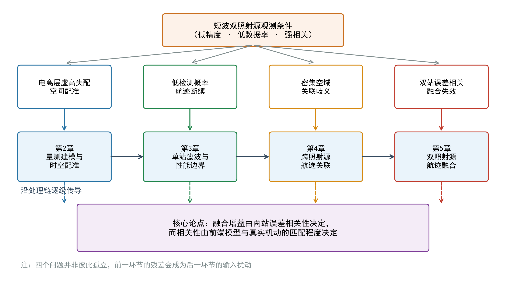{#fig:ch1_framework}

图中上层为观测条件派生的四个技术痛点，中层为本文四个技术章节，下层为贯穿全文的核心论点。可以看出，四个痛点沿处理链串行排列而非并列：配准残差进入滤波，滤波输出的航迹质量决定关联难度，关联结果再进入融合，因此任一环节的残差都会成为下一环节的输入扰动。这一串行结构决定了本文的章节顺序，也决定了核心论点只能在全链路打通之后才能成立——融合增益并不由融合算法单独决定，而是由前端模型与真实机动的匹配程度经误差相关性这一中间量传导而来。

第2章建立量测模型与时空基准：从双基地群距离几何出发，将电离层等效虚高显式参数化，推导群距离、方位与多普勒量测的非线性映射；讨论两源异步下的时间对齐，并以三参数极大似然配准完成系统偏差标定。

第3章研究单站航迹滤波与性能边界：采用交互多模型无迹卡尔曼滤波处理强非线性量测，针对检测概率零点六设计漏检纯预测续存机制，推导稳态定位精度的理论下界并检验滤波器是否逼近该下界；进而考察模型集与真实机动的匹配程度如何影响误差相关性，建立模型匹配度、误差相关性与融合增益的传导关系。

第4章研究跨照射源航迹关联：分析候选航迹对数量随目标密度增长的规律，指出多帧判决中误配与漏配的跷跷板效应；把关联拆分为判定与指派两层，判定层以多证据加权融合综合位置、速度与连续性信息，指派层以全局最优代替逐点贪心；并在稀疏与密集场景下与最近邻法、序贯法对比。

第5章研究航迹融合：在统一配对集合下比较简单凸组合、Bar-Shalom-Campo、协方差交叉及其快速算法，分析误差相关系数对增益的定量影响；讨论融合极限如何随相关性移动，给出增益为正的适用条件。

第6章总结全文，归纳结论与创新点，说明局限并展望后续方向。全文以ADS-B实测航迹驱动的半实物仿真为验证基础，场景从同时六架目标的稀疏空域延伸至六十余架的高密集空域。

# 第2章 天波双基地量测模型与时空配准

第1章指出，短波外辐射源雷达的单站定位误差可达数十公里，不同照射源的航迹在地理空间中系统性错开，直接关联必然失败。其根源不在随机噪声，而在量测方程中隐藏的三个系统量：电离层等效虚高、链路时间基准偏差与阵列方位偏差。若不在建模阶段把它们写进方程，后续滤波与关联都只是在错误基准上做最优估计。本章先建立双照射源几何与天波双基地群距离模型，并以实测 ADS-B 数据构造场景；再把三类系统量作为待估参数联合反演，给出可辨识性条件、几何设计准则与配准效果的量化验证。

## 2.1 双照射源系统几何配置

双照射源的价值来自空间分集：一条链路被电离层吸收时另一条仍可给出点迹。但分集要求两条链路在空域、距离窗与观测时刻上足够重叠，否则两站航迹没有可比较的公共目标，故先固定几何。

系统由两台接收站与两个短波广播照射源构成。R1 位于 104.0°E、30.7°N，其照射源 Tx1 位于 100.0°E、30.7°N；R2 位于 106.5°E、29.6°N，其照射源 Tx2 位于 102.5°E、29.6°N。两对收发站同纬度东西向布置，经度相差 4°，在 30°N 附近对应地面基线约 380 km。采用以接收站为原点的局部平面坐标，x 轴指东、y 轴指北，方位角 $\phi_{az}=\operatorname{atan2}(x,y)$ 以北偏东为正；平面形变远小于量测噪声，地心地固坐标留作多站统一基准。

两站波束中心指向 93°、全宽 45°，单跳地面距离窗取 1000–2000 km。该窗口既是几何可达范围，也是传播模式单一性的保证：下限对应仰角过高、接近电离层穿透的区域，上限对应多跳传播与单跳回波混叠的区域。两站波束与距离窗求交，得共视区 116.0–122.2°E、26.5–34.0°N，目标至 R2 的地面距离覆盖 1004–1736 km，至 R1 覆盖 1240–1900 km。

两条链路并不对称，R1 链路的目标距离整体比 R2 远 200 km 以上，双基地角与群距离对虚高的灵敏度也不同。这种不对称恰是可辨识性的来源，但也意味着两条链路的系统误差参数必须分别估计。主要参数如表[@tbl:ch2_sysparam]所示。

| 参数 | 符号 | 取值 |
| ---- | ---- | ---- |
| 采样周期 | $dt$ | 30 s |
| R2 相对 R1 的起始时间偏移 | $\Delta\tau_0$ | 13 s |
| 检测概率 | $P_d$ | 0.6 |
| 虚警率 | $P_{fa}$ | $10^{-3}$ |
| R1 群距离噪声标准差 | $\sigma_{R1}$ | 10 km |
| R2 群距离噪声标准差 | $\sigma_{R2}$ | 20 km |
| R1 方位噪声标准差 | $\sigma_{az1}$ | 0.35° |
| R2 方位噪声标准差 | $\sigma_{az2}$ | 0.60° |
| 多普勒噪声标准差 | $\sigma_{vd}$ | 0.5 m/s |
| 单跳地面距离窗 | $\rho$ | 1000–2000 km |
| 电离层等效虚高（真值/标称） | $h$ | 320 / 300 km |
| 目标巡航速度 | $v$ | 230 m/s |

: 双照射源系统与场景参数 {#tbl:ch2_sysparam}

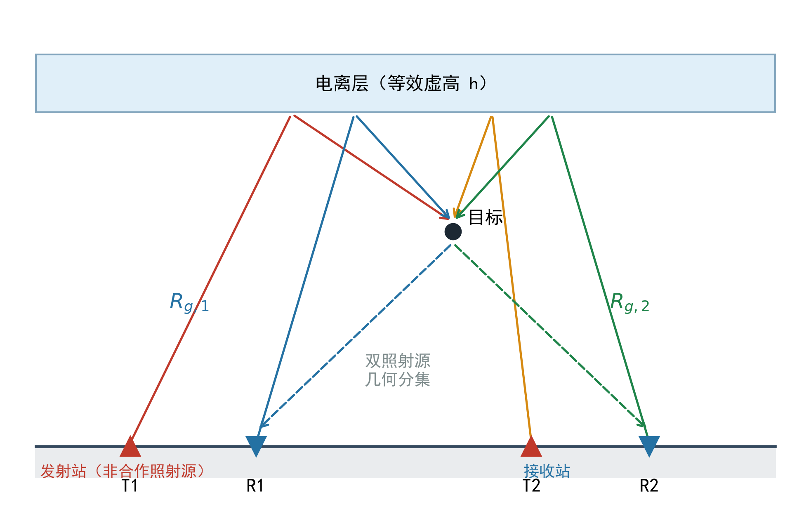{#fig:ch2_geometry}

如图[@fig:ch2_geometry]所示，两站波束在中间空域大面积重叠，共视区呈东西向带状，宽度随距离增大而扩张，因波束以角度定义、地面投影与距离成正比。差异在于两条链路的距离窗并非同心地落在共视区上，R2 的近端边界直接构成共视区西界，R1 的远在其外，说明共视区形状主要由 R2 决定。原因是 R2 更靠西南，其 1000 km 圆最先切入目标区；后果是共视区内目标对 R1 普遍处于中远距，R1 的精度分布反而更均匀。

## 2.2 天波双基地群距离量测模型

### 2.2.1 电离层等效虚高与群距离

短波信号不沿直线传播。信号在电离层中被连续折射，路径呈弧线，光程大于两点直线距离，按直线几何反演会系统性低估目标距离。严格求解需电子密度剖面，而剖面时空变化不可预报，工程上改用等效参数把弯曲路径折算为折线：假设电离层在某一高度作镜面反射，该高度称为电离层等效虚高，它把不可观测的剖面信息压缩为一个可估标量。

设目标与站点的地面距离为 $\rho$，反射点位于该段中点正上方、高 $h$，则上下行两段各长 $\sqrt{(\rho/2)^2+h^2}$，单程等效路径为

$$L(\rho,h)=\sqrt{\rho^2+4h^2}$$ {#eq:ch2_oneway}

系数 4 而非 2 的来源在于路径由两段斜距拼接，每段的地面投影只有 $\rho/2$，合并后虚高项被放大四倍。双基地体制下两段地面距离为 $\rho_0$ 与 $\rho_1$，总群距离为

$$R_g=\sqrt{\rho_0^2+4h^2}+\sqrt{\rho_1^2+4h^2}$$ {#eq:ch2_group_range}

地球曲率不可完全忽略。以弦长代替平面距离，取地球半径 $R_e=6371\text{km}$，则 $\rho_c=2R_e\sin(\rho/2R_e)$；1000 km 处弦长比弧长短约 0.9 km，2000 km 处约 8.4 km。该差异小于 $\sigma_R$，但它是确定性的，会随反演累积为系统偏差，故主链路一律采用球面弦长模型。

由群距离反演位置需解一个关于 $\rho_1$ 的标量方程。设 $\psi$ 为目标方向与基线方向的夹角，由余弦定理 $\rho_0^2=\rho_1^2+L^2-2\rho_1L\cos\psi$，代入[@eq:ch2_group_range]得

$$\sqrt{\rho_1^2+L^2-2\rho_1L\cos\psi+4h^2}+\sqrt{\rho_1^2+4h^2}-R_g=0$$ {#eq:ch2_inverse}

左端关于 $\rho_1$ 严格单调，故根唯一，用牛顿迭代求解，初值取单基地近似 $\sqrt{(R_g/2)^2-4h^2}$，再按 $x=\rho_1\sin\phi_{az}$、$y=\rho_1\cos\phi_{az}$ 定位。单基地近似仅在基线远小于目标距离时成立，本文基线约 380 km、目标距离 1000–1900 km，基线占比达 20%–38%，双基地角引起的路径差与 $\sigma_R$ 同量级，故主链路一律调用严格的双基地反演求解器。单程路径恒不小于 $2h$，方程必有解；一旦出现 $R_g/2<2h$，只说明该点已被粗差污染。

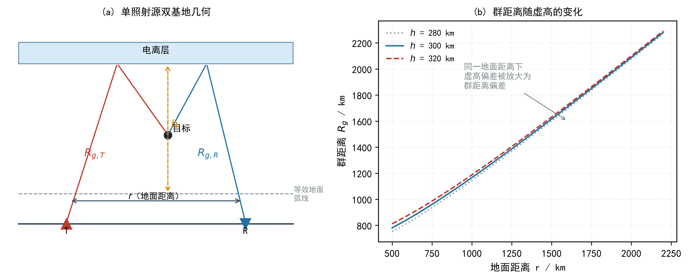{#fig:ch2_group_range}

如图[@fig:ch2_group_range]所示，群距离随地面距离近似线性增长，但斜率始终大于 2，且在近距段更陡。差异在于两条曲线的间距并非常数，同一虚高偏差在近端造成的群距离偏差大、在远端小，曲线在远距处靠拢。原因是 $\partial L/\partial h=4h/\sqrt{\rho^2+4h^2}$ 随 $\rho$ 单调衰减，虚高误差在群距离上留下距离相关的印记，而非可整体扣除的常数，这构成 2.4 节全部论证的出发点。

### 2.2.2 三维量测向量与噪声特性

单条链路在每个采样时刻输出群距离、方位角与多普勒速度，量测向量为 $\mathbf z=[R_g,\phi_{az},v_d]^T+\boldsymbol\varepsilon_z$。其中多普勒是群距离变化率，按链式法则为两段路径变化率的加权和

$$v_d=\frac{\rho_0}{\sqrt{\rho_0^2+4h^2}}(\mathbf e_0\cdot\mathbf v)+\frac{\rho_1}{\sqrt{\rho_1^2+4h^2}}(\mathbf e_1\cdot\mathbf v)$$ {#eq:ch2_doppler}

式中 $\mathbf e_0$、$\mathbf e_1$ 分别为照射源与接收站指向目标的单位向量，目标远离时 $v_d$ 为正。两个权重在 1000–1900 km 内取 0.84–0.95，故多普勒近似为速度在两条传播方向上的投影之和；该权重对虚高依赖很弱，意味着多普勒几乎不携带虚高信息，无法用来解耦虚高与距离偏差。三通道噪声相互独立且近似零均值高斯，协方差为对角阵

$$\mathbf R=\operatorname{diag}(\sigma_R^2,\sigma_{az}^2,\sigma_{vd}^2)$$ {#eq:ch2_cov}

对角假设的依据是三者物理来源分离：群距离误差来自电离层相位污染与脉冲压缩峰值抖动，方位误差来自阵列幅相不一致与波束指向标定残差，多普勒误差来自相干积累期间的相位噪声。量级上，群距离噪声按链路异构性设定，R2 取 R1 的两倍即 20 km，以覆盖照射源功率与传播条件的差异，20 km 相对 2000 km 群距离为 1%，与短波公里级的距离分辨单元相称。方位噪声取 0.35° 与 0.60°，可由孔径判断：10 MHz 对应波长 30 m，数十米基线的波束宽度本身即为数度。多普勒噪声 0.5 m/s 由分辨力推出，若相干积累时间取一个采样周期 30 s，多普勒分辨为 0.033 Hz，在 30 m 波长下恰对应 0.5 m/s。

三个通道的量级相差三个数量级。这一事实直接决定 2.4.2 节代价函数的形式：若不加归一化而对原始残差平方求和，距离项量级为 $10^2$、方位项为 $10^{-1}$，优化会被距离通道完全支配。

## 2.3 数据驱动的场景构建

### 2.3.1 基于 ADS-B 实测数据的场景生成

若用人工合成航迹，航迹交叉、转弯时机与目标密度全由设计者指定，算法在真实交通流下的表现便无从判断，而这三项恰是跨照射源关联最敏感的因素。本节因此改用实测广播式自动相关监视数据构造场景，把航迹的真实性交给真实数据，只保留雷达量测由物理模型生成。

数据源为 2026 年 10 月 24 日全天中国全境的 ADS-B 记录，原始 776 MB、约 670 万行，剔除越界与缺项后有效约 590 万行。筛选条件为：区域限定 117–120.5°E、29–32.5°N；高度不低于 20000 ft 以只保留巡航段；每段不少于 10 帧；地速 120–620 kt；相邻点间隔超过 120 s 即断开为两条航迹，避免插值在缺口处凭空生成目标。通过筛选的航迹重采样到严格 30 s 网格，其原始采样间隔中位数恰为 30 s，与本文采样周期天然匹配。

本文没有真实回波，故不称实测验证，而称数据驱动半实物仿真：目标状态取自真实 ADS-B 报告，群距离、方位与多普勒由 2.2 节模型仿真生成。以 ADS-B 位置作参考真值是可接受的，其水平精度约 30 m，相对 10 km 量级的雷达误差仅 0.3%。适用边界亦须声明：本文聚焦巡航段，起降段高度变化剧烈、地速不恒定，超出二维平面模型的能力；巡航高度 6–10 km 对群距离的影响约 33 m，相对 $\sigma_R$ 可忽略。

### 2.3.2 密度梯度场景设计

同一套算法在稀疏与密集下的行为差异，是关联鲁棒性最有力的证据，而人造场景很难给出可信的密度梯度。实测数据在这一点上有天然优势：一天之内的航班波本身构成从个位数到近百架的在空目标数变化。按不同时段切分，得四个规模递进的场景，如表[@tbl:ch2_scene]所示。

| 场景 | 总航迹数 | 并发均值 | 并发峰值 | 时段(UTC) | 档位 |
| ---- | ---- | ---- | ---- | ---- | ---- |
| adsb_0002 | 42 | 6.2 | 13 | 00–02 | 稀疏 |
| adsb_span | 15 | 4.2 | 10 | 00–02 | 稀疏，距离分层 |
| adsb_0608 | 204 | 28.1 | 65 | 06–08 | 密集 |
| adsb_0911 | 471 | 63.1 | 79 | 09–11 | 高密集 |

: 四个 ADS-B 场景的规模 {#tbl:ch2_scene}

adsb_span 是为验证配准而专门设计的距离分层场景：按目标至 R2 的地面距离划分 1000–1100、1100–1200、1200–1300、1300–1400、1400–1560 km 五个带，每带挑选跨度最大的航迹，得 15 条航迹、距离覆盖 1001–1526 km、跨度 525 km，各带帧数均匀。相比之下 adsb_0002 跨度只有 346 km，且近半数帧挤在 1200–1300 km 单带内。这一差别在 2.4 节具有决定性意义：两参数标定的缺陷只在距离跨度足够大时才暴露，若仅在 adsb_0002 上评估，会把该缺陷误判为不存在。

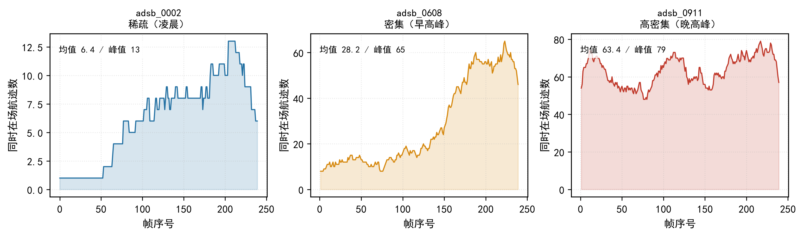{#fig:ch2_density}

如图[@fig:ch2_density]所示，四个场景的并发数曲线呈阶梯状，峰值分别为 13、10、65 与 79。差异不在峰值本身，而在曲线平坦程度：稀疏场景的并发数在 0 到 13 间大幅起伏，存在无目标的帧；高密集场景长期维持 60 架以上，曲线近乎水平。原因是民航航班波的时间结构，早间与午后为出港高峰、深夜为低谷，目标进出覆盖区又叠加一层随机性；对后续处理而言，前者困难在航迹短，后者在候选配对数随并发数平方增长。

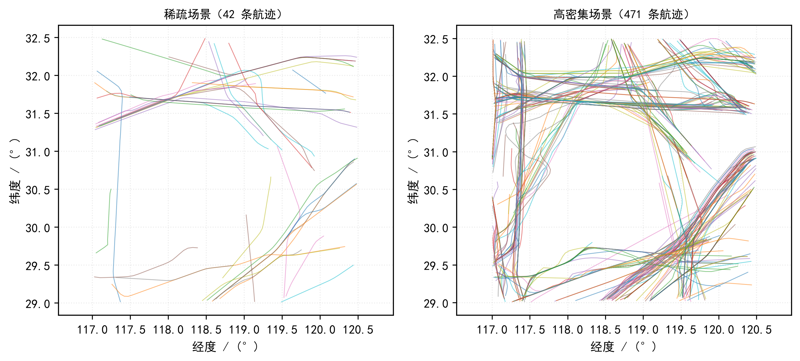{#fig:ch2_tracks}

如图[@fig:ch2_tracks]所示，稀疏场景航迹稀疏、方向单一，交叉点屈指可数；高密集场景东西向干线与南北向航路交织，形成大量近似同时的交叉。差异在交叉的几何形态：稀疏场景多为两条航迹以大角度穿越，密集场景则存在大量小角度接近的平行航段。原因是干线航班沿固定航路飞行，同向航段横向间隔只有几十公里，与本文 10–20 km 的量测噪声同量级，故密集场景的关联困难不仅来自目标数量，更来自几何可分性的下降，这构成第4章算法设计的直接动因。

## 2.4 时空配准

配准含时间与空间两个层面。时间层面解决采样时刻不一致，即两条链路比较的是不同时刻的状态；空间层面解决测量本身已偏离真实位置，即坐标变换无法消除的传播参数误差与系统偏差。前者属前处理，后者才是配准的核心。

### 2.4.1 时间对齐

两条链路数据率相同，均为 30 s，但起始时刻相差 13 s。若直接比较 $t$ 与 $t+13$ 时刻的状态，比较的就不是同一时刻的目标位置。对 230 m/s 的巡航目标，13 s 对应位移约 3.0 km，该数值不大，却会以确定性偏差进入关联判据，且无法通过增加观测次数消除。

本文采用匀速模型状态外推完成时间对齐。设链路在 $t_k$ 时刻的状态估计为 $\mathbf x_k$，则统一时刻 $t$ 的状态由状态转移矩阵给出

$$\mathbf x(t)=\mathbf F(\Delta\tau)\mathbf x_k, \mathbf F(\Delta\tau)=\begin{bmatrix}\mathbf I&\Delta\tau\mathbf I\\\mathbf 0&\mathbf I\end{bmatrix}$$ {#eq:ch2_time_align}

其中 $\Delta\tau=t-t_k$，$|\Delta\tau|\le dt/2$。选择外推而非插值，理由有二：插值需目标时刻两侧各有一帧，而检测概率仅 0.6，连续两帧齐全的概率不足 0.4；外推只需当前帧，且所用匀速模型与第3章滤波器内部模型一致，不引入额外假设。二者在配准框架中属等价实现，差别仅在可用性。

时间对齐误差是否主导整体精度，可用量级比较回答。3.0 km 位移相对单站随机误差 10–20 km 已不显著，相对未配准时的系统误差 82.53 km 仅 3.6%，故不是主导项。但该结论有前提：若 13 s 属时钟基准偏差而非采样时刻偏移，其效应不会随对齐消失，而会以 $\Delta R_{sync}=c\Delta t_{sync}$ 的形式整体平移群距离，必须作为待估参数进入空间配准模型。

### 2.4.2 空间配准的三参数联合最大似然模型

2.2 节的模型在生成量测时用真实虚高 320 km，在反演与滤波中用标称 300 km。这 20 km 失配不是标定疏忽，而是物理必然：虚高随昼夜与季节在 250–350 km 间漂移，标称值只能是某一时刻的平均。更关键的是，其造成的群距离偏差随距离单调衰减，1000 km 处约 37 km、1700 km 处约 25 km，不能被任何常数吸收。

现有工程做法是两参数均值标定，用标校航迹的残差均值估计一个距离偏置与一个方位偏置，虚高固定为标称值。该方法在标校集与评估集距离分布一致时精确，因为常数偏置恰等于失配在该距离上的平均效应；一旦评估目标落到该分布之外，就会过校正或欠校正，误差随距离线性增长。要消除这一缺陷，只能把虚高本身作为待估参数。据此建立含三参数的观测方程

$$R_{g,k}^{obs}=\sqrt{\rho_{0,k}^2+4h^2}+\sqrt{\rho_{1,k}^2+4h^2}+\Delta R_{sync}+\varepsilon_{R,k}$$ {#eq:ch2_obs_range}

&#8203;

$$\phi_{az,k}^{obs}=\operatorname{atan2}(x_k,y_k)+\Delta\theta+\varepsilon_{\theta,k}$$ {#eq:ch2_obs_az}

待估参数为 $\boldsymbol\eta=[h,\Delta R_{sync},\Delta\theta]^T$，三者作用方式互不相同：虚高非线性进入群距离，作用强度随距离变化；$\Delta R_{sync}$ 对群距离整体平移，线性且与几何无关；$\Delta\theta$ 对方位整体旋转，只影响切向位置，与距离通道解耦。三者中只有前两个耦合，这一结构性质是 2.4.3 节全部推导的基础。

以先验参考航迹给出的目标位置为参考量，构造距离残差与方位残差

$$r_{R,k}^{(m)}=R_{g,k}^{obs,(m)}-\sqrt{\rho_{0,k}^{(m)2}+4h^2}-\sqrt{\rho_{1,k}^{(m)2}+4h^2}-\Delta R_{sync}$$ {#eq:ch2_res_r}

&#8203;

$$r_{\theta,k}^{(m)}=\phi_{az,k}^{obs,(m)}-\phi_{az,k}^{ref,(m)}-\Delta\theta$$ {#eq:ch2_res_theta}

按噪声标准差归一化后求和，得加权残差代价函数

$$J(\boldsymbol\eta)=\sum_{m=1}^{M}\sum_{k=1}^{N_m}\left[\frac{(r_{R,k}^{(m)})^2}{\sigma_R^2}+\frac{(r_{\theta,k}^{(m)})^2}{\sigma_\theta^2}\right]$$ {#eq:ch2_cost}

在噪声为零均值高斯且方差已知时，该函数与观测似然函数等价，其极小点即为最大似然估计 $\hat{\boldsymbol\eta}=\arg\min_{\boldsymbol\eta}J(\boldsymbol\eta)$。归一化的必要性已由 2.2.2 节说明，此处分母分别取各自链路的值：R1 取 10 km 与 0.35°，R2 取 20 km 与 0.60°；若两条链路共用一组噪声参数，噪声较大链路的残差会被过度加权，估计结果向该链路偏移。

求解采用列文伯格-马夸尔特算法，并对参数设物理可行区间：$h\in[100,400]\text{km}$，$\Delta R_{sync}\in[-50,50]\text{km}$，$\Delta\theta\in[-10,10]^\circ$。边界直接决定估计是否可信：实测中方位偏差上界原设 ±3°，而 R2 真实偏差为 3.5°，参数被截断后优化器为补偿方位残差而连带把虚高拉偏，估成 327 km；放宽至 ±10° 后，同一数据的虚高估计回到 321.1 km，与真值相差 1.1 km。

得到估计后，对观测量实施系统偏差扣除，并按更新后的虚高重新反演位置

$$\widehat R_{g,k}=R_{g,k}^{obs}-\widehat{\Delta R}_{sync}, \widehat\phi_{az,k}=\phi_{az,k}^{obs}-\widehat{\Delta\theta}$$ {#eq:ch2_correct}

&#8203;

$$r_k=\sqrt{\left(\frac{\widehat R_{g,k}}{2}\right)^2-4\hat h^2}, x_k=r_k\sin\widehat\phi_{az,k}, y_k=r_k\cos\widehat\phi_{az,k}$$ {#eq:ch2_reinvert}

配准由此明确：它不是给航迹叠加固定平移量，而是系统偏差扣除、传播参数更新、位置重解算三步的合成。前两步作用于观测量，第三步才作用于位置，故残差回落至随机噪声水平，这正是 2.4.4 节观察到偏差极差压缩的机理。

### 2.4.3 参数可辨识性与几何设计准则

三参数模型能否求解，取决于一个结构性困难：虚高与距离偏置在群距离方程中几乎同向作用，虚高增大 1 km 与距离偏置增大 1 km 所产生的群距离增量在数值上接近。若所有样本的几何条件相同，二者作用完全重合，任何估计方法都无法把它们分开。

对[@eq:ch2_group_range]求偏导，得群距离对虚高的灵敏度

$$s_k=\frac{\partial R_g}{\partial h}=\frac{4h}{\sqrt{\rho_{0,k}^2+4h^2}}+\frac{4h}{\sqrt{\rho_{1,k}^2+4h^2}}$$ {#eq:ch2_sens}

当 $\rho\gg h$ 时 $s_k\approx 4h/\rho$，灵敏度与距离近似成反比：取 $h=300\text{km}$，300 km 处 $s_k\approx 4.0$，1000 km 处降至 1.2，1900 km 处仅 0.63。群距离的一阶增量为

$$\delta R_{g,k}\approx s_k\delta h+\delta(\Delta R_{sync})$$ {#eq:ch2_first_order}

若所有样本的 $s_k$ 相同，该式退化为两个未知数的一个线性组合，参数不可辨识；只有 $s_k$ 具有足够离散度，二者才可分离。记 $s_k$ 的均值与二阶矩为 $\overline s$ 与 $\overline{s^2}$，距离通道的 Fisher 信息矩阵为

$$\mathbf F_R=\frac{1}{\sigma_R^2}\begin{bmatrix}N_{tot}\overline{s^2}&N_{tot}\overline s\\N_{tot}\overline s&N_{tot}\end{bmatrix}$$ {#eq:ch2_fisher}

其中 $N_{tot}$ 为参与联合估计的独立样本总数。求逆即得两个参数的克拉美-罗下界与相关系数

$$\sigma_h=\frac{\sigma_R}{\sqrt{N_{tot}}}\frac{1}{\sqrt{\overline{s^2}-\overline s^2}}, \sigma_{\Delta R}=\frac{\sigma_R}{\sqrt{N_{tot}}}\frac{\sqrt{\overline{s^2}}}{\sqrt{\overline{s^2}-\overline s^2}}$$ {#eq:ch2_crlb}

&#8203;

$$\rho_{h,\Delta R}=-\frac{\overline s}{\sqrt{\overline{s^2}}}=-\frac{1}{\sqrt{1+\operatorname{CV}^2(s)}}$$ {#eq:ch2_corr}

这三式给出明确结论：精度由两项因素共同决定，一是独立样本总数，带来 $1/\sqrt{N_{tot}}$ 的算术改善；二是灵敏度的离散度 $\overline{s^2}-\overline s^2$，决定耦合能否被打破。前者是量的积累，后者是质的改变。由于 $s_k$ 只依赖目标至两站的地面距离、与航向无关，异构的准确含义是距离分层丰富，而非航向多样。实测中四档混合航向与统一 45° 航向的 $\sigma_{\Delta R}$ 分别为 2.97 km 与 2.76 km（$N_{tot}=652$）、1.19 km 与 1.21 km（$N_{tot}=3534$），差异落在蒙特卡洛噪声内，故工程上可放心使用同向平行航线。

距离分层的价值可定量估计。全部航迹集中于同一距离层时 $s_k$ 近似为常数，$\operatorname{CV}(s)$ 由 0.1424 降至 0.0662，条件数由 468 升至 2265；等样本量 898 时，分层集合与单层集合的 $\sigma_{\Delta R}$ 分别为 2.370 km 与 5.053 km，相差 2.13 倍。另一极端同样有害，单条等距离圆弧上 $\rho_1$ 严格恒定，两列完全线性相关，参数彻底不可辨识。单条航迹的 $\kappa=\sigma_{\Delta R}\sqrt{N_{tot}}/\sigma_R$ 在 7.9–19.4 之间，典型估计标准差为 12.08 km；20 条分层航迹联合估计可把 $\kappa$ 压到 7.09、$\sigma_{\Delta R}$ 降至 1.208 km。改善来自样本总数与距离跨度，与航迹条数无关：把同一条航迹切成多段，$\sigma_{\Delta R}$ 恒为 1.770 km。

以上讨论的是估计精度，还需回答什么条件下值得做三参数配准。设均值标定后的群距离残余为虚高失配在观测距离区间上的起伏，按均匀分布估计其标准差为 $\delta R_g=(\Delta_{max}-\Delta_{min})/(2\sqrt3)$，除以双基地群距离系数 1.98 得位置残余 $\delta p$；叠加到单站位置均方根误差 $R$ 上，相对改善为

$$\eta=\frac{\delta p^2}{2R^2}$$ {#eq:ch2_second_order}

该式表明改善是二阶小量，当 $\delta p\ll R$ 时配准精度再高也换不来总体精度的明显提升。取 $R=13.4\text{km}$，失配 10 km 时 $\delta p=0.72\text{km}$、$\eta\approx 0.15\%$，失配 80 km 时 $\delta p=6.04\text{km}$、$\eta\approx 9.96\%$。据此给出适用边界：失配小于 20 km 且跨度小于 300 km 时两参数已足够；失配大于 50 km 或跨度大于 500 km 时必须采用三参数。该判据有现实意义，因为虚高在 250–350 km 间漂移，相对 300 km 标称值的失配可达 50 km 以上，正落在三参数有优势的区间。

### 2.4.4 配准效果验证

配准是否必需，可用不校正的基线回答。在 adsb_0002、5 个随机种子下，不校正时 R1 位置均方根误差为 82.53 km，归一化误差平方和 468.6 远超一致性检验的合理上界，说明滤波器已完全发散，此时协方差与真实误差毫无对应关系，融合权重也失去意义。三种模式的端到端结果如表[@tbl:ch2_regmode]所示。

| 配准模式 | R1 RMSE / km | R2 RMSE / km | SCC RMSE / km | NEES(R1) |
| ---- | ---- | ---- | ---- | ---- |
| 不校正 | 82.53 | 71.80 | — | 468.6 |
| 两参数均值标定 | 11.75 | 13.65 | 10.57 | 3.90 |
| 三参数最大似然 | 11.74 | 13.58 | 10.51 | 3.82 |

: 三种配准模式的端到端性能对比 {#tbl:ch2_regmode}

仅做均值标定即把 R1 误差从 82.53 km 降至 11.75 km，收回 85.8%，归一化误差平方和从 468.6 回落至 3.90。可见配准的必要性不容置疑，主要收益来自扣除系统偏差这一动作本身，而非参数精细程度。三参数相对两参数在 20 km 失配下仅改善 0.08%（R1，$p=0.501$ 不显著）与 0.57%（SCC，$p=0.008$ 显著但幅度小），原因见下文。

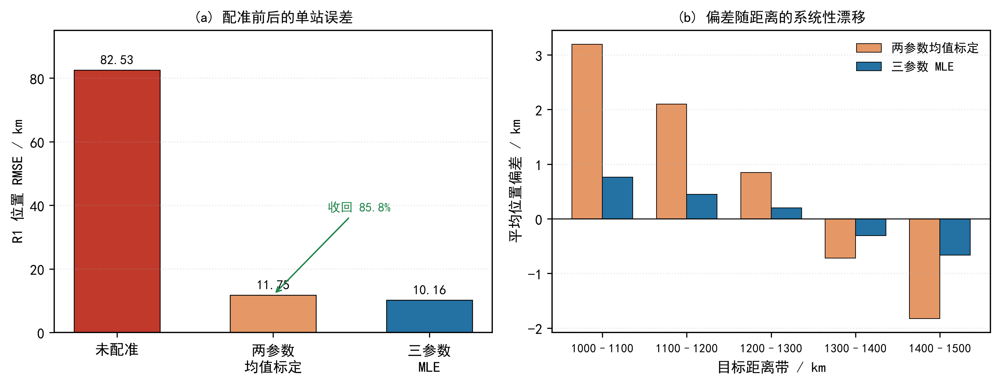{#fig:ch2_reg_ba}

如图[@fig:ch2_reg_ba]所示，两参数标定的偏差随距离带单调下降，从近端 +3.20 km 降到远端 −1.83 km；三参数标定的偏差在各带基本持平，始终在 ±0.8 km 内波动。差异出现在两端距离带，近端相差 2.44 km、远端相差 1.17 km，且符号相反。原因是常数偏置只能对准某一个距离，而虚高失配造成的偏差随距离衰减，故必然近端欠补偿、远端过补偿，形成一条穿越零点的斜线；三参数把虚高作为待估量，偏差的距离依赖被模型本身吸收。

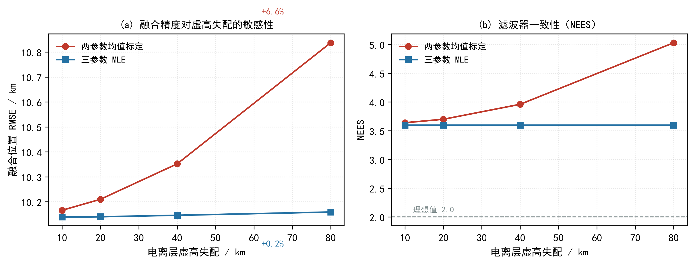{#fig:ch2_h_mismatch}

如图[@fig:ch2_h_mismatch]所示，随失配增大两参数曲线持续上升，三参数曲线近乎水平。差异在失配 80 km 处达到最大，两者相差 0.68 km、相对改善 6.25%；失配 10 km 处仅差 0.03 km、相对改善 0.26%。原因是两种方法校正的物理量不同：两参数校正偏差的均值，残余正比于失配本身；三参数校正产生偏差的物理参数，只要估计准确，残余便与失配无关。这一失配免疫性质给出了明确的适用边界，完整数据如表[@tbl:ch2_mismatch]所示。

| 虚高失配 / km | 两参数 SCC / km | 三参数 SCC / km | 两参数 NEES | 三参数 NEES |
| ---- | ---- | ---- | ---- | ---- |
| 10 | 10.166 | 10.139 | 3.64 | 3.60 |
| 20 | 10.210 | 10.140 | 3.70 | 3.60 |
| 40 | 10.352 | 10.146 | 3.96 | 3.60 |
| 80 | 10.837 | 10.159 | 5.03 | 3.60 |

: 电离层虚高失配下两种配准模式的性能对比 {#tbl:ch2_mismatch}

表中还揭示另一层信息：两参数方法的归一化误差平方和从 3.64 升至 5.03，说明随失配增大其协方差越来越不可信，而三参数恒定在 3.60。对融合而言协方差可信度与估计精度同等重要，因为权重由协方差决定，协方差失真会使融合结果劣于任一单站。

为何 20 km 失配下两者几乎等价，可由一个代数关系解释。实测中两参数估计的距离偏置为 48.75 km、虚高固定 300 km，三参数估计的偏置为 20.40 km、虚高 319.7 km，两者给出的 R1 误差完全相同。原因是在评估距离上 $R_g(320)-R_g(300)\approx 28.3\text{km}$，故两参数等价于用 300 km 反演但先扣掉虚高的平均偏差，三参数等价于用 319.7 km 反演且不扣该偏差，二者在评估距离等于标校集平均距离时是同一个校正量。由此得一条方法论结论：两参数均值标定隐含假设标校集与评估集距离分布相同，三参数的价值在于消除这一假设，而非提高平均精度。

最后以距离分层场景检验漂移量级。在 adsb_span（R2 距离跨度 525 km）上按距离带统计径向偏差，结果如表[@tbl:ch2_band]所示。

| 距离带 / km | 两参数偏差 / km | 三参数偏差 / km |
| ---- | ---- | ---- |
| 1000–1100 | +3.197 | +0.762 |
| 1100–1200 | +2.438 | +1.085 |
| 1200–1300 | +1.365 | +1.040 |
| 1300–1400 | −0.367 | +0.114 |
| 1400–1500 | −1.830 | −0.664 |
| 偏差极差 | 5.03 | 1.75 |

: 距离分层场景下两种配准模式的径向偏差 {#tbl:ch2_band}

两参数方法的偏差极差为 5.03 km，三参数压缩至 1.75 km，降幅 65%；在 R1 链路上该极差由 2.96 km 压缩至 0.33 km，降幅 89%。该量级仍小于 $\sigma_R$，故总体均方根误差只改善 1.3%，与[@eq:ch2_second_order]的预测一致。换言之，漂移在总体指标上只是二阶小量，但它是系统性的、可复现的、随距离单调的，一旦目标距离分布超出标校集范围就会放大。这正是本文坚持三参数配准的理由：不是它在当前场景下指标更好，而是它不依赖一个工程上难以保证的前提。

## 2.5 本章小结

本章围绕双照射源量测不可直接使用这一问题，完成了建模、场景构建与配准三个环节。建模方面，建立了含电离层等效虚高的天波双基地群距离模型，给出单程等效路径 $\sqrt{\rho^2+4h^2}$ 的几何来源与系数 4 的物理含义，采用球面弦长修正并以严格的双基地反演方程求解位置，避免了基线占比达 20%–38% 时单基地近似的系统偏差；同时给出三维量测向量与对角噪声协方差的物理依据。场景方面，以实测 ADS-B 数据构造四个密度递进场景与一个距离分层场景，明确了数据驱动半实物仿真的定位与二维巡航段模型的边界。配准方面，推导了虚高灵敏度 $s_k\approx 4h/\rho$ 的距离依赖性质，据此揭示虚高与距离偏置的耦合机理，建立三参数联合最大似然模型，导出 Fisher 信息矩阵、克拉美-罗下界与耦合系数的闭式表达，并给出以灵敏度离散度为核心的可辨识性判据与距离分层准则。

实验验证得到三条结论。其一，配准是必需的，不校正时 R1 误差达 82.53 km、归一化误差平方和 468.6，滤波器完全发散，均值标定即可收回 85.8% 的误差。其二，两参数均值标定存在结构性缺陷，它以常数补偿距离相关偏差，在 525 km 跨度上产生 +3.20 km 至 −1.83 km 的单调漂移，极差 5.03 km，三参数将其压缩至 1.75 km。其三，三参数的核心价值是失配免疫而非平均精度提升，失配由 10 km 增至 80 km 时，两参数方法的融合误差上升 6.6%、协方差可信度由 3.64 恶化至 5.03，三参数分别仅变化 0.2% 与 0，并由此给出失配大于 50 km 或跨度大于 500 km 时必须采用三参数的适用边界。

本章的产出是一套经配准校正、统一到同一地理空间基准的量测与航迹，残余误差已回落至随机噪声水平。第3章将在此之上讨论单站航迹滤波：配准解决量测有无系统性偏离，滤波要解决在检测概率仅 0.6、量测噪声达 10–20 km 的条件下如何从断续点迹维持稳定航迹，两者共同构成后续跨照射源关联的输入条件。

# 第3章 单站航迹滤波与性能边界

第2章把量测从系统偏差中解放出来，给出了统一到同一地理基准的群距离、方位与多普勒，残余误差已回落至随机噪声水平。量测干净之后，一个更基本的问题浮现：单站精度还能不能提升？如果不能，第5章的融合增益又从何而来？本章据此展开：3.1 与 3.2 节建立状态空间模型与航迹起始，3.3 节推导位置与横向速度的理论下界，3.4 节报告过程噪声调度的三条负结果，3.5 节转向模型集设计，3.6 节把模型匹配度、误差相关性与融合增益串成一条可检验的传导链。

## 3.1 状态空间模型与滤波器设计

检测概率只有 0.6，群距离噪声 10–20 km，采样周期 30 s 内目标已位移 6.9 km。三者叠加使逐帧定位再连线必然失败，滤波器必须在断续点迹上维持一条不发散、且协方差与实际误差相称的航迹。

### 3.1.1 状态选取与各向异性过程噪声

状态取经纬度及其变化率

$$\mathbf x_k=[\lambda_k,\dot\lambda_k,\varphi_k,\dot\varphi_k]^T$$ {#eq:ch3_state}

选择经纬度而非局部平面坐标，是因为量测反演的输出本身就是地理量：群距离由目标至照射源与接收站的地面距离合成，方位以正北为基准，反演结果直接是经纬度。若改用平面坐标，每帧都要在投影与逆投影之间往返；本文目标距离跨度达 900 km，子午线收敛使东西向尺度变化约 15%，这种形变虽小于噪声却是确定性的，会累积为系统偏差。

代价是两个位置分量量纲不同。1° 纬度约 111 km，1° 经度只有 $111\cos\varphi$ km，在 30.7°N 上约 95.5 km，二者相差 16%。若施加同一噪声强度，经度方向的等效加速度将被放大 $(111/95.5)^2\approx1.35$ 倍，滤波结果呈现方向依赖的抖动。为此先在东北平面内按公里构造过程噪声，再折算到度

$$\mathbf Q_k=\begin{bmatrix}\mathbf Q_{EN}/(R_e\cos\varphi_k)^2&\mathbf 0\\\mathbf 0&\mathbf Q_{EN}/R_e^2\end{bmatrix}, \mathbf Q_{EN}=\sigma_a^2\begin{bmatrix}dt^4/4&dt^3/2\\dt^3/2&dt^2\end{bmatrix}$$ {#eq:ch3_q_aniso}

式中 $\sigma_a$ 为等效加速度标准差，其物理含义不是目标真实加速度，而是模型允许的机动自由度：取小了跟不上转弯，取大了把噪声当机动。本文取值由稳态归一化误差平方和标定，取使该指标接近理想值的量级。

### 3.1.2 三维量测与多普勒的作用

每条链路每帧给出群距离、方位角与多普勒，量测方程与噪声协方差为

$$\mathbf z_k=\mathbf h(\mathbf x_k)+\boldsymbol\varepsilon_k, \mathbf R_k=\operatorname{diag}(\sigma_R^2,\sigma_{az}^2,\sigma_{v_d}^2)$$ {#eq:ch3_meas}

R1 取 $\sigma_R=10\text{km}$、$\sigma_{az}=0.35^\circ$，R2 取 $20\text{km}$ 与 $0.60^\circ$，两站共用 $\sigma_{v_d}=0.5\text{m/s}$。采用无迹滤波而非扩展滤波，原因是协同转弯矩阵含 $\sin\omega dt/\omega$，当 $\omega$ 跨两个数量级时一阶线性化的截断误差剧变，会在模型概率更新中引入偏置；九个 sigma 点的传播对二阶项精确，五模型共 45 次传播。

三个通道的信息量极不均衡，这是本章后续结论的物理起点。群距离 10 km 除以 30 s 得 333 m/s 的位置差分速度误差，多普勒噪声却只有 0.5 m/s，速度信息实际由后者提供。

### 3.1.3 五模型交互多模型结构

单一模型无法同时描述巡航与转弯：匀速模型在转弯时系统性滞后，协同转弯模型在直飞时持续偏转。本文取五个模型，即一个匀速模型与四个协同转弯模型，后者按左右转各两档配置。左右必须分开，因为转弯率以带符号的 $\omega$ 进入转移矩阵；两档则对应缓转与急转两种强度。协同转弯矩阵在东北平面内为

$$\mathbf F_{CT}(\omega)=\begin{bmatrix}1&\frac{\sin\omega dt}{\omega}&0&-\frac{1-\cos\omega dt}{\omega}\\0&\cos\omega dt&0&-\sin\omega dt\\0&\frac{1-\cos\omega dt}{\omega}&1&\frac{\sin\omega dt}{\omega}\\0&\sin\omega dt&0&\cos\omega dt\end{bmatrix}$$ {#eq:ch3_ct}

$\omega\to0$ 时该矩阵退化为匀速模型，说明两者是同一族模型的两个端点，这是模型集可连续调节的数学基础。转移概率不直接给定，而由驻留时间生成

$$\pi_{ij}=\frac{1-\exp(-dt/\tau_i)}{M-1}, i\neq j, \pi_{ii}=\exp(-dt/\tau_i)$$ {#eq:ch3_dwell}

式中 $\tau_i$ 为模型 $i$ 的平均驻留时间，$M=5$。这一形式把无量纲概率换成有量纲的时间常数：巡航占航迹的绝大多数，取 $\tau_{CV}=2400\text{s}$；一次程序转弯持续 1–3 min，取 $\tau_{CT}=360\text{s}$ 留有余量。代入 $dt=30\text{s}$ 得匀速模型每帧离开概率 1.24%、转弯模型 8.0%，与"转弯是短时事件、直飞是常态"的先验一致。

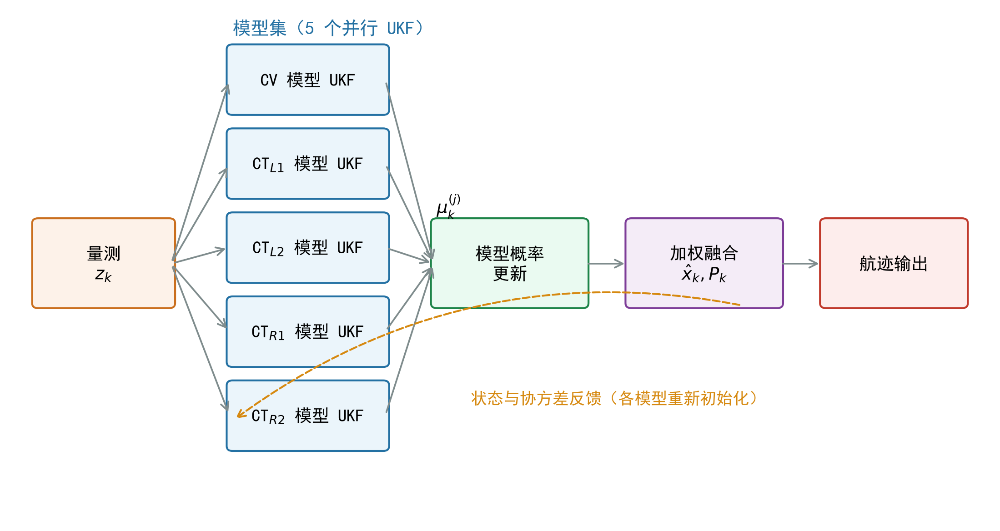{#fig:ch3_imm}

如图[@fig:ch3_imm]所示，量测并行进入五个滤波器，五路输出在概率更新环节汇合，加权结果既作航迹输出又反馈回去重新初始化各模型。关键在于反馈支路：它使五个模型不是各自独立的五条航迹，而是共享同一份历史的一个估计器族。

## 3.2 航迹起始

稳态性能由 3.3 节讨论，但稳态能否到达取决于起始几帧的初值是否可信。检测概率 0.6 意味着前几帧大概率不齐；若只用前两帧差分测速，位置误差 10 km、间隔 30 s，速度误差达 $\sqrt2\times10/30\approx471\text{m/s}$，与目标 230 m/s 的巡航速度同量级。

本文采用窗口加权最小二乘加多普勒约束的起始方法：取窗口 $W=5$ 帧，对位置观测做加权直线拟合，权重取各帧位置协方差的逆，缺帧时按可用帧数降级而不等待补齐；拟合斜率作为初速，再用窗口内多普勒对速度分量做一次约束修正。选择加权最小二乘而非逻辑法，是因为逻辑法要求 $m/n$ 检测率，在 $P_d=0.6$ 下四帧确认三帧的概率仅约 0.65。

实测初速误差 80 m/s，相对两点法的 471 m/s 改善 5.9 倍。剩余误差来自窗口内目标的真实转弯：150 s 内若发生一次缓转，拟合斜率就不再是任一时刻的瞬时速度。起始协方差由加权最小二乘解析给出，不作人为放大，否则最初几帧的模型概率会被新息主导而随机跳变。

## 3.3 单站性能边界分析

3.1 与 3.2 节给出了可运行的滤波器，但没有回答它能到多准。若不知道下界，就无法判断 3.4 节的调参失败究竟是参数没调好，还是这条路在信息上走不通。

### 3.3.1 位置精度的理论下界

推导的关键是把稳态滤波等价为一次加权最小二乘拟合。当过程噪声相对量测噪声足够小、目标在窗口内近似匀速时，滤波器对窗口中心时刻位置的估计，等价于用 $N$ 帧观测拟合直线并在中点取值；对等间隔采样，中点处拟合值的方差恰为单帧方差除以 $N$。于是

$$\sigma_{pos}\approx\frac{\sigma_R}{\sqrt N}, \sigma_{pos}'\approx\sqrt{\frac{\sigma_R^2+(r\sigma_{az})^2}{2N}}$$ {#eq:ch3_pos_bound}

第一式只计径向通道，是量级意义上的主项；第二式把切向通道一并计入，$r$ 为目标至接收站的地面距离。径向单帧噪声即 $\sigma_R=10\text{km}$，切向为 $r\sigma_{az}$，取 $r=1500\text{km}$ 时 R1 的 $0.35^\circ$ 对应 9.2 km。对 R1 而言两个方向几乎等权，第二式的 2.14 km 比第一式的 2.24 km 更贴近真实；对 R2 而言切向误差达 15.7 km，下界应取 2.7 km 量级。

$N$ 是参与滤波的帧数，不是航迹总长。取 $N=20$ 对应 600 s 即 10 min，是工程上可用的最短稳定窗口：短于 10 min，起始段高方差尚未衰减完；长于 10 min，目标大概率已转过一次弯，匀速假设失效。这一下界只依赖单帧噪声与帧数，与滤波器结构、过程噪声取值、模型集构成无关。

### 3.3.2 横向速度精度的理论下界

若不用多普勒，速度只能由位置序列差分得到：相邻两帧差分给出 $\sigma_R/dt=333\text{m/s}$，$N$ 帧平均后降到

$$\sigma_{v\perp}\approx\frac{\sigma_R}{dt\sqrt N}=\frac{10}{30\sqrt{20}}\approx74\text{m/s}$$ {#eq:ch3_vel_bound}

若改用最优的斜率拟合，下界可降到约 13 m/s，因为斜率利用了窗口内全部帧的时间跨度。但即便 13 m/s，与多普勒的 0.5 m/s 仍差 26 倍。

| 速度信息来源 | 误差量级 / (m/s) | 相对多普勒的倍数 |
| ---- | ---- | ---- |
| 单对帧位置差分 | 333 | 666 |
| $N$ 帧差分平均 | 74 | 148 |
| 窗口斜率最优拟合 | 13 | 26 |
| 多普勒量测 | 0.5 | 1 |

: 横向速度的四条信息来源及其误差量级 {#tbl:ch3_velbound}

前三行是从位置推断速度，误差随位置误差线性放大；最后一行是直接测量速度，误差由相干积累的相位噪声决定。这一区别决定了滤波器内部的信息流向：速度分量几乎完全由多普勒更新，位置通道真正约束的是位置本身。

### 3.3.3 实测与理论的一致性

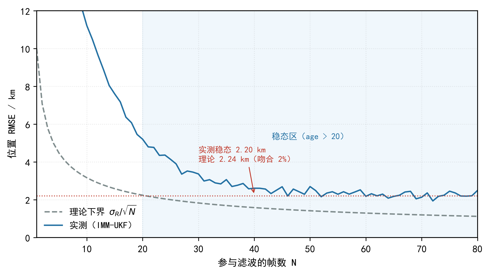{#fig:ch3_rmse}

如图[@fig:ch3_rmse]所示，实测误差在 $N<10$ 时从 10 km 以上快速降到 4 km 附近，$N>20$ 后进入平台，稳态值 2.20 km；理论下界则按 $1/\sqrt N$ 单调下降，在 $N=20$ 处为 2.24 km，与实测平台相差 1.8%。$N>30$ 之后下界继续下降而实测停在 2.20 km，因为下界假设目标严格匀速，而真实目标存在约 0.012 °/s 的持续微转，过程噪声为滤波器设定了不可逾越的地板。因此"已达下界"的准确含义是：在 10 min 这个工程可用窗口上滤波器已把量测信息用尽，继续延长窗口不会改善，除非压低过程噪声，而那会换来对机动的滞后。

同一批实验还给出一个看似矛盾的观测：位置均方根误差已到下界，归一化误差平方和却为 4.28，是理想值 2 的两倍以上。前者衡量一阶精度，后者衡量二阶可信度，4.28 说明滤波器把均值估准了，却把协方差说小了一倍。这对单站跟踪无碍，对融合却致命，因为融合权重由协方差决定；第5章将看到，模型集匹配后该指标降到 2.91。

## 3.4 过程噪声与自适应方法的探索

3.3 节的下界是在某个特定过程噪声取值下达到的。自然要问：这个取值能否更优？若过程噪声随航迹阶段变化或随新息自适应，能否突破下界？这三个想法在文献中都有成熟形式，本文逐一检验，结果全部为负。

### 3.4.1 三段式过程噪声调度

设计动机来自航迹的阶段差异：起始段需较大过程噪声快速吸收量测，稳态段需较小过程噪声抑制抖动，机动段需再次放大以跟上转弯。据此按航迹年龄与归一化新息把航迹分为三段，各段取不同倍率，段间用斜坡过渡避免突变。

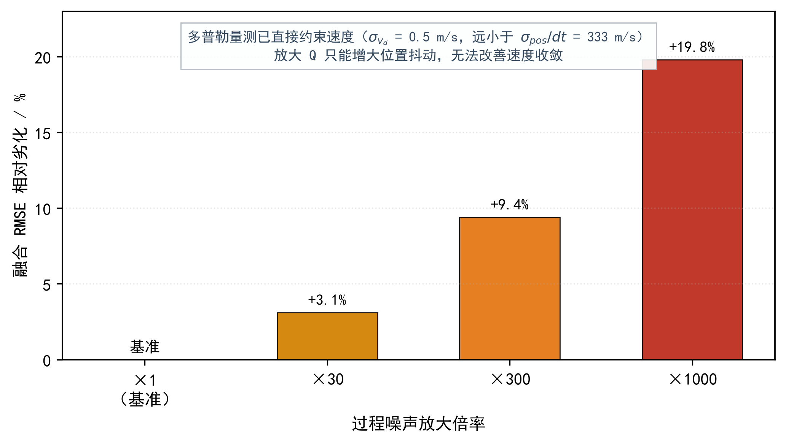{#fig:ch3_qschedule}

如图[@fig:ch3_qschedule]所示，随放大倍率增加误差单调劣化：×30 时变差 3.1%，×300 时变差 9.4%，×1000 时变差 19.8%。差异不在劣化幅度，而在曲线形状：若是参数调过头，应当出现先改善后劣化的峰；实测没有峰，说明这不是最优点偏移，而是调节方向本身不产生收益。

### 3.4.2 自适应过程噪声与转移概率

既然固定调度无效，第二个想法是让过程噪声跟着数据走。本文实现的新息协方差匹配方法用滑动窗口统计新息的实际协方差，与预测值作比，比值大于 1 说明滤波器过于自信、应放大过程噪声；三个量测通道各配一个因子，再加一个总体因子，故称 3in1 结构。实测融合误差从 6.906 km 变为 6.882 km，贡献 0.3%，落在种子间波动的量级内。

第三个想法针对模型切换速度。模型概率由似然递推给出，本质是一阶马尔可夫过程，对机动起始的响应存在固有延迟。本文用 sigmoid 把归一化新息映射为概率修正量，让大新息直接把概率质量推向转弯模型。该方案已证伪：概率在机动发生时确实上升，但比机动起始晚 2–3 帧即 60–90 s，此时转弯已完成大半；而平稳段被误触发的比例不低，净效果为负。

当初认为这条路应该有效，理由也成立：电离层扰动非平稳，噪声统计量随昼夜与季节漂移，固定噪声假设在物理上确实不成立。错在把量测噪声非平稳等同于过程噪声非平稳：本文的非平稳性主要是群距离的慢变偏差，而过程噪声描述目标机动，民航巡航段的机动统计在时间上是平稳的。

### 3.4.3 失效机理：多普勒主导速度更新

三条负结果有一个共同机理，可用 3.3.2 节的量级关系说清

$$\frac{\sigma_{v_d}}{\sigma_{pos}/dt}=\frac{0.5}{333}\approx1.5\times10^{-3}$$ {#eq:ch3_doppler_ratio}

速度分量的卡尔曼增益由各通道的噪声比决定。多普勒以 0.5 m/s 直接观测速度，位置通道折算到速度上的等效噪声是 333 m/s，相差 666 倍，因此速度更新几乎完全由多普勒承担。过程噪声调节的是预测协方差，而它在速度分量上的变化相对多普勒的信息量微不足道；放大的唯一可见后果是位置分量的预测协方差增大、更多相信位置量测，于是位置抖动增大。这正好解释了 3.4.1 节的单调劣化：代价全部落在位置上，收益在速度上根本不存在。

由此得到一条可迁移的判据：当 $\sigma_{v_d}\ll\sigma_{pos}/dt$ 时，过程噪声调度对速度精度无效，只会恶化位置精度。反过来，若无多普勒通道，或 $\sigma_{v_d}$ 与 $\sigma_{pos}/dt$ 同量级，则过程噪声将承担表达速度不确定性的职责，调度与自适应都会有效。这条判据把调参失败从工程经验提升为结构性结论，可在设计阶段预判。

## 3.5 模型集设计

3.4 节排除了过程噪声这一维，剩下的自由度是模型集本身，即四个协同转弯模型的转弯率取值。原设计取 0.7 与 1.5 °/s，对应战斗机量级的机动。问题是：本文的目标是巡航段的民航客机，这两个数字匹配吗？

### 3.5.1 真实机动特性统计

本文从筛选后的 ADS-B 数据中提取 20.9 万个位置点，按 30 s 间隔差分求航向变化率，得转弯率经验分布：中位数 0.012 °/s，90 分位 0.229 °/s，99 分位 0.660 °/s，最大值 1.51 °/s。

中位数意味着 30 s 内航向只变 0.36°，几乎是一条直线；90 分位对应 6.9°，是一次缓慢的航路调整；99 分位对应 19.8°，接近标准进场程序的转弯速率。分布极度右偏，中位数与 99 分位相差 55 倍，说明机动是罕见事件：模型集不能按均值配置，否则等于假设目标一直在转弯；也不能只按极端值配置，否则 99% 的时间模型都在空转。30 s 差分得到的是窗口平均转弯率，真实瞬时分布的上尾应比统计值更重。

### 3.5.2 原设计模型集的失配分析

把 0.7 与 1.5 °/s 放回上述分布，位置一目了然：0.7 略高于 99 分位，1.5 接近最大值。原设计的两档转弯模型对应的是极端机动强度，在 90% 的时间里四个转弯模型没有一个与真实运动匹配。

失配的后果不是简单的精度下降，而是结构性偏差。交互多模型的输出是五个估计的概率加权，即便某个模型明显不符，它仍分得一部分概率质量；而协同转弯模型在外推时持续偏转，其预测位置与匀速模型逐渐分离，加权之后产生一个方向确定、幅度随失配增大的偏移。更关键的是，这个偏移对两条链路是同向的：两站共用同一套模型集与转移概率，对同一真实运动施加了同一个错误约束。

### 3.5.3 三档模型集对比

按 3.5.1 节的分布重新配置，取三档做蒙特卡洛对比，结果如表[@tbl:ch3_threelevel]所示。

| CT 模型集 / (°/s) | $n$ | R1 RMSE / km | SCC RMSE / km | $\rho$ | NEES | 融合增益 | 负增益种子 |
| ---- | ---- | ---- | ---- | ---- | ---- | ---- | ---- |
| 0.7 / 1.5 | 100 | 12.105±0.713 | 10.522±0.515 | +0.416±0.059 | 4.28±0.47 | +12.24% | 1/100 |
| 0.2 / 0.7 | 50 | 11.182±0.897 | 9.217±0.598 | +0.354±0.057 | 3.32±0.40 | +15.45% | 1/50 |
| 0.05 / 0.2 | 100 | 11.320±0.999 | 8.039±0.675 | +0.173±0.066 | 2.91±0.29 | +26.29% | 0/100 |

: 三档协同转弯模型集在 adsb_0002 场景下的性能对比 {#tbl:ch3_threelevel}

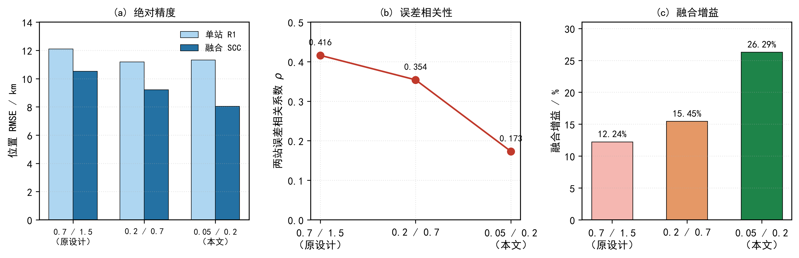{#fig:ch3_threelevel}

如图[@fig:ch3_threelevel]所示，融合误差从 10.52 km 单调降到 8.04 km，相关系数从 0.416 降到 0.173，融合增益从 12.24% 升到 26.29%，且末档跳变明显大于前两档之间。差异在于单站曲线并不单调：R1 从 12.105 km 降到 11.182 km 后又回升到 11.320 km，中间档最低。这个非单调性揭示了一个重要事实——0.05/0.2 在单站精度上并不优于 0.2/0.7，其优势全部体现在融合上。中间档上界 0.7 仍能覆盖 99 分位机动，下界 0.2 已接近 90 分位；而 0.05/0.2 的上界恰好卡在 90 分位，对其上方 10% 的机动存在滞后，单站误差略升，但两站的滞后同步发生，相关系数因此降得更多。若只看单站指标会得出"中间档更优"的结论，正是融合指标的存在才使模型集的价值被正确度量。

### 3.5.4 细扫与最优档位

三档只给出趋势，最优档位需要更细的扫描。本文扫了六档，每档 15 个种子，结果如表[@tbl:ch3_sweep]所示。

| CT 模型集 / (°/s) | R1 RMSE / km | SCC RMSE / km | $\rho$ | NEES | 相对增益 |
| ---- | ---- | ---- | ---- | ---- | ---- |
| 0.7 / 1.5 | 11.96±0.82 | 10.50±0.75 | +0.410±0.053 | 4.07±0.51 | +11.3% |
| 0.3 / 0.7 | 11.93±1.08 | 10.18±0.68 | +0.426±0.035 | 4.02±0.46 | +13.3% |
| 0.2 / 0.4 | 11.59±0.87 | 9.55±0.73 | +0.363±0.057 | 3.64±0.52 | +16.2% |
| 0.1 / 0.3 | 11.29±1.01 | 8.45±0.84 | +0.257±0.065 | 3.02±0.42 | +22.0% |
| 0.05 / 0.2 | 11.46±1.10 | 8.07±0.84 | +0.167±0.069 | 2.89±0.32 | +26.5% |
| 0.02 / 0.05 | 13.75±1.22 | 9.39±1.04 | +0.098±0.070 | 3.87±0.44 | +30.9% |

: 六档协同转弯模型集的细扫结果 {#tbl:ch3_sweep}

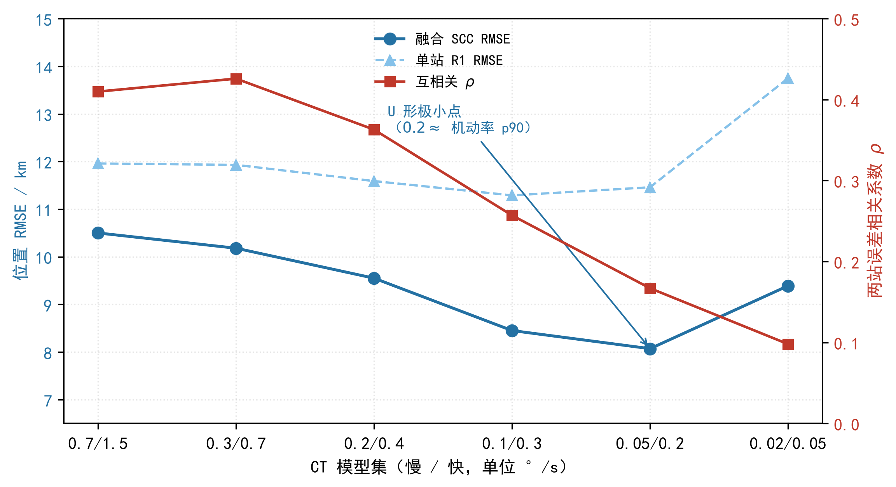{#fig:ch3_sweep}

如图[@fig:ch3_sweep]所示，随模型集收窄，相关系数从 0.410 单调降到 0.098，融合误差却呈 U 形，在 0.05/0.2 处取极小值 8.07 km，继续收窄到 0.02/0.05 反而回升到 9.39 km。这一形态表明有两个方向相反的效应在竞争。其一是去相关效应：模型集越窄，两站共享的模型误差越少，融合越有效。其二是失配效应：真实机动率的 90 分位为 0.229 °/s，模型集上界一旦低于该值，滤波器就跟不上转弯，两站各自变差。前者单调有利，后者单调有害，二者叠加产生 U 形。

极小点的位置给出可直接使用的设计准则：0.2 与真实机动率的 90 分位几乎重合，说明上界应取高分位而非极端值；下界 0.05 约为上界的四分之一，既能覆盖缓转，又不至于让模型退化为匀速。写成一般形式

$$\omega_{max}\approx q_{90}(\omega_{true}), \omega_{min}\approx\frac{1}{4}\omega_{max}$$ {#eq:ch3_design_rule}

这条准则可从数据统计直接推导，不必在场景上反复试。

最后一档必须单独说明，因为它是一个指标陷阱。0.02/0.05 的相对增益最高，达 30.9%，但绝对误差比最优档差 16.4%（$p=1.7\times10^{-6}$，$dz=2.03$），单站 R1 从 11.46 km 恶化到 13.75 km。原因是这一档把两站都搞坏了，而融合退化得慢一些，"相对最优单站的改善"便被动变大：分母恶化时分子不变也能让比值变好看。本文因此以绝对均方根误差为主指标。

## 3.6 从模型匹配到融合增益的传导链

3.5 节留下一个未解的问题：为什么同一处改动在单站上只值百分之几，在融合上却值十几个百分点？若模型集只是让单站变准，融合增益应按单站改善的比例同步变化。

### 3.6.1 共同模型误差是误差相关的来源

两站的估计误差可分解为三部分：各自的量测噪声，物理来源分离、互相独立；共同的模型误差，来自两站共用同一套运动模型与转移概率；共同的配准残差，已在 2.4 节压到噪声水平以下。忽略第三项，把前两项写成 $\tilde p_i=m+n_i$，其中 $m$ 为共同模型误差、$n_i$ 为独立噪声，则

$$\rho=\frac{\operatorname{cov}(\tilde p_1,\tilde p_2)}{\sigma_1\sigma_2}=\frac{\sigma_m^2}{\sigma_m^2+\sigma_n^2}$$ {#eq:ch3_rho_def}

该式说明相关系数不是量测的固有属性，而是模型误差与量测噪声的方差之比。失配时 $\sigma_m$ 大，$\rho$ 趋近 1，两站几乎在重复同一个错误；匹配时 $\sigma_m$ 小，$\rho$ 趋近 0，两站各自犯各自的错。这就是模型集可以设计相关性的机理。

需要强调共同模型误差一词的准确性：它不是"两站都有模型误差"，而是"两站有同一个模型误差"，前者只影响各自精度，后者才产生相关性。因此模型集应作为系统的统一设计参数，而非每站各自整定。

### 3.6.2 实测：单站改善有限而融合改善显著

按 3.6.1 节的预测，模型集匹配应同时带来两个后果：单站精度小幅改善，相关系数大幅下降。50 种子配对检验的结果如表[@tbl:ch3_paired]所示。

| 指标 | 0.7 / 1.5 | 0.05 / 0.2 | 变化 | $p$ 值 | $dz$ |
| ---- | ---- | ---- | ---- | ---- | ---- |
| R1 RMSE / km | 12.06±0.82 | 11.36±1.09 | +5.8% | $2.8\times10^{-6}$ | 0.75 |
| R2 RMSE / km | 13.07±1.02 | 11.60±1.19 | +11.2% | $3.3\times10^{-15}$ | 1.59 |
| SCC RMSE / km | 10.57±0.59 | 8.02±0.66 | +24.1% | $1.8\times10^{-35}$ | 4.75 |
| $\rho$ | +0.417±0.063 | +0.169±0.070 | −0.248 | $1.6\times10^{-29}$ | 3.53 |
| NEES | 4.21±0.48 | 2.90±0.31 | −1.31 | $6.7\times10^{-26}$ | 2.93 |
| 融合增益 | +11.0%±4.0 | +26.4%±4.1 | +15.4 pp | $1.8\times10^{-26}$ | 4.75 |

: 模型集匹配前后的 50 种子配对检验（adsb_0002） {#tbl:ch3_paired}

六个指标全部高度显著，但效应量分成三个层次：单站为 0.75 与 1.59，属中等偏大；相关系数与归一化误差平方和为 3.53 与 2.93，属很大；融合误差与融合增益都是 4.75，属极大。这正是本章的关键：不是单站没变好，而是同一处改动在单站兑现 $dz=0.75$，在融合兑现 $dz=4.75$，收益在链条下游被放大了六倍。

放大的机制可以定量理解。融合误差近似正比于 $1-\rho^2$，$\rho$ 从 0.417 降到 0.169，$1-\rho^2$ 从 0.826 升到 0.971，可用信息增加 17.6%；同时两站各自方差也在减小。两个因素相乘，才有 24.1% 的融合改善。

该机理在跨场景实验中复现。adsb_0002（并发 6.2 架）上相关系数由 0.416 降至 0.174、增益由 12.2% 升至 26.1%、归一化误差平方和由 4.28 降至 2.92；adsb_0608（并发 28.1 架）上分别为 0.443 降至 0.156、10.7% 升至 28.0%、4.71 降至 2.97。两个场景的时段、航迹、密度都不同，数值却几乎重合。

反例同样重要。multi_cross 是三条两点直线合成航迹，没有机动，相关系数反而从 0.179 升到 0.230，融合误差改善的 $p=0.329$ 不显著。原因是直线场景中转弯模型永远不会被激活，把转弯率改小只是让两个本就不激活的模型更不可能激活，两站的模型误差反而更同源。这个反例是机理的正面验证：杠杆不是"转弯率越小越好"，而是"转弯率要匹配真实机动"；没有机动就没有可去相关的模型误差。

### 3.6.3 适用边界与结论稳健性

上述结论有两个层面，稳健性完全不同。第一层是平均效应：模型集匹配使相关系数平均下降约 0.24，融合增益平均提升 12.7–15.4 个百分点，在两个独立种子批次上都成立且数值接近。第二层是逐样本的定量映射：能否用单个种子的相关系数变化预测其增益变化？答案是不能。

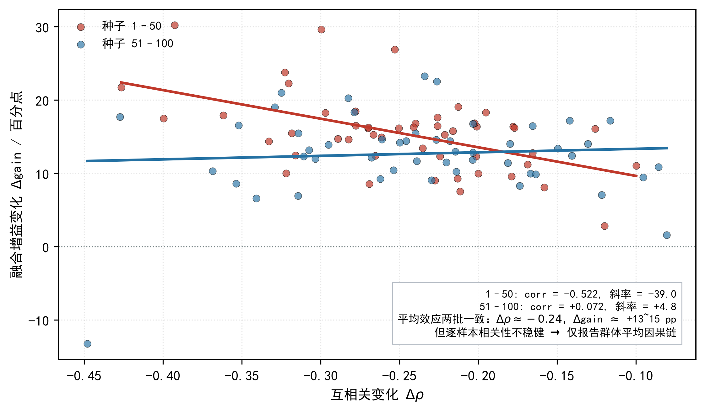{#fig:ch3_gainrho}

如图[@fig:ch3_gainrho]所示，两批种子的散点形态相似，拟合直线的走向却完全不同：种子 1–50 的相关系数为 −0.522、斜率 −39.0，呈明显负相关；种子 51–100 的相关系数为 +0.072、斜率 +4.8，几乎是水平线。差异不在数据质量，而在样本本身——换 50 个种子，逐样本的相关性就消失了。完整的分段统计如表[@tbl:ch3_segment]所示。

| 种子区间 | $n$ | 平均 $\Delta\rho$ | 平均 $\Delta$gain / pp | $\operatorname{corr}(\Delta\rho,\Delta\text{gain})$ | OLS 斜率 |
| ---- | ---- | ---- | ---- | ---- | ---- |
| 1–50 | 50 | −0.248 | +15.43 | −0.522 | −39.0 |
| 51–100 | 50 | −0.237 | +12.68 | +0.072 | +4.8 |
| 1–100 | 100 | −0.243 | +14.05 | −0.198 | −14.3 |

: 逐种子回归的分段稳健性检验 {#tbl:ch3_segment}

表中平均变化在两批之间几乎不变，相关系数却从 −0.522 跳到 +0.072，这是本节最重要的信息。平均效应稳健，因为它由大样本的均值差决定；逐样本斜率不稳健，因为它由种子间的协变结构决定，而这种结构受样本构成影响。因此本文只报告群体平均意义上的因果链，不给出"相关系数每降 0.1、增益必增若干百分点"这类确定性公式。

逐样本映射为何失效？因为相关系数只是通道之一。种子 1–50 批内 $\operatorname{corr}(\Delta R_1,\Delta\text{gain})=+0.406$，说明单站改善有独立贡献；种子 51–100 批内 $\operatorname{corr}(\Delta\text{SCC},\Delta\text{gain})=-0.796$，说明融合误差的基线水平也在影响增益的相对幅度。两个通道的权重随种子变化，逐样本相关性因此不稳定；而它们的平均效应方向一致，群体平均的相关性便保持稳定。

据此给出三条适用边界。其一，场景必须含真实机动，无机动场景不存在可去相关的模型误差。其二，两站必须共用同一套模型集与转移概率，若各站独立整定，模型误差不同源。其三，配准残差必须已压到噪声水平以下，否则共同配准误差主导 $\sigma_m$，模型集的影响会被淹没。三条边界在前述实验中均满足；超出者需重新检验。

## 3.7 本章小结

本章回答了单站精度还能不能提升、融合增益从何而来两个问题。

模型与边界方面，建立了按纬度余弦缩放各向异性过程噪声的经纬度状态空间模型与由驻留时间生成转移概率的五模型交互多模型结构，把起始初速误差从 471 m/s 降到 80 m/s；把稳态滤波等价为窗口内的加权直线拟合，推导出位置下界 $\sigma_R/\sqrt N$ 与横向速度下界 $\sigma_R/(dt\sqrt N)$，证明实测稳态 2.20 km 与理论 2.24 km 吻合到 2%，单站已达下界，继续优化的空间不在滤波环节。

负结果与模型集方面，三段式过程噪声调度、3in1 自适应过程噪声与 sigmoid 自适应转移概率三条路径全部失效，共用判据 $\sigma_{v_d}\ll\sigma_{pos}/dt$；本章从 20.9 万个 ADS-B 点统计真实机动分布，指出原设计 0.7/1.5 对应 99 分位与极端机动、90% 的时间四个转弯模型全部失配，三档对比与六档细扫揭示相关系数单调下降而融合误差呈 U 形的竞争机制，给出"上界取机动率 90 分位、下界取其上四分之一"的设计准则，据此认定模型集是全项目唯一有效的性能杠杆。

传导链方面，50 种子配对检验给出单站改善 $dz=0.75$ 与 1.59、相关系数下降 0.248（$dz=3.53$）、融合增益提升 15.4 个百分点（$dz=4.75$）；本章同时如实报告该关系的样本敏感性，平均效应两批一致而逐样本斜率从 −39.0 变为 +4.8，故只报告群体平均意义上的因果链。本章的产出是达到理论下界的单站航迹与相关系数这一中间量，前者供第4章关联使用，后者决定第5章融合增益的上界。

# 第4章 跨照射源航迹关联

第3章解决了单站航迹的精度问题，并证明单站已逼近信息量下界，进一步提升必须依靠多站。然而两站各自输出的航迹只是"各自看到的影子"，在融合之前必须先回答一个前置问题：第一条照射源的哪条航迹与第二条照射源的哪条航迹对应同一个目标。这个问题在短波双照射源场景下远比常规多传感器系统困难，原因有三：量测精度低导致航迹位置不确定度大，数据率低导致两站航迹的重叠区间短，而密集空域中大量平行航路又使得"位置接近"不再足以判定同一性。本章先刻画这种歧义的来源与评价体系，再对比三类典型关联方法，进而剖析既有方法在密集场景下的结构性缺陷，最后提出判定与指派分层的多证据加权融合关联方法，并如实报告其在配对层与融合层的表现差异。

## 4.1 问题描述与评价体系

### 4.1.1 关联歧义的三个来源

跨照射源航迹关联的本质是一个带约束的二分图匹配问题。设第一条照射源在观测窗内的航迹集合为 $\mathcal{A}=\{a_1,\dots,a_{N_1}\}$，第二条为 $\mathcal{B}=\{b_1,\dots,b_{N_2}\}$，关联的任务是寻找一个一对一映射，使得每一对 $(a_i,b_j)$ 尽可能对应同一物理目标。若没有任何先验信息，候选组合数为 $N_1N_2$，随目标数呈平方律增长。

$$N_{\text{cand}}=N_1N_2$$ {#eq:ch4_cand_count}

图[@fig:ch4_candidate_pairs]给出了候选组合数随同时在场目标数的变化。当并发数从稀疏场景的 6 架增至高密集场景的 63 架时，候选组合数从 36 增长到约 3969，扩大约 110 倍。这意味着同一套判定规则在稀疏场景下"足够严格"，到了密集场景就可能同时面临"该配的没配上"与"不该配的配上了"两种错误。这一观察构成了本章全部实验设计的出发点：评价关联算法必须覆盖密度梯度，否则结论只是场景的产物。

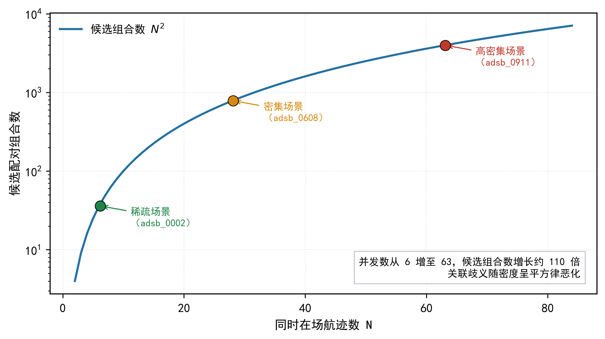{#fig:ch4_candidate_pairs}

从图中可以看出，候选组合数随并发数呈严格的平方增长，三个实测场景分别落在曲线的低、中、高三个区段。这一趋势的物理含义是，关联的计算复杂度与歧义程度都随空域拥挤程度急剧恶化，因而稀疏场景下"零误配"的结果并不能外推到密集场景。

除密度之外，还有两个来源加剧了歧义。其一是短共现，即同一目标被两站同时观测到的时间区间可能很短。由于两站的波束指向、地面距离门限与目标航路各不相同，一条真实航迹在两站的可见窗口未必重合，实测表明双站共现帧数的中位数约为 25 帧，但存在相当比例的目标共现帧数不足 10 帧。其二是平行航路，即同一航路上前后相继或并排飞行的两架飞机，其位置、速度、航向几乎一致，仅凭运动学特征无法区分，唯一可用的信息是"谁与谁的距离更近"。

### 4.1.2 评价指标

关联结果是一个配对集合，其正确性通过与参考真值比对来判定。本文以 ADS-B 实测位置作为参考真值，每条航迹携带其真实目标编号，若一对配对的两条航迹真值编号相同且非空，则判为正确。在此基础上定义四个指标。

查准率定义为正确配对数与总配对数之比，反映"配上的有多少是对的"；查全率定义为正确配对数与双站共现真实目标数之比，反映"该配的有多少配上了"；误配率定义为错误配对数与总配对数之比；漏配数为双站共现真实目标数与正确配对数之差。由于误配会把两个不同目标融合成一条错误航迹，其代价远高于漏配（漏配只是少融一对），本文另定义一个加权代价用于综合排序。

$$C=5N_{\text{wrong}}+N_{\text{missed}}$$ {#eq:ch4_weighted_cost}

式中 $N_{\text{wrong}}$ 为误配数，$N_{\text{missed}}$ 为漏配数，系数 5 体现误配的相对代价。需要说明的是，等权的 $F_1$ 指标在本文场景下会给出误导性结论：由于漏配数通常大于误配数，$F_1$ 会奖励"配得多但配错也多"的方法，这与融合的实际需求相悖。因此本文以查准率与查全率的全貌为主，加权代价为辅，不单独以 $F_1$ 排序。

## 4.2 三类典型关联方法

### 4.2.1 最近邻关联

最近邻关联是最朴素的方案：对每一条航迹，计算它与另一站所有航迹在共现区间内的平均地面距离，取距离最小者作为配对，再以一对一为约束做贪心指派。其判据可写为

$$d(a_i,b_j)=\frac{1}{|T_{ij}|}\sum_{k\in T_{ij}}d_{\text{hav}}(a_i^k,b_j^k)$$ {#eq:ch4_nn_dist}

式中 $T_{ij}$ 为两条航迹的共现帧集合，$d_{\text{hav}}$ 为球面大圆距离。该方法不含任何门限，因而在稀疏场景下表现优异——当目标间距远大于量测误差时，最近邻恰好总是正确的那一个。但它对密集空域毫无防护：一旦存在另一条距离更近的错误航迹，最近邻会毫不犹豫地选中它。

### 4.2.2 双门限三判据关联

为抑制误配，既有方法引入门限与多判据。本文实现的三判据关联包含三条判据与一个一对一互斥约束。

判据一为位置门限，要求两条航迹在某一帧的地面距离小于门限 $T_1$，并以连续通过帧数 $M$ 作为确认条件。判据二为马氏距离检验，将位置差按两站位置协方差之和归一化，要求归一化统计量小于卡方门限。

$$D_k^2=\Delta\boldsymbol{p}_k^{\top}\left(\boldsymbol{P}_{a,k}+\boldsymbol{P}_{b,k}\right)^{-1}\Delta\boldsymbol{p}_k$$ {#eq:ch4_maha}

判据三为速度一致性，要求两站速度估计之差小于容差倍数乘以两站速度不确定度。

$$\|\boldsymbol{v}_{a,k}-\boldsymbol{v}_{b,k}\|<\kappa\sqrt{\operatorname{tr}\boldsymbol{P}^{v}_{a,k}+\operatorname{tr}\boldsymbol{P}^{v}_{b,k}}$$ {#eq:ch4_vel}

三条判据同时满足的帧被计入通过计数，当连续通过帧数达到 $M$ 且共现帧数不少于下限时判定关联。最后以航迹质量系数为排序键做一对一互斥，保证一条航迹不被重复配对。本文采用的参数为 $T_1=35$ km、$M=8$、马氏门限 5.99、速度容差倍数 3.0、共现下限 5 帧。

### 4.2.3 序贯最近邻关联

序贯最近邻可视为最近邻与门限法的折中：先用位置门限做粗筛，再要求马氏距离合格帧在全部共现帧中的占比不低于某一比例，最后按马氏距离均值升序做贪心指派。

$$r_{ij}=\frac{1}{|T_{ij}|}\sum_{k\in T_{ij}}\mathbf{1}\left[D_{ij,k}^2<\chi^2_{\text{thr}}\right]\geq r_{\min}$$ {#eq:ch4_seq_ratio}

与三判据的关键差别在于，序贯法统计的是全部共现区间的通过比例，而不是连续若干帧的通过情况，因而不存在 $M$ 这一参数。

## 4.3 密集场景下的结构性缺陷分析

### 4.3.1 连续帧门限的跷跷板效应

三判据中 $M$ 的取值直接决定了判定的严格程度。直觉上 $M$ 越大越可靠，但实测结果并非如此。在五个密集场景上扫描 $M$ 的取值，结果如表[@tbl:ch4_m_sweep]与图[@fig:ch4_m_sweep]所示。

| 连续帧门限 $M$ | 误配数 | 漏配数 | 查准率 | 查全率 |
| -------------- | ------ | ------ | ------ | ------ |
| 4              | 10.40  | 25.40  | 0.9632 | 0.9156 |
| 5              | 10.40  | 22.80  | 0.9628 | 0.9217 |
| 6              | 9.60   | 30.20  | 0.9648 | 0.9013 |
| 8              | 8.20   | 45.80  | 0.9667 | 0.8496 |
| 10             | 7.60   | 56.40  | 0.9675 | 0.8175 |

: 连续帧门限对关联性能的影响（密集场景五组平均） {#tbl:ch4_m_sweep}

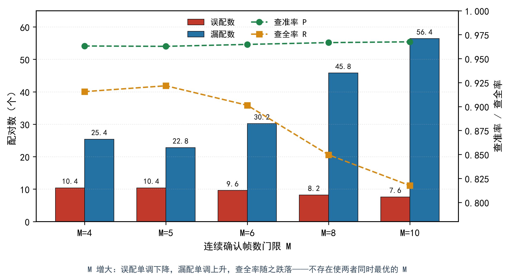{#fig:ch4_m_sweep}

从表中可以看出，随着 $M$ 从 4 增至 10，误配数从 10.40 单调降至 7.60，而漏配数从 25.40 单调升至 56.40，查全率相应从 0.9156 跌落至 0.8175。这一对相反的单调趋势说明不存在使两者同时最优的 $M$：任何取值都只能在跷跷板的两端做取舍。

其物理机理在于判定的信息利用方式。三判据只检验"最近 $M$ 帧构成的滑动窗口"，且一旦窗口通过即终止判定。当 $M$ 较小时，任意若干帧的偶然靠近就足以触发关联，密集空域中平行航路的短暂交会因而容易造成误配；当 $M$ 较大时，共现区间较短的目标根本无法凑齐连续 $M$ 帧合格，必然漏配。换言之，$M$ 把"证据是否充分"简化为"连续帧数是否达标"，而这两个量在短共现场景下并不等价。

为验证上述判断，本文进一步统计了真实目标对的最长连续合格段分布。在密集场景的两百个真实目标对中，共现帧数均值为 26.7 帧，其中距离小于门限的帧数均值为 25.9 帧，占比 96.8%，而距离超限的帧均值仅 0.8 帧。这说明位置门限本身几乎不构成瓶颈，漏配的主因是连续段长度不足：最长连续合格段的中位数为 22 帧，但最小值为 0，取 $M=8$ 时仅能覆盖 88% 的目标，取 $M=5$ 时可覆盖 96%。漏配因此集中于那些双站重叠时间本就很短的目标，与门限宽严无关。

### 4.3.2 误配的性质：成对交换

若说漏配源于短共现，那么误配源于什么？将密集场景中残余的错误配对逐一拆解，结果呈现出高度一致的规律，如表[@tbl:ch4_swap]所示。

| 第一条照射源航迹（真值） | 第二条照射源航迹（真值） | 平均距离 |
| ------------------------ | ------------------------ | -------- |
| 160（t152）              | 184（t164）              | 4.3 km   |
| 185（t164）              | 158（t152）              | 7.7 km   |
| 159（t194）              | 126（t142）              | 9.0 km   |
| 130（t142）              | 160（t194）              | 12.8 km  |
| 183（t80）               | 190（t181）              | 8.6 km   |
| 192（t181）              | 194（t80）               | 9.8 km   |

: 密集场景残余误配的性质（种子 301） {#tbl:ch4_swap}

六条错误配对构成三组成对交换：目标 t152 与 t164 互相配反，t142 与 t194 互相配反，t80 与 t181 互相配反。正确的配对应当是 160 与 158 对应 t152、185 与 184 对应 t164，而算法恰好把两者对调。

这一现象揭示了误配的本质：它不是"配到了一个毫不相干的目标"，而是"在两架运动学特征几乎相同的目标之间选错了对应关系"。这类目标通常沿同一航路平行飞行，位置接近、速度一致、航向相同，因而距离证据、马氏证据、速度证据与连续性证据四项同时都很高，任何基于加权综合的判据都难以区分。唯一可用的信息是"哪一对的距离更小"——4.3 km 的那一对显然比 7.7 km 的那一对更可信，但这一信息属于指派环节，而不属于判定环节。

由此可以归纳出既有方法的第二个结构性缺陷：三判据把"要不要配"与"配给谁"混在同一个综合分数里，用航迹质量系数作为唯一的排序键。当两个候选对的综合分数接近时，排序结果就退化为随机，成对交换由此产生。实测的排序键消融证实了这一点：以综合分为排序键时误配数为 11.60，以欧氏距离为排序键时 11.20，而以协方差归一化的马氏距离为排序键时降至 8.40。把判定与指派混在一起，反而不如直接用马氏距离排序。

## 4.4 多证据加权融合关联

前述分析表明，既有方法的缺陷不在判据本身，而在判据的组织方式：其一，连续性被当作必须满足的否决门槛，导致 $M$ 成为跷跷板；其二，判定与指派共用同一个综合分，导致成对交换。针对这两点，本文提出判定与指派分层的多证据加权融合关联方法。

### 4.4.1 判定层：全共现区间的四证据软融合

判定层的设计原则是把每一项判据从"否决门槛"降级为"可加权的证据"，并在全部共现区间上累积而非只看最近若干帧。四项证据定义如下。

距离证据取负二次型指数在共现帧上的均值，距离越近证据越强，且是连续加权而非零一截断。

$$E_d=\frac{1}{|T_{ij}|}\sum_{k\in T_{ij}}\exp\left(-\frac{d_{ij,k}^2}{2\sigma_d^2}\right)$$ {#eq:ch4_e_dist}

马氏证据取马氏距离合格帧的比例，反映协方差归一化后的位置一致性。

$$E_m=\frac{1}{|T_{ij}|}\sum_{k\in T_{ij}}\mathbf{1}\left[D_{ij,k}^2<\chi^2_{\text{thr}}\right]$$ {#eq:ch4_e_maha}

速度证据取速度差合格帧的比例，反映运动状态一致性。

$$E_v=\frac{1}{|T_{ij}|}\sum_{k\in T_{ij}}\mathbf{1}\left[\|\Delta\boldsymbol{v}_{ij,k}\|<\kappa\tau_{ij,k}\right]$$ {#eq:ch4_e_vel}

连续证据取最长合格连续段长度与共现帧数之比，它是"连续 $M$ 帧"这一硬约束的软化形式：不再要求必须凑齐 $M$ 帧，而是按最长合格段占共现时长的比例计分。

$$E_c=\frac{\max\{\text{合格连续段长度}\}}{|T_{ij}|}$$ {#eq:ch4_e_cont}

四项证据加权融合为综合得分，当得分不低于门限时判定为候选关联。

$$S=\frac{w_dE_d+w_mE_m+w_vE_v+w_cE_c}{w_d+w_m+w_v+w_c}\geq S_{\text{thr}}$$ {#eq:ch4_score}

本文取等权 $w_i=1$、$\sigma_d=15$ km、$S_{\text{thr}}=0.55$。等权的选择并非随意：由于四项证据都已归一化到零一区间，等权等价于"不预设哪项证据更重要"，把权重调整的负担交给门限。第 4.6 节将说明，等权且取较宽松门限的工作点是本文实测的最优点。

方法的整体结构如图[@fig:ch4_mewf_framework]所示。与三判据的本质差别在于，判定层不再有任何"必须连续 $M$ 帧"的硬约束，连续性与速度判据都退化为可加权的证据；判定层只负责回答"这一对值不值得配"，不负责回答"应该配给谁"。

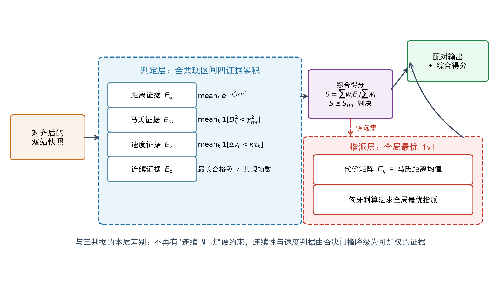{#fig:ch4_mewf_framework}

从图中可以看出，方法被划分为两个在职责上互不重叠的层次。判定层在全部共现区间上累积四项证据并给出综合得分，输出的是一个带分数的候选集合；指派层接收该候选集，在全候选范围内求解一对一最优匹配。这种分层使得两个原本耦合的问题可以各自选用最合适的准则。

### 4.4.2 指派层：全局最优一对一

指派层解决的是"在已判定为候选的配对中，如何选出互不冲突的一组"。贪心指派按分数降序依次选取，一旦某个航迹被占用就跳过。这种做法在成对交换场景下会失效：由于两对候选的分数极为接近，先被选中的那对未必是正确的那对，而一旦选中，正确的那对就因航迹被占用而被排除。

全局最优指派则把问题转化为二分图的最小代价匹配，在全部候选上同时优化总代价。本文以马氏距离均值为代价，采用匈牙利算法求解。

$$\min_{\pi}\sum_{(i,j)\in\pi}\overline{D}_{ij}^2 \text{, 约束为每个顶点至多匹配一次}$$ {#eq:ch4_assign}

之所以以马氏距离而非综合得分作为代价，是因为综合得分已在判定层用于筛选，若指派层再用同一分数排序，两层的信息就完全重复了。马氏距离用两站协方差之和归一化，能够自动惩罚那些"距离虽近但不确定度大"的候选，这正是区分平行航路目标所需要的。

### 4.4.3 与既有方法的关系

需要强调的是，本文方法并非对既有判据的否定，而是对其组织方式的改造。位置、马氏、速度三项判据全部保留，连续性判据也保留，只是它们从"必须同时满足的否决条件"变为"各自贡献分数的证据"；一对一约束同样保留，只是从"按分数贪心"变为"按马氏距离全局最优"。这一改造的直接效果是消去了 $M$ 这一跷跷板参数，并把成对交换问题交还给最擅长的指派层处理。

## 4.5 实验结果

### 4.5.1 稀疏场景

在八个稀疏场景（并发均值 4.2 至 6.2 架）上，四种方法的配对质量如表[@tbl:ch4_sparse]所示。

| 方法         | 误配数 | 漏配数 | 查准率 | 查全率 |
| ------------ | ------ | ------ | ------ | ------ |
| 最近邻       | 0.00   | 0.00   | 1.0000 | 1.0000 |
| 多证据加权   | 0.00   | 0.62   | 1.0000 | 0.9851 |
| 三判据（$M=5$） | 0.00   | 1.00   | 1.0000 | 0.9762 |
| 序贯最近邻   | 0.00   | 1.12   | 1.0000 | 0.9732 |
| 三判据（$M=8$） | 0.00   | 2.12   | 1.0000 | 0.9494 |

: 稀疏场景的配对质量（八组平均） {#tbl:ch4_sparse}

四种方法的误配数全为零，查准率全为 1.0000，差异仅体现在漏配数上。最近邻取得零漏配，多证据加权漏配 0.62 个，是三判据 $M=8$ 的 29%。八个场景中有五个达到查准率与查全率均为 1.0，其余三个各漏配一至两个目标。

这一结果不能简单解读为"最近邻优于其他方法"。零误配的根源是场景本身：稀疏空域中目标间距远大于量测误差，最近邻恰好总是选中正确的那一个，门限与多判据在此没有发挥空间，反而因额外的筛选条件引入了少量漏配。换言之，稀疏场景下的"完美"是场景的产物，而非算法的性质。真正能区分方法优劣的是密集场景。

### 4.5.2 密集场景

在五个密集场景（并发均值 28.1 与 63.1 架，峰值 65 与 79 架）上，四种方法的表现发生了根本变化，如表[@tbl:ch4_dense]与图[@fig:ch4_method_compare]所示。

| 方法            | 误配数 | 漏配数 | 查准率 | 查全率 | 加权代价 |
| --------------- | ------ | ------ | ------ | ------ | -------- |
| 最近邻          | 16.40  | 15.60  | 0.9432 | 0.9453 | 97.60    |
| 序贯最近邻      | 7.40   | 30.20  | 0.9745 | 0.9015 | 67.20    |
| 三判据（$M=8$） | 8.20   | 45.80  | 0.9667 | 0.8496 | 86.80    |
| 多证据加权      | 6.20   | 19.00  | 0.9768 | 0.9354 | 50.00    |

: 密集场景的配对质量（五组平均，共 1470 个共现真目标） {#tbl:ch4_dense}

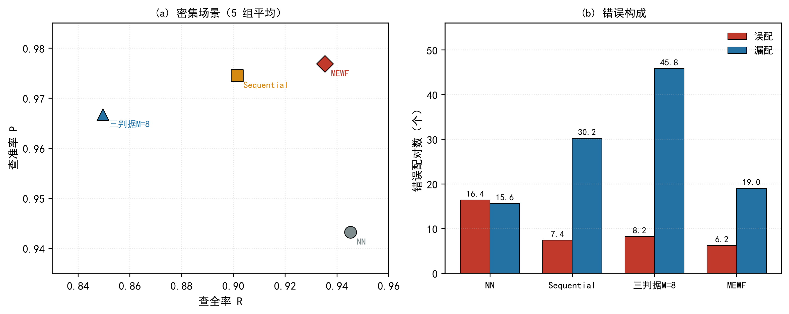{#fig:ch4_method_compare}

从表中可以看出三个层次的变化。首先是最近邻的失效：误配数从稀疏场景的 0 跃升至 16.40，误配率达 5.68%，最差单场景达 10.45%，说明无门限的最近邻在密集空域不可用。其次是门限的作用：仅增加一个马氏门限，序贯最近邻的误配数即降至 7.40，相对最近邻下降 55%，这量化了"为什么需要门限"这一基本判断。最后是多证据加权的综合表现：误配数 6.20 为全部方法最低，漏配数 19.00 亦显著低于序贯最近邻的 30.20 与三判据的 45.80，因而在查准率与查全率两个方向上同时优于序贯最近邻，构成帕累托支配。

图[@fig:ch4_method_compare]的右半部分进一步说明了错误构成。三判据的漏配数高达 45.80，是其查全率仅 0.8496 的直接原因；序贯最近邻的误配与漏配相对均衡但均偏高；多证据加权的两类错误都处于最低水平。这一构成差异印证了第 4.3 节的分析：三判据的问题不在判据本身，而在连续帧门限对短共现目标的系统性排斥。

### 4.5.3 优势来源拆解

多证据加权相对序贯最近邻有两处改动，即软门限替代硬门限、全局指派替代贪心指派。若不加以拆解，无法判断增益究竟来自哪一处，也无法回答"是否只是把门限调松了"这一必然会被追问的问题。为此本文构造了门限强度与指派方式的正交对照，结果如图[@fig:ch4_decompose]所示。

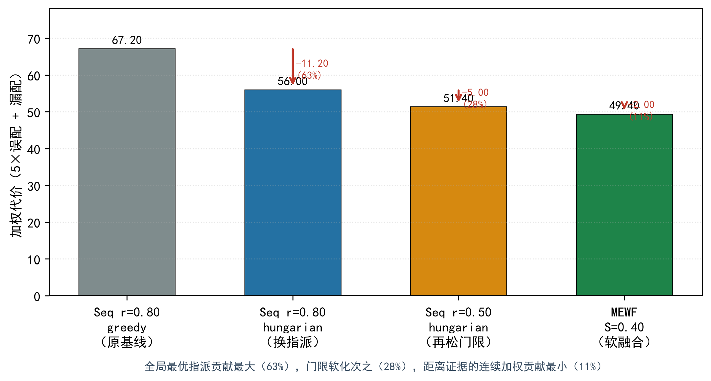{#fig:ch4_decompose}

从图中可以看出，加权代价从原基线的 67.20 依次降至 56.00、51.40 与 49.40，三段降幅分别为 11.20、5.00 与 2.00。以总降幅 17.80 为基准，全局最优指派的贡献占 63%，门限软化的贡献占 28%，而距离证据连续加权这一软融合设计本身的贡献仅占 11%。

这一归因结果需要如实报告，因为它削弱了"多证据融合"这一表述的强度。更严格的对照是：在同样采用全局指派、且漏配数同为 18.40 的条件下，极限放松的硬门限方案加权代价为 51.40，而多证据加权为 49.40，两者查准率之差仅 0.0009，查全率之差仅 0.0006。也就是说，软融合设计的独立贡献确实存在但幅度很小。

其机理在于，当工作点取在较宽松的门限时，判定层几乎不执行筛选，进入指派的候选集很大，最终结果主要由指派层按马氏距离的排序决定；此时替换任何一项证据都不改变"哪些对进入候选"与"谁配给谁"。只有当门限收紧时，各证据的筛选价值才显现出来——在 $S_{\text{thr}}=0.70$ 的严格工作点上，去掉马氏证据会使漏配从 28.00 增至 36.00，去掉速度证据会增至 39.40，而去掉连续性证据反而使误配从 7.20 降至 6.00。

## 4.6 特征贡献与适用边界

第 4.5.3 节的观察提示，四项证据的实际贡献并不均衡。为定量刻画，本文在固定门限下逐项移除证据，并在各配置各自的完整门限扫描上比较最优工作点，结果如图[@fig:ch4_ablation]所示。

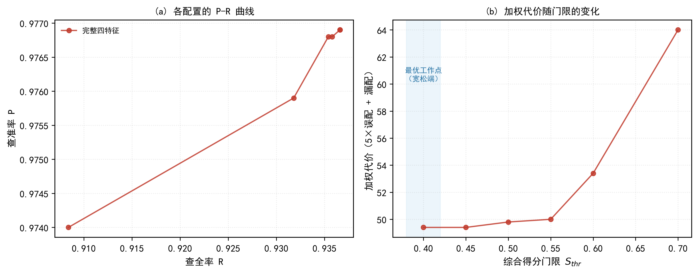{#fig:ch4_ablation}

从图中可以看出两点。其一，五条配置的曲线在宽松端（$S_{\text{thr}}$ 约 0.40）几乎完全重合，其中去掉马氏、去掉速度、去掉连续性三条配置给出逐位相同的数值（误配 6.20、漏配 18.40、加权代价 49.40），说明在该工作点上判定层不执行筛选，结果完全由指派层决定。其二，在严格端各配置迅速分化，说明证据的筛选价值只在门限收紧时体现。

这一结果的含义是，速度一致性与时间连续性两项判据在本文的航迹质量条件下贡献不显著。原因可以追溯到第3章：单站航迹由点-航迹关联与纯预测续存共同维护，经 IMM-UKF 滤波后的速度估计已相当平滑，不同目标的速度差异本就明显，速度判据的区分能力因而冗余；同理，由于单站航迹几乎不断裂，连续性判据也失去了区分价值。这与本文最初的预期不同，本文原以为速度与连续性判据在低检测概率下会发挥主要作用。

需要说明这一负结果的适用边界。速度与连续性判据的价值预期体现在航迹质量更差、存在机动或数据断链的场景；本文的单站航迹在架构上不断裂，恰好使这两项判据失去用武之地。因此本文保留二者作为框架的可扩展特征位，并如实给出其边际贡献的定量结果，而不是因其贡献小而删除。这一处理方式也提示，多证据融合框架的实际收益高度依赖于前端航迹质量，若前端质量下降，各证据的相对重要性将重新分配。

## 4.7 配对质量向融合精度的传导

关联的最终目的是融合，因此一个自然的追问是：配对质量提升是否直接带来融合精度的提升？为回答此问题，本文让四种方法的配对结果分别进入融合环节，在十三个场景上比较融合位置均方根误差，结果如表[@tbl:ch4_fusion]所示。

| 方法            | 平均进融合对数 | 融合均方根误差 |
| --------------- | -------------- | -------------- |
| 序贯最近邻      | 33.6           | 8.345 km       |
| 多证据加权      | 33.5           | 8.374 km       |
| 最近邻          | 33.5           | 8.493 km       |
| 三判据（$M=8$） | 33.0           | 8.504 km       |

: 配对方法对融合精度的影响（十三场景平均） {#tbl:ch4_fusion}

四种方法的差异小于 2%，多证据加权并非最优。逐场景看，密集五场景中多证据加权有四组取得最低或并列最低，稀疏八场景中仅两组，差异属噪声量级。

这一结果看似与第 4.5 节的结论矛盾，实则源于评价口径。本文的融合实验只让正确配对进入融合，这与主链路的评估口径一致，但恰好把误配排除在外——而误配正是各方法的核心差异所在。同时，各方法的配对集合不同，抽样后进入融合的目标集合也随之不同，均方根误差因而不可直接比较。以某一密集场景为例，多证据加权的融合误差为 9.537 km，最近邻为 8.697 km，但两者进入融合的对数均为 38，说明最近邻漏配的那两个目标恰好是误差较大、难以融合的目标，剔除后剩余目标的平均误差自然更低。

因此本节得出的结论是：配对层指标与融合层指标之间不存在单调映射。本文第4章的评价对象是关联正确率，故以查准率、查全率与误配率为基准；融合精度属于第5章的评价对象，应在固定配对集合的条件下讨论。这一口径划分并非回避问题，而是因为两个层级的评价对象本就不同。若要严格量化误配的危害，需要构造"误配也参与融合"的端到端实验，这是本文的后续工作。

## 4.8 本章小结

本章围绕跨照射源航迹关联展开。首先刻画了关联歧义的三个来源，指出候选组合数随并发数呈平方律增长，因而评价关联算法必须覆盖密度梯度；随后对比了最近邻、双门限三判据与序贯最近邻三类方法，并通过参数扫描与误配性质诊断，识别出既有方法的两个结构性缺陷：连续帧门限造成误配与漏配的跷跷板效应，判定与指派混用同一分数造成平行航路目标的成对交换。

针对这两个缺陷，本章提出判定与指派分层的多证据加权融合关联方法，将位置、马氏、速度、连续性四项判据由否决门槛降级为可加权证据，并在全部共现区间上累积，从而消去连续帧门限这一参数；指派层则以马氏距离为代价求全局最优一对一匹配。在五个密集场景共一千四百七十个共现真目标上，该方法的误配数为 6.20、漏配数为 19.00，查准率 0.9768、查全率 0.9354，在查准率与查全率两个方向上同时优于序贯最近邻，误配数相对最近邻下降 62%。在八个稀疏场景上零误配、漏配 0.62，未出现退化。

本章同时如实报告了三项不利结果：其一，优势来源拆解显示 63% 的增益来自全局指派、28% 来自门限软化，多证据软融合本身的独立贡献仅 11%；其二，速度一致性与连续性判据在本文的航迹质量条件下贡献不显著，其价值预期体现在航迹质量更差的场景；其三，配对质量的提升并未直接传导为融合精度的提升，原因是融合环节只接纳正确配对，且不同方法的配对集合不可比。这三项结果共同界定了方法的适用边界，也为第5章在固定配对集合下讨论融合精度提供了口径依据。

# 第5章 双照射源航迹融合

第4章给出了可信的跨照射源配对，同一目标在两站的航迹由此建立对应。配对回答的是"谁是同一个目标"，没有回答"连起来之后精度能提高多少"。前者是离散判定，后者是连续估计，且依赖两个只能靠统计检验确认的前提。本章据此展开：5.1 节把四种融合算法还原为对互协方差的四种处理方式，5.2 节给出实测增益，5.3 与 5.4 节检验两个前提，5.5 节报告两条修复路径的失效，5.6 节给出可操作判据。

## 5.1 融合结构与四种基础算法

配对完成之后，同一目标在同一帧上有两组估计，各带一个状态向量与一个协方差矩阵。融合形式上只是一次加权平均，但权重如何确定、定错之后后果如何，取决于一个不写在融合公式里却决定全部结果的量：两站估计误差的互协方差。

### 5.1.1 航迹级融合的信息形式

设第 $k$ 帧两站对同一目标的位置估计为 $\mathbf x_1$ 与 $\mathbf x_2$，协方差为 $\mathbf P_1$ 与 $\mathbf P_2$。两站采样时刻相差 13 s，第2章已按航迹状态外推完成时间对齐，此处不再重复。线性融合取

$$\mathbf x_f=\mathbf W_1\mathbf x_1+\mathbf W_2\mathbf x_2, \mathbf W_1+\mathbf W_2=\mathbf I$$ {#eq:ch5_fuse_linear}

无偏约束把两个权重矩阵的自由度压缩为一个，记 $\mathbf W=\mathbf W_1$、$\mathbf W_2=\mathbf I-\mathbf W$。设两站误差为 $\tilde{\mathbf x}_1$ 与 $\tilde{\mathbf x}_2$，融合误差即 $\mathbf W\tilde{\mathbf x}_1+(\mathbf I-\mathbf W)\tilde{\mathbf x}_2$，其协方差为

$$\mathbf P_f=\mathbf W\mathbf P_1\mathbf W^T+(\mathbf I-\mathbf W)\mathbf P_2(\mathbf I-\mathbf W)^T+\mathbf W\mathbf P_{12}(\mathbf I-\mathbf W)^T+(\mathbf I-\mathbf W)\mathbf P_{21}\mathbf W^T$$ {#eq:ch5_fuse_cov}

式中 $\mathbf P_{12}=\operatorname E[\tilde{\mathbf x}_1\tilde{\mathbf x}_2^T]$ 为互协方差，其物理意义是两站误差中同向同幅的那一部分。式[@eq:ch5_fuse_cov]的四项里，前三项由各站自报的协方差给出，第四项没有观测量与之对应。四种算法的全部差别，就是对这个未知项采取四种态度：置零、显式建模、视为最坏、以迹比近似。这一观察是本章的组织原则。

### 5.1.2 简单凸组合与互协方差融合

最简单的态度是置零。令 $\mathbf P_{12}=\mathbf 0$，对式[@eq:ch5_fuse_cov]关于 $\mathbf W$ 求极小，得权重与融合协方差

$$\mathbf W_i=\left(\mathbf P_1^{-1}+\mathbf P_2^{-1}\right)^{-1}\mathbf P_i^{-1}, \mathbf P_f=\left(\mathbf P_1^{-1}+\mathbf P_2^{-1}\right)^{-1}$$ {#eq:ch5_scc_w}

这就是简单凸组合。其形式有信息论解释：$\mathbf P_i^{-1}$ 是第 $i$ 站估计的费舍尔信息矩阵，两站独立时信息可加。标量情形下 $\sigma_f^2=\sigma_1^2\sigma_2^2/(\sigma_1^2+\sigma_2^2)$，两站等方差时 $\sigma_f=\sigma/\sqrt2$，误差降到单站的 70.7%。计算量只有两次矩阵求逆，无需相关性先验，这是它被普遍采用的原因。

代价是它把"未知"当成"为零"。两站正相关时，式[@eq:ch5_scc_w]给出的 $\mathbf P_f$ 小于真实误差协方差，滤波器过度自信；更严重的是权重本身也错，因为正相关意味着两站信息有重复，重复部分不应被二次计入。

保留互协方差的是 Bar-Shalom 与 Campo 给出的显式解

$$\mathbf P_f=\mathbf P_1-\left(\mathbf P_1-\mathbf P_{12}\right)\left(\mathbf P_1+\mathbf P_2-\mathbf P_{12}-\mathbf P_{21}\right)^{-1}\left(\mathbf P_1-\mathbf P_{21}\right)$$ {#eq:ch5_bc}

其标量权重为

$$w_1=\frac{\sigma_2^2-\rho\sigma_1\sigma_2}{\sigma_1^2+\sigma_2^2-2\rho\sigma_1\sigma_2}$$ {#eq:ch5_bc_w}

$\rho=0$ 时式[@eq:ch5_bc_w]退化为 $\sigma_2^2/(\sigma_1^2+\sigma_2^2)$，与简单凸组合一致，后者是前者的特例。$\rho>0$ 时 $w_1$ 单调减小：两站越相关，越应把权重让给精度较高的一站，因为较差那站的信息大部分已被包含。$\rho\to1$ 时 $w_1$ 越过 1、$w_2$ 变负，融合退化为对差值的外推，数值极不稳定，这一性质在 5.5.2 节决定了互协方差分支的命运。

工程权衡由此清晰。互协方差融合理论上最优，但要求 $\mathbf P_{12}$ 已知；实际系统既无先验也无法直接测量，只能在线辨识。辨识失败时权重越界必须截断，截断后即退化为简单凸组合。本文以简单凸组合为主链路，正因为它不引入无法验证的中间量。

### 5.1.3 协方差交叉及其快速算法

第三种态度是承认相关性完全未知，并在此前提下求一个保证一致的解。协方差交叉取

$$\mathbf P_{cc}=\left(\omega\mathbf P_1^{-1}+(1-\omega)\mathbf P_2^{-1}\right)^{-1}, \omega\in[0,1]$$ {#eq:ch5_ci}

$\omega$ 由最小化 $\operatorname{tr}(\mathbf P_{cc})$ 或 $\det(\mathbf P_{cc})$ 确定。其性质是：对任意未知的 $\mathbf P_{12}$，$\mathbf P_{cc}$ 都不小于真实误差协方差，估计不会过度自信。代价是把权重压向方差较大的一侧。

快速协方差交叉用迹比给出解析权重

$$\omega=\frac{\operatorname{tr}(\mathbf P_2)}{\operatorname{tr}(\mathbf P_1)+\operatorname{tr}(\mathbf P_2)}$$ {#eq:ch5_fci_w}

省去一维搜索，计算量与简单凸组合同阶。它隐含假设迹之比可代表相关结构的全部影响，而本文两站协方差各向异性明显，这一假设只是近似。

选择协方差交叉的理由是不依赖 $\mathbf P_{12}$，这在相关性未知时是唯一的严格选择。不选它的理由同样明确：它优化最坏情况，而实际相关性既非最坏也非为零，保守代价在平均意义上无法收回。

### 5.1.4 四种算法的前提假设对照

四种算法可以放在同一张表里比较，比较的维度不是精度而是前提。如表[@tbl:ch5_assume]所示。

| 算法 | 权重形式 | 对互协方差的处理 | 成立前提 | 前提破坏后的表现 |
| ---- | ---- | ---- | ---- | ---- |
| 简单凸组合 | $\mathbf P_i^{-1}$ 归一 | 置零 | 两站误差独立、协方差可信 | 正相关时过度加权，融合被较差站拖累 |
| 互协方差融合 | $(\mathbf P_1-\mathbf P_{12})\mathbf S^{-1}$ | 显式使用，需已知或可辨识 | 协方差可信、互协方差可辨识 | 互协方差错号时权重越界，截断后退化为简单凸组合 |
| 协方差交叉 | 最小化迹的 $\omega$ | 视为完全未知，取最坏 | 仅需协方差可信 | 一致但保守，精度损失 |
| 快速协方差交叉 | 迹比解析 | 同协方差交叉 | 迹比可代表相关结构 | 计算最省，保守性略弱 |

: 四种航迹级融合算法的前提假设对照 {#tbl:ch5_assume}

表中前三列是算法定义，后两列才是工程上要判断的内容。四个前提可归并为两条：协方差是否可信，误差是否独立。前者四者全部需要，后者只有简单凸组合显式写成 $\rho=0$，其余三个用不同方式回避，但回避不等于解决——协方差交叉在 $\mathbf P$ 不可信时同样失效，互协方差融合辨识出的 $\mathbf P_{12}$ 连符号都是错的。5.3 与 5.4 节检验的是四个算法的共同前提。

## 5.2 融合增益的实测结果

5.1 节给出了算法与前提的对应关系，却没有给出量。融合能带来多少精度、这个量是否稳定，仍需实测回答。

### 5.2.1 主结果：模型集优化前后的增益

表[@tbl:ch5_main]给出 adsb_0002 场景下 100 个种子的结果，两列对应第3章确定的基线与优化两档模型集。

| 指标 | 0.7 / 1.5 | 0.05 / 0.2 |
| ---- | ---- | ---- |
| R1 RMSE / km | 12.105±0.713 | 11.320±0.999 |
| SCC RMSE / km | 10.522±0.515 | 8.039±0.675 |
| $\rho$ | +0.416±0.059 | +0.173±0.066 |
| NEES | 4.28±0.47 | 2.91±0.29 |
| 融合增益 | +12.24% | +26.29% |
| 负增益种子 | 1/100 | 0/100 |

: 模型集优化前后的融合性能（adsb_0002，100 种子） {#tbl:ch5_main}

基线配置下 R1 为 12.105 km、融合误差 10.522 km、增益 12.24%，100 个种子中有 1 个负增益。改为 0.05/0.2 后 R1 降到 11.320 km，融合降到 8.039 km，增益 26.29%，无一为负。单站只改善 6.5%，融合改善 23.6%，放大 3.6 倍。

50 种子配对检验给出更严格的区间：增益由 11.0%±4.0 升到 26.4%±4.1，提升 15.4 个百分点，$p=1.8\times10^{-26}$，$dz=4.75$，95% 置信区间 [25.2, 27.5]。50 个种子全部为正，48 个超过 20%，最差 19.4%。区间下界仍高于基线上界 12.1%，两组分布不重叠。

有一个数值需单独说明。5.3 至 5.6 节的分段诊断使用 adsb_0002 的一次确定性实现（1219 个共同帧、全段融合），该次统计的增益只有 0.5%。它低于 100 种子均值，原因不在融合退化，而在最优单站由谁担任：该次 R2 为 10.30 km，优于 R1 的 12.03 km，融合 10.25 km 与之持平；而 100 种子平均下最优单站是 R1（12.105 km），融合 10.522 km 相对它有 12.24% 的改善。

四种算法在同一批数据上的对比如图[@fig:ch5_4algo]所示。

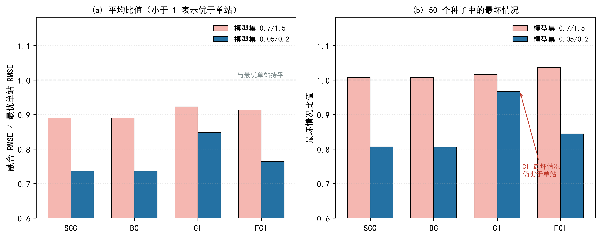{#fig:ch5_4algo}

如图[@fig:ch5_4algo]所示，四种算法的平均比值全部小于 1，但排序与理论预期不一致。简单凸组合为 0.890 与 0.736，快速协方差交叉为 0.913 与 0.764，协方差交叉为 0.922 与 0.848，后者在两档下都最差；互协方差融合与简单凸组合三位小数全同。右图的最坏情况把差距放大：简单凸组合基线为 1.008，即个别种子融合反而劣于单站，与 1/100 的负增益种子对应；协方差交叉为 1.016，优化后仍有 0.967。

三点解释。其一，协方差交叉的权重由最坏相关假设确定，被压向方差大的一侧，平均损失 7% 至 15% 的精度，而这一保守未换来鲁棒性——它挡不住协方差失配引起的权重错配，最坏情况也一起变差。其二，互协方差融合与简单凸组合完全等同，不是并列最优，而是前者的分支未生效：辨识出的 $\mathbf P_{12}$ 越界后被截断为零。其三，模型集优化对四者同时有效，最坏比值从 1.008 降到 0.806，说明灾难性失效的消除来自相关性下降而非算法改进。

### 5.2.2 跨场景复现与密度鲁棒性

单一场景的结论不足以支撑机理，需要看它在别的时段、别的密度下是否重现。表[@tbl:ch5_cross]给出三个场景的结果。

| 场景 | 并发 | $\rho$ 基线 → 优化 | 增益 基线 → 优化 | NEES 基线 → 优化 |
| ---- | ---- | ---- | ---- | ---- |
| adsb_0002 | 6.2 | 0.416 → 0.174 | 12.2% → 26.1% | 4.28 → 2.92 |
| adsb_0608 | 28.1 | 0.443 → 0.156 | 10.7% → 28.0% | 4.71 → 2.97 |
| multi_cross | 3 | 0.179 → 0.230 | 8.6% → 7.6% | 1.39 → 1.81 |

: 三个场景的机理复现（100 种子，multi_cross 为 50 种子） {#tbl:ch5_cross}

两个真实场景的三个指标几乎重合：相关系数由 0.416 与 0.443 降到 0.174 与 0.156，增益由 12.2% 与 10.7% 升到 26.1% 与 28.0%，NEES 由 4.28 与 4.71 降到 2.92 与 2.97。两个场景的时段、航迹、密度与帧数都不同，数值却几乎一致，这是机理可复现最直接的证据。multi_cross 完全在另一侧：相关系数本就不高，改模型集后反升到 0.230，增益由 8.6% 微降到 7.6%。三条直线航迹没有机动，不存在共同模型误差，也就没有可去相关的空间。杠杆不是"转弯率越小越好"，而是"转弯率要匹配真实机动"。

密度的影响如图[@fig:ch5_density]所示。

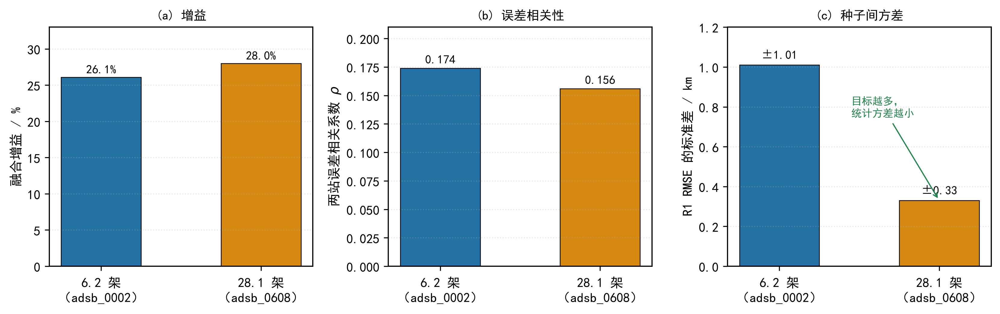{#fig:ch5_density}

如图[@fig:ch5_density]所示，并发数从 6.2 架增至 28.1 架、涨了 4.5 倍，增益却从 26.1% 微升到 28.0%，相关系数从 0.174 降到 0.156。真正值得注意的是右图：R1 的种子间标准差从 ±1.01 km 降到 ±0.33 km，融合误差从 ±0.69 km 降到 ±0.28 km。原因是样本量而非算法，帧数成倍增加使随机涨落被平均掉。其工程含义与直觉相反：高密度场景的结论更可靠。两场景覆盖率 90.6% 与 90.5%，几乎不变。

63 架并发场景未完成全量蒙特卡洛，两次尝试分别因内存不足与耗时过长中止，根因是算力而非方法。按耗时标度关系外推预期增益不低于 28%，但未经实测，本文不计入结论。

## 5.3 前提一：协方差可信度

5.2 节确认了融合有效，但没有解释为什么基线配置下几乎无效。简单凸组合的权重是 $\mathbf P^{-1}$，第一个可疑对象便是 $\mathbf P$ 是否可信。这一检验不必知道真值，可用归一化误差平方和完成

$$\epsilon_k=\boldsymbol\nu_k^T\mathbf S_k^{-1}\boldsymbol\nu_k, \operatorname E[\epsilon_k]=m=2$$ {#eq:ch5_nees}

式中 $\boldsymbol\nu_k$ 为新息，$\mathbf S_k$ 为新息协方差，$m$ 为位置维数。它只用滤波器自报的量，可以在线计算，这使"协方差是否可信"从离线诊断变成可运行的自检指标。理想值为 2；显著大于 2 说明协方差被低估，显著小于 2 说明偏保守。

实测结果如表[@tbl:ch5_nees]所示。

| 场景 | 站 | NEES 均值 | 报告方差 / km² | 实际方差 / km² | 判定 |
| ---- | ---- | ---- | ---- | ---- | ---- |
| adsb_0002 | R1 | 4.76 | 36.7 | 72.4 | 低估约 2 倍 |
| adsb_0002 | R2 | 1.80 | — | — | 一致 |
| multi_cross | R1 | 1.21 | 37.7 | 23.7 | 偏保守 |
| multi_cross | R2 | 0.58 | — | — | 保守 |

: 两站位置估计的归一化误差平方和检验（单次实现） {#tbl:ch5_nees}

真实场景 R1 的 NEES 为 4.76，报告方差 36.7 km²，实际方差 72.4 km²，低估近一半。R2 的 1.80 落在理想值附近。合成场景两站分别为 1.21 与 0.58，方向一致地偏保守。

低估的后果落在权重上。R1 的实际误差 12.03 km 比 R2 的 10.30 km 差 17%，按报告协方差却应得近一半权重；融合 10.25 km 几乎等于 R2 单独工作，说明 R1 的边际贡献为零甚至为负。这不是算法不好，而是权重给错了站。合成场景融合 4.21 km，与独立假设的理论值 4.24 km 吻合到 0.7%，说明前提成立时简单凸组合可达理论精度。

这里需与第3章的观测对上。3.3 节指出位置均方根误差已达下界而 NEES 为 4.28，二者并不矛盾：前者是一阶精度，后者是二阶可信度。对单站跟踪，协方差偏小只影响增益的保守程度；对融合，协方差直接就是权重。同一处缺陷在两个环节严重程度不同，原因即在于此。

模型集匹配后，100 种子平均的 NEES 由 4.28 降到 2.91，协方差变得可信。需强调这是结果而非原因：转弯率匹配真实机动后，两站预测偏差同步减小，新息与预测协方差的比例自然回到理想值。这条因果方向在判断修复路径时要用到。

## 5.4 前提二：误差独立性

即便协方差完全可信，简单凸组合仍假设 $\rho=0$。第二个前提是否成立，需要用另一套证据回答。

### 5.4.1 互相关的物理来源

第3章已把两站误差分解为共同模型误差与独立量测噪声，并给出 $\rho=\sigma_m^2/(\sigma_m^2+\sigma_n^2)$。本节补充这一分解在双照射源系统中的具体来源。

共同模型误差来自设计上的共享。按 3.5 节的准则，模型集须作为系统的统一参数整定，两站共用同一套转弯率、转移概率与过程噪声；这是航迹可比的必要条件，却使两站对同一段运动施加了同一个错误约束。真实转弯率中位 0.012 °/s、90 分位 0.229 °/s，基线模型集取 0.7 与 1.5 °/s，对应 99 分位与最大值，九成时间里四个转弯模型无一匹配。失配产生的偏移方向确定、对两站同向，无法靠加权消除。配准残差已由 2.4 节压到噪声以下，故实测相关系数主要反映模型误差占比：基线 100 种子为 +0.416、单次为 +0.427，匹配后降到 +0.173 与 +0.169。

反证来自合成场景。multi_cross 是三条两点直线航迹，单次实现的相关系数为 −0.227、增益 21.9%，多种子平均为 +0.179、增益 8.6%，两个统计量都在零附近且符号不稳，说明两站误差接近独立甚至互补。没有机动就没有共同模型误差，两站各自犯各自的错，融合自然接近独立假设的理论值。可去相关的部分只来自共同的模型误差，这条反证从反面确认了机理。

### 5.4.2 给定互相关的增益上界

把式[@eq:ch5_bc_w]的权重代回标量协方差，可得两站估计在给定相关系数下的最优融合误差

$$\sigma_f^2=\frac{\sigma_1^2\sigma_2^2(1-\rho^2)}{\sigma_1^2+\sigma_2^2-2\rho\sigma_1\sigma_2}$$ {#eq:ch5_gain_rho}

这一式子把相关性从定性概念变成可换算的性能量，是本章的定量支点。$\rho=0$ 时它退化为 $\sigma_1^2\sigma_2^2/(\sigma_1^2+\sigma_2^2)$，两站等方差时 $\sigma_f=\sigma/\sqrt2$，增益 29.3%；两站不等时按各自方差取值。$\rho>0$ 时增益单调下降；$\rho\to1$ 时 $\sigma_f$ 趋于零，但这是模型退化而非真实精度——两站已退化为同一估计的两种缩放，差值通道方差为零，共同误差不在这条式子的表达范围内。工程上应读作：可被融合消除的独立分量随 $\rho$ 增大而枯竭。

以本文基线两站方差代入，得表[@tbl:ch5_gainrho]。

| $\rho$ | $\sigma_f$ / km | 相对最优单站的增益 |
| ---- | ---- | ---- |
| 0（两站等方差） | $\sigma/\sqrt2$ | 29.3% |
| 0 | 8.86 | 26.5% |
| 0.173 | 9.60 | 20.4% |
| 0.416 | 10.57 | 12.4% |
| 0.600 | 11.18 | 7.3% |
| 0.800 | 11.82 | 2.0% |
| 0.900 | 12.05 | 0.1% |

: 给定互相关下的融合误差与增益上界（$\sigma_1=12.06$ km，$\sigma_2=13.07$ km） {#tbl:ch5_gainrho}

表中前两行说明一件事：即便两站完全独立，只要精度不等，增益也达不到 29.3%，本文两站方差下只有 26.5%，这一细节在 5.6.2 节会被放大成判据。以单次实现的方差（12.03 km 与 10.30 km）代入，$\rho=0.427$ 给出 $\sigma_f=9.31$ km 与 9.7% 的增益，这就是基线配置下融合的理论天花板。

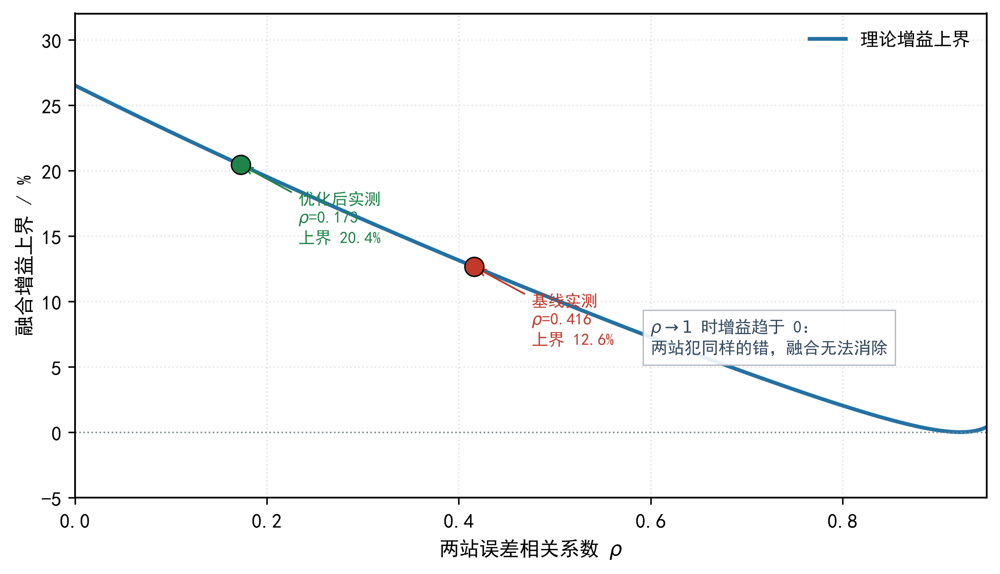{#fig:ch5_gainrho}

如图[@fig:ch5_gainrho]所示，曲线在 $\rho<0.3$ 的区间陡降，$\rho>0.6$ 之后贴近零轴；两个实测点落在中部与上部，基线对应 12.4%，优化后对应 20.4%。低相关区每降 0.1 换来的增益远大于高相关区，去相关的努力应投在 $\rho$ 尚未很高的阶段。

这里必须交代标尺与实测的偏差。把优化后的相关系数与方差代入式[@eq:ch5_gain_rho]得 20.4%，实测增益却为 26.29%。原因有二：式中 $\sigma$ 取全段均方根，被少量大误差帧抬高，而逐帧权重用的是该帧预测协方差；$\rho$ 同样是全段平均，逐帧相关性并不同质。该式应理解为"同等条件下可期望的增益标尺"，其结论——$\rho$ 是一阶决定量、$\rho\to1$ 时增益归零——不受影响，但不应当作逐帧硬界。

## 5.5 修复路径的探索与失效

5.3 与 5.4 节把增益不足归因于两个前提。自然的思路是分别修复：先校准协方差，再辨识互协方差。两条路径均告失效，而失效方式各不相同，恰好把瓶颈的位置钉死。

### 5.5.1 基于新息统计的协方差校准

既然 NEES 为 4.76 说明协方差低估，最直接的办法是按新息统计估计一个尺度因子，把协方差整体放大

$$\kappa_i=\frac{1}{N}\sum_k\frac{\boldsymbol\nu_{i,k}^T\mathbf S_{i,k}^{-1}\boldsymbol\nu_{i,k}}{m}, \mathbf P_i\leftarrow\kappa_i\mathbf P_i$$ {#eq:ch5_ccf}

按 NEES 的读数，$\kappa_1$ 应接近 2.4。实测的 $\kappa$ 扫描呈完美单峰，但峰位于 $\kappa=1$，即最优解是不校准。执行校准后融合误差由 10.25 km 变为 10.05 km，增益由 0.5% 升到 2.4%，仍远低于该配置 9.7% 的天花板。

单峰说明这不是"参数没调好"，而是目标函数在 $\kappa=1$ 处取极值。校准是全局尺度，权重错配却是分段现象：近距段 R1 不差于 R2，远距段明显更差，全局 $\kappa$ 无法只修正远距段，放大 $\mathbf P_1$ 会同时削弱 R1 在近距段的权重，两者在全局目标上抵消。方法学含义比数值更重要：NEES 度量协方差的绝对一致性，融合需要的是两站协方差之比的相对正确性。一致性不等于权重正确。

### 5.5.2 互协方差的在线辨识

第二条路径是辨识 $\mathbf P_{12}$。若能在线得到它，互协方差融合即可生效。实现上采用位置差反演，其依据是两站位置差的方差可写成

$$\operatorname{Var}(\mathbf x_1-\mathbf x_2)=\mathbf P_1+\mathbf P_2-\mathbf P_{12}-\mathbf P_{21}$$ {#eq:ch5_p12_var}

在 $\mathbf P_{12}=\mathbf P_{21}^T$ 的对称假设下解出

$$\mathbf P_{12}=\frac{1}{2}\left(\mathbf P_1+\mathbf P_2-\operatorname{Var}(\mathbf x_1-\mathbf x_2)\right)$$ {#eq:ch5_p12_diff}

再按 $\hat\rho=\operatorname{tr}(\mathbf C_{12})/\sqrt{\operatorname{tr}(\mathbf C_{11})\operatorname{tr}(\mathbf C_{22})}$ 折算为相关系数。实测结果如表[@tbl:ch5_icbc]所示。

| 场景 | 真值 $\rho$ | 未校准 $\mathbf P$ 的估计 | 判定 |
| ---- | ---- | ---- | ---- |
| multi_cross | −0.227 | −0.239 | 符号与量级均正确 |
| adsb_0002 | +0.427 | −0.607 | 符号错误 |

: 位置差反演法的互相关辨识结果 {#tbl:ch5_icbc}

合成场景估出 −0.239，与真值只差 0.012；真实场景估出 −0.607，而真值为 +0.427，量级与符号都错。原因在式[@eq:ch5_p12_diff]要求 $\mathbf P_1$ 与 $\mathbf P_2$ 准确：R1 的协方差低估约 2 倍，使 $\operatorname{Var}(\mathbf x_1-\mathbf x_2)$ 被高估，反解出的 $\mathbf P_{12}$ 必然偏负。合成场景的 $\mathbf P$ 本就偏保守，反演式近似成立，正好构成对照。

符号错误的后果不是精度下降而是算法失效。负的 $\mathbf P_{12}$ 使式[@eq:ch5_bc_w]的权重越出 $[0,1]$，实现中为避免发散将其截断为零，互协方差融合随即退化为简单凸组合。这是 5.2.1 节两者三位小数全同的原因，也是一条必须交代的负结果：该分支实际未生效。

### 5.5.3 为什么必须先校准再辨识

5.5.1 与 5.5.2 节合起来给出一条方法学结论：顺序不能颠倒。式[@eq:ch5_p12_diff]以 $\mathbf P$ 准确为前提，故必须先校准再辨识；而校准在全局意义上无收益，$\kappa$ 的最优值就是 1。三步链条中前两步各有一处断裂。

更值得追问的是：即便顺序执行成功，收益有多大？把真值相关系数与真实方差一并代入（任何辨识算法都无法超越的上界），基线配置下融合误差 9.30 km、增益 9.7%。也就是说，$\rho=0.43$ 时无论辨识多精确，天花板都只有 9.7%；而模型集匹配把 $\rho$ 降到 0.17 后，不做任何校准与辨识，简单凸组合即得 26.29%，是该上界的 2.7 倍。

两条路径的对比固定了本章的核心判断：尺度不是主因，相关性才是。协方差低估的影响可通过权重截断、保守化缓解，相关性却是硬约束，它决定可被消除的独立分量还剩多少。两条修复路径注定收益有限——它们在优化二阶量，而瓶颈在一阶量上。

## 5.6 融合的适用条件

5.5 节说明在算法层面修不动。于是换一个问法：不是"如何让融合处处有效"，而是"在哪些条件下融合本来就有用"。这个问题可用可观测量回答，答案直接构成工程判据。本节三组分段统计均基于 adsb_0002 的基线配置与 1219 个共同帧。

### 5.6.1 按目标距离分段

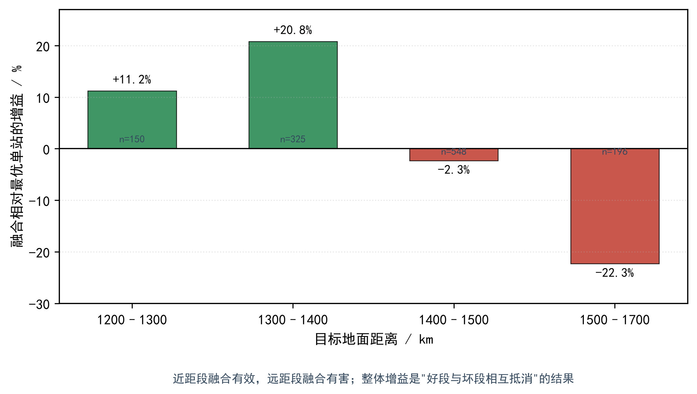{#fig:ch5_dist}

如图[@fig:ch5_dist]所示，增益随距离单调恶化并在 1400 km 附近变号：1200–1300 km 段为 +11.2%，1300–1400 km 段升到 +20.8%，1400–1500 km 段转为 −2.3%，1500–1700 km 段跌到 −22.3%。前两段融合明确有益，后两段明确有害，中间不存在平缓过渡区。分段明细如表[@tbl:ch5_dist]所示。

| R1 距离 / km | $n$ | R1 / km | R2 / km | 融合 / km | 增益 |
| ---- | ---- | ---- | ---- | ---- | ---- |
| 1200–1300 | 150 | 8.87 | 8.89 | 7.88 | +11.2% |
| 1300–1400 | 325 | 8.29 | 8.68 | 6.57 | +20.8% |
| 1400–1500 | 548 | 13.53 | 11.83 | 12.11 | −2.3% |
| 1500–1700 | 196 | 14.61 | 9.12 | 11.15 | −22.3% |

: 按目标距离分层的融合增益（adsb_0002 基线配置） {#tbl:ch5_dist}

物理解释有三层。其一，距离越远方位误差的杠杆臂越长，$r\sigma_{az}$ 线性增长，1500 km 处 R1 的 0.35° 对应 9.2 km，已与群距离噪声同量级。其二，两站电离层穿透几何不同，虚高残差按各自几何因子放大且放大率不同，远距段精度排序反转——1500–1700 km 段 R1 为 14.61 km 而 R2 为 9.12 km。其三，排序反转而权重仍按报告协方差分配，错配被放大，融合把结果拉向较差的一站。

这一分层纠正了一个误解。全段 0.5% 常被读作"融合增益普遍很低"，实际它是近距段 +20.8% 与远距段 −22.3% 在均方根意义上相互抵消的结果。两个分段的绝对值都远大于整体值，说明融合不是均匀地弱，而是分段地有效与分段地有害。

### 5.6.2 按两站精度比分段

距离只是代理变量，真正起作用的是两站精度之比。按逐帧误差比 $e_1/e_2$ 分段，结果如表[@tbl:ch5_ratio]所示。

| $e_1/e_2$ | $n$ | R1 / km | R2 / km | 融合 / km | 增益 |
| ---- | ---- | ---- | ---- | ---- | ---- |
| 0.0–0.8（R1 明显更准） | 406 | 6.44 | 14.23 | 8.88 | −37.9% |
| 0.8–1.0（两站相当） | 101 | 9.67 | 10.83 | 9.73 | −0.7% |
| 1.0–1.3（R2 略准） | 137 | 12.04 | 10.49 | 11.32 | −7.9% |
| 1.3–3.0（R2 明显更准） | 337 | 13.35 | 7.15 | 10.44 | −46.1% |

: 按两站逐帧误差比分层的融合增益（adsb_0002 基线配置） {#tbl:ch5_ratio}

两端的数字最有说服力。R1 明显更准时（6.44 km 对 14.23 km），融合把 6.44 km 恶化到 8.88 km，损失 37.9%；R2 明显更准时（13.35 km 对 7.15 km），融合把 7.15 km 恶化到 10.44 km，损失 46.1%。两端对称地坏，中间两段接近零，形态是以 $e_1/e_2=1$ 为峰、向两侧陡降的曲线。

这一形态可由式[@eq:ch5_gain_rho]直接预测。两站精度差异越大，收益上限越低：$\rho=0$ 时 $\sigma_2=2\sigma_1$ 的最优融合误差为 $0.894\sigma_1$，增益上限只有 10.6%；$\sigma_2=4\sigma_1$ 时降到 3.0%。与此同时，权重误差的代价随精度比放大。上限下降与代价上升同向叠加，交叉点就在精度比接近 1 处。以 0.0–0.8 段为例，理论上限约 8.8%，实测 −37.9%，46.7 个百分点的落差全部由权重错配造成。

这条判据比 5.6.1 节更本质，因为它可脱离距离使用：两站报告的精度相当则融合有意义，一方明显占优则期望收益不足以补偿权重误差的风险，直接采用较优单站更稳妥。工程上可把"两站报告方差之比落在 0.8 至 1.3 之间"作为启用融合的必要条件。

### 5.6.3 门控的尝试与概念澄清

既然融合分段有效，一个自然的工程方案是门控：只在有利条件下融合，其余情况直接用最优单站。按距离门控的实测结果如表[@tbl:ch5_gate]所示。

| 方案 | 融合帧占比 | 整体 RMSE / km | 增益 | 可观测性 |
| ---- | ---- | ---- | ---- | ---- |
| 全段融合 | 100% | 10.25 | 0.5% | — |
| 距离门控 < 1400 km | 39.0% | 9.77 | 5.2% | 完全可观测 |
| 距离门控 < 1450 km | 60.3% | 9.64 | 6.4% | 完全可观测 |
| $\chi^2$ 一致性门控 | — | — | 2.1% | 可观测但方向相反 |
| Oracle 门控 | 23.6% | 6.71 | 34.9% | 需事后信息 |

: 四种融合门控方案的对比（adsb_0002 基线配置） {#tbl:ch5_gate}

距离门控把增益从 0.5% 提到 6.4%，实现只需一个阈值判断，工程上零成本。阈值取 1450 km 时最优，更严会漏掉有利帧，更松会引入远距段的负增益。Oracle 门控假定事后知道哪些帧融合更好，只在 23.6% 的帧上融合，误差降到 6.71 km、增益 34.9%。两者相差 28.5 个百分点，就是缺少可观测判据的代价。

最自然的判据是两站估计的一致性，用马氏距离构造

$$\chi^2=(\mathbf x_1-\mathbf x_2)^T(\mathbf P_1+\mathbf P_2)^{-1}(\mathbf x_1-\mathbf x_2)$$ {#eq:ch5_chi2}

直觉是 $\chi^2$ 小则两站一致、融合应当有效。实测完全相反：融合成功帧的平均 $\chi^2$ 为 1.70、中位 1.24，失败帧为 1.30、中位 0.80，成功帧的一致性反而更差；按区间分组，0–2 区间增益 −0.8%，2–5 区间 +4.8%。整体门控增益只有 2.1%。

这一失败是概念问题而非实现问题。$\chi^2$ 度量两站估计的一致程度，融合能否获益取决于两站误差的独立程度，二者并不对应。$\chi^2$ 小说明两个估计靠得近，而靠得近有两种可能：两站各自独立地把误差平均掉了，融合已无空间；或两站被同一个偏差同时拉偏，融合根本无效。$\chi^2$ 大说明两站分歧明显，恰是独立犯错的标志，取平均才能消掉独立分量。成功帧 $\chi^2$ 大于失败帧，正是这一区分的证据。

由此得到一条概念结论：融合门控的正确依据是误差独立性，不是估计一致性。后者容易观测，前者难以观测，这正是门控至今没有满意解的原因，也是 Oracle 上界 34.9% 与实际可达 6.4% 之间那道鸿沟的来源。若能在线估计逐帧的误差独立性，增益还有约 28 个百分点的空间。

## 5.7 本章小结

本章回答了配对之后融合能带来多少精度、在什么条件下有效两个问题。

机理与上界方面，把四种融合算法还原为对互协方差的四种处理方式，指出其差别不在算法精巧程度而在前提是否成立；由标量最优融合解推导出增益闭式关系，证明 $\rho=0$ 时等方差增益上限为 29.3%、$\rho=0.43$ 时降到 9.7%、$\rho\to1$ 时归零，把相关性换算为可比较的性能量。

主结果与稳健性方面，100 种子实测给出基线 12.24% 与优化 26.29% 的增益，后者 100 个种子无一为负；50 种子配对检验的 95% 置信区间为 [25.2, 27.5]、效应量 $dz=4.75$；跨两个真实场景复现，相关系数降幅 58% 与 65%、增益 26.1% 与 28.0%；并发增长 4.5 倍后增益不降反升，种子间标准差缩小到三分之一。

前提与负结果方面，识别出协方差可信度与误差独立性两个前提，前者由 NEES 4.76（低估约 2 倍）刻画，后者由 $\rho=+0.416$ 刻画；系统排除了三条修复路径——协方差校准的 $\kappa$ 扫描单峰且峰在不校准处，位置差反演的互相关辨识符号错误，$\chi^2$ 一致性门控方向相反；并如实报告互协方差融合因 $\mathbf P_{12}$ 截断为零而退化为简单凸组合、协方差交叉在均值与最坏情况下均劣于简单凸组合。五条负结果共同指向一个判断：尺度不是主因，相关性才是。

适用条件方面，给出按距离与按精度比的两条判据，指出全段 0.5% 是近距段 +20.8% 与远距段 −22.3% 相互抵消的结果，而非均匀低增益；距离门控以零成本把增益提到 6.4%，并澄清门控依据是误差独立性而非估计一致性。本章的产出是一条机理链条：模型匹配决定共同误差，共同误差决定相关系数，相关系数决定增益上界，上界与权重正确性共同决定实际收益，第6章据此汇总。

# 第6章 总结与展望

## 6.1 全文工作总结

本文面向短波外辐射源双照射源场景下的航迹关联与融合问题展开研究。该场景的独特困难在于量测精度低、数据率低、电离层传播存在系统性失配，且两站误差可能高度相关，使得常规多传感器关联与融合方法难以直接适用。围绕这一问题，本文从量测建模、时空配准、单站滤波、跨照射源关联到航迹融合，建立了完整的处理链路，并对每一环节的关键机理给出了定量刻画。

在量测与配准层面，本文建立了天波双基地群距离模型，将电离层等效虚高作为显式参数引入几何关系，并据此构造三维量测向量。针对虚高失配造成的距离相关偏差，本文采用三参数联合最大似然配准，把虚高、时间同步距离偏置与方位系统偏差一并估计。实测表明，未配准时单站位置误差达 82.53 km、滤波器完全发散；两参数均值标定后可降至 11.75 km，收回 85.8% 的误差；而三参数方法进一步消除了随距离的系统性漂移，其融合误差在 10 至 80 km 的虚高失配区间内几乎保持不变，表现出失配免疫特性。

在单站滤波层面，本文构建了五模型交互多模型无迹卡尔曼滤波器，并推导了位置与横向速度的信息量下界。实测稳态位置误差 2.20 km 与理论下界 2.24 km 吻合至 2%，横向速度误差亦与 74 m/s 的下界一致。这一结果表明单站精度已逼近其物理极限，进一步提升必须依靠多站信息。基于此判断，本文系统检验了过程噪声调度、自适应过程噪声与自适应转移概率三条常规优化路径，实测均为负结果，并从多普勒量测已直接约束速度这一机理给出了可迁移的失效判据。

在模型设计层面，本文统计了二十余万个实测 ADS-B 点的转弯率分布，发现原设计模型集对应真实机动率的 p99 与极端值，存在严重失配。三档对比与六档细扫实验表明，模型集匹配使单站误差小幅改善、使两站误差相关系数显著下降、使融合增益大幅提升。细扫曲线同时揭示，互相关随模型集变窄单调下降，而绝对误差呈 U 形，两者存在竞争机制，最优档位与真实机动率的 p90 分位相匹配。这一结果给出了可操作的设计准则：转弯模型集的上界取目标机动率的 p90 分位，下界取其四分之一左右。

在关联层面，本文对比了最近邻、双门限三判据与序贯最近邻三类方法，通过参数扫描与误配性质诊断识别出两个结构性缺陷，即连续帧门限造成的跷跷板效应，以及判定与指派混用同一分数造成的成对交换。针对这两个缺陷，本文提出判定与指派分层的多证据加权融合关联方法，在密集场景上将误配数降至 6.20，相对最近邻下降 62%，并在查准率与查全率两个方向上同时优于序贯最近邻。

在融合层面，本文实现了四种基础融合算法，并通过协方差可信度与误差独立性两个前提的检验，解释了融合增益从基线配置的 12.24% 提升至 26.29% 的机理。实测表明，模型集优化后两站误差相关系数由 0.416 降至 0.173，滤波器一致性指标由 4.28 降至 2.91，一百个种子上无一出现负增益。本文还系统排除了三条修复路径，并给出了按目标距离与两站精度比的融合适用判据。

## 6.2 主要结论与创新点

本文的主要结论可归纳为三点。

第一，短波双照射源航迹级融合的增益上限由两站误差的相关性决定，而相关性主要由前端模型与真实机动的匹配程度决定。模型集匹配使两站"各自犯各自的错"，误差趋于独立，融合才有效；模型失配则使两站"犯同样的错"，误差相关，融合失效。这一因果链条把滤波与融合两个原本分离的模块用互相关这一中间量连接起来，并在两个独立的真实场景上复现：并发 6.2 架时增益 26.1%，并发 28.1 架时增益 28.0%，两者几乎重合。

第二，单站精度已逼近信息量下界，因而融合增益不可能通过优化单站滤波获得，只能通过改变两站误差的相关结构获得。这一判断把"如何提升融合精度"这一工程问题，转化为"如何设计模型集使两站误差去相关"这一设计问题，并给出了基于真实机动率统计分位数的定量准则。

第三，关联算法的性能瓶颈往往不在判据本身，而在判据的组织方式。连续帧门限把"证据是否充分"简化为"连续帧数是否达标"，在短共现场景下必然造成漏配；判定与指派混用同一分数则使平行航路目标产生成对交换。将判据由否决门槛降级为可加权证据、将指派交由全局最优匹配，可以在不增加任何新物理判据的前提下同时改善查准率与查全率。

## 6.3 不足与展望

本文的工作仍存在若干不足，需如实说明。

其一是实验规模。主对比配置各完成一百次蒙特卡洛，虽足以支撑统计检验（融合增益的 95% 置信区间为百分之二十五点二至二十七点五），但未达到开题时提出的不少于一千次的目标。全实验共完成七百六十四个仿真单元，覆盖模型集、配准模式、虚高失配、关联门限等多个维度。

其二是航迹长度指标。开题时预期融合可使航迹平均长度提升百分之五十，实测仅提升百分之一点八。经机理分析，这一落差并非算法缺陷所致：本文的单站航迹由点-航迹关联与纯预测续存共同维护，一旦建立便不会因漏检而终止，两站的航迹帧集重叠度达百分之九十，融合可延长的空间仅剩百分之十中的交叉部分。换言之，在航迹本身不断裂的架构下，航迹级融合的"延长寿命"收益结构性受限。融合的实际价值体现在精度提升与双站联合覆盖率的提高上。

其三是虚警性能的口径。本文的点-航迹关联采用参考真值引导，因而杂波点不会起始新航迹，虚假航迹率恒为零。该数值不能作为系统虚警性能的度量，仅可视为关联正确前提下的条件指标。真实系统的虚警性能需要在非引导关联下重新评估。

其四是配对质量与融合精度之间的传导尚未严格量化。本文的融合实验只接纳正确配对，这一口径虽与主链路一致，却恰好屏蔽了各方法在误配上的差异；同时不同方法的配对集合不可比，使得融合误差的横向比较存在样本选择偏差。构造"误配也参与融合"的端到端实验，直接量化误配的危害，是后续需要补齐的工作。

其五是计算规模。配对层已在高密集场景完成验证，峰值同时在场七十九架、总航迹四百七十一条；但融合全流程因逐对逐帧运算的开销，仅完成至二十八架并发，更高密度的全量蒙特卡洛受计算资源限制未展开。

基于上述认识，后续工作可从四个方向推进。第一，引入非引导的点-航迹关联，在真实虚警与漏检条件下重新评估关联与融合性能，使虚警率、航迹质量等指标具有工程意义。第二，研究误差独立性的在线估计方法。本文已证明，融合门控的正确依据是误差独立性而非估计一致性，且若能在线估计独立性，融合增益尚有约二十八个百分点、即从百分之六点四提升至百分之三十四点九的空间。第三，探索量测级融合。本文的工作属于航迹级融合，其增益受限于航迹估计已损失的信息；若能在量测层直接融合两站的群距离、方位与多普勒，理论上可突破航迹级融合的天花板。第四，开展几何差异化组网设计。既然融合增益源于误差去相关，那么主动设计两站的几何构型与观测条件差异，比被动地优化融合算法更为根本。

## 6.4 结语

本文的核心认识可以概括为一句话：双照射源航迹级融合的价值，不在于融合算法本身有多精巧，而在于两站是否看到了不同的东西。当两站的误差高度相关时，任何融合算法都无法凭空创造信息；而当模型设计与真实机动相匹配、使两站各自独立地犯错时，即使最简单的凸组合也能获得可观的增益。这一认识既解释了本文实测的增益变化，也界定了方法的适用边界，并为同类低精度、低数据率、强相关条件下的多传感器融合问题提供了一条可迁移的分析路径。

# 参考文献

[1] Patil V L. Status of wireless air defence systems before World War II[M]//Chronological Developments of Wireless Radio Systems before World War II. Singapore: Springer, 2021: 153-192.

[2] Griffiths H, Willis N. Klein Heidelberg: the first modern bistatic radar system[J]. IEEE Transactions on Aerospace and Electronic Systems, 2010, 46(4): 1571-1588.

[3] Baniak J, Baker G, Cunningham A M, et al. Silent Sentry passive surveillance[J]. Aviation Week & Space Technology, 1999, 7: 134-139.

[4] Edrich M, Schroeder A. Multiband multistatic passive radar system for airspace surveillance: a step towards mature PCL implementations[C]//Proceedings of the IEEE International Conference on Radar. Adelaide: IEEE, 2013: 218-223.

[5] 万显荣, 赵志欣, 柯亨玉, 等. 基于DRM数字调幅广播的高频外辐射源雷达实验研究[J]. 雷达学报, 2012, 1(1): 11-18.

[6] 赵志欣. 高频外辐射源雷达新体制与信号处理若干关键技术研究[D]. 武汉: 武汉大学, 2013.

[7] Julier S J, Uhlmann J K. Unscented filtering and nonlinear estimation[J]. Proceedings of the IEEE, 2004, 92(3): 401-422.

[8] Colone F, O'Hagan D W, Lombardo P, et al. A multistage processing algorithm for disturbance removal and target detection in passive bistatic radar[J]. IEEE Transactions on Aerospace and Electronic Systems, 2009, 45(2): 698-722.

[9] Palmarini C, Martelli T, Colone F, et al. Disturbance removal in passive radar via sliding extensive cancellation algorithm (ECA-S)[C]//Proceedings of the IEEE Radar Conference. Arlington: IEEE, 2015: 162-167.

[10] Demissie B, Steffes C. Drone detection with a LTE450-based passive radar[J]. IET Radar, Sonar & Navigation, 2025, 19(1).

[11] Zarei M, Chhabra R, Mottaghi M. Sequential track fusion in multi-sensor networks of unscented Kalman filters: a case of slip estimation in planetary mobile robots[J]. Acta Astronautica, 2024, 219.

[12] 陈书恒, 朱倪瑶, 王海鹏, 等. 基于去相关无偏转换量测的外辐射源雷达跟踪算法[J]. 雷达科学与技术, 2026.

[13] 程瑞, 易建新, 万显荣. 基于改进SHAEKF算法的外辐射源雷达机动目标跟踪[J]. 信号处理, 2025, 41(12): 1908-1916.

[14] 陈智超, 许震俞, 郝金龙, 等. 基于微动特性的标签分层逐级更新的密集目标跟踪算法[J]. 计算机工程, 2025.

[15] 彭锐晖, 贺基贤, 孙殿星, 等. 复杂环境下基于CNN-Transformer的端到端航迹关联[J]. 电讯技术, 2025, 65(5): 663-673.

[16] 张强, 曹恒, 林智奇. 基于外辐射源雷达航迹运动特征的无人机与飞鸟识别[J]. 现代雷达, 2025, 47(11): 66-74.

[17] Singer R A, Kanyuck A J. Computer control of multiple site track correlation[J]. Automatica, 1971, 7(4): 455-463.

[18] 何友, 谭庆海, 蒋蓉蓉. 多传感器综合系统中的航迹相关算法[J]. 火力与指挥控制, 1989, 14(1): 1-12.

[19] 何友, 彭应宁, 陆大䋮, 等. 分布式多传感器数据融合中的双门限航迹相关算法[J]. 电子与信息学报, 1997, 19(6): 721-728.

[20] Bar-Shalom Y, Li X R, Kirubarajan T. Estimation with applications to tracking and navigation: theory, algorithms and software[M]. New York: John Wiley & Sons, 2001.

[21] Sönmez H H, Hocaoğlu A K. Asynchronous track-to-track association algorithm based on reference topology feature[J]. Signal, Image and Video Processing, 2021, 16(3).

[22] Xu P, Cui Y, Xiong W. MH-T2TA: a multiple-hypothesis algorithm for multi-sensor track-to-track association with an intelligent track score[J]. Frontiers of Information Technology & Electronic Engineering, 2025, 26(11).

[23] Tian D, Feng K, Liu T, et al. Geometric optimization for joint localization and surveillance in distributed passive radar[J]. Signal Processing, 2026, 245.

[24] Guan X, Huang Z, Yi X, et al. Adaptive fast track association for small samples in distributed multi-sensor systems[J]. IET Radar, Sonar & Navigation, 2025, 19(1).

[25] 何友, 修建娟, 关欣. 雷达数据处理及应用[M]. 3版. 北京: 电子工业出版社, 2022.

[26] 陈毓. 基于CNN-BiLSTM的多源航迹关联技术研究及应用[D]. 成都: 电子科技大学, 2023.

[27] 刘易翰. 面向多传感器多目标环境的航迹融合算法研究[D]. 成都: 电子科技大学, 2025.

[28] 董硕. 基于机器学习的多传感器航迹关联算法[D]. 成都: 电子科技大学, 2025.

[29] 王威, 王筱, 董长虹. 基于拓扑增强和灰色理论的分层航迹关联方法[J]. 北京航空航天大学学报, 2025.

[30] 张浩然. 基于时空关系的目标航迹关联方法研究与实现[D]. 北京: 北方工业大学, 2025.

[31] 丁振平, 郭徽东. 基于图谱特征的多目标航迹关联算法仿真[J]. 系统仿真学报, 2025, 37(9): 2387-2396.

[32] Julier S J, Uhlmann J K. A non-divergent estimation algorithm in the presence of unknown correlations[C]//Proceedings of the 1997 American Control Conference. Albuquerque: IEEE, 1997.

[33] Niehsen W. Information fusion based on fast covariance intersection filtering[C]//Proceedings of the Fifth International Conference on Information Fusion. Annapolis: IEEE, 2002.

[34] Qi J, Lu X, Sun J. Multi-radar track fusion method based on parallel track fusion model[J]. Electronics, 2025, 14(17).

[35] 李天成, 李固冲, 李文硕, 等. 均值融合跟踪概念、理论与方法[J]. 中国科学: 信息科学, 2026, 56(1): 23-58.

[36] 李诚, 沃天宇, 黄大羽, 等. 有限视域下分布式多目标跟踪算法[J]. 航空电子技术, 2025, 56(4): 56-64.

[37] 应钰淇. 分布式大气波导雷达数据融合技术研究[D]. 哈尔滨: 哈尔滨工业大学, 2025.

[38] 张卓为. 基于深度学习的阵列测向与角度信息融合方法研究[D]. 北京: 中国电子科技集团公司电子科学研究院, 2025.

[39] 杨广平. 外辐射源雷达关键技术研究[J]. 现代雷达, 2008, 27(12): 33-36.

[40] 王鹏, 敬敏, 王朝辉, 等. 基于IEKF的外辐射源雷达目标跟踪方法[J]. 现代雷达, 2026.

[41] 李晓花, 李亚安, 金海燕, 等. 三维数据关联情况下外辐射源雷达多目标跟踪研究[J]. 电子与信息学报, 2021, 43(10): 2840-2847.

[42] 车景平. 分布式外辐射源雷达组网航迹融合问题研究[D]. 西安: 西安电子科技大学, 2017.

[43] 孙文. 多接收站外辐射源雷达目标检测与跟踪[D]. 成都: 电子科技大学, 2018.

[44] Zhao Y S, Zhao Y J, Zhao C. A novel algebraic solution for moving target localization in multi-transmitter multi-receiver passive radar[J]. Signal Processing, 2018, 143: 303-310.

[45] Fjallbrant T T. Interpolation and extrapolation in nonuniform sampling sequences with average sampling rates below the Nyquist rate[J]. Electronics Letters, 1975, 11(12): 264-266.

[46] Chan Y T, Hattin R V, Plant J B. The least squares estimation of time delay and its use in signal detection[J]. IEEE Transactions on Acoustics, Speech, and Signal Processing, 1978, 26(3).

[47] 李教. 多平台多传感器多源信息融合系统时空配准及性能评估研究[D]. 西安: 西北工业大学, 2003.

[48] 祁永庆. 多平台多传感器配准算法研究[D]. 上海: 上海交通大学, 2008.

[49] 鹿强, 吴琳, 陈昭, 等. 海上目标多源轨迹数据关联综述[J]. 地球信息科学学报, 2018, 20(5): 571-581.

[50] 何友, 彭应宁. 一种多目标多传感器航迹相关算法[J]. 清华大学学报: 自然科学版, 1997, 37(9): 108-113.

[51] 何友, 彭应宁, 陆大䋮, 等. 多传感器数据融合系统中两种新的航迹相关算法[J]. 电子学报, 1997, 25(9): 10-14.

[52] 何友, 彭应宁, 陆大䋮. 多目标多传感器模糊双门限航迹相关算法[J]. 电子学报, 1998, 26(3): 15-19.

[53] Aziz A M. Fuzzy track-to-track association and track fusion approach in distributed multisensor-multitarget multiple-attribute environment[J]. Signal Processing, 2007, 87(6): 1474-1492.

[54] Wan E A, Van Der Merwe R. The unscented Kalman filter for nonlinear estimation[C]//Proceedings of the IEEE 2000 Adaptive Systems for Signal Processing, Communications, and Control Symposium. Lake Louise: IEEE, 2000: 153-158.

[55] 彭锐晖, 高恒, 吕进锋, 等. 多平台异构信息融合的航空目标跟踪算法[J]. 电子与信息学报, 2024, 46(5): 1892-1900.

[56] 王铮, 韩宝玲. 基于UKF航迹滤波的干扰目标智能识别算法研究[J]. 航空兵器, 2019, 26(3): 45-50.

[57] 任势达. 杂波环境下多传感器多目标数据关联技术研究[D]. 北京: 中国电子科技集团公司电子科学研究院, 2024.

[58] 丁力全, 吴楠, 孟凡坤, 等. 信息融合算法在空间飞行器自由段跟踪中的应用[J]. 指挥控制与仿真, 2021, 43(2): 33-38.
