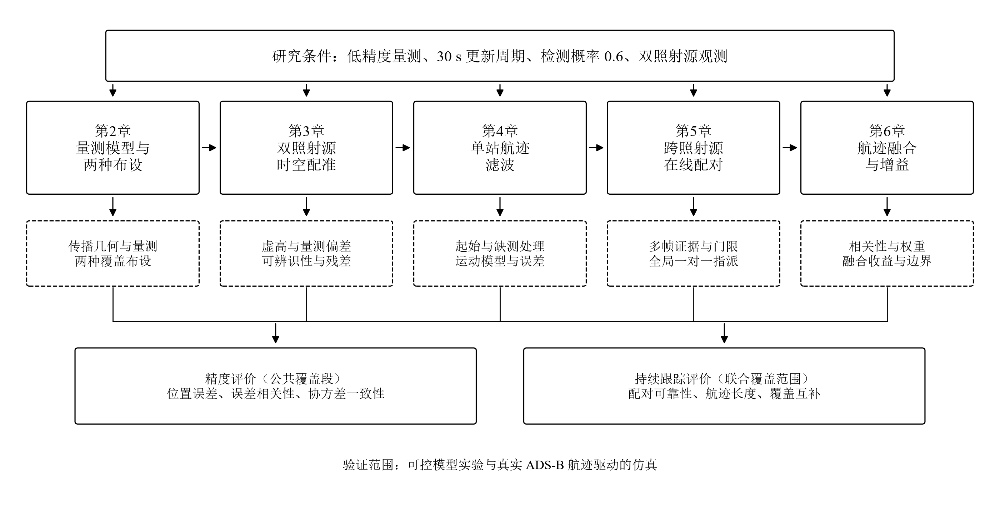

# 第1章 绪论

## 1.1 研究背景与意义

对超视距、强隐蔽目标的广域监视需求，长期受制于雷达体制的物理边界。微波雷达依靠视距传播，单站作用距离仅数十至数百公里，且受地球曲率遮挡；自建发射阵地的短波超视距雷达虽可覆盖数千公里，却因阵地固定、辐射特征明显而生存能力受限。短波外辐射源雷达提供了第三条路径：以广播、通信等既有的短波信号为照射源，借助电离层反射实现超视距照射，接收站只负责接收目标散射回波，自身不辐射。

其优势来自体制而非单项指标[39]。照射源属于第三方，接收站无需申请专用频率、无需建设发射设施，成本与部署周期一并压缩；全程被动接收，难以被电子侦察发现与定位，也不存在可被反辐射武器攻击的发射阵地；短波波长远大于吸波材料的适用尺度，双基地几何下前向散射增强，因而具备一定的反隐身潜力。

其效能同时被物理链路制约。信号须两次穿越电离层，由此形成三重困难。电离层是时变、非均匀的随机介质，行波扰动引起相位污染、多普勒展宽与群路径抖动，等效虚高在数十分钟内即可漂移数公里。非合作信号并非为雷达设计，调幅广播与 DRM 信号的带宽仅十千赫兹量级，模糊函数沿时延轴的主瓣很宽，距离分辨单元可达数十公里。回波功率比直达波低数十至上百分贝[8]，检测须先解决强直达波与多径分量的抑制。

上述条件最终凝结为一组量测指标：群距离误差 10 km 量级，方位误差 0.35° 至 0.60°，检测概率 0.6，更新周期 30 s。在 1500 km 地面距离上，0.35° 的方位误差对应约 9 km 的横向误差，与群距离误差同量级；30 s 内巡航速度 230 m/s 的目标已移动 6.9 km。量测误差与帧间位移同量级，意味着相邻两帧的点迹在状态空间中已难以区分。经典的航迹起始、点迹关联与状态滤波都以误差远小于帧间位移为前提，这一前提在短波条件下不成立，直接套用现有算法难以获得提升。

利用多个照射源同时照射同一区域、以空间与频率分集获取额外信息，是被广泛看好的路径[44]。分集的价值在于误差互补：同一目标相对两源的双基地几何不同，误差椭球的长轴方向也不同，在一个源上主要表现为群距离误差的方向，在另一个源上可能是方位约束较强的方向；两源载频不同，衰落近似不相关，一个源漏检时另一个源仍可能给出有效点迹。分集增益不会自动兑现。两条航迹放在一起，先要判断它们是否指向同一目标，再要判断如何把两个低精度估计合成为更好的估计。时间上两源帧时刻存在偏移；空间上两条射线的电离层路径不同，等效虚高不一致，形成与目标位置强耦合的系统偏差；关联上低精度使不同目标的航迹相互交叠，低数据率又使可用判决样本极少；融合上两源共视同一目标与同一片电离层，局部估计误差不再独立，独立性假设随之失效。四个问题层层相扣，构成本文研究对象的整体。

理论意义在于：经典航迹融合假设传感器精度足够高、数据率足够密、局部估计误差相互独立，短波双照射源场景同时打破这三条。因此改进的起点不在算法库中另选一种加权方式，而在误差从何而来、相关性如何形成这一层面，重新审视融合的有效性。工程意义在于：所形成的方案可支撑海空态势感知与远程目标监视，使短波被动探测从能发现走向能连续跟踪。

## 1.2 国内外研究现状

### 1.2.1 短波外辐射源雷达的发展脉络

外辐射源探测的思想几乎与雷达同时诞生。1935 年 Watson-Watt 利用 BBC 短波广播信号探测到 12 km 外的轰炸机，验证了借用第三方照射源探测目标的可行性[1]。二战期间德国研制 Klein Heidelberg 系统，通过接收英国 Chain Home 雷达网的信号实现机群预警，成为最早的实战化双基地雷达[2]。此后因收发隔离困难与信号处理能力不足，研究重心转向单基地雷达，该体制停滞近半个世纪。

20 世纪末，电子对抗对隐蔽探测的需求使其重新受到重视。1998 年美国洛克希德·马丁公司推出 Silent Sentry 系统，利用调频广播与电视信号实现 200 km 量级探测，标志其进入实用化阶段[3]。21 世纪初 DAB、DVB-T 与 DRM 等数字广播信号普及，带宽与载频稳定性优于模拟广播；德国 Cassidian 公司的 PARADE 系统综合运用多种广播信号，探测距离超过 150 km，定位精度优于 500 m[4]。国内起步较晚但进展迅速，武汉大学团队研制多波段实验系统并基于 DRM 信号开展外场实验[5,6]，多所高校与院所随后相继开展研究[39]。近年 LTE 等移动通信信号亦被引入，用于低空小目标的探测[10]。

纵观这一脉络，可见一条清晰的取舍：成熟系统多工作于米波或分米波段，依靠视距传播，作用距离百公里量级、精度可达百米量级；短波波段借助电离层反射可覆盖数千公里，代价是精度下降一个数量级以上。已公开的短波天波研究多采用自建发射站，以非合作广播为照射源、多源并用的工作尚不多见。距离与精度的这一矛盾，正是短波外辐射源雷达信息处理的起点。

### 1.2.2 天波链路的信息处理与单站滤波

信息处理的第一道关口是信号级处理。外辐射源雷达的直达波功率通常比目标回波高出数十至上百分贝，多径与杂波残留严重污染距离—多普勒平面，杂波抑制因而是检测的前提。Colone 等人提出的扩展相消算法以批处理投影消除强直达波与多径分量[8]，其滑窗改进版本进一步适应信道时变与目标机动[9]。这类方法决定有没有点迹，不决定点迹准不准。

单站航迹滤波方面，非线性滤波是主线。Julier 与 Uhlmann 提出的无迹卡尔曼滤波以无迹变换传播状态分布，避免线性化截断误差，成为处理极坐标量测的标准工具[7,54]。围绕外辐射源雷达的具体困难，国内学者做了针对性改进：文献[12]设计去相关无偏转换量测滤波以应对观测误差大、非线性强；文献[13]将自适应扩展卡尔曼滤波与交互多模型结合；文献[40]以迭代扩展卡尔曼滤波处理天波路径下的强非线性；文献[14]在 SORT 框架下并联多个无迹卡尔曼滤波器，借助马氏距离完成关联；文献[41]研究三维数据关联下的多目标跟踪。深度学习方法亦被引入，文献[15]构建端到端的航迹关联网络，文献[16]从运动特征入手区分无人机与飞鸟。

低检测概率下的航迹维持是另一条线索。检测概率 0.6 意味着平均每五帧丢失两帧，常规的连续多帧删除逻辑会使真实航迹过早终止。文献[10]在 LTE 体制的被动雷达中采用针对性的跟踪策略，验证了非合作信号下连续跟踪的可行性；文献[11]研究无迹卡尔曼滤波器组网中的序贯融合，以递归传播互协方差降低计算量；文献[55]与文献[56]分别处理多平台异构信息与干扰条件下的滤波。已有工作表明，低数据率下的滤波性能不仅取决于算法结构，更取决于运动模型与真实机动的匹配程度。不过，现有方法大多假设检测概率较高、噪声统计特性平稳，对电离层扰动引起的非平稳噪声缺乏系统处理；自适应过程噪声策略的有效性依赖新息统计量与机动强度的可分辨性，而这一前提在 30 s 采样间隔下并不稳固。

### 1.2.3 时空配准与系统偏差估计

多传感器系统的时空配准包含两个相对独立的问题：时间对齐与空间配准。时间对齐处理各传感器采样时刻不一致，常用插值或外推把状态折算到统一时刻，非均匀采样下的插值与外推精度已有系统分析[45]，时延的最小二乘估计则为异步量测提供了估计框架[46]。空间配准估计各传感器的系统偏差，经典做法把测距、测角的偏差建模为常值，以最小二乘或极大似然从公共目标中联合估计[47,48]。这类方法的前提是偏差与目标位置无关，因而可以用一组常数刻画。

天波链路不满足这一前提。等效虚高以非线性方式进入群距离，其灵敏度随目标距离单调衰减，同一虚高偏差在 1000 km 与 1900 km 处留下的距离误差相差约七成；标称值与真值之差因此不能被折成一个常数扣除，也不能靠坐标变换吸收。这使天波双基地的配准需要把虚高本身作为待估参数，并与距离偏置联合求解。两个参数在群距离上高度相关，可辨识性取决于标校集的几何分布，而非样本数量。已公开的配准研究多针对常值偏差，对这类随几何变化的参数讨论较少，而该环节的残差会直接进入后续的关联门限与融合权重。

### 1.2.4 航迹关联方法

航迹关联判断来自不同传感器的两条局部航迹是否源于同一目标，是融合的前置环节。基于统计检验的方法历史最久：最近邻法仅比较当前时刻的统计距离，密集目标下极易误判[17]；K 近邻法引入历史判决次数以提升鲁棒性[18]；双门限法设置距离与次数两级门限，仅当统计距离持续小于门限且累计次数足够时才确认关联[19]；序贯法利用航迹历史状态差的联合似然比检验，充分挖掘时间维信息[50,51]。基于模糊数学的方法以隶属度刻画相似性，构造模糊相关矩阵后按最大相似度判决[52,53]。Bar-Shalom 与何友分别在专著中系统总结了上述方法[20,25]，文献[49]给出了面向海上目标轨迹的综述。

近年来，关联方法向利用结构信息与利用学习能力两个方向演进。前者着眼于航迹间的拓扑关系：文献[21]以参考拓扑特征与广义子模式分配距离度量拓扑相似度，以抵抗系统误差；文献[29]采用上层灰色理论、下层拓扑相似的分层结构，在补偿系统偏差的同时降低计算量；文献[31]以航迹点的绝对与相对位置构建图谱特征，在密集场景下区分能力较好；文献[30]以时空关系描述航迹间的相对运动。后者借助学习模型提取时空特征：文献[26]以卷积与双向长短期记忆网络提取时空特征，文献[28]以机器学习方法构造关联判别器，文献[24]以密度峰值聚类应对小样本条件，文献[22]则在多假设框架下引入航迹评分以抑制歧义。文献[23]指出定位精度与观测几何构型密切相关，为门限设计提供了物理依据。

### 1.2.5 航迹融合方法

航迹融合把关联成功的局部航迹合成为全局一致的航迹，分布式结构因通信量小、鲁棒性强而成为主流[20]。简单凸组合融合按误差协方差的反比分配权重，计算量极小，其最优性依赖局部估计误差相互独立。为处理相关性，Bar-Shalom 与 Campo 给出了互协方差的递推估计[20]；互协方差难以获得时，协方差交叉融合构造包含各局部椭球交集的保守解以保证一致性[32]，其快速形式以协方差迹确定权重[33]。国内研究亦有积累：文献[35]综述了两类概率密度均值融合方法，文献[36]处理有限视域下的标签一致性问题，文献[37]研究分布式大气波导雷达的数据融合，文献[34]提出并行航迹融合模型，文献[27]面向多传感器多目标环境研究航迹融合算法，文献[38]把学到的方法引入阵列测向的角度信息融合，文献[42]与文献[43]分别讨论组网融合与多接收站探测的工程约束，文献[57]与文献[58]则处理杂波环境与空间飞行器跟踪中的融合问题。

### 1.2.6 现状评述

综合来看，两个方向的理论体系都已完备，但其假设前提与短波双照射源场景存在系统性错位。关联方法假定航迹连续、数据率高、误差远小于目标间距，而短波条件下误差与目标间距同量级、航迹片段化严重；融合方法假定局部估计误差独立或互协方差可计算，而双照射源共视同一目标与同一片电离层，相关性恰恰不可忽略。现有研究也很少把配准误差、航迹断续、关联歧义与误差相关放在同一场景中考察其相互放大的机制，因而难以回答一个更基本的问题：在这种量测条件下，融合究竟能带来多少增益，增益又由什么决定。

## 1.3 需要解决的问题

将上述分析落到具体环节，本文认为短波双照射源航迹关联与融合有四个需要正面回答的问题，它们分别位于配准、滤波、关联与融合，并沿处理链逐级传导。

第一是电离层等效虚高失配引起的空间配准问题。天波量测得到的是收发总群距离，需借助等效虚高才能反演目标的地面距离，而等效虚高本身未知且缓变。虚高误差经反演近乎一比一地转化为位置误差，在本场景的 1400 km 处系数为 1.02。实测中，标称失配 20 km 使单站均方根误差由 15.5 km 升到 21.7 km，融合增益由 41.9% 降到 19.6%；失配 40 km 时融合误差升至 30.1 km，增益只剩 8.5%。传统配准方法多针对测距、测角环节的常值偏差设计[47,48]，难以刻画虚高经非线性几何映射后形成的位置偏差。若不解决这一环节，后续关联将在被系统偏差整体平移的坐标中进行，任何门限设计都失去意义。

第二是低检测概率与低数据率共同导致的航迹断续问题。检测概率 0.6 意味着单站每五帧丢失两帧，30 s 的数据率又使目标在相邻帧间移动 6.9 km，预测协方差在连续漏检时迅速膨胀。传统航迹管理以连续多帧确认起始、以连续多帧丢失终止，在这种条件下要么过早终止真实航迹，要么因门限放宽而接纳大量虚假航迹。航迹一旦断裂，跨照射源关联便失去可供比较的重叠段，融合更无从谈起。进一步地，滤波器对过程噪声的调节在本体制下不构成有效手段，因为多普勒通道已经承担了全部速度信息；真正决定单站精度的，是运动模型与真实机动的匹配程度。

第三是密集空域下的关联歧义问题。同时在场目标增至数十架时，候选航迹对数量随目标数近似平方增长，而可区分度随量测误差增大而下降。当位置误差达到十公里量级、目标间距与之相当时，最近邻准则退化为近似随机指派；即便引入多帧累积，门限的收紧与放松也会在误配与漏配之间形成权衡，不存在同时最优的取值。更棘手的是残余误配的形态：平行航路或编队飞行下，两条航迹互相配反之后各自的位置序列仍然平滑合理，单帧统计检验无法察觉，只有从全局指派的角度才能识别。这类交换型误配一旦进入融合，会把两个目标的航迹长期污染。

第四是双站误差相关导致的融合失效问题。两个照射源跟踪同一目标，共享同一段真实机动过程与同一套运动模型；当模型与真实机动不匹配时，两站会在同一时刻、朝同一方向产生同号预测误差，局部估计误差因而正相关。此时简单凸组合融合仍按独立假设分配权重，结果既过度自信又偏离最优，融合精度甚至可能劣于较好的单站航迹。引入互协方差的算法理论上更合理，但互协方差难以从数据可靠估计；协方差交叉融合虽保证一致性，却以保守性为代价。由此可知，融合收益并不单纯由融合算法决定，更多取决于误差相关性这一前端属性，且这一关系应当有可计算的判据。

这四个问题并非彼此孤立。配准残差使量测带有缓变偏差，降低关联区分度；航迹断续使可用公共帧减少，加剧歧义；误配把错误配对送入融合；误差相关则决定即便配对完全正确，融合也未必带来收益。现有研究很少沿这条传导链考察各环节的耦合关系，这正是本文的切入点。

## 1.4 研究内容与结构安排

本文的研究定位是在既有的短波双照射源观测条件下，回答三个递进的问题：航迹级融合在什么条件下有效，为什么有效，以及如何使其有效。本文不追求单项指标全面最优，而力求把每一环节的性能边界、失效机理与适用条件交代清楚。全文的研究框架与章节对应关系如图[@fig:ch1_framework]所示。

{#fig:ch1_framework}

图中上层为观测条件派生的技术问题，中层为五个技术章与各自的决定性量，下层为贯穿全文的核心论点。五个环节沿处理链串行排列而非并列：配准残差进入滤波，滤波输出的航迹质量决定配对难度，配对结果再进入融合，因此任一环节的残差都会成为下一环节的输入扰动。这一串行结构决定了章节顺序，也决定了核心论点只能在全链路打通之后才能成立。

第2章建立量测模型与数据场景。从双基地群距离的折线等效出发，把电离层等效虚高显式参数化为可估量，推导群距离、方位与多普勒量测及其对虚高的灵敏度；给出近共视与覆盖互补两种布设的几何参数与分工，说明前者的用途是隔离变量、后者是延长航迹，二者不互相替代；以实测 ADS-B 航迹构造数据驱动的半实物场景。

第3章研究双照射源时空配准。区分站间时基与站源时基，把虚高、距离偏置与方位偏差写成三参数观测模型；由一阶线性化导出 Fisher 信息矩阵与参数下界，给出放大因子与可辨识条件，说明标校精度由距离跨度而非航迹条数决定；以最大似然估计完成标定，并用端到端对照与蒙特卡洛验证估计器逼近下界。

第4章研究单站航迹滤波与性能边界。采用交互多模型无迹卡尔曼滤波处理强非线性量测与 0.6 的检测概率，推导匀速窗口下的位置与速度下界；用三条负结果说明过程噪声调节不构成有效手段，并给出可迁移的判据；指出模型集与真实机动分布的匹配是唯一有效的杠杆；给出误差重尾的统计形态与报告口径。

第5章研究跨照射源在线配对。分析歧义的三个来源，把配对拆成判定与指派两层；判定层将多项判据软化为可加权证据，指派层以全局最优代替逐点贪心；用正交实验分离各成分的贡献，并由判别力推出确认帧数的取值。

第6章研究航迹融合与增益机理。导出逆方差加权的方差闭式，给出融合有效的条件；通过模型集匹配实验把误差相关性、协方差一致性与融合增益连成一条可检验的传导链；给出航迹长度的几何上界与覆盖互补布设的系统基线。

第7章总结全文，归纳结论与适用边界，说明未闭合的问题与后续方向。

全文以 ADS-B 实测航迹驱动的半实物仿真为验证基础：目标状态取自真实广播式自动相关监视报告，水平精度约 30 m，相对 10 km 量级的雷达误差可忽略；群距离、方位与多普勒由第2章的物理模型生成，检测与虚警按设定概率仿真。本文因此不称实测验证，所有结论在量测模型正确这一前提下成立。场景从同时六架目标的稀疏空域延伸至六十余架的高密集空域，前者检验链路可用性，后者检验方法在歧义压力下的行为。

按这一安排，本文的工作可以概括为：把双照射源的融合增益分解为几何的航迹延长与统计的误差互补两部分，分别给出上界与判据；把配准、滤波、配对三个环节的性能边界用可计算的量表达出来，使"为什么只能做到这一步"成为可以回答的问题。
