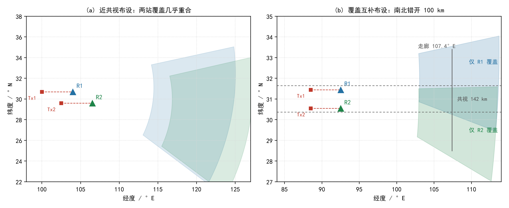
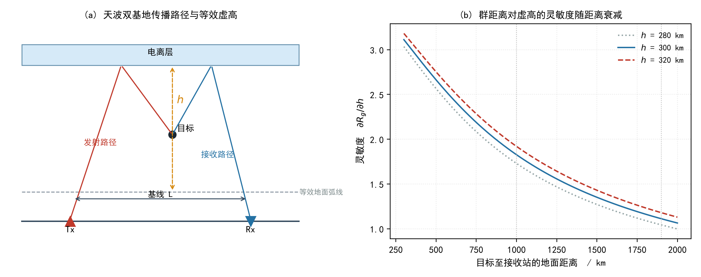
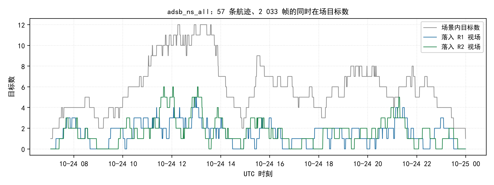
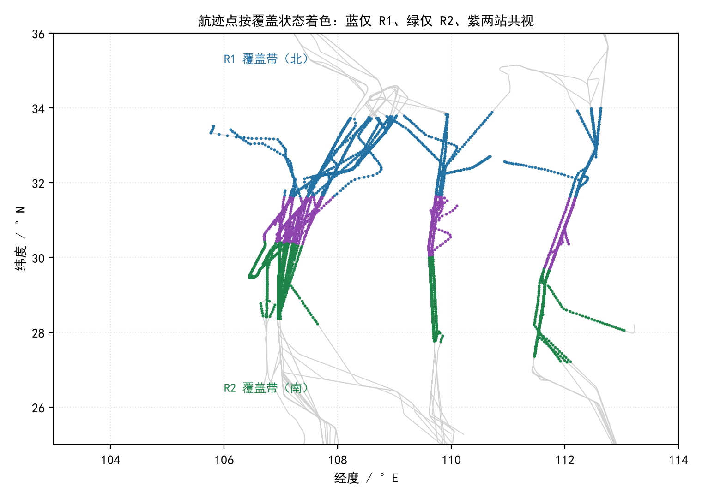

# 第2章 天波双基地量测模型与场景构建

双照射源的价值来自空间分集：一条链路被电离层吸收或衰落时，另一条链路仍能给出点迹；两站的误差来源不同，融合才有增益可谈。但分集不是免费的。分集要成立，两站覆盖既要在空域上重合，又要不完全重合。重合才有公共目标可比对，错开才能让并集比任一单站更长。这个张力决定了本文的两种布设，也决定了后面每一章的实验在哪一种几何上做。

本章把量测写清楚。短波信号经电离层折射，路径不是直线，按直线几何反演会系统性低估距离；双基地体制下收发两条路径长度不等，群距离是二者的和；三个量测通道的量级相差三个数量级，这直接决定了第3章代价函数的形式。本章还交代数据来源与场景构成：航迹取自真实的 ADS-B 报告，量测由前述模型仿真生成，二者结合构成本文全部实验的输入。

本章不涉及任何算法。滤波、关联、融合的处理流程从第3章开始，本章只回答一个问题：给定这样的几何、这样的传播模型和这样的数据，后续算法面对的究竟是什么样的量测。

## 2.1 两种布设

### 2.1.1 近共视布设

第一种布设让两站覆盖几乎重合，如图[@fig:ch2_layout]的(a)图所示。北站 R1 位于 104.0°E、30.7°N，其照射源 Tx1 位于 100.0°E、30.7°N；南站 R2 位于 106.5°E、29.6°N，照射源 Tx2 位于 102.5°E、29.6°N。两对收发站同纬度东西向布置，经度相差 4°，在 30° 附近对应收发基线约 385 km；两站相距约 270 km。两站波束中心同为 93°、全宽 45°，单跳地面距离窗取 1000–2000 km。

这种布设的用途是隔离变量。两站覆盖几乎重合，同一目标在两站的时间段高度重叠，站间差异只剩下噪声强度与几何微差，任何性能差异都可以归因到算法或模型，而不是"这边看得见、那边看不见"。第6章的模型集传导链在第4章的单站滤波之上讨论，用的就是这一布设，因为传导链关心的是两站误差的相关性，不是覆盖的拼接。

距离窗的下限对应仰角过高、接近电离层穿透的区域，上限对应多跳传播与单跳回波混叠的区域。窗口之外并非没有回波，问题在于回波无法归因到单一传播模式，建模的前提不成立。

### 2.1.2 覆盖互补布设

第二种布设把两站南北错开 100 km，波束同时向东、各 15°，如图[@fig:ch2_layout]的(b)图所示。北站 R1 位于 92.50°E、31.45°N，南站 R2 位于 92.50°E、30.55°N，两站的照射源分别在正西 4°、与站同纬度。波束中心不是简单对称摆放：两站指向同一走廊点时，100 km 的南北基线在 1400 km 处产生约 4° 的方位视差，这段视差必须先补偿掉。按走廊参考点 107.40°E、31.00°N 计算，该点自 R1 的方位为 88.13°、地面距离 1413.7 km，自 R2 的方位为 84.17°、距离 1420.4 km；再分别向北、向南偏转 4.6°，得两束中心 83.53° 与 88.77°，二者相差 5.24°，在 15° 视场下形成约 9.8° 的重叠。

沿走廊经线统计，R1 覆盖 30.36–33.66°N（约 366 km），R2 覆盖 28.28–31.64°N（约 373 km），两者在 30.36–31.64°N 之间重叠约 142 km，并集从 28.28°N 延伸到 33.66°N，约 597 km。一条南北向航迹因此依次经过"仅 R2 覆盖、两站共视、仅 R1 覆盖"三段。

覆盖互补不是交接。系统里没有切换环节，也没有切换判据；融合本来就是两路量测的加权，某一段只有一路有量测时，另一路的权重自然为零，输出直接采用有量测那一路。整条链路仍是"单站成航迹、站间配对、融合输出"，变的只是覆盖区不再重合。这一性质使布设的改变不需要算法的任何改动，也使"融合航迹比单站长多少"这个问题第一次有了可讨论的基础：它由两站并集决定，与算法无关。

两种布设与场景参数汇总于表[@tbl:ch2_sysparam]。

| 参数 | 符号 | 近共视 | 覆盖互补 |
| ---- | ---- | ---- | ---- |
| R1 位置 | — | 104.0°E, 30.7°N | 92.50°E, 31.45°N |
| R2 位置 | — | 106.5°E, 29.6°N | 92.50°E, 30.55°N |
| 照射源 | — | 站正西 4° | 站正西 4° |
| 视场全宽 | — | 45° | 15° |
| 波束中心 | — | 93.0° / 93.0° | 83.53° / 88.77° |
| 单跳地面距离窗 | $\rho$ | 1000–2000 km | 1000–2000 km |
| 采样周期 | $dt$ | 30 s | 30 s |
| 检测概率 | $P_d$ | 0.6 | 0.6 |
| 虚警率 | $P_{fa}$ | $10^{-3}$ | $10^{-3}$ |
| R1 群距离噪声 | $\sigma_{R1}$ | 10 km | 10 km |
| R2 群距离噪声 | $\sigma_{R2}$ | 20 km | 20 km |
| R1 方位噪声 | $\sigma_{\theta1}$ | 0.35° | 0.35° |
| R2 方位噪声 | $\sigma_{\theta2}$ | 0.60° | 0.60° |
| 等效虚高（真值/标称） | $h$ | 320 / 300 km | 320 / 320 km |
| 目标巡航速度 | $v$ | 230 m/s | 230 m/s |

: 两种布设的系统参数 {#tbl:ch2_sysparam}

{#fig:ch2_layout}

如图[@fig:ch2_layout]所示，两种布设的差别不在站的数目，而在覆盖的形态。(a) 中两站的覆盖区大体重合，并集与单站几乎一样宽；(b) 中两束有意错开，并集扩展到 597 km，比单站的 366 km 与 373 km 长出六成，代价是共视段只有 142 km，约占并集的四分之一。物理解释很直接：视场宽度决定单站覆盖带的南北跨度，波束偏转决定两条带的相对位置；偏转越大，并集越长，共视段越短，配对所需的共同观测段也越短。这一取舍在第6章讨论航迹长度时成为主要约束。

## 2.2 天波双基地群距离模型

### 2.2.1 等效虚高与折线路径

短波信号不沿直线传播。它在电离层中被连续折射，路径呈弧线，光程大于两点间的直线距离。严格求解需要电子密度剖面，而剖面随昼夜、季节与空间位置变化，不可预报。工程上改用等效参数把弯曲路径折算为折线：假设电离层在某一高度作镜面反射，该高度称为电离层等效虚高 $h$，它把不可观测的剖面信息压缩为一个可估的标量。

设目标与站点的地面距离为 $\rho$，反射点位于该段中点正上方、高 $h$，则上下行两段各长 $\sqrt{(\rho/2)^2+h^2}$，单程等效路径为

$$L(\rho,h)=\sqrt{\rho^2+4h^2}$$ {#eq:ch2_oneway}

系数 4 而非 2，是因为路径由两段斜距拼接，每段的地面投影只有 $\rho/2$，合并后虚高项被放大四倍。双基地体制下，照射源到目标、目标到接收站的地面距离分别为 $\rho_0$ 与 $\rho_1$，群距离是两条单程路径之和

$$R_g=\sqrt{\rho_0^2+4h^2}+\sqrt{\rho_1^2+4h^2}$$ {#eq:ch2_group_range}

{#fig:ch2_group_range}

如图[@fig:ch2_group_range]所示，灵敏度 $\partial R_g/\partial h$ 随目标距离单调衰减，从 300 km 处的 3.1 降到 2000 km 处的 1.1。差异不是均匀缩小：近距段单位虚高偏差对应的群距离偏差是远距段的三倍，且两条路径的贡献此消彼长。原因是灵敏度对每条路径约为 $4h/\sqrt{\rho^2+4h^2}$，随 $\rho$ 增大而衰减，短路径先饱和、长路径后饱和。这一性质有两个后果：距离信息在近距段对虚高最敏感，因此标校集必须有近距样本；而同一虚高偏差在不同距离上留下的群距离偏差不同，任何常数偏置都无法把它吸收干净。

地球曲率不可完全忽略。以弦长代替平面弧长，取地球半径 $R_e=6371\text{ km}$，则 $\rho_c=2R_e\sin(\rho/2R_e)$；1000 km 处弦长比弧长短约 0.9 km，2000 km 处约 8.4 km。该差异小于群距离噪声，但它是确定性的，会随反演累积为系统偏差，故本文一律采用球面弦长模型。

### 2.2.2 群距离反演

由群距离反演位置需解一个关于 $\rho_1$ 的标量方程。设 $\psi$ 为目标方向与基线方向的夹角，由余弦定理 $\rho_0^2=\rho_1^2+L^2-2\rho_1L\cos\psi$，代入[@eq:ch2_group_range]得

$$\sqrt{\rho_1^2+L^2-2\rho_1L\cos\psi+4h^2}+\sqrt{\rho_1^2+4h^2}-R_g=0$$ {#eq:ch2_inverse}

左端关于 $\rho_1$ 严格单调，根唯一。本文用牛顿迭代求解，初值取单基地近似 $\sqrt{(R_g/2)^2-4h^2}$，再按 $x=\rho_1\sin\phi_{az}$、$y=\rho_1\cos\phi_{az}$ 定位。

单基地近似只在基线远小于目标距离时成立。近共视布设的收发基线约 385 km、目标距离 1000–1900 km，基线占比达 20%–38%，双基地角引起的路径差与群距离噪声同量级；覆盖互补布设的基线同为 385 km，目标距离约 1400 km，占比仍在 27%。两个布设因此都调用严格的双基地反演，不用单基地近似。

方程左端在 $\rho_1$ 轴上恰有一个零点：单程路径恒不小于 $2h$，故 $R_g\ge 4h$；一旦出现 $R_g<4h$，只说明该点迹已被粗差污染，应作为野值剔除，而不是强行求解。

### 2.2.3 三维量测向量与噪声

单条链路在每个采样时刻输出群距离、方位角与多普勒速度，量测向量为 $\mathbf z=[R_g,\phi_{az},v_d]^T+\boldsymbol\varepsilon_z$。多普勒是群距离的变化率，按链式法则为两段路径变化率的加权和

$$v_d=\frac{\rho_0}{\sqrt{\rho_0^2+4h^2}}(\mathbf e_0\cdot\mathbf v)+\frac{\rho_1}{\sqrt{\rho_1^2+4h^2}}(\mathbf e_1\cdot\mathbf v)$$ {#eq:ch2_doppler}

式中 $\mathbf e_0$、$\mathbf e_1$ 分别为照射源与接收站指向目标的单位向量，目标远离时 $v_d$ 为正。两个权重在 1000–1900 km 内取 0.84–0.95，多普勒因此近似为速度在两个传播方向上的投影之和。需要注意这一权重对虚高的依赖很弱：虚高变化 20 km 只改变权重约 1.5%，多普勒几乎不携带虚高信息，无法用来解耦虚高与距离偏差。三通道噪声相互独立且近似零均值高斯，协方差为对角阵

$$\mathbf R=\operatorname{diag}(\sigma_R^2,\sigma_\theta^2,\sigma_{vd}^2)$$ {#eq:ch2_cov}

对角假设的依据是三者物理来源不同：群距离误差来自电离层相位污染与脉冲压缩峰值抖动，方位误差来自阵列幅相不一致与波束指向标定残差，多普勒误差来自相干积累期间的相位噪声。量级上，群距离噪声按链路异构性设定，R2 取 R1 的两倍即 20 km，以覆盖照射源功率与传播条件的差异；20 km 相对 2000 km 的群距离为 1%，与短波公里级的距离分辨单元相称。方位噪声取 0.35° 与 0.60°，可由孔径判断：10 MHz 对应波长 30 m，数十米基线的波束宽度本身即为数度。多普勒噪声 0.5 m/s 由分辨力推出，若相干积累时间取一个采样周期 30 s，多普勒分辨为 0.033 Hz，在 30 m 波长下恰对应 0.5 m/s。

三个通道的量级相差三个数量级。距离残差平方的量级为 $10^2$、方位为 $10^{-1}$，若不加归一化而对原始残差平方求和，优化会被距离通道完全支配。第3章代价函数的分母正是由此而来。

## 2.3 数据驱动的场景构建

### 2.3.1 数据来源与筛选

用人工合成航迹时，航迹交叉、转弯时机与目标密度全由设计者指定，算法在真实交通流下的表现便无从判断，而这三项恰是跨照射源配对最敏感的因素。本节改用实测广播式自动相关监视数据构造场景，把航迹的真实性交给真实数据，只保留雷达量测由物理模型生成。

数据源为 2026 年 10 月 24 日全天中国全境的 ADS-B 记录，原始 776 MB、约 670 万行，剔除越界与缺项后有效约 590 万行。筛选条件为：区域限定在走廊经度 104–112.5°E、纬度 22–40°N；高度不低于 20000 ft 以只保留巡航段；每段不少于 10 帧；地速 120–620 kt；相邻点间隔超过 120 s 即断开为两条航迹，避免插值在缺口处凭空生成目标。通过筛选的航迹重采样到严格 30 s 网格，其原始采样间隔的中位数恰为 30 s，与本文采样周期天然匹配。

本文没有真实回波，故不称实测验证，而称数据驱动半实物仿真：目标状态取自真实 ADS-B 报告，群距离、方位与多普勒由 2.2 节模型仿真生成。以 ADS-B 位置作参考真值是可行的，其水平精度约 30 m，相对 10 km 量级的雷达误差只有 0.3%。检测层同样按物理设定仿真：检测概率 0.6，虚警按泊松分布注入，1500 个分辨单元在 $10^{-3}$ 的虚警率下每帧约 1.5 个。唯一的理想化是站内点—航迹关联直接使用参考真值，这一条在 2.4 节作为显式假设列出。

### 2.3.2 场景构成

按上述条件得到的场景记为 adsb_ns_all，包含 57 条航迹、2 033 帧、12 281 个目标帧，时段为 07:03–23:59 UTC。57 条航迹由两部分构成：37 条穿越走廊的南北向航迹，以及 20 条远距航迹；后者用于检验距离窗边缘的行为，也为标校集提供距离跨度。航迹经预处理按时间断点与视场进出切成 63 段，其中 57 段曾同时进入两站视场，构成第5章配对的候选池，其余 6 段只有单站可见。

| 场景 | 航迹数 | 帧数 | 目标帧 | 并发均值 | 并发峰值 | 时段(UTC) |
| ---- | ---- | ---- | ---- | ---- | ---- | ---- |
| adsb_ns_all | 57（63 段） | 2 033 | 12 281 | 6.0 | 12 | 07–24 |

: 主场景规模 {#tbl:ch2_scene}

{#fig:ch2_density}

如图[@fig:ch2_density]所示，场景内目标数在 0 到 12 之间起伏，均值 6.0，午间出现两个峰值；落入单站视场的只有 0 至 6 个。差异不在峰值本身，而在视场利用率：12 281 个目标帧中，落入 R1 视场 3 108 个、落入 R2 视场 3 301 个、两站同时可见 1 398 个，分别占 25%、27% 与 11%。原因是走廊上并非所有航迹都在两站视场之内，南北向航迹从南到北依次穿过南站带、共视带与北站带，两端各有大量帧只有单站可见。这一结构与布设设计一致，也直接决定了第5章的一个事实：系统航迹的大部分长度来自单源段，而非双源段。

{#fig:ch2_tracks}

如图[@fig:ch2_tracks]所示，南北向航迹呈现清晰的绿—紫—蓝三段结构，说明覆盖互补在真实交通流上确实成立；东西向航迹则多落在灰色区域，它们穿越走廊但不在两站视场内。截面上的规律是：航迹越贴近走廊经线，三段结构越完整，共视段越长。由此可以得到一条设计准则：共视段长度由航迹与走廊经线的夹角决定，近似正比于 $1/\sin\alpha$，$\alpha$ 为航迹与走廊的夹角。这一准则在第5章设定配对确认帧数时给出硬约束：共视段约 21–24 帧，扣掉两条航迹各自的起始成熟段后，可用于累积证据的帧数只剩十余帧。

## 2.4 模型边界与可控假设

本文的全部实验建立在一个显式假设之上，它划定了本研究与非研究内容的边界。

**A0（站内关联理想假设）**：单站内的点—航迹关联，即量测到局部航迹的分配，视为理想；局部航迹的位置误差只来自量测噪声、检测损失与滤波器，不含量测误配。

单站数据关联是成熟问题，最近邻、联合概率数据关联与多假设跟踪都有成熟解法，开题报告已明确不将其列为研究内容。更实质的理由是问题定位：双照射源带来的新困难在"站间"，不在"站内"。两站各自把点迹连成航迹，这一步的难点与单站雷达无异；真正的困难在于两条航迹是否指向同一目标、如何融合。

A0 引出三条推论，它们分别是后三章的地基。其一，局部航迹误差可分解为量测噪声、检测损失与滤波残差三项，且三项能分别由检测概率、噪声强度与模型集单独控制，这支撑了第4章的可控实验设计：改变一个参数，只有对应的误差项发生变化。其二，两站误差的相关性只来源于共同的模型误差，即同一目标的同一段机动叠加同一组运动模型，不来源于数据关联；这条推论把"融合增益为什么上不去"从算法层面拉到了模型层面，是第5、6章的决定性依据。其三，站间配对门限只需覆盖配准残差与两站独立噪声，不必覆盖关联歧义，这支撑了第5章的门限设计。

模型本身还有三条边界必须声明。二维平面模型只适用于巡航段，起降段高度变化剧烈、地速不恒定，超出模型能力，这也是筛选条件取高度 20000 ft 以上的原因。巡航高度 6–10 km 对群距离的影响约 33 m，相对 10 km 的群距离噪声可忽略。等效虚高是标量，只在一个距离段、一个时间段内成立，跨越昼夜或跨越数百公里后必须重新估计，这一限制在第3章展开为完整的标定理论与适用边界。

## 2.5 本章小结

本章完成了三件事：确定几何、写出量测方程、构造数据场景。几何方面，给出近共视与覆盖互补两种布设，前者用于隔离变量，后者用于打开航迹长度；覆盖互补布设中两站南北错开 100 km，在走廊上形成 366 km 与 373 km 的两条覆盖带，中间重叠 142 km，并集约 597 km。量测方面，建立了含电离层等效虚高的天波双基地群距离模型，给出单程路径 $\sqrt{\rho^2+4h^2}$ 的几何来源与系数 4 的含义，用球面弦长修正、以严格的双基地反演方程求解位置，并给出三维量测向量与对角噪声协方差的物理依据。数据方面，以实测 ADS-B 数据构造 57 条航迹、2 033 帧的主场景，明确其作为数据驱动半实物仿真的定位与二维巡航段模型的边界。

本章还立下一条贯穿全文的假设 A0 及其三条推论，把研究范围收缩到"站间配对与融合"，并说明两站误差的相关性只可能来自共同的模型误差。第3章将从这里接续：量测方程中的虚高取的是标称值；真值与标称值之差源于电离层的时变，是物理必然，必须作为待估参数解出来。
