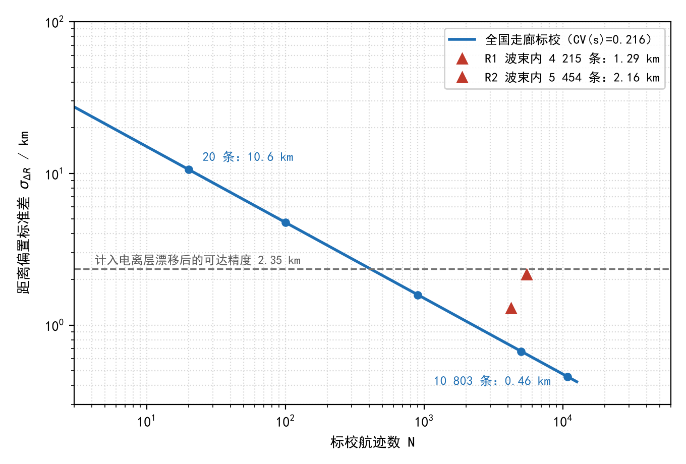
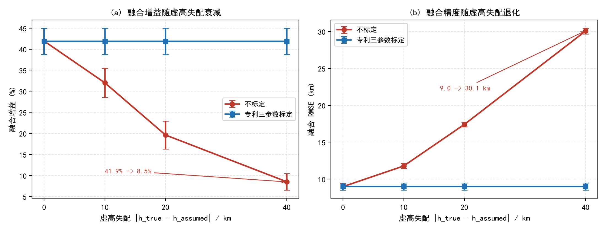

# 第3章 双照射源时空配准

天波链路的定位误差不是随机的。它由三个可命名的系统量构成：电离层等效虚高 $h$、接收站与外辐射源之间时基失配在群距离上的等效偏置 $\Delta R_{sync}$、阵列方位偏差 $\Delta\theta$。三者中只有 $\Delta\theta$ 是一个常数。$h$ 以非线性方式进入群距离，其灵敏度随目标距离单调衰减，同一个虚高偏差在 1000 km 处与 1900 km 处留下的距离误差相差约七成；以残差均值为基准的标定因此只在一段距离内成立，跨距离使用时必须把 $h$ 本身作为待估参数，而不是把它的平均效应折成一个常数扣掉。

第2章的量测模型已经写出群距离的几何形式，但虚高只取了标称值，系统偏差尚未处理。由此产生三个必须回答的问题。第一，三个量能否从数据中分离，条件是什么；第二，分离到什么精度，代价是什么；第三，残差以何种方式进入后续的关联与融合。本章的回答分别是：可以分离，条件是标校集的距离跨度足够；估计标准差可以逼近克拉美-罗下界，本文实测与下界之比在 1.04–1.26 之间；初始失配能被标定完全消除，而残余失配每增加 10 km，融合增益损失 8.5–11 个百分点。

本章只处理系统偏差。随机噪声的强度、尾部形态与单站精度的信息量下界留给第4章；两条链路各自标定，不做联合估计；时间层面只讨论站与源之间的那一段时基，两站之间的时基由授时保证，不进入模型。

## 3.1 参数化观测模型

### 3.1.1 两种时基

时空配准中的"时"在本系统里指什么，必须先定死，否则会把一个已被授时保证的量当成待估参数，为不存在的问题设计实验。两站之间的时间基准由 GPS/北斗授时保证，误差在微秒量级。它影响的是状态所指的时刻，对应的位置偏差是速度与时间之积：取目标速度 230 m/s、时基误差 1 μs，得 0.23 mm，比群距离噪声 10 km 小七个数量级。本文因此视两站共时基，不设站间时偏参数。

把站间时基差写成 $c\Delta t$ 是一个常见的错误。$c\Delta t$ 只在时基差被当作群距离量测的偏差时才成立，那是接收站与外辐射源之间的事。两条链路各自有一个外辐射源，其发射时刻不受我方授时系统约束，只能以直达波到达时刻为基准，残余时基差以 $\Delta R_{sync}$ 的形式整体平移群距离。它不能靠增加观测消除，也不能被坐标变换吸收，只能作为待估参数进入观测方程。这就是本章同时处理"时"与"空"的原因：时间问题不在两站之间，而在每一站与它的照射源之间。

帧时刻的对齐是另一件小事，不设参数。两站采样周期同为 30 s，若帧时刻不落在同一网格，按匀速模型把状态外推到统一时刻即可

$$ \mathbf x(t)=\mathbf F(\Delta\tau)\mathbf x_k, \mathbf F(\Delta\tau)=\begin{bmatrix}\mathbf I & \Delta\tau\mathbf I\\ \mathbf 0 & \mathbf I\end{bmatrix} $$ {#eq:ch3_time_align}

式中 $\Delta\tau=t-t_k$，$|\Delta\tau|\le dt/2$。由此引入的残差是二阶小量，外推与真实轨迹之差为 $\tfrac12 a\Delta\tau^2$。即使帧时刻错开一个采样周期的量级（13 s），按本场景实测转弯率，典型工况下该残差也只有 4–50 m，极端转弯的 99 分位为 224 m，比 $\sigma_R=10\text{ km}$ 小两个量级，与 3.2 节给出的标定下界相比也可忽略。选择外推而非插值，理由是可获得性：检测概率仅 0.6，相邻两帧同时齐备的概率不足 0.4，而外推只需要当前帧。

### 3.1.2 三个参数的作用方式

一条链路在每个时刻输出群距离与方位，扣除设备标定后仍含三项系统偏差，观测方程写为

$$ R_{g,k}^{obs}=\sqrt{\rho_{0,k}^2+4h^2}+\sqrt{\rho_{1,k}^2+4h^2}+\Delta R_{sync}+\varepsilon_{R,k} $$ {#eq:ch3_obs_range}

&#8203;

$$ \phi_{az,k}^{obs}=\operatorname{atan2}(x_k,y_k)+\Delta\theta+\varepsilon_{\theta,k} $$ {#eq:ch3_obs_az}

式中 $\rho_0$、$\rho_1$ 分别为照射源与接收站到目标的地面距离，$\varepsilon_{R}$、$\varepsilon_{\theta}$ 为零均值高斯噪声。待估参数向量为 $\boldsymbol\eta=[h,\Delta R_{sync},\Delta\theta]^T$。

三者的作用方式互不相同，这决定了估计的难度。$h$ 非线性地进入两条路径的斜距，作用强度随地面距离增大而衰减，因而对观测几何敏感；$\Delta R_{sync}$ 是整体平移，与几何无关；$\Delta\theta$ 是整体旋转，只改变横向位置，与距离通道完全解耦。真正相互纠缠的只有 $h$ 与 $\Delta R_{sync}$ 这一对，3.2 节的全部推导都围绕它们展开。

### 3.1.3 两条链路各自估计

三个参数属于一条链路，两条链路共 6 个，各自独立估计。这一设定的依据在模型层面。

专利的权利要求写的是单链路三参数：同一链路的多条参考航迹共享一组 $\boldsymbol\eta$，不同链路之间没有共享关系。专利自身的双链路实施例给出过先例：链路 A 的参数真值为 $(300,10,5.0)$，链路 B 为 $(325,-6,-3.5)$，两组参数由各自的先验参考航迹分别估计。虚高真值被有意设成相差 25 km，说明专利认为不同传播路径的虚高本来就不相同。

曾考虑过把两链路合并为 5 参数模型，令 $h$ 共享，理由是两条链路穿过同一片电离层、少一个未知数、估计更紧。该方案被放弃。两条链路与共视区之间夹角不同，穿过的电离层区域不同，观测几何的灵敏度离散度也不同；强行共享 $h$ 等于把两者之差压进残差，是用一个更紧的估计器换一个系统性偏差。3.4 节的扫描给出了这笔交易的定价：虚高失配 10 km 时融合误差上升 16.6%，远超少估计一个参数所能节省的精度。

代价是每个参数只能由本链路的样本约束。本文实测的两组估计为 R1 $(320.4,19.15,-2.998)$、R2 $(319.0,-13.72,3.491)$，与真值 $(320,20,-3.00)$、$(320,-15,3.50)$ 的差都在 1.3 km 与 0.01° 以内。两条链路的虚高估计相差 1.4 km，在估计噪声范围内，但真实系统中这一差异是物理存在的，不应被模型抹平。

## 3.2 标校集构造与可辨识性

### 3.2.1 耦合的来源

$h$ 与 $\Delta R_{sync}$ 都通过群距离起作用，一个是随距离变化的增量，一个是常数平移。对群距离求偏导，得虚高的灵敏度

$$ s_k=\frac{\partial R_g}{\partial h}=\frac{4h}{\sqrt{\rho_{0,k}^2+4h^2}}+\frac{4h}{\sqrt{\rho_{1,k}^2+4h^2}} $$ {#eq:ch3_sens}

当 $\rho\gg h$ 时每条路径的灵敏度约为 $4h/\rho$，双基地群距离是两条路径之和，$s_k$ 因此随距离衰减、整体量级高于单程。取 $h=300\text{ km}$、两段地面距离均约 1000 km，$s_k\approx 2.1$；均约 1900 km 时降到 1.2。灵敏度与距离近似成反比，这一性质在第2章已由群距离曲线给出。群距离的一阶增量为

$$ \delta R_{g,k}\approx s_k\,\delta h+\delta(\Delta R_{sync}) $$ {#eq:ch3_first_order}

若标校集内所有目标的距离相近，$s_k$ 退化为同一个数，上式就是两个未知数的一个线性组合，任何估计方法都无法把它们分开。只有当 $s_k$ 具有足够的离散度，两个参数才可辨识。记 $s_k$ 的均值与变异系数为 $\overline s$ 与 $\mathrm{CV}(s)$，距离通道的 Fisher 信息矩阵为

$$ \mathbf F_R=\frac{N_{\mathrm{tot}}}{\sigma_R^2}\begin{bmatrix}\overline{s^2}&\overline s\\\overline s&1\end{bmatrix} $$ {#eq:ch3_fisher}

求逆即得两个参数的下界

$$ \sigma_h=\frac{\sigma_R}{\sqrt{N_{\mathrm{tot}}}}\frac{1}{\overline s\,\mathrm{CV}(s)}, \sigma_{\Delta R}=\frac{\sigma_R}{\sqrt{N_{\mathrm{tot}}}}\frac{\sqrt{1+\mathrm{CV}^2(s)}}{\mathrm{CV}(s)} $$ {#eq:ch3_crlb}

与耦合系数

$$ \rho_{h,\Delta R}=-\frac{\overline s}{\sqrt{\overline{s^2}}}=-\frac{1}{\sqrt{1+\mathrm{CV}^2(s)}} $$ {#eq:ch3_corr}

记放大因子 $\alpha=\sqrt{1+\mathrm{CV}^2(s)}/\mathrm{CV}(s)$，则 $\sigma_{\Delta R}=\alpha\sigma_R/\sqrt{N_{\mathrm{tot}}}$。这一形式把两个改善途径分开：样本总数带来 $1/\sqrt{N}$ 的算术改善，灵敏度离散度带来 $\alpha$ 的几何改善。$N$ 可以靠增加观测积累，$\mathrm{CV}(s)$ 不能；当 $\mathrm{CV}(s)$ 趋于零时 $\alpha$ 发散，再多样本也无法补偿。本文把后者视为标校集设计的核心指标。

$\rho_{h,\Delta R}$ 不适合用作判据。由[@eq:ch3_corr]，该系数在任何实用范围内都接近 $-1$：$\mathrm{CV}$ 为 0.017 时是 $-0.9999$，为 0.216 时仍是 $-0.978$。用相关性强弱判断能否分离，会得出"永远不可辨识"的结论。真正区分样本集的是 $\alpha$：专利几何的 $\mathrm{CV}(s)=0.121$ 对应 8.3 倍，本项目全国走廊的 $\mathrm{CV}(s)=0.2155$ 对应 4.75 倍。

### 3.2.2 从单条航迹到距离分层

下界的差别要用同一噪声条件下的两组标校集比较才看得出。取 $\sigma_R=10\text{ km}$、$h=300\text{ km}$，单条航迹（200 个样本）的下界为 $\sigma_h=11.68\text{ km}$、$\sigma_{\Delta R}=15.57\text{ km}$；换成 8 条按距离分层的航迹（240 个样本），下界降到 $2.17\text{ km}$ 与 $5.34\text{ km}$，改善 5.4 倍与 2.9 倍。样本数只增加 20%，精度却提高近三倍。改善来自 $s_k$ 的铺开，与样本数关系不大。

换成本项目自己的几何，结论相同且更极端。单条南北向航迹的 $\mathrm{CV}(s)$ 只有 0.017，按[@eq:ch3_crlb]算得 $\sigma_{\Delta R}=53.3\text{ km}$；沿走廊取网格点后 $\mathrm{CV}(s)$ 提高到 0.137，下界降到 4.6 km，改善 11.6 倍。其中约 8 倍来自 $\mathrm{CV}$ 的抬高，其余来自样本数增加。把同一条航迹切成多段不改变 $\mathrm{CV}(s)$，等效样本数不变，下界也不变。航迹条数不是变量，距离跨度才是。

这一结论给标校集的构造定下直接要求：必须采集距离分层丰富的参考航迹，而不是采集尽可能多的参考航迹。工程上这意味着标校扇区不能只取本站波束，还要覆盖远近不同的距离带；航向是否多样并不重要，因为 $s_k$ 只依赖距离，与航向无关。

### 3.2.3 三种样本集与适用边界

按"只用本站波束内样本""用走廊网格""用全国数据"三种口径分别计算下界，结果如表[@tbl:ch3_crlb]所示。波束内口径与全国口径的下界相差 3 至 5 倍，这个差别在本章后面会反复出现，引用时必须与样本集一起给出。

| 标校集 | 航迹数 | $\mathrm{CV}(s)$ | $\sigma_h$ / km | $\sigma_{\Delta R}$ / km |
| ---- | ---- | ---- | ---- | ---- |
| 单条南北航迹 | 1 | 0.017 | 36.1 | 53.3 |
| 走廊网格 | — | 0.137 | 3.2 | 4.6 |
| 全国走廊 | 10 803 | 0.2155 | — | 0.46 |
| 波束内 R1 | 4 215 | — | — | 1.29 |
| 波束内 R2 | 5 454 | — | — | 2.16 |

: 不同标校集下距离偏置估计的克拉美-罗下界 {#tbl:ch3_crlb}

{#fig:ch3_crlb}

如图[@fig:ch3_crlb]所示，样本数从 20 增至 10 803，下界由 10.6 km 单调降到 0.46 km，斜率在对数坐标上恒为 $-1/2$，即单纯的数量收益。差异出现在红色三角与蓝线之间：波束内样本的 4 215 条与 5 454 条，按图中蓝线本应分别落在 0.73 km 与 0.64 km，实际下界却是 1.29 km 与 2.16 km，达到曲线值的 1.8 倍与 3.4 倍。原因是波束内样本的距离跨度小，$\mathrm{CV}(s)$ 低，整条曲线向右上方平移，而非曲线上取点。图中还有一个容易被忽略的对照：R2 的样本数比 R1 多 1 239 条，下界却更大。数量与精度的这种反向关系，只能由距离跨度解释。

0.46 km、1.29–2.16 km 与 2.35 km 是三个不同口径的数，正文引用时不能混用。0.46 km 是 10 803 条全国航迹、忽略电离层漂移的纯下界；2.35 km 是计入漂移、按最优标校窗长 1.36 h 估计的实际可达精度；1.29 km 与 2.16 km 是只用本站波束内样本时的下界，用来说明"样本集受限时精度退到哪里"。三者对应的是信息量的差别。

标校集还须满足两条工程约束，否则再精确的下界也没有意义。其一，标校集与评估集必须分离，用同一批航迹既标定又评估等于自己出题自己答；本文按 UTC 时段切分，标校取 12–18 时，其余时段用于评估。其二，标定窗口不能太长，虚高在昼夜尺度上漂移，长窗口的平均值在窗口两端都不成立，这与 2.35 km 那个数出自同一条推理。

至于什么条件下值得放弃两参数、改用三参数，可作一阶估计。均值标定残留的是一段距离上虚高失配的起伏，失配 10 km、评估集跨度 300 km 时，位置残余不足 1 km，相对单站 15 km 的误差是二阶小量；失配 80 km 时位置残余可达 6 km，与单站误差同量级，不可忽略。据此给出判据：失配小于 20 km 且跨度小于 300 km 时两参数已足够，失配大于 50 km 或跨度大于 500 km 时必须采用三参数。虚高在 250–350 km 之间漂移，相对 300 km 标称值的失配可达 50 km 以上，正落在必须采用三参数的一侧，这是本文坚持三参数配准的现实理由。

## 3.3 参数估计与验证

### 3.3.1 加权最大似然

以先验参考航迹给出的目标位置为参考量，构造距离残差与方位残差，并按各自链路的噪声标准差归一化后求和，得到代价函数

$$ J(\boldsymbol\eta)=\sum_{m=1}^{M}\sum_{k=1}^{N_m}\left[\frac{(r_{R,k}^{(m)})^2}{\sigma_{R}^{(m)2}}+\frac{(r_{\theta,k}^{(m)})^2}{\sigma_{\theta}^{(m)2}}\right] $$ {#eq:ch3_cost}

在噪声为零均值高斯、方差已知时，该函数与观测似然等价，其极小点即最大似然估计 $\hat{\boldsymbol\eta}=\arg\min_{\boldsymbol\eta}J(\boldsymbol\eta)$。归一化不可省略：三个通道的量级相差三个数量级，距离残差平方的量级为 $10^2$、方位为 $10^{-1}$，不加权时优化会被距离通道完全支配。分母必须取各自链路的值，R1 用 10 km 与 0.35°、R2 用 20 km 与 0.60°；若两条链路共用一组权重，噪声较大的链路残差被过度加权，估计整体向该链路偏移。

求解采用列文伯格-马夸尔特算法，并通过 logistic 重参数化把参数映射到物理可行区间内，避免迭代越界。参数边界不是装饰：方位偏差的上界若设得过紧，优化器会为补偿方位残差而连带把虚高拉偏，两个参数同时出错却仍能拟合观测。估计得到后，先扣除距离与方位偏差，再以更新后的虚高调用第2章的严格双基地反演方程重解位置

$$ \widehat R_{g,k}=R_{g,k}^{obs}-\widehat{\Delta R}_{sync}, \widehat\phi_{az,k}=\phi_{az,k}^{obs}-\widehat{\Delta\theta} $$ {#eq:ch3_correct}

配准由此明确为三步合成：扣除系统偏差、更新传播参数、重解位置。前两步作用于观测量，第三步才作用于位置。配准不是给航迹叠加一个固定平移量，因此残差能够回落到随机噪声水平，不会换一个方向继续偏。

### 3.3.2 端到端对照

配准是否必需，用一个单变量对照回答最直接：同一场景、种子与参数，只切换配准模式。场景为 63 段 2 033 帧的覆盖互补布设，注入的系统偏差为：虚高真值 320 km，R1 的 $\Delta R=+20\text{ km}$、$\Delta\theta=-3°$，R2 的 $\Delta R=-15\text{ km}$、$\Delta\theta=+3.5°$。三种模式的结果如表[@tbl:ch3_ab]所示，其中"零偏差基线"是不注入任何系统偏差时的同一场景，作为标定效果的参照。

| 指标 | 不标定 | 三参数最大似然 | 零偏差基线 |
| ---- | ---- | ---- | ---- |
| R1 单站 RMSE / km | 90.57 | 18.09 | 18.08 |
| R2 单站 RMSE / km | 92.47 | 17.15 | 17.20 |
| 融合 RMSE / km | 104.73（1 对，且错） | 8.57 | 8.60 |
| 配对正确数 | 1 对，且错 | 56/56 | 56/56 |
| 航迹长度比 | 1.006 | 1.291 | 1.291 |

: 注入系统偏差下三种配准模式的端到端性能 {#tbl:ch3_ab}

不标定时两条链路的误差都在 90 km 量级，融合只剩 1 对且是错配，航迹长度比 1.006 意味着航迹几乎无法延续。问题不在精度。3° 的方位偏差在 1400 km 处等于 73 km 的横向位移，远大于任何合理的关联门限，关联判据在系统偏差下已完全失去分辨力。标定后，单站误差降到 18 km 量级，融合误差 8.57 km，配对 56 对全对，长度比恢复到 1.291。

更关键的是标定后的结果与零偏差基线逐项重合：18.09 对 18.08，8.57 对 8.60，56/56 对 56/56。这说明偏差被完整补回，链路中没有残差泄漏，标定没有引入新的偏差。方位偏差的估计误差分别为 0.002° 与 0.009°，在注入的 3° 与 3.5° 面前可以忽略。

### 3.3.3 估计精度与下界

单次实验只能说明偏差被补回，不能说明估计器有多好。为此只跑标定环节、固定几何与噪声、换 10 个随机种子，把估计结果与 3.2.3 节的下界逐项比较，结果如表[@tbl:ch3_mc]所示。

| 链路 | 参数 | 真值 | 估计均值 | 偏置 | 实测标准差 | 下界 | 实测/下界 |
| ---- | ---- | ---- | ---- | ---- | ---- | ---- | ---- |
| R1 | $h$ / km | 320 | 320.23 | +0.23 | 1.03 | 0.92 | 1.12 |
| R1 | $\Delta R$ / km | 20 | 19.63 | −0.38 | 1.34 | 1.29 | 1.04 |
| R1 | $\Delta\theta$ / ° | −3 | −2.999 | +0.001 | 0.007 | 0.005 | 1.26 |
| R2 | $h$ / km | 320 | 319.96 | −0.04 | 1.87 | 1.54 | 1.22 |
| R2 | $\Delta R$ / km | −15 | −14.92 | +0.08 | 2.53 | 2.16 | 1.17 |
| R2 | $\Delta\theta$ / ° | 3.5 | 3.504 | +0.004 | 0.009 | 0.008 | 1.08 |

: 10 个种子的标定估计与克拉美-罗下界对比 {#tbl:ch3_mc}

六个参数的实测标准差与下界之比落在 1.04 与 1.26 之间，偏置绝对值不超过 0.38 km，估计器是有效的。表中还有一处需要解释：既然全国走廊的下界是 0.46 km，为什么这里只能做到 1.34 km 与 2.53 km。答案在样本集。0.46 km 对应 10 803 条全国航迹，本节只用本站波束内的 4 215 条与 5 454 条，对应的下界是 1.29 km 与 2.16 km，实测比值 1.04 与 1.17 正是在这一基准上比较的结果。把全国走廊的下界当成波束内标定的基准，会得出"估计器达不到理论"的错误结论，而两者相差的 2.8–4.7 倍全部来自距离跨度。

表中还可以读出 3.2 节论点的实证：R2 用了比 R1 更多的样本，$\Delta R$ 的标准差却更大。想进一步逼近 0.46 km，只有放宽标校扇区、增大距离跨度一条路，代价是放弃"只用本站波束内样本"这条工程约束。这是一个取舍，不是可以绕开的技术细节。

## 3.4 残差向关联与融合的传递

### 3.4.1 初始失配可被完全消除

前三节讨论的是偏差能否被估出。对后续章节而言更重要的问题是：如果配准被拆掉，或者标称值与真值不符，代价会以什么形式传导到融合端。为此设计单变量消融实验：真值虚高固定 320 km，标称虚高取 $320-d$，$d\in\{0,10,20,40\}\text{ km}$，其余全部沿用当前在线配置，分别在拆掉配准（不标定）与使用专利三参数标定（标定）两条支路上各跑 3 个种子，结果如表[@tbl:ch3_e7]所示。

| 虚高失配 $d$ / km | 不标定 R1 / km | 不标定 R2 / km | 不标定融合 / km | 不标定增益 | 标定融合 / km | 标定增益 |
| ---- | ---- | ---- | ---- | ---- | ---- | ---- |
| 0 | 15.51 | 30.74 | 8.98 | 41.91% | 8.99 | 41.86% |
| 10 | 17.37 | 31.40 | 11.78 | 32.02% | 8.99 | 41.86% |
| 20 | 21.69 | 33.73 | 17.41 | 19.63% | 8.99 | 41.86% |
| 40 | 32.88 | 42.06 | 30.07 | 8.52% | 8.99 | 41.86% |

: 虚高标称失配下拆掉配准与保留配准的融合性能 {#tbl:ch3_e7}

{#fig:ch3_e7}

如图[@fig:ch3_e7]所示，不标定支路的融合增益随失配单调下降，由 41.9% 降到 8.5%，融合误差由 8.98 km 升到 30.07 km；标定支路在四档失配下是一条水平线。差异的全部来源是标称虚高是否被重新估计：标定从数据中解出 $h$ 并覆盖标称值，初始虚高假设因此被完全消除，即使标称给到 280 km 也能拉回 320 km。逐种子看，三个种子的增益都随 $d$ 单调下降，没有例外，说明这一趋势不是种子效应。

量化的传导关系近似线性：失配每增加 10 km，增益损失 8.5–11 个百分点；$d=40\text{ km}$ 时融合误差 30.07 km 仍略优于最好的单站 32.88 km，但增益只剩 8.5%，此时恰当的表述是"融合不再带来实质收益"，而不是"融合失效"。

引用这张表时有两点纪律。第一，$d=0$ 的 41.9% 不能当作系统增益基线，它与第6章的系统基线不是同一批种子，正文只使用档间差值。第二，本表证明的是"初始标称失配可被标定完全消除"，不是"标定后没有残差"；时变漂移与空间梯度造成的残余仍在，见下一小节。

### 3.4.2 残余失配的边界

标定只能消除标称值与真值之间的常数差，三类残余无法消除：虚高随时间漂移、虚高在空间上有梯度、实际噪声强于标定假设。把这三类失配逐项注入生成侧，估计侧仍按标称处理，得到退化曲线，结果如表[@tbl:ch3_mismatch]所示。

| 失配类型 | 注入量 | 融合 RMSE / km | 相对退化 | 配对 |
| ---- | ---- | ---- | ---- | ---- |
| 虚高时间漂移（周期 6 h） | 0 / 2 / 5 / 10 km | 8.56 / 8.61 / 8.92 / 9.98 | 0 / +0.6% / +4.2% / +16.6% | — |
| 噪声强度失配 | 1.0 / 1.2 / 1.5 / 2.0 倍 | 8.56 / 9.41 / 10.06 / 11.75 | 0 / +9.9% / +17.5% / +37.3% | 56/56 / 56/56 / 54/55 / 47/48 |

: 三类残余失配下的融合退化 {#tbl:ch3_mismatch}

漂移 5 km 以内、噪声失配 1.2 倍以内时，融合退化小于 10%，标定可用；漂移达到 10 km 或噪声达到 2 倍时，退化升到 17%–37%，此时需要缩短标校窗或提高噪声标定的精度。噪声失配同时冲击配对，机理是协方差不匹配等价于关联门限被等效收紧。滤波器高估自身精度，判据对新息的容忍度下降，2 倍噪声下配对由 56 对掉到 47 对。这一通道与本节前一个实验不同，前者是配准残差直接污染位置，后者是协方差失真收紧门限，两条机理必须分开陈述，不能合成一句话。

空间梯度给出的教训更微妙。当虚高沿经向存在 2 km/° 的梯度时，常数模型无法拟合，估计器沿 $h$–$\Delta R$ 的脊线滑走：虚高估成 281.2 km、距离偏置估成 75.0 km，各自偏离真值 39 km 与 55 km，而融合误差纹丝不动，仍为 8.57 km。原因在[@eq:ch3_first_order]：$h$ 与 $\Delta R$ 在群距离上近似可交换，错误的参数对仍能拟合观测。由此得出一条写作与工程上都应遵守的纪律：$\hat h$ 不能当作物理量报告，它只在电离场均匀的假设下有意义；梯度一旦存在，它会沿脊线漂走几十公里而残差看不出来。真实电离层的经向梯度量级为 0.02–0.1 km/°，在本场景下没有实质影响，但这不等于 $\hat h$ 可信，只说明它没有被激励出来。

## 3.5 本章小结

本章把天波量测中的三项系统量写进观测方程，给出参数化模型、可辨识条件、估计方法与残差传递的量化关系。模型方面，确认每条链路三个参数、两条链路各自估计，共享虚高会把两链路的差异压进残差，代价是虚高失配 10 km 时融合退化 16.6%。可辨识性方面，导出灵敏度 $s_k\approx 4h/\rho$ 与放大因子 $\alpha=\sqrt{1+\mathrm{CV}^2(s)}/\mathrm{CV}(s)$，说明精度由距离跨度而非航迹条数决定：单条航迹的距离偏置下界为 53.3 km，走廊网格降到 4.6 km，全国走廊降到 0.46 km；R2 样本多而精度低，正是这一结论的直接实证。

估计方面，三参数最大似然把 90 km 量级的偏差补回到零偏差基线，融合误差由 104.73 km 降到 8.57 km，配对由 1 对且错变为 56 对全对；10 个种子的实测标准差与下界之比为 1.04–1.26，估计器有效。残差传递方面，初始标称失配可被标定完全消除，四档失配下结果逐位重合；时变漂移、噪声失配与空间梯度造成的残余无法消除，漂移 10 km 退化 16.6%，噪声 2 倍退化 37.3%，而空间梯度会沿 $h$–$\Delta R$ 脊线把参数估计拖偏几十公里。

至此，量测已经被校正到同一地理基准上，残余误差回落到随机噪声水平。但随机噪声并不好对付：单站位置误差的中位数约 6–7 km，均方根却达 15–17 km，说明误差分布是重尾的；而第4章将说明，单站误差不由噪声单独决定，而由机动、断点与重尾共同决定，滤波调参已无余地。跨照射源关联因此必须同时面对低精度、重尾与两站误差相关三个条件，这是第5章配对与第6章融合的共同起点。
