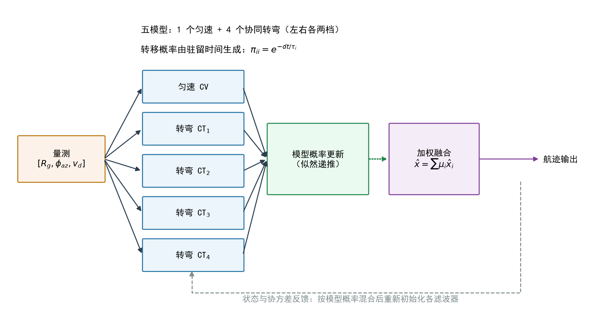
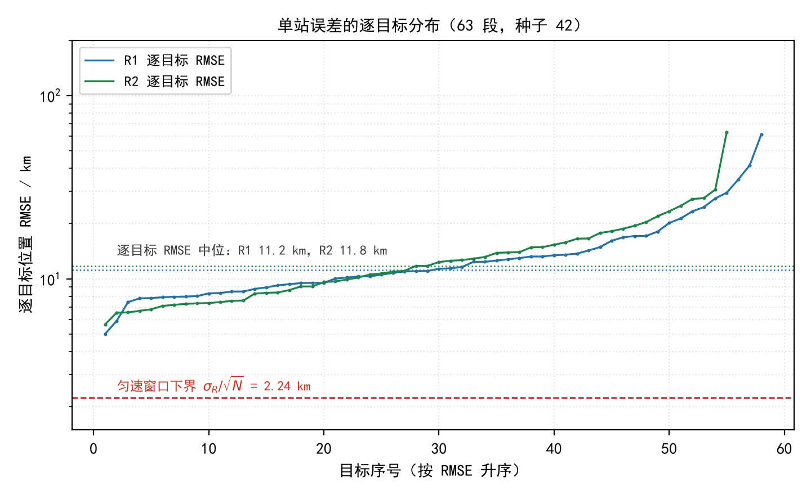

# 第4章 单站航迹滤波与性能边界

第3章把量测校正到同一地理基准，残余误差回落到随机噪声水平。随机噪声本身仍然构成困难：检测概率只有 0.6，群距离噪声 10–20 km，30 s 的采样周期内目标已位移 6.9 km。三者叠加，逐帧定位再连线必然失败，滤波器必须在断续点迹上维持一条不发散、且协方差与实际误差相称的航迹。由此产生两个问题：这样的滤波能达到多准，以及是否还能更准。

第一个问题有一个确定的答案，其边界由信息量而非实现方式决定。在匀速窗口内，滤波等价于一次加权直线拟合，位置误差可以降到 $\sigma_R/\sqrt N$ 量级，20 帧时约 2.2 km；但在真实航迹上，机动段、漏检段与重尾目标使整条航迹的均方根误差停在 15 km 以上。理解这条分界线为何存在，比记住具体数值更重要，因为它决定了第二个问题的答案。

第二个问题的答案是：滤波参数的调节已不构成可利用的自由度。本章以三条负结果证明过程噪声的任何调度与自适应都不产生收益，并给出可以迁移到同类系统的判据；随后说明剩下的唯一杠杆是模型集本身，即四个转弯模型的转弯率取值；最后给出单站误差的真实形态即重尾，这一点决定了后续两章必须同时报告误差的中位数、分位数与均方根。

## 4.1 状态空间模型

### 4.1.1 坐标系选择与各向异性过程噪声

状态取经纬度及其变化率

$$\mathbf x_k=[\lambda_k,\dot\lambda_k,\varphi_k,\dot\varphi_k]^T$$ {#eq:ch4_state}

选择经纬度而非局部平面坐标，原因在量测反演的输出形式：群距离由目标至照射源与接收站的地面距离合成，方位以正北为基准，反演结果直接是经纬度。若改用平面坐标，每帧都要在投影与逆投影之间往返；而目标距离跨度达 900 km，子午线收敛使东西向尺度变化约 15%，这种形变虽小于噪声，却是确定性的，会随帧序累积为系统偏差。

代价是两个位置分量的量纲不同。1° 纬度约 111 km，1° 经度在 30.7°N 上只有约 95.5 km，二者相差 16%。若对两个方向施加同一噪声强度，经度方向的等效加速度被放大 $(111/95.5)^2\approx1.35$ 倍，滤波结果呈现方向依赖的抖动。为此先在东北平面内按公里构造过程噪声，再折算到度

$$\mathbf Q_k=\begin{bmatrix}\mathbf Q_{EN}/(R_e\cos\varphi_k)^2&\mathbf 0\\\mathbf 0&\mathbf Q_{EN}/R_e^2\end{bmatrix}, \mathbf Q_{EN}=\sigma_a^2\begin{bmatrix}dt^4/4&dt^3/2\\dt^3/2&dt^2\end{bmatrix}$$ {#eq:ch4_q_aniso}

式中 $\sigma_a$ 为等效加速度标准差，$\mathbf Q_{EN}$ 是连续时间白噪声加速度模型在一个采样周期内的离散化结果。$\sigma_a$ 的物理含义是模型允许的机动自由度：取小了跟不上转弯，取大了把噪声当机动。本文的取值由稳态归一化误差平方和目标定，取使该指标接近理想值（约为状态维数）的量级。

### 4.1.2 无迹变换与滤波递推

每条链路每帧给出群距离、方位角与多普勒，量测方程与噪声协方差为

$$\mathbf z_k=\mathbf h(\mathbf x_k)+\boldsymbol\varepsilon_k, \mathbf R_k=\operatorname{diag}(\sigma_R^2,\sigma_\theta^2,\sigma_{v_d}^2)$$ {#eq:ch4_meas}

R1 取 $\sigma_R=10\text{ km}$、$\sigma_\theta=0.35°$，R2 取 20 km 与 0.60°，两站共用 $\sigma_{v_d}=0.5\text{ m/s}$。采用无迹滤波而非扩展滤波，原因是协同转弯矩阵含 $\sin(\omega dt)/\omega$ 项，当 $\omega$ 跨越两个数量级时一阶线性化的截断误差剧变，会在模型概率更新中引入偏置；九个 sigma 点的传播对二阶项精确，五个模型共 45 次传播，计算量可以接受。

设状态维数 $n=4$，按下式生成 $2n+1$ 个 sigma 点及其权重

$$\boldsymbol\chi_0=\hat{\mathbf x}, \boldsymbol\chi_i=\hat{\mathbf x}\pm\left(\sqrt{(n+\kappa)\mathbf P}\right)_i, 
w_0^{m}=\frac{\kappa}{n+\kappa}, w_i^{m}=w_i^{c}=\frac{1}{2(n+\kappa)}$$ {#eq:ch4_sigma}

式中 $\kappa$ 为尺度参数，$(\cdot)_i$ 表示矩阵平方根的第 $i$ 列。预测与更新按标准无迹变换进行，交叉协方差 $\mathbf P_{xz}=\sum_iw_i^{c}(\boldsymbol\chi_i-\hat{\mathbf x})(\mathbf h(\boldsymbol\chi_i)-\hat{\mathbf z})^T$ 给出增益。选择无迹变换的另一个理由是它不要求量测方程可微，群距离反演在 $R_g\to4h$ 附近的强非线性因此不会引起数值问题。

三个通道的信息量极不均衡，这是本章后续全部结论的物理起点。群距离 10 km 除以 30 s 得 333 m/s 的单帧位置等效速度噪声，而多普勒噪声只有 0.5 m/s，速度信息实际由后者提供。4.4 节将说明，这一比值决定了过程噪声调参为何无效。

### 4.1.3 五模型交互多模型

单一模型无法同时描述巡航与转弯：匀速模型在转弯时系统性滞后，协同转弯模型在直飞时持续偏转。本文取五个模型，即一个匀速模型与四个协同转弯模型，后者按左右转各两档配置。左右必须分开，因为转弯率以带符号的 $\omega$ 进入转移矩阵；两档则对应缓转与急转两种强度。协同转弯矩阵在东北平面内为

$$\mathbf F_{CT}(\omega)=\begin{bmatrix}1&\frac{\sin\omega dt}{\omega}&0&-\frac{1-\cos\omega dt}{\omega}\\0&\cos\omega dt&0&-\sin\omega dt\\0&\frac{1-\cos\omega dt}{\omega}&1&\frac{\sin\omega dt}{\omega}\\0&\sin\omega dt&0&\cos\omega dt\end{bmatrix}$$ {#eq:ch4_ct}

$\omega\to0$ 时该矩阵退化为匀速模型，说明两者是同一族模型的两个端点，这是模型集可以连续调节的数学基础。

交互多模型在每个周期由混合、滤波与概率更新三步构成。记模型 $i$ 的先验概率为 $\mu_i$，转移概率矩阵为 $\boldsymbol\pi=[\pi_{ij}]$，则预测概率与混合权重为

$$c_j=\sum_{i=1}^{M}\pi_{ij}\mu_i, \mu_{i|j}=\frac{\pi_{ij}\mu_i}{c_j}$$ {#eq:ch4_mix}

混合初值与混合协方差为

$$\hat{\mathbf x}_{0j}=\sum_{i=1}^{M}\mu_{i|j}\hat{\mathbf x}_i, 
\mathbf P_{0j}=\sum_{i=1}^{M}\mu_{i|j}\left[\mathbf P_i+(\hat{\mathbf x}_i-\hat{\mathbf x}_{0j})(\hat{\mathbf x}_i-\hat{\mathbf x}_{0j})^T\right]$$ {#eq:ch4_mixstate}

各模型以混合初值独立滤波，似然取新息的多元高斯密度 $\Lambda_j=\mathcal N(\boldsymbol\nu_j;\mathbf 0,\mathbf S_j)$，模型概率更新为

$$\mu_j=\frac{\Lambda_jc_j}{\sum_{i=1}^{M}\Lambda_ic_i}$$ {#eq:ch4_prob}

总输出为 $\hat{\mathbf x}=\sum_j\mu_j\hat{\mathbf x}_j$，协方差按同样方式加权。

转移概率不直接给定，而由驻留时间生成

$$\pi_{ij}=\frac{1-\exp(-dt/\tau_i)}{M-1}, i\neq j, \pi_{ii}=\exp(-dt/\tau_i)$$ {#eq:ch4_dwell}

式中 $\tau_i$ 为模型 $i$ 的平均驻留时间，$M=5$。这一形式把无量纲概率换成有量纲的时间常数：巡航占航迹的绝大多数，取 $\tau_{CV}=2400$ s；一次程序转弯持续 1–3 min，取 $\tau_{CT}=360$ s 留有余量。代入 $dt=30$ s，匀速模型每帧离开概率 1.24%、转弯模型 8.0%，与"转弯是短时事件、直飞是常态"的先验一致。

{#fig:ch4_imm}

如图[@fig:ch4_imm]所示，五个模型共享同一份历史，构成一个由概率加权的估计器族，而不是五条独立航迹。反馈支路是关键：它把融合后的状态按模型概率重新分配给各滤波器，使上一步的判断影响下一步的起点。

## 4.2 航迹起始的加权最小二乘解

稳态性能由 4.3 节讨论，但稳态能否到达取决于起始几帧的初值是否可信。检测概率 0.6 意味着前几帧大概率不齐；若用前两帧差分测速，位置误差 10 km、间隔 30 s，速度误差为 $\sqrt2\times10/30\approx471\text{ m/s}$，与目标 230 m/s 的巡航速度同量级。这样的初值会让滤波器在最需要稳定的时候剧烈摆动。

本文采用窗口加权最小二乘加多普勒约束的起始方法。取窗口 $W=5$ 帧，对位置观测拟合直线

$$x_j=a+bt_j+e_j, e_j\sim\mathcal N(0,\sigma_R^2)$$ {#eq:ch4_start_ls}

权重取各帧位置协方差的逆，缺帧时按可用帧数降级而不等待补齐。拟合斜率 $b$ 作为初速，再用窗口内多普勒对速度分量做一次约束修正，相当于给斜率加一条先验收缩。起始协方差由最小二乘的解析式给出，不作人为放大，否则最初几帧的模型概率会被新息主导而随机跳变。

选择加权最小二乘而非 $m/n$ 逻辑法，原因在于低检测率下逻辑法的确认概率。四帧内出现三帧合格的概率为

$$P_{3/4}=\sum_{k=3}^{4}\binom{4}{k}P_d^k(1-P_d)^{4-k}=0.475$$ {#eq:ch4_mn}

即在 $P_d=0.6$ 时过半航迹无法在四帧内确认起批。最小二乘起始对缺帧是渐进的，少一帧只降低有效样本数，不会否决起批。

实测初速误差约 80 m/s，相对两点法的 471 m/s 改善 5.9 倍。剩余误差来自窗口内目标的真实转弯：150 s 内若发生一次缓转，拟合斜率就不再是任一时刻的瞬时速度。这一残差是结构性的，无法通过增加窗口长度消除，因为更长的窗口包含更多机动。

## 4.3 单站性能的信息量下界

### 4.3.1 位置下界

推导的关键是把稳态滤波等价为一次加权最小二乘拟合。当过程噪声相对量测噪声足够小、目标在窗口内近似匀速时，滤波器对窗口中心时刻位置的估计等价于用 $N$ 帧观测拟合直线并在中点取值。

取窗口内采样时刻关于中点对称：$t_j=j dt$，$j=-(N-1)/2,\dots,(N-1)/2$，则 $\sum t_j=0$。对式[@eq:ch4_start_ls]的正规方程求逆，截距估计为

$$\hat a=\frac{1}{N}\sum_jx_j, \operatorname{Var}(\hat a)=\frac{\sigma_R^2}{N}$$ {#eq:ch4_mid_var}

即中点处拟合值的方差恰为单帧方差除以 $N$。这一结果不依赖斜率是否被估计，是设计矩阵对称的直接后果。由此得径向位置的下界

$$\sigma_{pos}\approx\frac{\sigma_R}{\sqrt N}$$ {#eq:ch4_pos_bound}

切向通道的贡献需要单独计入。目标至接收站的地面距离为 $r$ 时，方位噪声在横向上等效为 $r\sigma_\theta$ 的位置误差，与径向误差正交独立。取两个方向标准差的均方根作为各向同性等效值，得

$$\sigma_{pos}'\approx\sqrt{\frac{\sigma_R^2+(r\sigma_\theta)^2}{2N}}$$ {#eq:ch4_pos_bound2}

径向单帧噪声即 $\sigma_R=10$ km，切向为 $r\sigma_\theta$；取 $r=1500$ km 时 R1 的 0.35° 对应 9.2 km。对 R1 而言两个方向几乎等权，式[@eq:ch4_pos_bound2]的 2.14 km 比式[@eq:ch4_pos_bound]的 2.24 km 更贴近真实；对 R2 而言切向误差达 15.7 km，下界应取 2.7 km 量级。

$N$ 是参与滤波的有效帧数，不是航迹总长。取 $N=20$ 对应 600 s 即 10 min，是工程上可用的最短稳定窗口：短于 10 min，起始段的方差尚未衰减完；长于 10 min，目标大概率已转过一次弯，匀速假设失效。该下界只依赖单帧噪声与帧数，与滤波器结构、过程噪声取值、模型集构成均无关，这是它可以作为基准的原因。

### 4.3.2 速度下界的推导与量级对比

若不用多普勒，速度只能由位置序列推断。不同的估计器给出不同的精度，四者的量级需要逐一导出。

两帧差分是最简单的一种：$\hat v=(x_2-x_1)/dt$，两端噪声独立，方差为 $2\sigma_R^2/dt^2$，

$$\sigma_v^{(2)}=\frac{\sqrt2 \sigma_R}{dt}=\frac{1.414\times10}{30}=471\text{ m/s}$$ {#eq:ch4_v2}

$N$ 帧端点差分等价于对全部相邻差分取平均，方差降为

$$\sigma_v^{(N)}=\frac{\sqrt2 \sigma_R}{N dt}=\frac{1.414\times10}{20\times30}=23.6\text{ m/s}$$ {#eq:ch4_vN}

最优线性估计是斜率拟合，其方差由设计矩阵的散布给出

$$\sigma_v^{\text{LS}}=\frac{\sigma_R}{dt}\sqrt{\frac{12}{N(N^2-1)}}=\frac{10}{30}\sqrt{\frac{12}{20\times399}}=12.9\text{ m/s}$$ {#eq:ch4_vls}

式[@eq:ch4_vls]同时是位置通道关于速度的克拉美-罗下界：任何只使用位置的线性无偏估计都不可能优于它。

四个速度信息来源及其误差量级汇总如下：单对帧差分 471 m/s，$N$ 帧端点差分 23.6 m/s，窗口斜率拟合 12.9 m/s，多普勒量测 0.5 m/s；相对多普勒分别差 942、47、26 与 1 倍。前三行是从位置推断速度，误差随位置误差线性放大；最后一行直接测量速度，误差由相干积累的相位噪声决定。这一区别规定了滤波器内部的信息流向：速度分量几乎完全由多普勒更新，位置通道真正约束的只有位置。

### 4.3.3 实测与下界的偏离

下界与实测之间差了一个量级。63 段场景、3 个种子、两站误差均在双源帧上统计，结果如表[@tbl:ch4_single]所示。

| 指标 | 种子 42 | 种子 43 | 种子 44 |
| ---- | ---- | ---- | ---- |
| R1 位置 RMSE / km | 14.76 | 17.21 | 14.28 |
| R1 误差中位数 / km | 6.44 | 6.66 | 6.00 |
| R1 误差 90 分位 / km | 15.15 | 15.93 | 15.10 |
| R2 位置 RMSE / km | 23.71 | 24.43 | 44.30 |
| R2 误差中位数 / km | 8.65 | 8.68 | 9.10 |
| R2 误差 90 分位 / km | 23.90 | 26.01 | 24.78 |

: 单站位置误差的三种统计量 {#tbl:ch4_single}

实测中位数 6.0–6.7 km 与 8.7–9.1 km，约为匀速窗口下界 2.2–2.7 km 的三倍；均方根 14.8–17.2 km 与 23.7–44.3 km，则达到下界的七到十六倍。差距的来源不在调参，而在三条前提在真实航迹上同时不成立。

其一是匀速假设。下界要求窗口内目标近似匀速，而真实航迹的机动率 90 分位为 0.23 °/s，10 min 窗口内几乎必然包含一次航向调整；一旦目标转弯，窗口拟合值不再是窗口中心的最优估计，误差转为与转弯率成正比的滞后。

其二是帧数假设。$\sigma_R/\sqrt N$ 中的 $N$ 是有效观测数，而检测概率 0.6 意味着 20 帧窗口内平均只有 12 帧有点迹，下界要放大约 $\sqrt{20/12}\approx1.29$ 倍；断点更长时有效帧数进一步下降。

其三是分布假设。均方根对尾部极其敏感，而单站误差的尾部很重，见 4.6 节。中位数与下界的差距只有三倍，均方根与下界的差距却有七倍以上，两者之差正是尾部的贡献。

由此得到本章最重要的一条认识：下界描述的是匀速窗口内的信息量，不是整条航迹的精度。前者说明滤波器没有浪费量测，后者说明航迹质量由机动与断点决定。若把两者混为一谈，就会得出"滤波器还差七倍"的错误结论，并把改进方向错误地指向调参。

## 4.4 过程噪声调节的负结果

4.3 节的下界是在某个特定过程噪声取值下达到的。自然的问题是：这个取值能否更优；若过程噪声随航迹阶段变化或随新息自适应，能否突破下界。这三个想法在文献中都有成熟形式，本文逐一检验，结果全部为负。

### 4.4.1 三项实验

第一项是三段式调度。设计动机来自航迹的阶段差异：起始段需要较大过程噪声快速吸收量测，稳态段需要较小过程噪声抑制抖动，机动段需要再次放大以跟上转弯。据此按航迹年龄与归一化新息把航迹分为三段，各段取不同倍率，段间用斜坡过渡避免突变。实测结果与设计预期相反：放大倍率 ×30 时误差变差 3.1%，×300 时变差 9.4%，×1000 时变差 19.8%，且曲线没有峰值。若是参数调过头，应当先改善后劣化；没有峰值说明调节方向本身不产生收益，而非最优点偏移。

第二项是自适应过程噪声。新息协方差匹配用滑动窗口统计新息的实际协方差，与预测值作比，比值大于 1 说明滤波器过于自信、应放大过程噪声；三个量测通道各配一个因子，再加一个总体因子，故称 3in1 结构。实测融合误差从 6.906 km 变为 6.882 km，贡献 0.3%，落在种子间波动的量级内。

第三项是自适应转移概率。模型概率由似然递推给出，本质是一阶马尔可夫过程，对机动起始的响应存在固有延迟。用 sigmoid 把归一化新息映射为概率修正量，让大新息直接把概率质量推向转弯模型。该方案已证伪：概率在机动发生时确实上升，但比机动起始晚 2–3 帧即 60–90 s，此时转弯已完成大半；平稳段被误触发的比例也不低，净效果为负。

### 4.4.2 失效机理与可迁移判据

三项负结果有一个共同的机理，可由 4.3.2 节的量级关系说明

$$\frac{\sigma_{v_d}}{\sigma_R/dt}=\frac{0.5}{333}\approx1.5\times10^{-3}$$ {#eq:ch4_doppler_ratio}

速度分量的卡尔曼增益由各通道的噪声比决定。多普勒以 0.5 m/s 直接观测速度，位置通道折算到速度上的等效噪声是每帧 333 m/s、最优估计器 12.9 m/s，二者相差三到四个量级，因此速度更新几乎完全由多普勒承担。过程噪声调节的是预测协方差，而它在速度分量上的变化相对多普勒的信息量微不足道；放大的唯一可见后果是位置分量的预测协方差增大、滤波器更相信位置量测，于是位置抖动加剧。这正好解释了 4.4.1 节的单调劣化：代价全部落在位置上，收益在速度上根本不存在。

由此得到一条可迁移的判据：当 $\sigma_{v_d}\ll\sigma_R/dt$ 时，过程噪声调度对速度精度无效，只会恶化位置精度。反过来，若无多普勒通道，或 $\sigma_{v_d}$ 与 $\sigma_R/dt$ 同量级，则过程噪声将承担表达速度不确定性的职责，调度与自适应都会有效。这条判据把调参失败从工程经验提升为结构性结论，可以在设计阶段预判，是本章对同类系统的可迁移贡献。

## 4.5 模型集与真实机动分布的匹配

过程噪声被排除后，剩下的自由度是模型集本身，即四个协同转弯模型的转弯率取值。原设计取 0.7 与 1.5 °/s，对应战斗机量级的机动。本文的目标是巡航段的民航客机，需要检验这一取值与真实分布是否匹配。

### 4.5.1 机动率的经验分布

从筛选后的 ADS-B 数据中提取 20.9 万个位置点，按 30 s 间隔差分求航向变化率，得转弯率的经验分布：中位数 0.012 °/s，90 分位 0.229 °/s，99 分位 0.660 °/s，最大值 1.51 °/s。

中位数意味着 30 s 内航向只变 0.36°，几乎是一条直线；90 分位对应 6.9°，是一次缓慢的航路调整；99 分位对应 19.8°，接近标准进场程序的转弯速率。分布极度右偏，中位数与 99 分位相差 55 倍，说明机动是罕见事件。模型集因此不能用均值配置，否则等于假设目标一直在转弯；也不能只按极端值配置，否则 99% 的时间模型都在空转。30 s 差分得到的是窗口平均转弯率，真实瞬时分布的上尾应比统计值更重。

### 4.5.2 失配的后果

把 0.7 与 1.5 °/s 放回上述分布，其位置一目了然：0.7 略高于 99 分位，1.5 接近最大值。原设计的两档转弯模型对应的是极端机动强度，在 90% 的时间里四个转弯模型没有一个与真实运动匹配。

失配的后果是结构性偏差。交互多模型的输出是五个估计的概率加权，即便某个模型与真实运动不符，它仍分得一部分概率质量；而协同转弯模型在外推时持续偏转，其预测位置与匀速模型逐渐分离，加权之后产生一个方向确定、幅度随失配增大的偏移。更关键的是，这个偏移对两条链路是同向的：两站共用同一套模型集与转移概率，对同一真实运动施加了同一个错误约束。这一共同模型误差是第6章误差相关性的来源，此处只需指出它是系统性偏移，而不是常被误认为的随机抖动。

### 4.5.3 匹配后的单站精度

按 4.5.1 节的分布重新配置，上界取机动率的 90 分位附近、下界取其四分之一，即 0.05 与 0.2 °/s。在近共视布设的 47 对在线蒙特卡洛配对上比较两档模型集，单站结果如表[@tbl:ch4_modelset]所示。

| 指标 | 0.7 / 1.5 | 0.05 / 0.2 | 变化 | $p$ 值 |
| ---- | ---- | ---- | ---- | ---- |
| R1 单站 RMSE / km | 12.23 | 10.61 | −13.2% | $3.7\times10^{-13}$ |
| R2 单站 RMSE / km | 13.85 | 12.97 | −6.4% | 0.265 |

: 两档模型集的单站精度（47 对在线配对，adsb_0002） {#tbl:ch4_modelset}

R1 的改善高度显著，R2 的改善则不显著。这一不对称不是偶然。R2 的群距离噪声是 R1 的两倍，其误差主要由滤波滞后与少数离群航迹贡献，而不是由模型失配贡献；模型集匹配改变的是两站犯同一个错的程度，对两站各自的滞后无能为力。这一点在第3章 R2 标定后仍有 30 km 量级残差时已经出现，此处再次得到印证：把配准与滤波的问题分开记账，是分析这类系统的基本纪律。

模型集匹配带来的主要收益不在单站而在融合。它的作用是让两站不再犯同一个错，单站精度的改善只是副产品。这部分内容属于第6章，此处只记下一个待解释的量：R1 的 13.2% 与 R2 的不显著，与第6章融合端的改善幅度不成比例，差额的来源就是误差相关性的下降。

## 4.6 重尾误差与离群目标的统计处理

均方根把两类完全不同的目标混在一起。逐目标统计能把它们拆开：在 63 段场景、3 个种子上，R1 每种子有 58 个目标实例，R2 有 55–56 个。

R1 的逐目标均方根中位数为 11.0 km，最大值 61.4 km；R2 的中位数为 11.5 km，最大值 156.8 km。按中位数加三倍稳健标准差判据（稳健标准差取 $\mathrm{MAD}/0.6745$），R1 每种子有 3–7 个离群目标，R2 有 2–6 个，约占总数的 5%–12%。剔除这些目标后，全队误差回落三分之一左右，结果如表[@tbl:ch4_outlier]所示。

| 指标 | 种子 42 | 种子 43 | 种子 44 |
| ---- | ---- | ---- | ---- |
| R1 逐目标均值（全部 / 剔除离群）/ km | 17.88 / 12.01 | 15.32 / 12.99 | 14.85 / 12.09 |
| R2 逐目标均值（全部 / 剔除离群）/ km | 17.21 / 14.13 | 18.18 / 14.82 | 28.72 / 13.64 |
| 融合（全部 / 剔除离群）/ km | 9.03 / 8.28 | 10.50 / 10.50 | 8.94 / 7.60 |

: 离群目标对误差统计的贡献 {#tbl:ch4_outlier}

{#fig:ch4_tail}

如图[@fig:ch4_tail]所示，逐目标误差在对数坐标上呈一条近乎直线的长尾：多数目标落在 5–10 km 之间，尾端却有目标超过 60 km（R1）与 150 km（R2）。差异不在中段，而在尾部的长度：R1 的最坏目标约为中位数的 5.6 倍，R2 达 13.6 倍。离群由具体事件触发：一次长断点后重新捕获、一次急转未被跟上、一段低仰角多径污染。这些事件的概率不高，一旦发生却足以主导均方根。

表[@tbl:ch4_outlier]还有一个容易被忽略的细节：融合的离群目标数与单站不同，且融合对离群的敏感度更低（种子 42 由 9.03 降到 8.28，降幅 8.3%，而单站 R1 降幅 32.8%）。原因是融合在两个源上做加权，单一源被污染时还有另一个源约束。这一性质在第6章会再次出现：融合的主要价值不在典型精度，而在尾部的抑制。

由此得出一条贯穿全文的口径纪律：单站精度必须同时报告中位数、分位数与均方根。只报均方根会把个别失败目标的影响放大成整体结论，只报中位数则掩盖尾部风险；两者之差本身就是信息，它度量的是系统在最坏情况下的可用性。

## 4.7 本章小结

本章回答了单站能到多准、是否还能更准两个问题。

模型与结构方面，建立了按纬度余弦缩放各向异性过程噪声的经纬度状态空间模型，给出无迹变换的 sigma 点构造与五模型交互多模型的混合、似然与概率更新方程，转移概率由驻留时间生成；采用窗口加权最小二乘加多普勒约束起始，把初速误差从两帧差分的 471 m/s 压到 80 m/s。

边界方面，由设计矩阵的对称性导出匀速窗口下的位置下界 $\sigma_R/\sqrt N$（20 帧时 2.24 km，计入切向通道 2.14 km），并给出速度的四级量级：两帧差分 471 m/s、$N$ 帧端点差分 23.6 m/s、斜率拟合 12.9 m/s（即位置通道的克拉美-罗下界）、多普勒 0.5 m/s。实测单站位置误差中位数 6.0–9.1 km、均方根 14.8–44.3 km，与下界分别相差三倍与七倍以上。差距来自匀速假设、漏检与重尾三条前提同时不成立，而不是滤波器浪费了量测。这一区分决定了改进方向：调参无法弥补，因为差距不在参数上。

负结果方面，三段式过程噪声调度、3in1 自适应过程噪声与 sigmoid 自适应转移概率三条路径全部失效，共用判据是 $\sigma_{v_d}\ll\sigma_R/dt$：多普勒已承担全部速度信息，过程噪声的调节只能恶化位置。模型集方面，从 20.9 万个 ADS-B 点统计出真实机动分布（中位 0.012 °/s、90 分位 0.229 °/s），指出原设计 0.7/1.5 对应 99 分位与极端机动；改成 0.05/0.2 后 R1 单站改善 13.2%，R2 改善 6.4% 但不显著。

本章的产出有两项：一批达到匀速窗口下界的单站航迹，以及一个尚未使用的事实，即两站共用同一套模型集、因而承受同一个模型误差。前者是第5章配对的输入，后者是第6章融合的起点。重尾问题则贯穿两章：配对的门限与融合的权重都必须对重尾有抵抗力。
