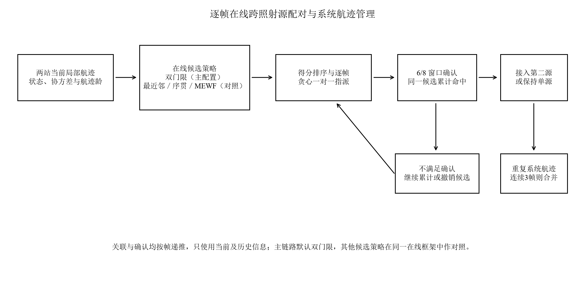
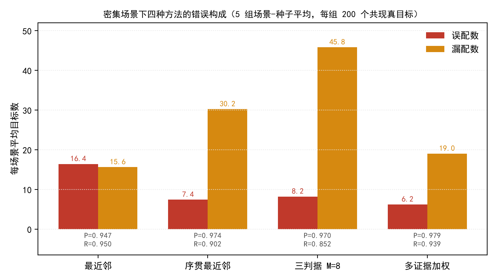
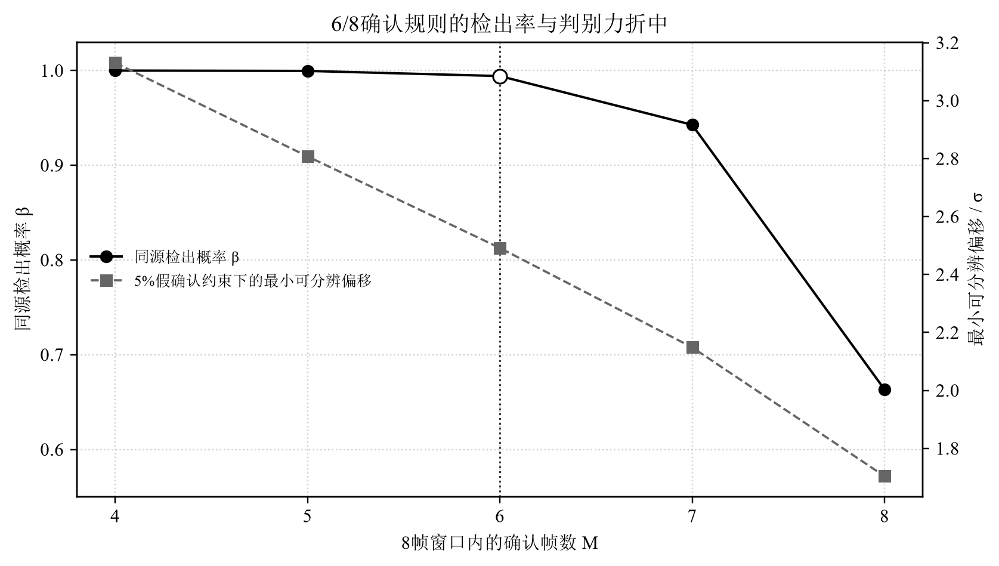

# 第5章 跨照射源在线航迹配对

跨照射源配对的任务，是判定分别由两条链路形成的两条局部航迹是否对应同一物理目标。两站各报出一条位置相差 4 km 的航迹时，仅凭几何邻近无法给出判定：在目标间距远大于量测误差的稀疏空域，最近邻准则通常正确；而当多条航迹同时落入同一小片空域，最近的候选可能只是恰好路过。位置接近既不是同一性的充分条件，也不是必要条件。

本章建立配对问题的形式化描述，给出判定层与指派层的分层结构，并以受控实验分离各成分的贡献。在线验证得到一个需要如实记录的结果：三种带门限的方法在同一批在线航迹上给出逐位相同的配对，方法之间的差异只在密集场景的受控实验中可观测。这一结果限定了本章结论的适用范围，也决定了第6章应当如何归因融合增益。

## 5.1 配对问题的形式化

### 5.1.1 二分图匹配与候选规模

设第一条照射源在观测窗内的航迹集合为 $\mathcal A=\{a_1,\dots,a_{N_1}\}$，第二条为 $\mathcal B=\{b_1,\dots,b_{N_2}\}$，配对即求一个一对一映射 $\mathcal M\subseteq\mathcal A\times\mathcal B$，使每一对尽可能对应同一物理目标。以二值变量 $x_{ij}\in\{0,1\}$ 表示 $a_i$ 与 $b_j$ 是否配对，问题写作

$$\min_{\{x_{ij}\}}\sum_{i=1}^{N_1}\sum_{j=1}^{N_2}c_{ij}x_{ij}, 
\text{s.t.} \sum_{j}x_{ij}\le1, \sum_{i}x_{ij}\le1, x_{ij}\in\{0,1\}$$ {#eq:ch5_ilp}

式中 $c_{ij}$ 为配对的代价。式[@eq:ch5_ilp]是经典的指派问题，其约束矩阵全单模，线性松弛的最优解自动取整，因此可由多项式时间的匈牙利算法求得全局最优。

在没有先验信息时，候选组合数为

$$N_{\text{cand}}=N_1N_2$$ {#eq:ch5_cand_count}

平方律意味着歧义随目标数急剧恶化：两站各 6 条航迹时只有 36 种组合，各 28 条时升至 784 种。同一套判据在稀疏场景下足够严格，到了密集场景就可能同时犯两种错误：该配的没配上，不该配的配上了。这是本章全部实验必须覆盖密度梯度的原因。只在稀疏场景上报出的零误配，度量的是场景的性质，不是算法的性质。

### 5.1.2 歧义的三个来源

第一个来源是密度。目标数与候选数成平方关系，而可用证据只随共现帧数线性增长，密度升高时判决的置信度必然下降。

第二个来源是短共现。两站的波束指向、距离窗与目标航路各不相同，同一目标被两站同时看到的时间未必长。覆盖互补布设下共现段只有 21–24 帧，扣除两条航迹各自的起始成熟段后，可用于判别证据的帧数只剩十余帧。配对面对的始终是两段部分重叠的记录：同一目标可能先进入南站视场、飞越共视带、最后从北站视场离开，它在 R2 上的航迹比在 R1 上的早十几分钟开始。这带来一个容易被忽略的要求：任何"位置接近"的证据都只在重叠段上有定义。本文因此把全部判据的统计域限定在共现帧集合 $T_{ij}$ 上，配对成功后允许两条航迹各自保留其非重叠段的量测。

第三个来源是平行航路。同一航路上前后相继或并排飞行的两架飞机，位置、速度、航向几乎一致，仅凭运动学特征无法区分，唯一可用的信息是哪一对的距离更小。

后两个来源指向同一件事：单帧信息不足以判定配对，只能在有限帧数内累积证据，再在候选之间做全局取舍。这一认识决定了后续的方法结构。

## 5.2 评价口径与配对池构造

配对结果是一个集合，其正确性通过与参考真值比对判定：一对配对的两条航迹真值编号相同且非空，则判为正确。在此基础上定义查准率（正确配对数与总配对数之比）、查全率（正确配对数与双站共现真实目标数之比）、误配数与漏配数。

不采用 $F_1$ 是刻意的。误配会把两个不同目标合成一条错误航迹，其后果在后续融合中被放大：两个目标的量测被强行平均，得到的航迹既不属于这一个也不属于那一个；漏配只是少融一对，系统退化为单站输出，仍然可用。二者代价不对等，而 $F_1$ 把它们视为等价，会奖励配得多而配错也多的方法。本文因此采用加权代价

$$C=5N_{\text{wrong}}+N_{\text{missed}}$$ {#eq:ch5_cost}

系数 5 体现误配的相对代价，本章所称"最优"一律指该代价最小。

查全率的分母必须是配对池，即两站曾同时有确认航迹的目标数，而不是场景内的目标总数；后者会把几何上从未共视的目标算成漏配，这在本文场景中占到了一成。63 段航迹中只有 57 段曾同时进入两站视场，其余 6 段全程只有单站可见，配对池因此取 57。这样处理是为了把"没有配对机会"与"有配对机会却没配上"分开：前者是布设的几何后果，计入查全率只会惩罚一个算法无法控制的因素。同理，两个目标即使都在池内，共现帧数也可能只有几帧；本文对此不设额外门槛，而让证据的累积方式（全共现区间平均而非连续帧否决）去适应它，这正是 5.4 节的设计动机。

## 5.3 既有方法及其失效机理

### 5.3.1 最近邻关联

最近邻对每一条航迹，在另一站找共现区间内平均地面距离最小者，再以一对一为约束做贪心指派

$$d(a_i,b_j)=\frac{1}{|T_{ij}|}\sum_{k\in T_{ij}}d_{\text{hav}}\left(a_i^k,b_j^k\right)$$ {#eq:ch5_nn}

它不含任何门限，因此在目标间距远大于量测误差时恰好总是正确的。但它对密集空域没有防护：一旦存在另一条距离更近的错误航迹，最近邻会无条件选中它。5.5 节的受控实验显示，这一无条件性在密集场景中付出的代价是每场景 16.40 个误配。

### 5.3.2 连续帧门限的偏置与方差权衡

为抑制误配，既有方法引入门限与多判据：位置门限、马氏距离检验、速度一致性，三条判据同时满足的帧计入通过计数，连续通过 $M$ 帧才判定关联。直观上 $M$ 越大越可靠，实测并非如此。在密集场景上扫描 $M$：$M$ 从 4 增到 10，误配数由 10.40 单调降到 7.60，漏配数却由 25.40 单调升到 56.40，查全率从 0.9156 跌到 0.8175。两个方向同时恶化，不存在使两者同时最优的取值。

这一权衡的根源在判据的组织方式。三判据只检验最近 $M$ 帧构成的滑动窗口，窗口一通过即终止判定；而"证据是否充分"与"连续帧数是否达标"在短共现条件下并不等价。对密集场景 200 个真实目标对的统计给出了直接证据：共现帧数均值 26.7 帧，其中距离小于门限的帧均值 25.9 帧，占 96.8%，说明位置门限本身几乎不构成瓶颈。真正的瓶颈是最长连续合格段的长度，其中位数为 22 帧、最小值为 0；取 $M=8$ 只能覆盖 88% 的目标，取 $M=5$ 可覆盖 96%。漏配因此集中于双站重叠时间本就很短的目标，与门限宽严无关。这一结论在 5.4.3 节将以判别力的形式重新出现：当 $M$ 逼近窗口长度 $N$ 时，确认规则退化为连续帧否决，其检出概率按 $p^N$ 衰减。

### 5.3.3 成对交换

如果说漏配来自短共现，误配则来自另一个机制。把密集场景中残余的错误配对逐一拆解，呈现出高度一致的形态：六条错误配成三组互换，t152 与 t164 互相配反，t142 与 t194 互相配反，t80 与 t181 互相配反。

误配的实质，是在两架运动学特征几乎相同的目标之间选错了对应关系，而不是配到一个毫不相干的目标。这类目标沿同一航路平行飞行，距离、马氏、速度、连续性四项证据同时都很高，任何加权综合都难以区分；唯一可用的信息是哪一对的距离更小。问题在于，三判据把"要不要配"与"配给谁"混在同一个综合分里，以航迹质量系数作为唯一排序键，当两个候选的综合分接近时即退化为随机。

排序键的消融给出佐证：以综合分为排序键时误配 11.60，以欧氏距离为排序键时 11.20，以协方差归一化的马氏距离为排序键时降到 8.40。把判定与指派混在一起，反而不如直接用马氏距离排序。

## 5.4 判定与指派的分层结构

上述分析表明，既有方法的缺陷不在判据本身，而在判据的组织方式：连续性被当作必须满足的否决门槛，导致 $M$ 退化为偏置与方差之间的权衡参数；判定与指派共用同一个综合分，导致成对交换。针对这两点，本章把两件事拆开：判定层回答是否值得配对，指派层回答配给谁。

{#fig:ch5_mewf}

### 5.4.1 证据的连续化与软门限

判定层把每项判据从否决门槛降级为可加权的证据，并在全部共现区间上累积，而不是只看最近若干帧。距离证据取负二次型指数在共现帧上的均值，是连续加权而非零一截断；马氏证据取马氏距离合格帧的比例

$$E_m=\frac{1}{|T_{ij}|}\sum_{k\in T_{ij}}\mathbb 1\left[\left(\boldsymbol\nu_{ij}^k\right)^T\left(\mathbf S_{ij}^k\right)^{-1}\boldsymbol\nu_{ij}^k<\gamma\right]$$ {#eq:ch5_maha}

式中 $\boldsymbol\nu$ 为两条航迹的位置差，$\mathbf S$ 为两站位置协方差之和；门限 $\gamma$ 取 $\chi^2_2$ 的 95% 分位 5.99，依据是匹配协方差下该二次型服从自由度为 2 的卡方分布。速度证据取速度差合格帧的比例；连续证据取最长合格连续段长度与共现帧数之比，它是连续 $M$ 帧这一硬约束的软化形式，不再要求凑齐 $M$ 帧，而按最长合格段占共现时长的比例计分。

四项证据都归一化到零一区间，加权平均后与门限比较

$$S=\frac{w_dE_d+w_mE_m+w_vE_v+w_cE_c}{w_d+w_m+w_v+w_c}\geq S_{\text{thr}}$$ {#eq:ch5_score}

等权 $w_i=1$ 不是随意选择：四项证据已经同尺度，等权等价于不预设哪项证据更重要，把调节的负担交给门限。5.6 节会说明，这个看似省事的决定恰好是本文实测的最优点。

### 5.4.2 指派层的全局最优

指派层在候选集上求解式[@eq:ch5_ilp]。贪心指派按分数降序依次选取，一旦航迹被占用就跳过，这在成对交换场景下必然失效：两对候选分数接近时，先选中的那对未必正确，而一旦选中，正确的那对就因航迹被占用而被排除。全局指派在全部候选上同时优化总代价，把局部的先到先得换成全局的最小代价匹配。

代价函数取马氏距离均值而非综合得分，理由是两层的信息不应重复：综合得分已在判定层用于筛选，指派层再用它排序，等于把同一份信息用了两遍。马氏距离用两站协方差之和归一化

$$c_{ij}=\frac{1}{|T_{ij}|}\sum_{k\in T_{ij}}\sqrt{\left(\boldsymbol\nu_{ij}^k\right)^T\left(\mathbf S_{ij}^k\right)^{-1}\boldsymbol\nu_{ij}^k}$$ {#eq:ch5_cost_maha}

自动惩罚"距离虽近但不确定度大"的候选，这正是区分平行航路目标所需要的。

### 5.4.3 确认帧数的判别力约束

在线链路保留了一个硬参数：最近 $N$ 帧内累计 $M$ 帧落在门限内，才把第二个源并入系统航迹。它与 5.3.2 节被批判的连续帧门限不是一回事：后者是判据本身，前者是判据通过之后的确认动作。但确认动作同样需要依据，其依据是判别力。

单帧判据为新息马氏距离平方 $T=\boldsymbol\nu^T\mathbf S^{-1}\boldsymbol\nu$。协方差匹配且均值偏移为零时 $T\sim\chi^2_2$；当两航迹存在标准化偏移 $\delta/\sigma$ 时，$T$ 服从自由度为 2、非中心参数为 $\lambda=(\delta/\sigma)^2$ 的非中心卡方分布。门限取 $g=5.99$ 时，同源帧的通过率为

$$p_1=F_{\chi^2_2}(g)=1-e^{-g/2}=0.950$$ {#eq:ch5_p1}

异源帧的通过率 $p_0(\lambda)=F_{\chi^2_2(\lambda)}(g)$ 随 $\lambda$ 单调下降。$N$ 帧内通过帧数服从二项分布，确认规则 $K\ge M$ 的假确认概率与检出概率分别为

$$\alpha(\lambda)=\sum_{k=M}^{N}\binom{N}{k}p_0^k(1-p_0)^{N-k}, 
\beta=\sum_{k=M}^{N}\binom{N}{k}p_1^k(1-p_1)^{N-k}$$ {#eq:ch5_bin}

要求 $\alpha\le0.05$，可反解出允许的最大异源单帧通过率 $p_0^*$，再反解 $\lambda$，得最小可分辨的标准化偏移 $\delta_{\min}/\sigma=\sqrt\lambda$。取 $N=8$ 的数值结果为：$M=4$ 时 $p_0^*=0.193$、$\delta_{\min}=3.13\sigma$、$\beta\approx1$；$M=5$ 时 $2.81\sigma$；$M=6$ 时 $p_0^*=0.400$、$\delta_{\min}=2.49\sigma$、$\beta=0.994$；$M=8$ 时判别力最强（$1.70\sigma$），但 $\beta=0.663$。

最后一行的结果决定了 $M$ 的上界。当 $M=N$ 时，确认规则退化为"最近 $N$ 帧全部通过"，即 5.3.2 节所批判的连续帧否决，其检出概率按 $p_1^N=0.663$ 衰减，三分之一的真实配对会被拒绝。$M$ 的下界则由判别力决定：$M=4$ 只能分辨 $3.13\sigma$ 的偏移，弱于 $M=6$ 的 $2.49\sigma$。取 $M=6$ 是 $N=8$ 时同时满足 $\beta>0.99$ 与判别力最强的取值。

窗口长度 $N$ 本身也受共视长度约束。若把 $N$ 放宽到 10 而取 $M=8$，可得 $2.25\sigma$ 与 $\beta=0.989$，判别力优于 6/8；代价是确认需要更长的观测，且所需共视帧数由 8 增至 10。本文场景的共视段只有 21–24 帧，扣掉两条航迹各自的起始成熟段（各不少于 5 帧）与确认窗，余量不足以支撑 $N=10$。$M/N=6/8$ 因而是判别力、检出率与共视长度三条约束的交点，其取值由这三条约束共同确定。

判别力的数值由脚本 `_analysis/diag_confirm_frames.py` 复现，其计算只依赖卡方分布与二项分布，不含任何调参。

## 5.5 方法成分贡献的正交分解

方法的三个成分（全局指派、放宽门限、证据软融合）需要正交对照才能归因。实验在密集场景上进行（并发均值 28.1 与 63.1，峰值 65 与 79，每组 200 个共现真目标，5 组场景与种子的组合），同一批航迹、同一套阈值定义，只切换配置。四种方法的结果如表[@tbl:ch5_dense]所示。

| 方法 | 误配数 | 漏配数 | 查准率 | 查全率 | 加权代价 |
| ---- | ---- | ---- | ---- | ---- | ---- |
| 最近邻 | 16.40 | 15.60 | 0.947 | 0.950 | 97.6 |
| 序贯最近邻 | 7.40 | 30.20 | 0.974 | 0.902 | 67.2 |
| 三判据 $M=8$ | 8.20 | 45.80 | 0.970 | 0.852 | 86.8 |
| 多证据加权+全局指派 | 6.20 | 19.00 | 0.979 | 0.939 | 50.0 |

: 密集场景下四种方法的配对质量（5 组场景与种子平均） {#tbl:ch5_dense}

{#fig:ch5_compare}

如表[@tbl:ch5_dense]与图[@fig:ch5_compare]所示，三种带门限的方法把误配从 16.40 压到 6–8，量化了设置门限这一基本判断的必要性；漏配的差别则更大，三判据 $M=8$ 因连续帧约束损失了 45.80 个目标，多证据加权把这一数字压到 19.00。后者在查准与查全两个方向上同时优于序贯最近邻，构成帕累托支配。

对各成分作正交分解后，归因结果与方法的表述重心并不一致。加权代价从原方案的 67.2 依次降到 56.0、51.4 与 49.4，三段降幅 11.2、4.6 与 2.0，分别占总降幅 17.8 的 63%、26% 与 11%。

{#fig:ch5_decompose}

如图[@fig:ch5_decompose]所示，最大的一段收益来自更换指派算法，其次来自放宽门限，而多证据融合这一最像本章贡献的部分只贡献了 11%。更严格的对照是：在同样采用全局指派、漏配数同为 18.40 的条件下，极限放松的硬门限方案加权代价 51.4，多证据加权 49.4，两者查准率之差 0.0009、查全率之差 0.0006。

机理在 5.4.2 节已经给出：工作点取在宽松一侧时，判定层几乎不执行筛选，进入指派的候选集很大，最终结果主要由指派层按马氏距离的排序决定；此时替换任何一项证据都不改变哪些对进入候选、谁配给谁。只有当门限收紧时，各证据的筛选价值才显现：在严格工作点上，去掉马氏证据使漏配从 28.00 增至 36.00，去掉速度证据增至 39.40。这一结果如实削弱了多证据融合的表述强度，本章因此把它定位为框架而非性能来源。

还有一组对照需要说明。"软融合只贡献 11%"并不等于四项证据无用。在本文工作点上逐项移除证据：去掉速度证据，误配由 6.20 升至 8.20、漏配由 19.00 升至 23.20；去掉连续性证据，误配升至 8.40、漏配 22.00。四项证据都在起作用，只是作用方式与指派方式不同：证据决定哪些对进入候选，指派决定候选之间如何取舍，而后者在宽松门限下承担了几乎全部筛选工作。门限扫描也印证了这一点：$S_{\text{thr}}$ 从 0.50 放宽到 0.65，误配由 8.40 降到 8.20，漏配由 21.40 升到 24.20，是一条很平缓的曲线，取 0.55 落在平台的中间。

## 5.6 在线链路验证

受控实验回答的是方法之间有无差别，在线系统回答的是这些差别在真实链路中是否可观测。在线链路的配对是在已有系统航迹上增加一个源：链路开机即工作，局部航迹到达即挂接，每条系统航迹在任一时刻可以挂一站、两站或零站。判别用马氏门限 5.99，确认规则 6/8，证据起算前要求两条航迹寿命均不少于 5 帧。

覆盖互补布设的 63 段中，只有 57 段曾同时进入两站视场，构成配对池；三个种子分别配出 57、53、57 对，池内查全 98.3%、93.0%、98.3%，均值 96.5%。配准注入 A/B 那一组（标定后）为 56 对且全部正确。把噪声强度放大到标称值的两倍，配对由 56 对掉到 47 对，说明门限对噪声标定的准确性敏感，这与第3章协方差失配等价于门限被等效收紧是同一条机理。

在线链路上，两门限、序贯与多证据加权三种方法的配对结果逐位相同，只有最近邻出现误配。其原因是场景的密度：覆盖互补布设下并发数均值 6.0、峰值 12，远低于受控实验的 28 与 63，平行航路造成的歧义很少被同时触发，三种带门限的方法因此给出同一组配对，差异被场景抹平。

这一结果限定了本章结论的适用范围：方法之间的优劣只在密集场景中可测，而本文的在线场景是稀疏的。配对方法的设计应以密集场景为准，因为密集场景是危险的那一端；在线结果的作用是证明整条链路在其目标场景中可用，而不是证明方法更优。

在线链路的挂接机制决定了几条工程约束。局部航迹到达时，先在门限内寻找可挂接的系统航迹，找到则更新，找不到则以自身为起点新建；连续 $K_{\text{loss}}=8$ 帧没有任何源供给即删除。由于一条真实航迹会依次穿过仅 R2、共视、仅 R1 三段，系统航迹的来源必然在运行中切换，切换点就是共视段的两个端点。另设一条合并规则：两条各持一站源的单源系统航迹，若连续 3 帧落在同一门限内，判为同一目标并合并，保留出生早的编号。这条规则处理的是配对晚于建轨的情形：两条航迹各自先独立成形，等到证据攒够才合并，避免系统航迹在共视段开头被拆成两条。

## 5.7 本章小结

本章把配对拆成两个问题并分别处理。判定层把位置、马氏、速度、连续性四项判据从否决门槛降级为可加权证据，在全部共现区间上累积，消去了连续帧门限的偏置与方差权衡；指派层以马氏距离为代价求解全局最优一对一匹配，把成对交换交还给最擅长的环节。

确认帧数的选择被还原为判别力计算。以 $\chi^2_2$ 的 95% 分位为单帧门限时，同源帧通过率 0.950，异源帧通过率随标准化偏移单调下降；要求假确认概率不超过 0.05，6/8 规则可分辨 $2.49\sigma$ 的偏移而检出概率保持 0.994，8/8 规则虽可分辨 $1.70\sigma$，检出概率却跌到 0.663，退化为被批判的连续帧否决。窗长放宽到 10 帧可进一步改善判别力，但受共视长度约束不可用。

这里有一条边界必须交代。稀疏场景的对照是反例而非支持：在并发均值 4.2–6.2 架的八个场景上，四种方法的误配数全为零，最近邻的漏配也为零，反而是三种带门限的方法各漏配 0.6–2.1 个。若只看稀疏场景，结论会变成最近邻最优。这不是算法优劣的反转，是场景的性质：目标间距远大于量测误差时，最近邻恰好总是正确的，门限与多证据只带来额外筛选。真正能区分方法的是密集场景，本章的结论因此一律限定在密集条件下。

受控实验给出了本章最诚实的结论：相对既有方法，加权代价由 67.2 降到 49.4，但收益的 63% 来自更换指派算法、26% 来自放宽门限，多证据软融合本身只占 11%。在线链路上三种带门限的方法逐位相同，只有最近邻会误配，差别在稀疏场景中不可观测。这两条合起来说明，配对环节的正确表述是用分层与全局指派消除结构性错误，而不是用多证据融合提高精度。

本章的产出是一组可信的配对及其边界：池 57/63、查全 96.5%、噪声加倍时掉到 47 对。第6章将在此基础上回答最后一个问题：给定这样一组配对，融合能把误差压到多少，压下去的部分又来自哪里。
