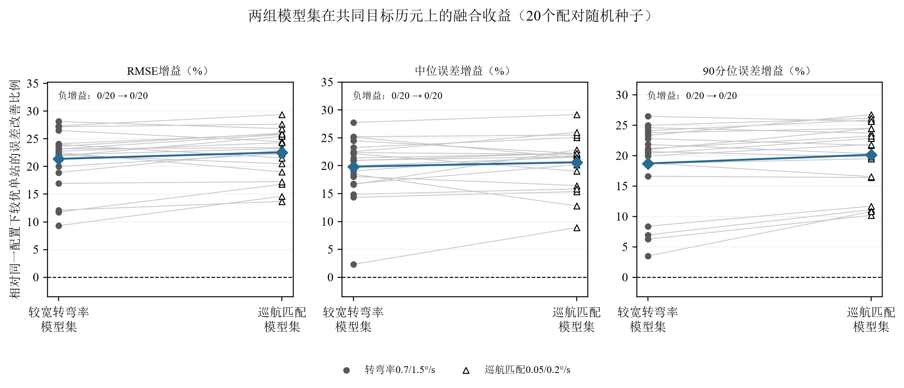

# 第6章 航迹融合与增益机理

第5章给出一组可信的配对：哪些局部航迹属于同一物理目标，以及这组判定的适用边界。配对成功只是融合的前提，并不保证融合有效。两条航迹即使确实属于同一目标，融合后的误差仍可能大于其中较差的一条，甚至大于较好的一条。融合是否有益，取决于两站误差的相关系数，而相关系数由第4章指出的共同模型误差决定。本章沿这条链条把问题推到可以计算的层面。

融合带来两类性质不同的收益。第一类是长度收益：两站的观测并集长于任一单站，系统的持续跟踪时间因此延长。这是一个几何量，由覆盖区与航迹方向的夹角决定，与两站的误差无关，其上限可以写出闭式。第二类是精度收益：两站对同一目标给出两个独立或部分独立的估计，加权后方差下降。这是一个统计量，由两站误差的相关系数 $\rho$ 与两站方差之比 $k$ 决定。两类收益的口径不同，评估方法也不同，混在一起陈述会使结论无法核对。

本章的结论有四条。线性融合的方差可以写成 $\rho$ 与 $k$ 的闭式，融合有效的条件因此是一个不等式，而不是经验判断；相关系数的主要来源是两站共用的模型集，模型集与真实机动分布匹配后，池化 $\rho$ 由 0.520 降到 0.224，融合从经常有害变为几乎总是有益；长度收益的上限由两站覆盖帧数的并集决定，四个工况的实现度为 91.6% 至 98.3%；在覆盖互补布设的 63 段场景上，系统航迹长度比 1.314，双源帧的融合误差为 8.94 km，而单源帧仍是 15.34 km 的单站水平。

## 6.1 两类收益与统计口径

### 6.1.1 长度收益的几何性质

设两条链路对某目标分别有 $F_1$、$F_2$ 帧确认航迹，二者同时可见的帧数为 $O$。系统航迹在任一时刻至少有一路供给即维持，因而其有源覆盖帧数等于两站的并集

$$F_{\text{union}}=F_1+F_2-O$$ {#eq:ch6_union}

以较长单站为基准，长度比的几何上界为

$$\frac{L_{\text{sys}}}{\max(F_1,F_2)}\le\frac{F_1+F_2-O}{\max(F_1,F_2)}$$ {#eq:ch6_bound}

式[@eq:ch6_bound]是恒等式而非估计：并集是确定的，任何实现都不可能超过它，只能逼近。$F_1=F_2=F$ 时该式退化为 $2-O/F$，重叠越少，可延长的比例越大。这解释了一个容易被误读的现象：延长比例由重叠度决定，而不由算法决定。覆盖互补布设通过波束偏转把 $O$ 压低，因此它的价值在于几何，与融合规则无关，这与 2.1.3 节的分工一致。

### 6.1.2 精度收益的统计性质

精度收益不是推导出来的必然结果。两条航迹属于同一目标，只保证它们估计的是同一个真值；融合后方差是否下降，取决于两个误差之间的相关性。若两站误差完全相关（$\rho=1$），融合不提供任何新信息，加权平均只是把同一个误差按比例分配给两个源；若两站误差独立（$\rho=0$），融合方差按调和平均下降，两源等方差时为一半。

因此精度收益的讨论必须以 $\rho$ 为中心。这也决定了本文对两类收益的评估口径：长度用覆盖帧数计，精度用双源帧的误差计，两者不合并成一个数。

### 6.1.3 单源段与双源段必须分段报告

在覆盖互补布设下，一条南北向航迹依次经过仅南站、共视、仅北站三段，系统航迹的来源在运行中切换。63 段场景的统计显示，多数帧只有单源供给，双源帧只占少数。若只报告双源段的融合精度，等于只描述了航迹的两成，其余八成被留在了没有交代的位置。

本文因此对系统航迹统一分段报告：单源段的精度与单站同量级，双源段为融合结果，两段合起来才是系统航迹的真实形态。这一口径还带出一条结论：航迹延长段不带来精度收益。延长段的量测与单站完全相同，融合无从发生，其误差水平因此不随航迹变长而改善。长度收益与精度收益在时空上是分开的，前者发生在单源段，后者只发生在共视段。

## 6.2 线性融合的方差与有效条件

### 6.2.1 逆方差加权的精确方差

设两站对同一目标的位置估计为 $\hat{\mathbf x}_1$、$\hat{\mathbf x}_2$，误差零均值，协方差为 $P_1$、$P_2$，互协方差为 $P_{12}=\rho\sqrt{P_1P_2}$。线性融合取

$$\hat{\mathbf x}_f=w\hat{\mathbf x}_1+(1-w)\hat{\mathbf x}_2,,  w+(1-w)=1$$ {#eq:ch6_lin}

无偏约束使权重之和为一，融合方差为

$$V(w)=w^2P_1+(1-w)^2P_2+2w(1-w)\rho\sqrt{P_1P_2}$$ {#eq:ch6_var}

系统实现的是逆方差加权，即 $w=P_2/(P_1+P_2)$，它等价于在两源独立的假设下取最优。代入式[@eq:ch6_var]得

$$V_{\text{SCC}}=\frac{P_1P_2}{P_1+P_2}+\frac{2\rho P_1P_2\sqrt{P_1P_2}}{(P_1+P_2)^2}$$ {#eq:ch6_scc}

第一项是独立假设下的融合方差，即两方差的调和平均；第二项是相关性带来的附加项，与 $\rho$ 成正比。记方差比 $k=\sigma_2/\sigma_1\ge1$，则

$$\frac{V_{\text{SCC}}}{\sigma_1^2}=\frac{k^2}{1+k^2}+\frac{2\rho k^3}{(1+k^2)^2}$$ {#eq:ch6_scc_k}

式[@eq:ch6_scc_k]表明，融合的方差由方差比与相关系数共同决定，而非"两站误差各减一半"。相关性不改变第一项，它只在第二项上叠加一个正偏移，该偏移的系数 $2k^3/(1+k^2)^2$ 在 $k\in[1,3]$ 上介于 0.50 与 0.65 之间。第一项则随 $k$ 增大而趋近 1，可用的余量随之变小，有效上界的收紧因此源于两源方差的差距，而非该系数的增大。

### 6.2.2 最优权重与等方差的特殊性

对式[@eq:ch6_var]关于 $w$ 求极小，得最优权重与对应方差

$$w^*=\frac{P_2-\rho\sqrt{P_1P_2}}{P_1+P_2-2\rho\sqrt{P_1P_2}},, 
V^*=\frac{P_1P_2(1-\rho^2)}{P_1+P_2-2\rho\sqrt{P_1P_2}}$$ {#eq:ch6_blue}

当两源等方差时，式[@eq:ch6_blue]给出 $w^*=1/2$，与 $\rho$ 无关，融合方差退化为经典的

$$V^*=\frac{(1+\rho)P}{2}$$ {#eq:ch6_equal}

这说明等方差情形下逆方差加权就是最优加权，相关性只降低增益的幅度，不改变权重。反过来说，逆方差加权的失误只发生在两源方差不等且 $\rho>0$ 时：此时它按方差的倒数分配权重，把过大的权重给了较差的一源，而真实的相关性又使这一源的误差无法被另一源抵消。系统在 63 段场景上的两源中位误差为 6.37 km 与 8.81 km，$k\approx1.4$，正落在会犯这类错误的一侧。

式[@eq:ch6_blue]还有一个必须说明的边界：当 $\rho$ 接近 1 时，$w^*$ 可能落在 $[0,1]$ 之外，此时的"最优"是靠负权重外推实现的，工程上不可用。约束 $w\in[0,1]$ 后，最优解在边界上取得，即退化为选择较好的单站。这也是融合在强相关下应当退出的数学依据。

### 6.2.3 融合有效的闭式条件

有了式[@eq:ch6_scc_k]，融合是否有益可以写成一个不等式。融合有效指融合方差小于两源中较好者，即 $V_{\text{SCC}}\le\min(P_1,P_2)=P_1$（不妨设 $P_1\le P_2$）。代入并整理，得

$$\rho\le\frac{1+k^2}{2k^3}$$ {#eq:ch6_cond}

式[@eq:ch6_cond]是本章的核心判据，它把"融合何时有益"从经验问题变成可计算问题。几个取值可以直接读出：$k=1$ 时右端为 1，等方差融合永远有效（$\rho=1$ 的退化情形除外）；$k=1.4$ 时右端为 0.54；$k=2$ 时为 0.31；$k=3$ 时降到 0.19。两源差距越大，允许的相关系数越低，这与 6.2.2 节的解释一致。

{#fig:ch6_region}

如图[@fig:ch6_region]所示，四条曲线对应 $k=1.0$ 至 3.0，虚线为无增益界线 $V=\sigma_1^2$。曲线与虚线的交点给出每个方差比下的有效上界：0.54、0.31、0.19。63 段场景的池化 $\rho$ 为 0.172、$k\approx1.4$，工作点落在界内且余量充分。10 对实验的两源方差比更接近 1（1.18 与 1.26），其有效上界分别为 0.73 与 0.64；$\rho$ 由 0.520 降至 0.224 后，$\rho$ 与上界之间的余量由 0.21 增至 0.42，这与实测增益由 1.70% 升至 17.4% 的方向一致。

式[@eq:ch6_cond]还能解释一个反直觉的结果。若把工作点移到 $k$ 较大的区域（例如某站因配准残差而显著变差），有效上界随之收紧，融合会从有益转为有害。这提示工程上的一个纪律：配准不良时不应通过调整融合权重去挽救，而应先消除系统偏差，因为偏差同时抬高 $\rho$ 与 $k$，两个因素都朝不利方向作用。

### 6.2.4 协方差交叉的适用前提

在 $\rho$ 完全未知时，常用协方差交叉（covariance intersection）保守地组合两个估计

$$P_{\text{CI}}^{-1}=\omega P_1^{-1}+(1-\omega)P_2^{-1},, 
\omega\in[0,1]$$ {#eq:ch6_ci}

$\omega$ 按使 $\operatorname{tr}P_{\text{CI}}$ 或 $\det P_{\text{CI}}$ 极小选取。该方法的一致性保证是：无论 $\rho$ 取何值，融合协方差都不小于真实方差。其代价也由此而来，$\omega$ 按照最坏情形选取，当真实 $\rho$ 已知时，该权重与最优权重一般不同，方差因此高于式[@eq:ch6_blue]给出的 $V^*$。

本文的立场是：$\rho$ 可以通过 6.3 节的方法从数据中估计，估计值本身就是判断融合是否有效的依据（式[@eq:ch6_cond]），因此没有必要为未知相关性付出保守代价；CI 的适用场合是 $\rho$ 不可估或两源异质到无法建立互协方差的情形，本文场景不属于此类。

另一个实现层面的问题需要交代。Bar-Shalom–Campo 递推要求传播两站的互协方差 $P_{12}$，本文的滤波器未传播该项，实现中将其置零，于是 BC 分支在数值上退化为与 SCC 完全相同。这是实现状态的如实陈述，而非两种方法的比较结果；若要评估 BC 的独立价值，需要先补齐互协方差的状态方程，本文未做。

## 6.3 误差相关性的来源与测量

### 6.3.1 共同模型误差

第4章已经指出，两站共用同一套运动模型与转移概率。对同一段真实机动，两站的滤波器以相同的模型失配方式外推，其预测误差因此同向。这种同向性的来源是模型误差，与量测噪声无关；它不会被增加观测消除，只能通过让模型与真实运动匹配来减小。

这一机理给出了一个可检验的预测：若把模型集从 0.7/1.5 改为与实测机动分布匹配的 0.05/0.2，则两站的共同模型误差应同时减小，$\rho$ 应显著下降，而单站精度只应有小幅改善。6.4 节的实验正是按这一预测设计的。

### 6.3.2 池化相关系数的定义

两站误差的相关系数需要先定义统计域。逐目标计算再取中位数，会把目标之间的共同偏差去掉，剩下的只是各目标内部的时序相关，量级偏小且对模型集不敏感。本文采用池化口径

$$\rho=\frac{\sum_{t}\boldsymbol\delta_1(t)^T\boldsymbol\delta_2(t)}
{\sqrt{\left(\sum_t\|\boldsymbol\delta_1(t)\|^2\right)\left(\sum_t\|\boldsymbol\delta_2(t)\|^2\right)}}$$ {#eq:ch6_rho}

式中 $\boldsymbol\delta_i(t)$ 为第 $i$ 站在 $t$ 时刻的位置误差，求和遍历全部双源帧。池化口径保留了目标之间的共同偏差，而这正是模型误差相关的主体。三个口径在同一批数据上可以相差三倍：在 5 种子的全口径诊断中，池化 $\rho$ 由 0.430 降到 0.146 且 5/5 一致下降，逐目标中位数只由 0.242 降到 0.149 且有 1 个种子反升。口径不同，结论的显著性随之不同，因此正文一律使用池化值，其余口径进附录。

### 6.3.3 协方差一致性的校验

$\rho$ 描述两个误差的线性关系，不描述滤波器对自身精度的判断是否可信。后者由归一化误差平方（NEES）检验

$$\epsilon=\frac{1}{n}\sum_{t=1}^{n}\boldsymbol\delta(t)^T\mathbf P(t)^{-1}\boldsymbol\delta(t)$$ {#eq:ch6_nees}

对二维位置误差，协方差一致时 $\mathbb E[\epsilon]=2$。实测值大于 2 说明滤波器低估了自身误差，协方差偏乐观。这一量在本文中有独立意义：3.5.2 节已表明，协方差偏乐观等价于关联门限被等效收紧，因此 NEES 既是融合权重的可信度指标，也是配对环节的输入质量指标。

## 6.4 模型集匹配的增益机理

实验在近共视布设的场景 adsb_0002 上完成，使用当前在线管线，取种子 1 至 10 的配对。只改模型集一个变量，其余配置、场景与种子全部固定。结果如表[@tbl:ch6_mech]所示，其中三口径增益分别对应均方根、中位数与 90 分位。

| 指标 | 基线 0.7/1.5 | 匹配 0.05/0.2 | 变化 | $p$ |
| ---- | ---- | ---- | ---- | ---- |
| 池化 $\rho$ | 0.520 | 0.224 | −0.297 | $9\times10^{-11}$ |
| NEES（R1 / R2） | 4.49 / 2.94 | 2.87 / 1.53 | −1.62 / −1.41 | $\sim0$ |
| R1 单站 RMSE / km | 11.47 | 9.88 | −13.8% | $6\times10^{-9}$ |
| R2 单站 RMSE / km | 13.56 | 12.47 | −8.1% | 0.59 |
| 融合 RMSE / km | 11.23 | 7.92 | −29.5% | $2.2\times10^{-5}$ |
| 融合中位 / km | 5.90 | 4.45 | −24.5% | $\sim0$ |
| 融合 90 分位 / km | 18.78 | 11.54 | −38.6% | $\sim0$ |
| RMSE 增益 | 1.70% | 17.43% | +15.7 pp | 0.063 |
| 中位增益 | 7.29% | 15.58% | +8.3 pp | $7\times10^{-4}$ |
| 90 分位增益 | −2.57% | 14.80% | +17.4 pp | $2.4\times10^{-9}$ |

: 模型集匹配前后的机理量（近共视场景，种子 1–10） {#tbl:ch6_mech}

{#fig:ch6_mech}

如表[@tbl:ch6_mech]与图[@fig:ch6_mech]所示，三条通道同时改善，但量的关系并不对称。单站只改善 13.8% 与 8.1%，且 R2 的变化不显著；池化 $\rho$ 下降 0.297，显著性达到 $10^{-11}$ 量级；融合误差在三个口径上分别下降 29.5%、24.5% 与 38.6%。单站改善与融合改善不成比例，差额可由式[@eq:ch6_scc_k]定量核对。以本节两源 RMSE 之比作 $k$：基线 $k=13.56/11.47=1.18$，代入得方差比 0.882，预测增益 6.1%，实测 RMSE 增益 1.70%；匹配后 $k=12.47/9.88=1.26$，方差比 0.748，预测 13.5%，实测 RMSE 与中位增益 17.4% 与 15.6%。两端的预测与实测分别相差 4.4 与 2 至 4 个百分点，方向一致、量级相同。

三个统计口径的差异本身是信息。基线下的 RMSE 口径增益只有 1.70%，显著性 0.063，处在边界；中位与 90 分位口径分别达到 15.58% 与 14.80%，均高度显著。原因是 RMSE 由极少数发散种子主导，均值因此接近零，而中位与 90 分位对少数发散样本不敏感，反映的是多数目标的改善。这一点的工程含义比均值更重要：融合的价值不在于把典型误差再压几个百分点，而在于抑制少数会让航迹不可用的偏离。

逐种子的相关性给出趋势律的直接证据。10 对样本中，$\rho$ 的下降量与增益的提升量之间的相关系数为 $-0.51$；剔除一个 RMSE 增益为 $-51\%$ 的灾难样本后升到 $-0.87$（$n=9$）。方向与预测一致：$\rho$ 降得越多，增益上升越多。但单个灾难样本足以把 RMSE 口径的相关性拉低一半，这说明该关系只能作为群体趋势，不能写成确定性公式。

47 对样本给出了同一结论在稳健性上的版本，如图[@fig:ch6_neg]所示。负增益的种子数在三个口径上分别由 13/47 降到 5/47、由 4/47 降到 0/47、由 27/47 降到 1/47；三口径的平均增益由 $-0.75\%$ 升到 $14.67\%$、由 $7.64\%$ 升到 $14.18\%$、由 $-1.74\%$ 升到 $15.99\%$。

{#fig:ch6_neg}

图[@fig:ch6_neg]的读法与表[@tbl:ch6_mech]不同。表回答的是"平均改善了没有"，图回答的是"最坏情况下还坏不坏"。90 分位口径下负增益种子由 27/47 降到 1/47，意味着融合从"超过一半的场合有害"变为"几乎总是有益"。这个转变比平均增益的提高更能说明模型集匹配的作用：它把工作点从式[@eq:ch6_cond]的边界外移到了边界内。

关于增益与相关性之间的定量关系，必须给出边界。式[@eq:ch6_blue]与式[@eq:ch6_scc_k]都是静态加权界：两个估计各用一次、权重固定。系统航迹则是有记忆的动态滤波，每个周期在上一次的基础上重新加权，误差在帧间自相关，逐点吻合因此不是必然的，本节 4 个百分点的偏差即属此类。更重要的是，在另一组配置上曾观察到实测增益超过等方差闭式界的情形，因此本文只把"增益随 $\rho$ 单调下降"作为趋势律使用，不写成上限。若要给出上限，需要建立带状态递推的动态界，本文不做，相关可行性在 7.4 节作为后续工作列出。

另一处需要说明的是参数口径。式[@eq:ch6_cond]以方差比 $k$ 为参数，而表[@tbl:ch6_mech]报告的是 RMSE。RMSE 在重尾分布下不是方差的稳健估计：按两源 RMSE 算得的 $k$ 为 1.18 与 1.26，而按 63 段场景的中位误差 6.37 km 与 8.81 km 算得 1.38。本节的数量级核对用前者，以保持与实验同一数据集；解释趋势时用后者，因为中位口径对尾部不敏感。两个数都出现在文中，但不相对于同一个统计量，引用时须随口径注明。

## 6.5 航迹长度的几何上界

式[@eq:ch6_bound]给出的是上界，实际能吃到多少需要单独测量。为此设计四个工况的扫掠：目标沿不同方位穿越走廊，布设固定为覆盖互补，检测概率 0.6，单种子 42。四个工况的覆盖帧数、几何上界与实测长度比见表[@tbl:ch6_ceiling]。

| 工况 | $F_1$ | $F_2$ | $O$ | 几何上界 | 实测长度比 | 实现度 |
| ---- | ---- | ---- | ---- | ---- | ---- | ---- |
| 垂直穿越 | 53 | 54 | 20 | 1.611 | 1.569 | 97.4% |
| 45° 斜穿 | 35 | 65 | 28 | 1.108 | 1.015 | 91.6% |
| 近距（106.0°E） | 49 | 49 | 18 | 1.633 | 1.528 | 93.6% |
| 远距（108.6°E） | 57 | 59 | 24 | 1.559 | 1.533 | 98.3% |

: 四个穿越工况下的长度上界与实现度 {#tbl:ch6_ceiling}

四个工况的实现度落在 91.6% 至 98.3% 之间，说明在线链路能够接近几何给出的上限。差额有确定来源：起始段的确认延迟、切换点的配对滞后与 $K_{\text{loss}}=8$ 的删除机制都会损失若干帧。这些损失不改变几何上界，只降低实现度，属于链路实现的固定开销。

45° 斜穿工况的比值只有 1.015，容易被误读为链路失效。实际上该工况的几何上界本身只有 1.108：一条链路覆盖了 65 帧，另一条只补充 7 帧，可延长的空间本来就窄。这一条必须与上界一起引用，否则"延长五成"会被误读为普遍可达。延长比例是重叠度的函数，不是系统的固有指标；可以横向比较的是实现度，它对重叠度不敏感。

覆盖互补布设的 63 段场景上，系统航迹的长度比为 1.314，逐段的几何上界不同，整体落在四个工况的实测区间之内。该数字与 2.1.2 节的覆盖带几何一致：并集比单站长约六成，但一条航迹未必贯穿整个并集，实际比值低于并集比是正常的。

## 6.6 覆盖互补布设的系统基线

把前五节的口径合起来，给出覆盖互补布设的系统基线，如表[@tbl:ch6_base]所示。三个种子的统计在双源帧上完成。

| 指标 | 均值 ± 标准差 |
| ---- | ---- |
| 融合 RMSE / 中位 / 90 分位（双源帧） | 8.94 ± 0.46 / 5.39 ± 0.11 / 13.95 ± 0.86 km |
| 双源帧 R1（RMSE / 中位 / 90 分位） | 15.42 ± 1.51 / 6.37 / 15.40 km |
| 双源帧 R2（RMSE / 中位 / 90 分位） | 30.81 ± 11.61 / 8.81 / 24.79 km |
| 融合增益（RMSE / 中位 / 90 分位） | 41.8% / 14.3% / 9.4% |
| 系统航迹·单源段 | 15.34 ± 0.99 km |
| 系统航迹·双源段 | 8.94 ± 0.46 km |
| 长度比 | 1.314 ± 0.004 |
| 配对池 / 池内查全 | 57 / 63 段入池，池内 96.5 ± 3.0% |
| 池化 $\rho$ | 0.172 ± 0.126 |

: 覆盖互补布设的系统基线（63 段，种子 42/43/44） {#tbl:ch6_base}

表[@tbl:ch6_base]有四处需要交代，都是口径问题而非结果问题。

其一，精度只在双源帧上统计。覆盖互补布设不改变两站的量测精度，本节报告的是共视段内的融合精度；单源段的 15.34 km 是单站水平，两者不能合并成一个"系统精度"。这也是 6.1.3 节分段口径的落点。

其二，三个增益口径必须并列。RMSE 口径的 41.8% 反映尾部抑制，中位口径的 14.3% 反映典型精度，90 分位口径的 9.4% 反映次尾部的改善。三者的数值方向并不一致，RMSE 口径最高而 90 分位口径最低，因此任何单一数字都不能代表融合增益。只报其中任何一个，都可以被另一个反驳。

其三，R2 的种子离散极大（RMSE 30.81 ± 11.61 km）。本文将其归因于少数目标在长断点后的重捕，与第4章的重尾结论一致；融合的 RMSE 离散反而小（8.94 ± 0.46 km），说明当一个源被污染时，另一个源的约束起了作用，这正是融合抑制尾部的作用机制。

其四，池化 $\rho=0.172$ 与 6.4 节的 0.224 来自不同场景。前者为覆盖互补布设的 63 段、3 个种子；后者为近共视布设的 10 对种子，且 0.224 是模型集匹配后的值（匹配前为 0.520）。两者同量级，但不可互替，引用时必须带场景。

## 6.7 本章小结

本章把融合拆成两类收益并分别给出判据。

精度收益方面，导出逆方差加权的精确方差式[@eq:ch6_scc_k]，说明融合方差是方差比与相关系数的二元函数；由该式得到融合有效的闭式条件 $\rho\le(1+k^2)/(2k^3)$，其数值含义是两源等方差时恒有效、差两倍时要求 $\rho\le0.31$、差三倍时要求 $\rho\le0.19$。等方差情形下逆方差加权就是最优加权，权重失误只发生在两源不等且相关时，这解释了负增益的成因。

相关性的来源方面，机理链为真实机动分布决定模型集、模型集同时作用于单站残差、共同模型误差与协方差一致性。10 对在线配对的实验显示，模型集匹配使池化 $\rho$ 由 0.520 降到 0.224（$p=9\times10^{-11}$），融合 RMSE、中位与 90 分位分别下降 29.5%、24.5% 与 38.6%，而单站只改善 13.8% 与 8.1%。47 对的稳健性统计显示，负增益种子数在 90 分位口径上由 27/47 降到 1/47，融合从经常有害变为几乎总是有益。增益与 $\rho$ 的关系只作为趋势律使用，静态界不作为上限。

长度收益方面，系统航迹的有源覆盖帧数等于两站覆盖的并集，长度比的上界为 $(F_1+F_2-O)/\max(F_1,F_2)$。四个穿越工况的实现度为 91.6% 至 98.3%，斜穿工况的低比值由上界本身较低解释，不是链路失效。

系统基线方面，覆盖互补布设 63 段的长度比 1.314，双源帧融合误差 8.94 km，单源段 15.34 km，三口径增益 41.8%/14.3%/9.4%，池内查全 96.5%。单源段不带来精度收益，长度收益与精度收益在时空上是分开的，这一结论与 2.1.3 节的分工一致。

至此，量测、配准、滤波、配对、融合五个环节的结论已经闭合。第7章将把这条链上的判断汇总，并交代它未覆盖的部分。
