# 第1章 绪论

## 1.1 课题来源、研究背景及意义

### 1.1.1 课题来源与研究背景

本课题来源于短波外辐射源雷达双照射源联合处理中的航迹关联与融合研究需求，在已有单站航迹跟踪程序的基础上，研究不同观测链路之间的信息协同处理。研究面向低量测精度、低检测概率和低数据率条件，关注单站航迹如何稳定形成、不同照射源的局部航迹如何正确配对，以及多源信息能否改善位置估计和持续跟踪能力。

远距离、隐蔽和持续的目标监视是海空态势感知的重要需求。地基微波雷达的覆盖受到视距传播、地球曲率和地形等因素制约，短波雷达则可以利用电离层传播实现超视距探测。短波外辐射源雷达进一步利用广播、通信等非合作信号照射目标，由接收端获取目标散射回波，无需自行建设专用雷达发射设施，具有被动接收和利用既有照射资源的特点，为广域目标监视提供了一种技术途径[5,6,39]。

双照射源被动探测的基本关系如图[@fig:ch1_principle]所示。不同照射源发出的信号经传播照射同一目标，接收端通过相应参考信号和目标回波获取目标信息，再将不同链路的处理结果送入融合中心。图中以共用接收端说明双源信号的利用原理；本文考虑的是分别形成局部航迹的两条收发观测链路，具体站点配置与覆盖范围在量测模型中定义。

{#fig:ch1_principle}

短波体制的覆盖优势伴随着复杂的观测条件。电离层随时间和空间变化，使传播路径与群时延具有不确定性，目标定位因而依赖传播参数及其估计。非合作信号的带宽、调制方式和发射功率不由雷达接收端控制，弱目标回波还需要与强直达波、多径及杂波分离[6,8,9]。这些因素可能造成量测误差较大、点迹更新间隔较长和漏检较多，进而影响单站状态估计和航迹维持。

单个照射源的观测范围与可用信息有限，多源联合处理因而具有研究价值。在公共覆盖区域内，两条观测链路可以提供互补的目标状态信息；在覆盖范围部分错开的情况下，目标离开一条链路视场后，另一条链路仍可能继续提供航迹信息，有助于延长系统航迹和有效观测时间。但两条局部航迹并不能直接合并：时间与空间偏差可能使同源航迹错开，定位误差和目标密集可能造成错误配对，局部估计误差的相关性又会影响加权融合结果[20,25,42,43]。

因此，本文的总体研究目的，是通过时空配准统一局部航迹的比较基准，通过单照射源滤波改善断续观测下的状态估计，通过跨照射源关联建立可靠的航迹对应关系，并利用双源信息研究位置估计改善与持续跟踪。滤波、关联和融合分别承担局部估计、同源判别与信息合成的任务，共同服务于可靠、连续的目标监视。

### 1.1.2 理论意义

短波双照射源航迹处理同时包含传播参数不确定性、非线性状态估计、多目标关联和相关误差融合等问题。将这些问题置于统一框架中分析，有助于明确传播参数与常值量测偏差的区别，说明标校样本的几何分布如何影响参数估计，并辨析运动模型、观测缺失及局部误差相关性对系统性能的作用。

本文通过参数可辨识性分析、理想条件下的估计误差基准、多帧判别分析和简化融合模型下的有效条件，研究不同环节的性能约束及其联系。这些分析能够为同类观测条件下的标校集选择、运动模型配置和关联融合规则设计提供参考，也有助于解释某项局部改进为何能够或不能转化为系统收益。

### 1.1.3 实际意义

对短波外辐射源雷达而言，获得少量有效点迹之后仍需形成可以持续使用的目标航迹。提高单站估计稳定性、减少跨源误配和漏配，并合理利用两条链路的覆盖互补，能够为目标位置判断和持续监视提供更可靠的信息。航迹延长的实际价值在于增加目标有效观测时间，减少因单源覆盖受限造成的信息中断；公共观测段的估计融合则用于改善位置精度，两者需要分别评价。

本文建立从量测建模、偏差标定、局部跟踪到在线配对与融合的处理流程，通过仿真考察算法选择和参数配置对系统输出的影响，可为双照射源处理方案及观测配置设计提供依据。相关结果的适用范围受量测模型、传播等效和观测条件限制，其工程应用还需要真实短波回波与外场条件的进一步检验。

## 1.2 国内外研究现状

### 1.2.1 短波外辐射源雷达及多源联合探测研究

借用第三方信号探测目标的思想在雷达早期发展中已经出现。1935 年 Watson-Watt 利用 BBC 广播开展飞机探测试验，二战期间 Klein Heidelberg 系统利用英国 Chain Home 雷达网的信号进行预警，分别体现了早期被动探测和双基地探测的探索[1,2]。这些工作为外辐射源探测提供了历史基础，但其工作频段、信号和传播条件与现代短波天波系统并不完全相同。

随着接收、计算和数字信号处理能力的发展，外辐射源雷达逐步拓展到多种广播与通信照射源。Silent Sentry 系统开展了基于广播信号的被动监视，多频段多基地系统进一步研究不同照射源和观测链路的联合利用[3,4]。这类研究说明，照射源选择和收发几何是被动探测系统的重要组成部分，多源观测的作用需要结合各链路的覆盖和量测特性进行分析。

国内在高频外辐射源体制、数字调幅广播利用和信号处理方面也形成了相关研究。万显荣等开展了基于 DRM 数字调幅广播的高频外辐射源雷达实验，赵志欣围绕高频外辐射源体制和关键处理技术进行了研究[5,6]。在目标点迹形成之前，强直达波、多径和杂波抑制是基础环节。Colone 等研究多级干扰消除与目标检测处理，Palmarini 等进一步研究滑动扩展相消方法，为改善被动雷达的点迹输入提供了途径[8,9]。

上述研究覆盖了系统体制、照射资源和信号级处理等方面，但不同频段的传播机理与量测条件存在明显差异。将视距被动雷达或一般多传感器方法用于短波天波场景时，还需要检验传播参数失配、低精度和断续观测的影响。本文以形成点迹后的航迹处理为研究对象，重点关注两条观测链路之间的配准、滤波、关联与融合。

### 1.2.2 时间对齐与空间配准研究

时间与空间基准的一致性是多源航迹比较的前提。对于采样时刻不一致的状态序列，可以借助插值或运动外推构造共同参考时刻的状态；若存在未知时间偏差，则还需要建立相应观测关系进行估计。非均匀采样下的插值外推和基于最小二乘的时延估计研究，为理解这类问题提供了基础[45,46]。其中，已知采样时刻差与未知时钟偏差属于不同问题，不能混为同一个待估量；在线处理中还应保证所使用的信息在输出时刻已经可获得。

空间配准通常包含坐标基准统一和系统误差估计。前者解决不同位置表达之间的转换，后者校正测距、测角和平台参数等偏差。相关研究采用最小二乘、广义最小二乘及极大似然等方法，将传感器偏差与目标观测联系起来，并讨论噪声和几何配置对估计结果的影响[47,48]。这类方法为本文的离线偏差标定提供了估计思路。

天波量测还包含传播介质的影响。采用等效虚高描述传播路径后，虚高通过非线性几何关系进入群距离，其误差在不同目标距离上产生的残差并不相同。因此，常值距离偏置与传播参数误差需要在模型中区分，坐标转换也不能替代这类误差的估计。当标校航迹的距离范围较窄时，不同参数对观测的作用还可能近似重合。

由此，适用于本文的配准研究需要同时回答模型和数据两个层面的问题：如何对传播参数与测距、测角偏差进行联合描述，以及参考航迹能否提供足够的几何变化来区分这些参数。进一步还需要分析，标定结果进入位置反演后，残余偏差如何影响局部航迹和跨源关联。

### 1.2.3 单照射源航迹滤波研究

航迹滤波通过运动模型与量测信息估计目标状态，是分布式融合的输入基础。对于非线性量测，扩展卡尔曼滤波通过局部线性化进行递推，无迹卡尔曼滤波则使用确定性采样传播分布的均值和协方差。Julier 与 Uhlmann 对无迹滤波和非线性估计进行了系统讨论，Wan 与 Van Der Merwe 给出了无迹卡尔曼滤波的实现研究[7,54]。这些方法降低了处理非线性观测的难度，但滤波精度仍依赖运动模型、噪声描述和初始条件。

国内外辐射源雷达跟踪研究围绕大观测误差和机动目标开展了多种改进。陈书恒等研究去相关无偏转换量测跟踪方法，程瑞等研究改进自适应扩展卡尔曼滤波与交互多模型的结合，王鹏等研究基于迭代扩展卡尔曼滤波的目标跟踪[12,13,40]。这些工作分别从量测变换、噪声适应和非线性更新等角度改善状态估计。多目标数据关联和多平台异构信息跟踪研究也提供了相关参考[41,55]。

交互多模型方法通过多个运动模型及其概率更新描述目标运动模式变化，适合将直飞与转弯等行为置于同一估计器中[20,25]。但增加模型数量并不必然改善结果，模型所覆盖的机动范围需要与目标实际运动相匹配；自适应噪声调整的效果也取决于新息是否能够区分机动、量测异常和模型误差。

在本文较低检测概率和较长更新周期下，缺帧会增加预测时段，真实机动与模型偏差可能持续累积。需要区分量测噪声抑制、缺测期间的航迹维持和机动响应等不同目标，并同时评价误差和协方差可信度。单站滤波的影响也不能止于局部轨迹是否平滑，其输出误差及不确定性将直接参与后续跨源判别和加权融合。

### 1.2.4 跨照射源航迹关联研究

航迹关联判断不同观测链路提供的局部航迹是否属于同一物理目标。统计方法通常利用状态差、距离或似然构造判据。Singer 与 Kanyuck 研究多站航迹相关处理，何友等研究利用历史判决和双门限的航迹相关算法，并在后续工作中讨论多目标多传感器关联方法[17-19,50,51]。这类方法结构清晰，能够将位置接近程度和多帧确认结合起来，其判决结果同时受到门限、误差统计和历史长度影响。

模糊方法通过隶属度或综合相似度描述多个属性，把单一距离判据扩展为多属性关联决策。何友等研究模糊双门限航迹相关，Aziz 讨论分布式多传感器多目标多属性条件下的关联与融合[52,53]。其价值在于能够组织不同来源的证据，但属性尺度、权重和判决规则仍需与数据条件相匹配。

近年来，航迹间的结构关系与学习型特征也被用于关联。Sönmez 与 Hocaoğlu 研究基于参考拓扑特征的异步航迹关联，王威等研究拓扑增强和灰色理论的分层方法，丁振平与郭徽东研究图谱特征关联[21,29,31]。陈毓研究 CNN-BiLSTM 多源航迹关联，Xu 等研究带智能航迹评分的多假设算法，其他机器学习方法也被用于构造关联判别[22,26,28]。这些方法提供了利用空间、运动和时序结构的不同途径。

不同关联方法各有适用条件。目标稀疏时，简单距离判别可能已经能够提供可靠结果；当定位误差与目标间距接近时，多对候选航迹可能同时满足局部条件，有限的公共观测又会限制多帧证据。此时除了判断某一对是否同源，还需要处理不同候选之间的竞争。本文据此将同源判定与全局指派分别考察，并通过同条件对照分析历史证据、门限和指派结构的作用。

### 1.2.5 航迹融合研究

航迹级融合由各节点先形成局部状态估计，再在融合中心合成目标信息。相对于传输全部原始量测，分布式结构能够减少通信需求，但需要处理局部估计之间的信息相关与重复使用[20,25]。误差独立时，协方差加权可以得到相应的最优线性估计；误差相关时，互协方差成为确定权重和融合不确定性的重要信息。

简单凸组合融合、Bar-Shalom-Campo 方法与协方差交叉代表了不同的相关性处理思路。前者以独立误差为基本条件分配权重；Bar-Shalom-Campo 方法通过互协方差修正融合计算，其应用需要与局部滤波过程相容的相关信息[20]。Julier 与 Uhlmann 提出的协方差交叉用于处理未知相关性，在输入估计及其协方差满足一致性等前提下形成保守融合，Niehsen 则研究了快速协方差交叉方法[32,33]。保守协方差与实际位置误差改善是不同性质的评价，不能相互替代。

国内外还在均值融合、有限视域标签一致性和学习型融合等方面开展了研究。李天成等对均值融合跟踪的概念与方法进行了综述，李诚等讨论有限视域下的分布式多目标跟踪，Qi 等研究并行航迹融合模型[34-36]。分布式大气波导雷达、外辐射源组网及多接收站检测跟踪研究，则为不同传播环境和节点配置下的信息联合提供了应用参考[37,42,43]。

对于本文的双照射源观测，同一目标运动、运动模型失配及未充分补偿的传播误差均可能形成相关误差。误差相关程度、单站精度差异以及协方差信息的可信度共同影响融合结果。另一方面，覆盖互补带来的航迹延长还受到公共观测长度、关联确认和航迹管理制约。因此，需在明确相关性处理方式的前提下比较融合表现，并将公共覆盖段的精度改善与联合覆盖范围内的持续跟踪分开评价。

## 1.3 现有研究不足与理论分析框架

### 1.3.1 现有研究不足与本文关注的问题

上述研究为配准、滤波、关联和融合提供了较丰富的方法基础，但在本文所关注的短波观测条件下，仍有若干需要进一步分析的衔接问题。

首先，天波传播参数与设备量测偏差对群距离的作用不同。仅进行坐标统一或常值偏差校正，不能完整描述传播失配在不同目标距离上的影响。需要将传播参数纳入配准模型，分析参数可分离的条件，并说明标校集几何分布与样本数量各自的作用。

其次，断续量测下的滤波误差可能同时来自量测噪声、运动模型失配和预测时段延长。某一参数在特定条件下改善局部误差，并不意味着在不同机动和漏检条件下仍然有效。需要结合真实目标机动特征，区分过程噪声调整和模型集配置的效果，并考察局部协方差能否合理描述实际误差。

再次，低精度与有限公共观测使关联判据面临误配、漏配和确认延迟之间的取舍。将多项特征共同引入关联时，还需要分离特征组织、门限变化和指派方式的贡献，说明何种场景能够区分方法，而不是将全部性能差异归因于综合得分。

最后，正确关联只是有效融合的必要前提。已有融合方法提供了不同的相关性处理工具，但在给定短波链路中，误差相关从何而来、前端模型改变如何影响相关性，以及精度收益与覆盖收益如何区分，仍需要在同一处理链中检验。本文据此关注系统误差、局部估计质量、配对判别与最终融合收益之间的联系。

### 1.3.2 理论分析框架

本文采用以观测误差和信息可用性为主线的分析框架，如图[@fig:ch1_analysis]所示。传播几何和量测模型决定观测约束及偏差的作用形式，配准影响后续估计使用的量测基准，单站滤波提供局部状态及其协方差，关联判断不同局部状态是否对应同一目标，融合则在关联成立的前提下合成信息。各环节既有各自的估计或判别问题，也通过输入误差和可用数据发生联系。

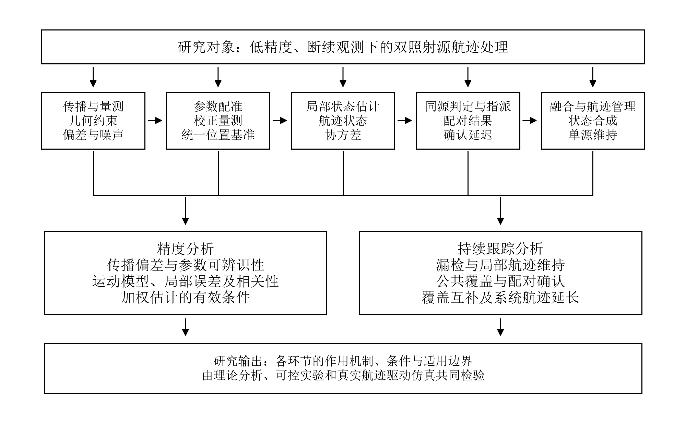{#fig:ch1_analysis}

精度分析关注三个相互联系的因素：传播和量测偏差是否得到合理补偿，局部滤波模型是否与真实运动相适应，以及两站误差相关性和精度差异是否允许有效加权。本文据此分析参数可辨识性、理想条件下的估计误差基准和简化条件下的融合有效性，并通过对照实验检验这些关系的解释范围。

持续跟踪分析关注信息在时间和空间上的可获得性。漏检会减少量测更新，有限公共覆盖会限制配对确认，覆盖互补则可能使目标由一条链路转入另一条链路时仍保有系统航迹。本文分析覆盖几何所提供的观测机会，以及滤波维持、配对延迟和航迹管理对实际持续跟踪时间的影响。由覆盖并集带来的潜在航迹延长，不能直接等同于算法已经实现的长度收益。

研究对象限定为双照射源配置下两条收发观测链路的航迹级处理，以二维目标运动和等效虚高描述相应几何。为集中研究跨源关联与融合，站内点迹与目标航迹的对应关系视为理想条件；局部航迹的漏检、预测和估计误差仍保留。这一边界使本文能够分析后端处理机制，但不能据此评价真实虚警环境下完整点迹关联和目标检测系统的性能。

## 1.4 主要研究内容

### 1.4.1 天波双基地量测与目标运动建模

建立含等效虚高的收发总群距离、方位和多普勒量测关系，描述量测噪声、检测及观测范围约束，并构建局部状态估计所需的运动模型。在真实 ADS-B 航迹基础上形成不同目标密度和机动条件的仿真场景，使各处理环节能够在一致的数据与量测条件下比较。

设置近共视和覆盖互补两类布设。前者用于公共目标观测段内的局部误差及融合精度分析，后者用于考察目标跨越不同覆盖区时的系统航迹维持与延长。具体站点参数、量测数值和样本筛选规则在模型部分统一定义。

### 1.4.2 传播参数与量测偏差的时空配准

区分接收站共同授时、采样时刻差和站源时基残差，分别处理状态时间对齐与量测距离零点偏移。在空间基准统一的基础上，将等效虚高、距离偏置和方位偏差纳入观测模型，通过参考航迹进行离线加权最大似然估计，并将结果反馈至量测校正和位置反演。

研究参数可辨识性及估计精度与标校集几何分布的关系，比较标定前后局部定位和关联融合结果，并考察传播参数残余失配的影响。重点回答可校正哪些偏差、参考数据需要满足什么条件，以及校正对后续处理有何作用。

### 1.4.3 断续观测下的单照射源航迹滤波

采用交互多模型无迹卡尔曼滤波处理非线性量测和目标机动，研究航迹起始估计、缺测预测与观测恢复更新。结合目标实际机动特征配置匀速和转弯模型，并分析过程噪声调整及模型集匹配对状态估计的影响。

以理想条件下的信息量基准为参照，区分噪声抑制、机动跟踪和断点后的恢复能力。通过误差分布及协方差一致性评价局部航迹质量，分析局部模型配置对两站误差共同变化的影响，为跨源关联和融合提供状态与不确定性信息。

### 1.4.4 有限公共观测下的跨照射源航迹配对

围绕同源判别与候选竞争，将配对处理划分为候选判定和全局指派。候选判定利用位置、马氏距离、速度及连续性等多帧信息，全局指派在候选集合中满足一对一约束。比较最近邻、序贯、门限类及多证据加权方案，分别分析门限、证据和指派结构的作用。

研究关联确认所需的公共观测长度与误配、漏配之间的关系，考察不同目标密度、噪声水平和航迹成熟度条件下的表现，并通过逐帧处理检验配对能否在可用时间内建立。关联评价同时考虑正确与错误配对以及未被确认的同源航迹。

### 1.4.5 相关误差下的航迹融合与持续跟踪

以简单凸组合、Bar-Shalom-Campo、协方差交叉及其快速形式为方法参照，在明确各自假设及相关信息处理方式的基础上分析航迹融合。重点研究局部误差相关性和单站精度差异如何影响逆方差加权，并检验运动模型配置改变后，局部误差、协方差可信度及融合表现的共同变化。

在公共覆盖段评价融合位置精度，在覆盖互补条件下评价系统航迹长度和有效观测时间。通过系统航迹的建立、关联确认、单源维持和删除过程，分析覆盖几何与处理延迟对实际收益的限制，为持续监视条件下的双源信息利用提供依据。

## 1.5 研究程序与方法

### 1.5.1 研究程序与技术路线

本文按照问题分析、模型建立、离线标定、在线处理和性能验证的程序开展研究，技术路线如图[@fig:ch1_route]所示。首先通过文献与观测条件分析确定处理对象和评价目标，建立传播、运动及检测模型，并构造标校数据和评估场景。标校集用于估计传播参数及量测偏差，评估集用于检验处理性能，两者按时段分离，避免用同一数据同时完成标定与效果评价。

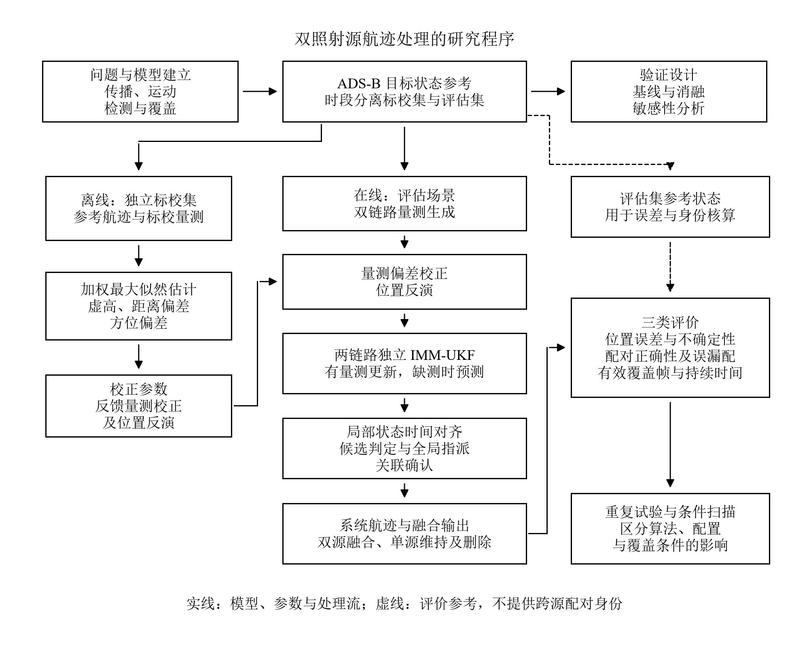{#fig:ch1_route}

离线阶段根据标校集估计各链路的参数，得到后续量测校正和位置反演所需的信息。在线阶段按观测周期生成两条链路的量测，分别完成偏差校正和局部状态估计，再将可用局部航迹对齐至共同参考时刻，进行跨源候选判定、关联确认与状态融合。系统航迹可以由单源建立，在满足确认条件后接入另一源，并在仅有一源提供信息时继续维持。

处理过程中区分状态所对应的参考时刻与数据实际可获得的时刻，时间对齐只使用当前已获得的局部估计及其运动模型，不调用未来观测。仿真参考身份仅用于量测生成、站内理想关联和事后指标核算，不作为跨照射源配对的判决依据。

性能验证既考察各环节的单独作用，也考察它们在共同链路中的表现。采用相同目标轨迹和配对随机条件比较不同配置，分别设置无偏差与有偏差、不同模型集、不同候选规则和融合方法等对照，再改变目标密度、噪声及覆盖条件，分析结论的稳定性与适用范围。

### 1.5.2 研究方法与验证方式

理论分析采用量测几何、统计估计和判别分析相结合的方法。通过量测方程分析参数作用，利用 Fisher 信息矩阵讨论可辨识性与估计下界，以非线性状态估计描述局部滤波，并在相应分布假设下分析多帧确认规则；对简化的相关误差加权模型推导融合有效条件。上述结果均需要保留其假设和分析对象，不能直接作为任意动态系统的通用性能界。

算法研究围绕各环节承担的任务展开：以最大似然方法估计系统参数，以多模型非线性滤波完成局部状态估计，以多帧证据和全局指派建立跨源对应关系，以不同相关性处理方式形成融合输出。通过控制变量和消融比较，区分模型选择、门限设置及结构改变的贡献，不预设增加算法复杂度必然带来改善。

实验采用可控模型仿真与真实航迹驱动仿真。前者便于单独改变偏差、噪声及运动条件，检验理论关系；后者利用 ADS-B 提供的目标位置与运动状态，保留真实航路、目标密度和机动特征，再由天波量测模型与检测模型生成雷达观测。ADS-B 数据属于实测目标状态资料，但本文的雷达群距离、方位、多普勒及检测过程仍为仿真，因此不能将该验证称为真实短波回波实测。

评价分别围绕估计精度、配对可靠性和持续跟踪能力展开。精度分析在可比的公共观测段进行，结合均方根误差、中位数和高分位误差反映典型表现及尾部失效；配对分析明确可关联目标集合，分别统计误配与漏配；持续跟踪分析比较系统与单站的有效覆盖帧数和观测时间。重复随机试验用于考察波动，敏感性分析用于识别退化条件，最终结论限定在已验证的模型、场景和统计范围内。

# 第2章 天波双基地量测模型与场景构建

短波外辐射源雷达以电离层为反射面，照射源与接收站分置两地，构成天波双基地体制。该体制的量测有两个固有特征。其一，传播路径经电离层连续折射，光程大于收发两点之间的地面距离，若按直线几何把群距离折算为地面距离，将产生与目标距离成正比的系统偏差；其二，发射路径与接收路径的长度不等，观测到的群距离是两条单程路径之和，其等值线不再是圆。这两个特征决定了距离反演必须求解一个非线性方程，也决定了电离层参数只能以可估量的形式进入观测模型，而不能作为已知常数扣除。

双照射源配置的增益来自两种彼此独立的分集。误差分集指两条链路的量测噪声互不相关、误差相关性小于一，融合后位置误差下降，属于精度问题；其成立的前提是两站覆盖高度重合，同一目标在两站同时具备长时段观测。覆盖分集指两条链路的覆盖区彼此错开，目标由一站视场进入另一站视场时航迹不中断，属于连续性问题；其成立的前提是覆盖区不重合。两种分集对布设提出的要求相反，无法由同一组几何同时满足，因此本文设置两种布设分别承载，并在全文中固定其使用范围。

本章建立后续各章共用的量测模型与数据场景。2.1 节给出两种布设的几何参数与分工依据；2.2 节推导天波传播的折线等效模型，给出群距离、几何等值线与虚高灵敏度的解析形式；2.3 节讨论定位反演的可解性、方位与多普勒量测以及三通道噪声的量级关系；2.4 节说明以实测 ADS-B 数据构造场景的方法与结果；2.5 节列出模型边界与一条贯穿全文的显式假设。

## 2.1 两种布设及其分工

### 2.1.1 近共视布设的隔离条件

第一种布设使两条链路的覆盖区几乎重合，平面几何如图[@fig:ch2_layout]的(a)所示。北站 R1 位于 104.0°E、30.7°N，其照射源 Tx1 位于 100.0°E、30.7°N；南站 R2 位于 106.5°E、29.6°N，照射源 Tx2 位于 102.5°E、29.6°N。两对收发站均按东西向布置且同纬度，经度相差 4°，在 30°N 附近对应收发基线约 385 km；两站本身相距约 270 km。两站波束中心同为 93°，视场全宽 45°，单跳地面距离窗取 1000–2000 km。

选择重合覆盖的目的是隔离变量。设两条链路的量测方程为 $\mathbf z_i=\mathbf h_i(\mathbf x)+\boldsymbol\varepsilon_i$，$i=1,2$。当两站覆盖区重合、且两站的几何差异可以忽略时，$\mathbf h_1\approx\mathbf h_2$，两条链路在同一目标集合上给出形式相同的观测，其差别仅在于噪声强度 $\sigma_i$。此时同一目标集合上的性能差异可以归因到算法与模型，不受观测机会不同的干扰。若覆盖区不重合，参与统计的目标集合在两站之间不一致，性能差异与覆盖差异相互混淆，任何归因都不成立。第4章的单站滤波性能与第6章的模型集传导链均在这一布设下评估，依据即在此。

距离窗的两端由传播模式的可归因性确定。下限对应仰角过高、射线接近电离层穿透的区域，上限对应多跳传播与单跳回波混叠的区域。窗口之外并非没有回波，问题在于回波无法归因到单一传播模式，折线等效的建模前提不成立。

### 2.1.2 覆盖互补布设的视差补偿

第二种布设使两条链路的覆盖区沿南北方向错开，几何如图[@fig:ch2_layout]的(b)所示。北站 R1 位于 92.50°E、31.45°N，南站 R2 位于 92.50°E、30.55°N，两站的照射源均在正西 4°、与本站同纬度，两站南北相距 100 km，波束指向正东，视场全宽 15°。

波束指向不能按对称方式摆放，原因在于视差。两站相距 $\Delta y=100\text{ km}$，对同一条走廊上的目标，两站的方位角必然不同。取走廊参考点 107.40°E、31.00°N，该点距 R1 的地面距离为 1413.7 km，距 R2 为 1420.4 km，自 R1 观测的方位为 88.13°，自 R2 为 84.17°，视差为

$$\Delta\theta_{\text{par}}\approx\arctan\frac{\Delta y}{\rho}=\arctan\frac{100}{1414}=4.05°$$ {#eq:ch2_parallax}

实测 3.96° 与式[@eq:ch2_parallax]的一阶估计相差 0.09°，说明在该距离上平面小角近似已经够用。若两束平行指向正东，二者的重叠区将整体偏向视场一侧，有效重叠角由 15° 降为 $15°-\Delta\theta_{\text{par}}\approx11°$，且偏离走廊经线。补偿方式是以各自的参考方位为基准向相反方向偏转同一角度，得两束中心 83.53° 与 88.77°，中心间隔 5.24°，在 15° 视场下形成约 9.76° 的重叠。

补偿后的覆盖带沿走廊经线统计如下：R1 覆盖 30.36–33.66°N，南北跨度约 366 km；R2 覆盖 28.28–31.64°N，跨度约 373 km；两者在 30.36–31.64°N 之间重叠约 142 km，并集自 28.28°N 延伸至 33.66°N，约 597 km。一条南北向航迹因此依次经过仅 R2 覆盖、两站共视、仅 R1 覆盖三个区段，区段的边界即两条覆盖带的两条端点纬线。

系统不含切换环节。融合本身是两路量测的加权，某区段只有一路存在量测时，另一路的权重自然为零，输出直接采用有量测的一路。整条链路的处理流程仍为单站成航迹、站间配对、融合输出，布设改变不引起算法改动。这一性质使"融合航迹比单站长多少"成为一个可以由两站并集直接计算、与算法无关的量。

### 2.1.3 两种布设的能力边界

覆盖互补布设不提高融合精度，这一点需要在模型层面说明。融合后的位置协方差由两站的单帧噪声与误差协方差阵的结构共同决定，与波束指向无关；布设改变的是两站覆盖的并集，即一条航迹能够延续的时间与系统能够覆盖的空间范围。因此本文对该布设只统计航迹长度、持续跟踪时间与覆盖范围三个量，不对其报告精度增益；第4至6章讨论精度时，样本一律取两站共视段，融合也只发生在共视段内。

表[@tbl:ch2_sysparam]汇总两种布设的全部系统参数。

| 参数 | 符号 | 近共视 | 覆盖互补 |
| ---- | ---- | ---- | ---- |
| R1 位置 | — | 104.0°E, 30.7°N | 92.50°E, 31.45°N |
| R2 位置 | — | 106.5°E, 29.6°N | 92.50°E, 30.55°N |
| 照射源 | — | 站正西 4° | 站正西 4° |
| 视场全宽 | — | 45° | 15° |
| 波束中心 | — | 93.0° / 93.0° | 83.53° / 88.77° |
| 单跳地面距离窗 | $\rho$ | 1000–2000 km | 1000–2000 km |
| 采样周期 | $dt$ | 30 s | 30 s |
| 检测概率 | $P_d$ | 0.6 | 0.6 |
| 虚警率 | $P_{fa}$ | $10^{-3}$ | $10^{-3}$ |
| R1 群距离噪声 | $\sigma_{R1}$ | 10 km | 10 km |
| R2 群距离噪声 | $\sigma_{R2}$ | 20 km | 20 km |
| R1 方位噪声 | $\sigma_{\theta1}$ | 0.35° | 0.35° |
| R2 方位噪声 | $\sigma_{\theta2}$ | 0.60° | 0.60° |
| 等效虚高（真值/标称） | $h$ | 320 / 300 km | 320 / 320 km |
| 目标巡航速度 | $v$ | 230 m/s | 230 m/s |

: 两种布设的系统参数 {#tbl:ch2_sysparam}

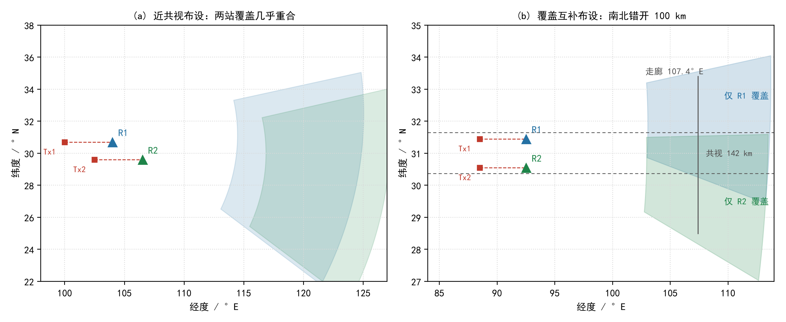{#fig:ch2_layout}

如图[@fig:ch2_layout]所示，两种布设的差别在于覆盖的形态而非站的数目。(a) 中两站覆盖区大体重合，并集宽度与单站几乎相同；(b) 中两束有意错开，并集扩展到 597 km，相对单站的 366 km 与 373 km 增加六成，代价是共视段只有 142 km，约占并集的四分之一。视场宽度决定单站覆盖带的南北跨度，波束偏转决定两条带的相对位置，偏转越大并集越长、共视段越短。这一取舍在第5章讨论配对所需的共同观测长度时成为主要约束。

## 2.2 天波传播的折线等效模型

### 2.2.1 等效虚高与单程路径长度

短波信号在电离层中被连续折射，路径为弧线，光程大于收发两点之间的直线距离。严格求解需要电子密度剖面，而剖面随昼夜、季节与空间位置变化，不可预报，不能作为已知量进入观测模型。工程上改用等效参数把弯曲路径折算为折线：假设电离层在某一高度对射线作镜面反射，该高度称为电离层等效虚高 $h$。其作用是把不可观测的剖面信息压缩为一个可估的标量，代价是该标量只在一定的时空范围内保持恒定。

设目标与接收站之间的地面距离为 $\rho$，反射点位于该段中点正上方、高 $h$。由镜面反射的对称性，上下行两段斜距相等，各为 $\sqrt{(\rho/2)^2+h^2}$，单程等效路径为二者之和

$$L(\rho,h)=2\sqrt{\left(\frac{\rho}{2}\right)^2+h^2}=\sqrt{\rho^2+4h^2}$$ {#eq:ch2_oneway}

式[@eq:ch2_oneway]中的系数 4 只作用于虚高项：地面距离项在拼接中保持 $\rho^2$，虚高项因两段各贡献 $h^2$ 而在平方内累加为 $4h^2$。其物理含义是虚高在路径长度中的权重被放大一倍。取 $h=300\text{ km}$、$\rho=1400\text{ km}$，得 $L=1523.2\text{ km}$，比地面距离长约 123 km，相对误差 8.8%；同一起始条件下 $\rho=1000\text{ km}$ 处为 16.6%，$\rho=1900\text{ km}$ 处为 4.9%。若把群距离按收发各半折算为地面距离而不计虚高，将系统性高估目标距离，且高估量随距离减小而增大，无法用单一比例因子修正。

双基地体制下，照射源到目标、目标到接收站的地面距离分别为 $\rho_0$ 与 $\rho_1$，两条路径各有一次电离层反射，群距离是两条单程路径之和

$$R_g=L(\rho_0,h)+L(\rho_1,h)=\sqrt{\rho_0^2+4h^2}+\sqrt{\rho_1^2+4h^2}$$ {#eq:ch2_group_range}

地球曲率的影响以球面弦长代替平面弧长处理。取地球半径 $R_e=6371\text{ km}$，弧长 $\rho$ 对应的弦长为

$$\rho_c=2R_e\sin\frac{\rho}{2R_e}$$ {#eq:ch2_chord}

1000 km 处弦长比弧长短 0.94 km，2000 km 处短 8.4 km。该差异小于群距离噪声，但它是确定性的，会随反演逐帧累积为系统偏差，故本文一律采用式[@eq:ch2_chord]的球面弦长模型。

### 2.2.2 群距离的几何等值线与单基地近似的适用性

式[@eq:ch2_group_range]给出的群距离不构成欧氏距离，等值线的形状需要单独讨论。当 $h\to0$ 时 $L\to\rho$，等值线 $\rho_0+\rho_1=R_g$ 退化为以照射源与接收站为焦点的椭圆。有限虚高使 $L$ 成为 $\rho$ 的单调增函数，等值线是椭圆的单调拉伸，不再具有解析的二次形式。把小量 $4h^2/\rho^2$ 展开可得

$$L(\rho,h)=\rho\sqrt{1+\frac{4h^2}{\rho^2}}\approx\rho+\frac{2h^2}{\rho}-\frac{2h^4}{\rho^3}$$ {#eq:ch2_expand}

在 $\rho=1000\text{ km}$ 处二阶展开的残差为 $-2.4\text{ km}$（0.2%），$\rho=1900\text{ km}$ 处为 $-0.1\text{ km}$。残差虽小，但与第3章给出的标定下界同量级，故本文不采用展开式，一律使用式[@eq:ch2_group_range]的闭式。

单基地近似是另一条常用简化，它把双基地群距离按平均地面距离折算为 $2L(\overline{\rho},h)$，$\overline{\rho}=(\rho_0+\rho_1)/2$。由泰勒展开，双基地路径和与单基地近似之差为

$$L(\overline{\rho}+d)+L(\overline{\rho}-d)-2L(\overline{\rho})=L''(\overline{\rho}) d^2+\mathcal O(d^4), L''=\frac{4h^2}{L^3}$$ {#eq:ch2_monostatic}

式中 $d=(\rho_0-\rho_1)/2$ 不超过基线的一半。取基线 385 km、$h=300\text{ km}$，在 $\overline{\rho}=1400\text{ km}$ 处该项为 3.8 km，在 1000 km 处为 8.4 km，均与群距离噪声同量级，也高于第3章 2.35 km 的可达精度。近共视布设的基线占比为 20%–38%，覆盖互补布设为 27%，两个布设因此都调用严格的双基地反演，不采用单基地近似。

### 2.2.3 群距离对虚高的灵敏度

虚高是待估参数，其对群距离的作用强度决定了该参数能否从数据中分离。对式[@eq:ch2_group_range]求偏导，得

$$s(\rho_0,\rho_1,h)=\frac{\partial R_g}{\partial h}=\frac{4h}{\sqrt{\rho_0^2+4h^2}}+\frac{4h}{\sqrt{\rho_1^2+4h^2}}=\frac{4h}{L_0}+\frac{4h}{L_1}$$ {#eq:ch2_sens}

灵敏度随两条路径的长度分别衰减，衰减规律为 $4h/\rho$（$\rho\gg2h$ 时）。取 $h=300\text{ km}$：$\rho_0=680\text{ km}$、$\rho_1=300\text{ km}$ 时 $s=3.11$；$\rho_0=\rho_1=1000\text{ km}$ 时 $s=2.06$；$\rho_0=\rho_1=1900\text{ km}$ 时 $s=1.20$。近端与远端的灵敏度相差约二点六倍，说明同一虚高偏差在不同距离上留下的群距离偏差不同，任何常数偏置都无法把它吸收干净。

{#fig:ch2_group_range}

如图[@fig:ch2_group_range]所示，灵敏度自近端的 3.1 单调降至远端的 1.1，曲线在 1000 km 以内的下降最陡。两个后果在后续章节中反复出现：其一，距离信息在近距段对虚高最敏感，标校集必须包含近距样本，否则虚高与距离偏置的耦合无法解开；其二，灵敏度的离散度本身就是可辨识性的来源，其量化形式是第3章的 Fisher 信息矩阵。

## 2.3 定位反演与量测噪声

### 2.3.1 反演方程的可解性

由群距离反演位置需先解出目标到接收站的地面距离。设 $\psi$ 为目标方向与基线方向的夹角，$L_b$ 为收发基线，由余弦定理 $\rho_0^2=\rho_1^2+L_b^2-2\rho_1L_b\cos\psi$，代入式[@eq:ch2_group_range]得标量方程

$$\sqrt{\rho_1^2+L_b^2-2\rho_1L_b\cos\psi+4h^2}+\sqrt{\rho_1^2+4h^2}-R_g=0$$ {#eq:ch2_inverse}

该方程的左端在 $\rho_1>0$ 上严格单调增。对第一项求导得 $(\rho_1-L_b\cos\psi)/L_0$，由余弦定理 $\rho_1-L_b\cos\psi=(\rho_1^2+\rho_0^2-L_b^2)/(2\rho_1)$，分子由三角不等式 $\rho_1+\rho_0>L_b$ 保证为正；第二项求导为 $\rho_1/L_1>0$。两项同号，故左端严格单调，零点唯一。

单调性同时给出存在条件。每条单程路径恒不小于 $2h$，故 $R_g\ge4h$；当 $R_g<4h$ 时方程无解，说明该点迹已被粗差污染，应作为野值剔除而非强行求解。本文以牛顿迭代求解式[@eq:ch2_inverse]，初值取单基地近似 $\sqrt{(R_g/2)^2-4h^2}$，收敛后用 $\rho_1$、方位角与球面弦长公式定位。反演对初值的敏感性由 $s(\rho_0,\rho_1,h)/\rho_1$ 度量，在本文几何下该比值不超过 $3\times10^{-3}$，迭代在四次以内收敛。

### 2.3.2 方位与多普勒量测

单条链路在每个采样时刻输出群距离、方位角与多普勒速度，量测向量为 $\mathbf z=[R_g,\phi_{az},v_d]^T+\boldsymbol\varepsilon_z$。多普勒是群距离对时间的导数，由链式法则

$$v_d=\frac{\mathrm dR_g}{\mathrm dt}=\sum_{i=0}^{1}\frac{\rho_i}{L_i} \dot\rho_i=\frac{\rho_0}{L_0}\left(\mathbf e_0\cdot\mathbf v\right)+\frac{\rho_1}{L_1}\left(\mathbf e_1\cdot\mathbf v\right)$$ {#eq:ch2_doppler}

式中 $\mathbf e_0$、$\mathbf e_1$ 分别为照射源与接收站指向目标的单位向量，目标远离时各项为正。权重 $\rho_i/L_i=1/\sqrt{1+4h^2/\rho_i^2}$ 在 1000–1900 km 内取 0.857–0.954，多普勒因此近似为速度在两个传播方向上的投影之和。

该权重对虚高的依赖很弱。对 $h$ 求导得 $\partial(\rho/L)/\partial h=-4h\rho/L^3$，在 $\rho=1400\text{ km}$ 处为 $-4.8\times10^{-4} \text{km}^{-1}$，虚高变化 20 km 只改变权重 1.0%。这意味多普勒几乎不携带虚高信息：它无法用来解耦虚高与距离偏差，但反过来也不受虚高估计误差的污染，可以在第4章独立地承担速度分量的观测职责。

### 2.3.3 三通道噪声的量级与几何稀释

三个通道的噪声相互独立且近似零均值高斯，协方差取对角阵

$$\mathbf R=\operatorname{diag}(\sigma_R^2,\sigma_\theta^2,\sigma_{vd}^2)$$ {#eq:ch2_cov}

对角假设的依据是三者物理来源不同：群距离误差来自电离层相位污染与脉冲压缩峰值抖动，方位误差来自阵列幅相不一致与波束指向标定残差，多普勒误差来自相干积累期间的相位噪声。各分量的量级由物理量推算，而非拟合得到。

群距离噪声按链路异构性设定。20 km 相对 2000 km 的群距离为 1%，与短波公里级的距离分辨单元相称；R2 取 R1 的两倍，以覆盖照射源功率与传播条件的差异。方位噪声取 0.35° 与 0.60°，可由孔径判断：10 MHz 对应波长 30 m，数十米基线的波束宽度本身即为数度。多普勒噪声由分辨力推出：相干积累时间取一个采样周期 30 s 时，多普勒分辨为 $1/30\approx0.033\text{ Hz}$，在 30 m 波长下对应 $0.033\times30/2\approx0.5\text{ m/s}$。

三者的量级关系决定了后续代价函数的形式。位置残差平方的量级为 $10^2 \text{km}^2$，方位残差平方的量级为 $10^{-1} \text{deg}^2$，相差三个数量级；若不加归一化而对原始残差平方求和，优化将被距离通道完全支配，方位通道形同虚设。第3章代价函数中的分母即由此而来。

量测噪声对位置的作用还受观测几何调制。设位置矢量为 $\mathbf p=[x,y]^T$，量测方程对位置的雅可比为

$$\mathbf H_k=\begin{bmatrix}\dfrac{\rho_0}{L_0}\mathbf e_0^T+\dfrac{\rho_1}{L_1}\mathbf e_1^T\\[6pt] \dfrac{1}{\rho_1}\mathbf u^T\end{bmatrix}$$ {#eq:ch2_jac}

式中 $\mathbf u$ 为与视线正交的单位向量。位置估计的克拉美-罗下界为

$$\mathbf P_{\text{pos}}=\left(\sum_k\mathbf H_k^T\mathbf R^{-1}\mathbf H_k\right)^{-1}$$ {#eq:ch2_gdop}

在 $\rho_0\approx\rho_1=1400\text{ km}$、$h=300\text{ km}$ 处，径向导数为 $\rho_1/L_1=0.919$，等效径向标准差为 $10/0.919=10.9\text{ km}$；切向误差为 $1400\times0.35°=8.6\text{ km}$。两个方向的误差量级相当，这是短波双基地几何的一个特征：径向误差被路径拉伸放大，切向误差被长距离放大，二者在中等距离上恰好平衡。距离更大时切向误差线性增长，方位精度成为主导，R2 的 0.60° 在 1400 km 处对应 14.7 km，是其单站精度低于 R1 的几何原因之一。

## 2.4 数据驱动的场景构建

### 2.4.1 数据来源与筛选准则

人工合成航迹的交叉形态、转弯时机与目标密度全部由设计者指定，算法在真实交通流下的表现因此无从判断，而这三项恰是跨照射源配对最敏感的因素。本文改用实测广播式自动相关监视数据构造场景，把航迹的真实性交给实测数据，只保留雷达量测由物理模型生成。

数据源为 2026 年 10 月 24 日全天中国全境的 ADS-B 记录，原始 776 MB、约 670 万行，剔除越界与缺项后有效约 590 万行。筛选准则有五条：区域限定在走廊经度 104–112.5°E、纬度 22–40°N；高度不低于 20000 ft 以只保留巡航段；每段不少于 10 帧；地速 120–620 kt；相邻点时间间隔超过 120 s 即断开为两条航迹，避免插值在缺口处凭空生成目标。通过筛选的航迹重采样到严格 30 s 网格，其原始采样间隔的中位数恰为 30 s，与本文采样周期天然匹配。

本文没有真实回波，故不称实测验证，而称数据驱动半实物仿真：目标状态取自真实 ADS-B 报告，群距离、方位与多普勒由 2.2 节模型仿真生成。以 ADS-B 位置作参考真值是可行的，其水平精度约 30 m，相对 10 km 量级的雷达误差为 0.3%。检测层同样按物理设定仿真：检测概率 0.6，虚警按泊松分布注入，1500 个分辨单元在 $10^{-3}$ 的虚警率下每帧约 1.5 个。唯一的理想化是站内点—航迹关联直接使用参考真值，这一条在 2.5 节作为显式假设列出。

### 2.4.2 场景规模与覆盖结构

按上述准则得到的场景记为 adsb_ns_all，规模如表[@tbl:ch2_scene]所示，包含 57 条航迹、2 033 帧、12 281 个目标帧，时段为 07:03–23:59 UTC。57 条航迹由两部分构成：37 条穿越走廊的南北向航迹，以及 20 条远距航迹；后者用于检验距离窗边缘的行为，并为标校集提供距离跨度。航迹经预处理按时间断点与视场进出切成 63 段，其中 57 段曾同时进入两站视场，构成第5章配对的候选池，其余 6 段只有单站可见。

| 场景 | 航迹数 | 帧数 | 目标帧 | 并发均值 | 并发峰值 | 时段(UTC) |
| ---- | ---- | ---- | ---- | ---- | ---- | ---- |
| adsb_ns_all | 57（63 段） | 2 033 | 12 281 | 6.0 | 12 | 07–24 |

: 主场景规模 {#tbl:ch2_scene}

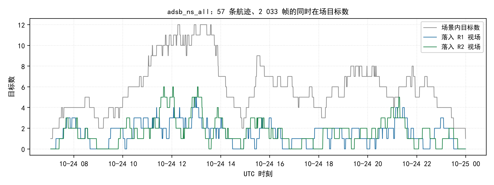{#fig:ch2_density}

如图[@fig:ch2_density]所示，场景内目标数在 0 到 12 之间起伏，均值 6.0，午间出现两个峰值；落入单站视场的只有 0 至 6 个。两站的视场利用率可由目标帧计数给出：12 281 个目标帧中，落入 R1 视场 3 108 个、落入 R2 视场 3 301 个、两站同时可见 1 398 个，分别占 25%、27% 与 11%。其原因是走廊上并非所有航迹都落在两站视场之内，南北向航迹自南向北依次穿过南站带、共视带与北站带，两端各有大量帧只有单站可见。这一结构与布设设计一致，也决定了第5章的一个基本事实：系统航迹的大部分长度来自单源段，双源段只占少数帧。

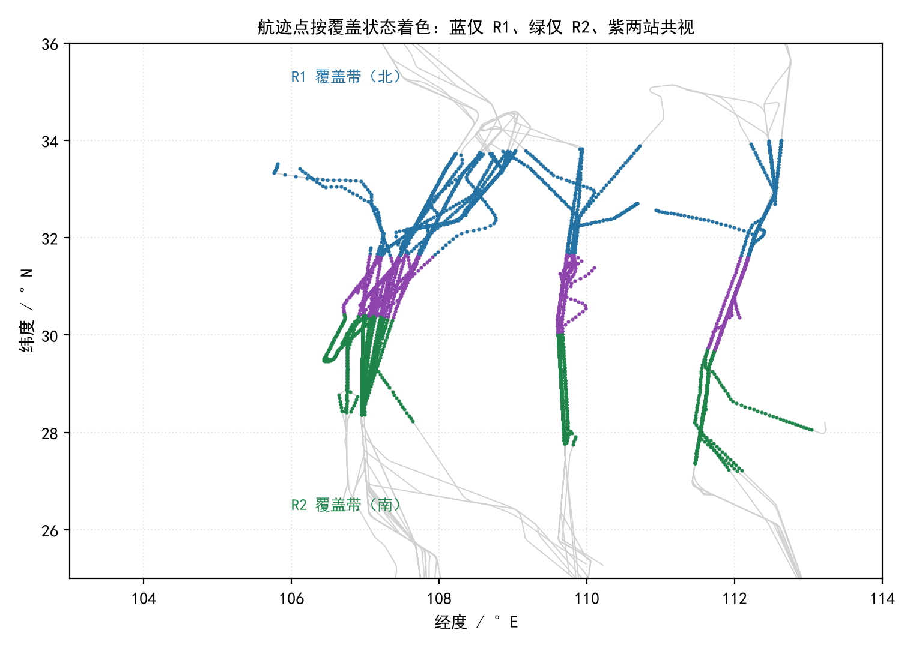{#fig:ch2_tracks}

如图[@fig:ch2_tracks]所示，南北向航迹呈现清晰的三段结构，自南向北依次为绿、紫、蓝，说明覆盖互补在真实交通流上确实成立；东西向航迹多落在灰色区域，它们穿越走廊但不在两站视场内。截面上的规律是：航迹越贴近走廊经线，三段结构越完整，共视段越长。设航迹与走廊经线的夹角为 $\alpha$，共视带宽度为 $W$，则共视段长度近似为

$$L_{\text{cov}}\approx\frac{W}{\sin\alpha}$$ {#eq:ch2_covlen}

式[@eq:ch2_covlen]给出共视段长度的一阶估计，它是第5章设定配对确认帧数的硬约束：本文场景的共视段约 21–24 帧，扣除两条航迹各自的起始成熟段后，可用于累积配对证据的帧数只剩十余帧。

## 2.5 模型边界与显式假设

本文的全部实验建立在下述显式假设之上，它划定了研究内容与非研究内容的边界。

**A0（站内关联理想假设）**：单站内的点—航迹关联，即量测到局部航迹的分配，视为理想；局部航迹的位置误差只来自量测噪声、检测损失与滤波器，不含量测误配。

单站数据关联是成熟问题，最近邻、联合概率数据关联与多假设跟踪都有成熟解法，本文将不将其列为研究内容。更实质的理由是问题定位：双照射源带来的新困难在站间，不在站内。两站各自把点迹连成航迹，这一步的难点与单站雷达无异；真正的困难在于判定两条航迹是否指向同一目标，以及如何融合。

A0 引出三条推论，分别构成后三章的地基。其一，局部航迹的误差可分解为量测噪声、检测损失与滤波残差三项，且三项能分别由检测概率、噪声强度与模型集单独控制，这支撑了第4章的可控实验设计：改变一个参数，只有对应的误差项发生变化。其二，两站误差的相关性只来源于共同的模型误差，即同一目标的同一段机动叠加同一组运动模型，不来源于数据关联；该推论把融合增益的上限问题从算法层面转移到模型层面，是第5、6章的决定性依据。其三，站间配对的门限只需覆盖配准残差与两站独立噪声，不必覆盖关联歧义，这支撑了第5章的门限设计。

模型本身还有三条边界。二维平面模型只适用于巡航段，起降段高度变化剧烈、地速不恒定，超出模型能力，这也是筛选条件取高度 20000 ft 以上的原因；巡航高度 6–10 km 对群距离的影响约 33 m，相对 10 km 的群距离噪声可忽略。等效虚高是标量，只在一个距离段、一个时间段内成立，跨越昼夜或跨越数百公里后必须重新估计，这一限制在第3章展开为完整的标定理论与适用边界。多跳传播不在模型内，其回波与单跳回波在群距离上不可区分，只能由距离窗排除。

## 2.6 本章小结

本章确定了两种布设的几何，建立了天波双基地量测模型，并构造了数据场景。

几何方面，给出近共视与覆盖互补两种布设。前者服务精度问题、用于隔离变量，其成立条件是两站覆盖重合、观测几何差异可忽略；后者服务连续性问题、用于延长航迹，两站南北错开 100 km，经 4.6° 视差补偿后在走廊上形成 366 km 与 373 km 的两条覆盖带，中间重叠 142 km，并集约 597 km。覆盖互补不改变量测精度，只改变系统能持续跟踪多久、能覆盖多宽，这一分工在 2.1.3 节已划清，全文的精度类结论一律取共视段。

量测方面，建立含电离层等效虚高的折线等效模型，给出单程路径 $L=\sqrt{\rho^2+4h^2}$ 的拼接来源与系数 4 的含义，导出虚高灵敏度的解析式 $s=4h/L_0+4h/L_1$，其在近端与远端相差约二点六倍；证明反演方程左端严格单调、零点唯一，并给出存在条件 $R_g\ge4h$；导出多普勒的传播方向加权形式，权重 0.857–0.954 对虚高的敏感度不超过 1%；给出三通道噪声的物理推算与位置下界的几何形式，在 1400 km 处径向与切向误差分别为 10.9 km 与 8.6 km，量级相当。

数据方面，以实测 ADS-B 数据构造 57 条航迹、2 033 帧的主场景，明确其作为数据驱动半实物仿真的定位。本章还立下假设 A0 及其三条推论，把研究范围收缩到站间配对与融合，并指出两站误差的相关性只可能来自共同的模型误差。

第3章将从量测方程的一处缝隙接续：式[@eq:ch2_group_range]中的虚高在建模时只能取标称值。真值与标称值之差源于电离层的时变，是物理必然；该差值以非线性的方式进入群距离，其灵敏度随距离衰减，因此不能折成一个常数扣除，只能作为待估参数解出来。

# 第3章 双照射源时空配准

天波链路的定位误差中含有一个非随机部分。它由三个可参数化的系统量构成：电离层等效虚高 $h$、接收站与外辐射源之间时基失配在群距离上的等效偏置 $\Delta R_{\text{sync}}$、阵列方位偏差 $\Delta\theta$。三者之中只有 $\Delta\theta$ 以常数形式作用于方位。$h$ 以非线性方式进入群距离，其灵敏度随目标距离单调衰减，同一虚高偏差在 1000 km 与 1900 km 处留下的距离误差相差约七成；以残差均值为基准的标定因此只在一段距离内成立，跨距离使用时必须把 $h$ 本身作为待估参数，而不能把它的平均效应折成一个常数扣除。

第2章的量测模型已给出群距离的几何形式，但其中的虚高只取了标称值，系统偏差尚未处理。由此产生三个问题。其一，三个参数能否从数据中分离，条件是什么；其二，分离能达到什么精度，代价是什么；其三，标定后的残差以何种方式进入后续的关联与融合。本章的结论分别是：参数可以分离，条件是标校集的距离跨度足够；估计标准差可以逼近克拉美-罗下界，本文实测与下界之比为 1.04–1.26；初始失配可被标定完全消除，而残余失配沿两条彼此独立的通道退化融合性能。

本章只处理系统偏差。随机噪声的强度、尾部形态与单站精度的信息量下界留给第4章；两条链路各自标定，不做联合估计；时间层面只讨论站与源之间的那一段时基，两站之间的时基由授时保证，不进入模型。

## 3.1 系统偏差的参数化模型

### 3.1.1 两种时基及其作用方式

时空配准中的"时"在本系统里指哪一段时间基准，必须先定义，否则会把一个已由授时保证的量误设为待估参数。两站之间的时间基准由 GPS/北斗授时保证，误差在微秒量级，它影响的是状态所指的时刻。对应的位置偏差是速度与时间之积：取目标速度 230 m/s、时基误差 1 μs，得 0.23 mm，比群距离噪声小七个数量级。本文因此视两站共时基，不设站间时偏参数。

站与源之间的时基不具同一性质。两条链路各自有一个外辐射源，其发射时刻不受本方授时系统约束，只能以直达波到达时刻为基准；残余时基差 $\Delta t$ 在群距离上表现为整体平移

$$\Delta R_{\text{sync}}=c \Delta t$$ {#eq:ch3_tr_sync}

该偏置不能靠增加观测消除，也不能被坐标变换吸收。它与站间时基的关键区别在于作用对象：站间时基是两站状态时刻之差，站源时基是量测本身的零点偏移。这就是本章标题中"时空"并列的原因：时间问题不在两站之间，而在每一站与它的照射源之间。

帧时刻的对齐是另一件事，不设参数。两站采样周期同为 30 s，若帧时刻不落在同一网格，按匀速模型把状态外推到统一时刻即可

$$ \mathbf x(t)=\mathbf F(\Delta\tau)\mathbf x_k, \mathbf F(\Delta\tau)=\begin{bmatrix}\mathbf I & \Delta\tau\mathbf I\\\mathbf 0 & \mathbf I\end{bmatrix} $$ {#eq:ch3_time_align}

式中 $\Delta\tau=t-t_k$，$|\Delta\tau|\le dt/2$。由此引入的残差是二阶小量：外推值与真实轨迹之差为 $\tfrac12a\Delta\tau^2$。按本场景实测转弯率，即使帧时刻错开一个采样周期量级（13 s），典型工况下该残差也只有 4–50 m，极端转弯的 99 分位为 224 m，比 $\sigma_R=10\text{ km}$ 小两个数量级，与 3.2 节的标定下界相比亦可忽略。选择外推而非插值的理由是可获得性：检测概率仅 0.6，相邻两帧同时齐备的概率不足 0.4，而外推只需要当前帧。

### 3.1.2 观测方程与参数向量

一条链路在每个时刻输出群距离与方位，扣除设备标定后仍含三项系统偏差。以第2章的折线等效模型为基础，观测方程写为

$$ R_{g,k}^{\text{obs}}=\sqrt{\rho_{0,k}^2+4h^2}+\sqrt{\rho_{1,k}^2+4h^2}+\Delta R_{\text{sync}}+\varepsilon_{R,k} $$ {#eq:ch3_obs_range}

&#8203;

$$ \phi_{az,k}^{\text{obs}}=\operatorname{atan2}(x_k,y_k)+\Delta\theta+\varepsilon_{\theta,k} $$ {#eq:ch3_obs_az}

式中 $\rho_0$、$\rho_1$ 分别为照射源与接收站到目标的地面距离，$\varepsilon_R$、$\varepsilon_\theta$ 为零均值高斯噪声。待估参数向量为 $\boldsymbol\eta=[h,\Delta R_{\text{sync}},\Delta\theta]^T$。

三个参数的作用方式互不相同，这决定了估计的难度。$h$ 非线性地进入两条路径的斜距，作用强度随地面距离增大而衰减，因而对观测几何敏感；$\Delta R_{\text{sync}}$ 是整体平移，与几何无关；$\Delta\theta$ 是整体旋转，只改变横向位置，与距离通道解耦。真正相互纠缠的只有 $h$ 与 $\Delta R_{\text{sync}}$ 这一对，3.2 节的全部推导围绕它们展开。

### 3.1.3 单链路独立估计的依据

三个参数属于一条链路，两条链路共六个，各自独立估计。这一设定的依据在模型层面。

专利的权利要求写的是单链路三参数：同一链路的多条参考航迹共享一组 $\boldsymbol\eta$，不同链路之间没有共享关系。专利自身的双链路实施例给出过先例：链路 A 的参数真值为 $(300,10,5.0)$，链路 B 为 $(325,-6,-3.5)$，两组参数由各自的先验参考航迹分别估计。虚高真值被有意设成相差 25 km，说明专利认为不同传播路径的虚高本来就不相同。

曾考虑把两链路合并为五参数模型、令 $h$ 共享，理由是两条链路穿过同一片电离层、少一个未知数、估计更紧。该方案被放弃。两条链路与共视区之间夹角不同，穿过的电离层区域不同，观测几何的灵敏度离散度也不同；强行共享 $h$ 等于把两者之差压进残差，是用一个更紧的估计器换一个系统性偏差。3.5 节给出了这笔交易的定价：虚高失配 10 km 时融合误差上升 16.6%，远超少估计一个参数所能节省的精度。

代价是每个参数只能由本链路的样本约束。本文实测的两组估计为 R1 $(320.4,19.15,-2.998)$、R2 $(319.0,-13.72,3.491)$，与真值 $(320,20,-3.00)$、$(320,-15,3.50)$ 的差都在 1.3 km 与 0.01° 以内。两条链路的虚高估计相差 1.4 km，在估计噪声范围内；真实系统中这一差异是物理存在的，不应被模型抹平。

## 3.2 参数的可辨识性

### 3.2.1 一阶线性化与 Fisher 信息矩阵

$h$ 与 $\Delta R_{\text{sync}}$ 都通过群距离起作用，前者是随距离变化的增量，后者是常数平移。将第2章式[@eq:ch2_sens]给出的灵敏度记为

$$ s_k=\frac{\partial R_g}{\partial h}=\frac{4h}{\sqrt{\rho_{0,k}^2+4h^2}}+\frac{4h}{\sqrt{\rho_{1,k}^2+4h^2}} $$ {#eq:ch3_sens}

则在参数真值附近作一阶展开，群距离的增量近似为

$$ \delta R_{g,k}\approx s_k \delta h+\delta(\Delta R_{\text{sync}})+\varepsilon_{R,k} $$ {#eq:ch3_first_order}

式[@eq:ch3_first_order]是一个以 $[s_k,1]$ 为设计行的线性模型，观测噪声方差为 $\sigma_R^2$。记标校集的样本总数为 $N_{\text{tot}}$，$s_k$ 的均值与方差为 $\overline{s}$ 与 $\mathrm{Var}(s)$，变异系数 $\mathrm{CV}(s)=\sqrt{\mathrm{Var}(s)}/\overline{s}$，则两个参数的 Fisher 信息矩阵为

$$ \mathbf F_R=\frac{N_{\text{tot}}}{\sigma_R^2}\begin{bmatrix}\overline{s^2}&\overline s\\\overline s&1\end{bmatrix}
=\frac{N_{\text{tot}}}{\sigma_R^2}\begin{bmatrix}\overline{s}^2\left(1+\mathrm{CV}^2\right)&\overline{s}\\\overline{s}&1\end{bmatrix} $$ {#eq:ch3_fisher}

方位通道对 Fisher 矩阵的贡献是块对角的：$\partial\phi/\partial h=0$、$\partial\phi/\partial\Delta R=0$，而 $\partial R_g/\partial\Delta\theta=0$，故 $\Delta\theta$ 与距离两参数在信息矩阵中不发生耦合，式[@eq:ch3_fisher]的 $2\times2$ 块即为 $(h,\Delta R)$ 的边缘信息量，方位参数只在本章的 $3\times3$ 完整模型中参与联合求解。

若标校集内所有目标的距离相近，$s_k$ 退化为同一个数，式[@eq:ch3_first_order]成为两个未知数的一个线性组合，任何估计方法都无法把它们分开。此时 $\mathrm{CV}(s)\to0$，式[@eq:ch3_fisher]的行列式趋于零，信息矩阵奇异。可辨识性因而不是二值判断，其程度由灵敏度的离散度连续度量。

### 3.2.2 闭式下界与几何放大因子

对式[@eq:ch3_fisher]求逆。记 $v=\mathrm{Var}(s)=\overline{s}^2\mathrm{CV}^2$，行列式为 $N_{\text{tot}}^2v/\sigma_R^4$，得

$$ \mathbf F_R^{-1}=\frac{\sigma_R^2}{N_{\text{tot}}v}\begin{bmatrix}1&-\overline{s}\\-\overline{s}&\overline{s}^2(1+\mathrm{CV}^2)\end{bmatrix} $$ {#eq:ch3_finv}

对角线开方即得两个参数的下界

$$ \sigma_h=\frac{\sigma_R}{\sqrt{N_{\text{tot}}}}\frac{1}{\overline{s} \mathrm{CV}(s)}, 
\sigma_{\Delta R}=\frac{\sigma_R}{\sqrt{N_{\text{tot}}}}\frac{\sqrt{1+\mathrm{CV}^2(s)}}{\mathrm{CV}(s)} $$ {#eq:ch3_crlb}

以及两个参数的相关系数

$$ \rho_{h,\Delta R}=\frac{[\mathbf F_R^{-1}]_{12}}{\sqrt{[\mathbf F_R^{-1}]_{11}[\mathbf F_R^{-1}]_{22}}}=-\frac{\overline{s}}{\sqrt{\overline{s^2}}}=-\frac{1}{\sqrt{1+\mathrm{CV}^2(s)}} $$ {#eq:ch3_corr}

记几何放大因子

$$ \alpha=\frac{\sqrt{1+\mathrm{CV}^2(s)}}{\mathrm{CV}(s)} $$ {#eq:ch3_alpha}

则距离偏置的下界写为 $\sigma_{\Delta R}=\alpha \sigma_R/\sqrt{N_{\text{tot}}}$。这一形式把两个改善途径分开：样本总数带来 $1/\sqrt N$ 的算术改善，灵敏度离散度带来 $\alpha$ 的几何改善。$N$ 可以靠增加观测积累，$\mathrm{CV}(s)$ 不能；当 $\mathrm{CV}(s)\to0$ 时 $\alpha\to\infty$，再多样本也无法补偿。本文因此把 $\mathrm{CV}(s)$ 而非样本数视为标校集设计的核心指标。

式[@eq:ch3_crlb]与数值 Fisher 信息矩阵的一致性可以校验。取 $\sigma_R=10\text{ km}$、单条 50 帧航迹（实测 $\mathrm{CV}=0.0435$），闭式给出 $\sigma_{\Delta R}=32.5\text{ km}$；按 $3\times3$ 非线性模型数值求逆得 33.8 km，相差 4%。多航迹情形（150 样本、$\mathrm{CV}=0.1227$）闭式给 6.70 km、数值给 6.73 km，相差 0.4%。单航迹的偏差来自线性化点：数值模型在 $h=320\text{ km}$ 处取灵敏度，闭式按 $h=300\text{ km}$ 计算，而 $s\propto h$，二者相差 6.7%，与观测到的 4% 同向同量级。这说明式[@eq:ch3_crlb]不仅是量级估计，而是一阶意义下的精确结果。

$\rho_{h,\Delta R}$ 不适合用作可辨识性判据。由式[@eq:ch3_corr]，该系数在任何实用范围内都接近 $-1$：$\mathrm{CV}$ 为 0.0435 时是 $-0.9991$，为 0.216 时仍是 $-0.978$。以相关系数的强弱判断能否分离，会得出"永远不可辨识"的结论。真正区分样本集的是 $\alpha$：专利几何的 $\mathrm{CV}(s)=0.121$ 对应 8.3 倍，本文全国走廊的 $\mathrm{CV}(s)=0.2155$ 对应 4.75 倍。这也解释了为什么 $\sigma_h$ 与 $\sigma_{\Delta R}$ 的比值恒等于 $\overline{s}\sqrt{1+\mathrm{CV}^2}$：两个参数的精度被同一条近零特征方向锁在一起（其方向近似为 $[1,-\overline{s}]$），$\alpha$ 就是该方向上的条件数放大倍数。

### 3.2.3 距离跨度而非航迹条数

下界的差别要在同一噪声条件下比较不同标校集才看得出。三个层次的对照如表[@tbl:ch3_crlb]所示，其中 $\alpha$ 按式[@eq:ch3_alpha]由实测 $\mathrm{CV}(s)$ 计算，$\sigma_{\Delta R}$ 为数值 Fisher 信息矩阵的结果。

| 标校集 | 样本数 $N_{\text{tot}}$ | $\alpha$ | $\sigma_{\Delta R}$ / km |
| ---- | ---- | ---- | ---- |
| 单条航迹（距离 1254–1521 km） | 50 | 23.0 | 33.8 |
| 三条航迹（距离 1089–1896 km） | 150 | 8.2 | 6.73 |
| 波束内 R1 | 4 215 | 8.4 | 1.29 |
| 波束内 R2 | 5 454 | 8.0 | 2.16 |
| 全国走廊 | 10 803 | 4.8 | 0.46 |

: 不同标校集下距离偏置估计的克拉美-罗下界（$\sigma_{R1}=10$ km，$\sigma_{R2}=20$ km） {#tbl:ch3_crlb}

前两行是同一几何下的对照：样本数增加三倍，下界由 33.8 km 降到 6.73 km，改善 5.0 倍。若精度只由样本数决定，三倍样本应带来 $\sqrt3=1.73$ 倍的改善；实际改善 5.0 倍，其中 2.8 倍来自 $\alpha$ 由 23.0 降到 8.2，其余来自样本数。把同一条航迹切成多段不改变 $\mathrm{CV}(s)$，等效样本数不变，下界也不变，可见航迹条数不是变量，距离跨度才是。

同一结论在后两行中以更强的形式出现。R2 的样本数比 R1 多 1 239 条，下界却更大（2.16 km 对 1.29 km）。原因有二：其一 R2 的群距离噪声是 R1 的两倍，$\sigma_R/\sqrt N$ 的基数大；其二 R2 波束内的距离跨度更窄，$\alpha$ 略高。数量与精度的这种反向关系，只能由地理几何解释，无法由样本数解释。

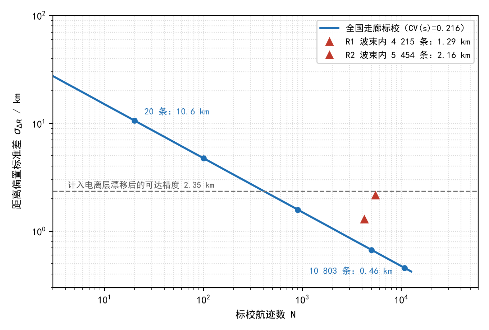{#fig:ch3_crlb}

如图[@fig:ch3_crlb]所示，样本数自 20 增至 10 803 时，下界由 10.6 km 单调降至 0.46 km，对数坐标下的斜率为 $-1/2$，即纯粹的数量收益。差异出现在红色三角与蓝线之间：波束内的 4 215 条与 5 454 条，按蓝线本应落在 0.73 km 与 0.64 km，实际下界为 1.29 km 与 2.16 km，达到曲线值的 1.8 倍与 3.4 倍。其原因在于整条曲线向右上方平移，而非在曲线上取点：波束内样本的距离跨度小，$\mathrm{CV}(s)$ 低，$\alpha$ 高。

0.46 km、1.29–2.16 km 与 2.35 km 是三个不同口径的数，引用时不能混用。0.46 km 是 10 803 条全国航迹、忽略电离层漂移的纯下界；2.35 km 是计入漂移、按最优标校窗长 1.36 h 估计的实际可达精度；1.29 km 与 2.16 km 是只用本站波束内样本时的下界，用来说明样本集受限时精度退到哪里。三者对应的是信息量的差别，不是估计器优劣的差别。

### 3.2.4 标校集的构造准则

上述分析给标校集的设计定下四条准则。

第一条，采集距离分层丰富的参考航迹，而不是尽可能多的参考航迹。工程上意味着标校扇区不能只取本站波束，还要覆盖远近不同的距离带；航向是否多样并不重要，因为 $s_k$ 只依赖距离，与航向无关。

第二条，标校集与评估集必须分离。用同一批航迹既标定又评估等于自己出题自己答，本文按 UTC 时段切分，标校取 12–18 时，其余时段用于评估。

第三条，标定窗口不能太长。虚高在昼夜尺度上漂移，长窗口的平均值在窗口两端都不成立，这与 2.35 km 那个数出自同一条推理。

第四条，标校周期与失配容限要匹配。均值标定残留的是一段距离上虚高失配的起伏，失配 $d$、评估集跨度 $W$ 时，位置残余近似为 $\tfrac12 d W/\rho$；取 $\rho\approx1400$ km，失配 10 km、跨度 300 km 时残余不足 1 km，相对单站 15 km 的误差是二阶小量；失配 80 km 时残余可达 6 km，与单站误差同量级，不可忽略。据此给出判据：失配小于 20 km 且跨度小于 300 km 时两参数标定已足够，失配大于 50 km 或跨度大于 500 km 时必须采用三参数。虚高在 250–350 km 之间漂移，相对 300 km 标称值的失配可达 50 km 以上，正落在必须采用三参数的一侧，这是本文坚持三参数配准的现实理由。

## 3.3 加权最大似然估计

### 3.3.1 代价函数与求解

以先验参考航迹给出的目标位置为参考量，构造距离残差与方位残差，并按各自链路的噪声标准差归一化后求和，得到代价函数

$$ J(\boldsymbol\eta)=\sum_{m=1}^{M}\sum_{k=1}^{N_m}\left[\frac{\left(r_{R,k}^{(m)}\right)^2}{\sigma_{R}^{(m)2}}+\frac{\left(r_{\theta,k}^{(m)}\right)^2}{\sigma_{\theta}^{(m)2}}\right] $$ {#eq:ch3_cost}

在噪声为零均值高斯、方差已知时，该函数与观测的负对数似然只差常数，其极小点即最大似然估计 $\hat{\boldsymbol\eta}=\arg\min_{\boldsymbol\eta}J(\boldsymbol\eta)$。归一化不可省略：由 2.3.3 节的量级关系，距离残差平方为 $10^2$ 级、方位残差平方为 $10^{-1}$ 级，不加权时优化将被距离通道完全支配。分母必须取各自链路的值，R1 用 10 km 与 0.35°、R2 用 20 km 与 0.60°；若两条链路共用一组权重，噪声较大的链路残差被过度加权，估计整体向该链路偏移。

求解采用列文伯格-马夸尔特算法，并通过 logistic 重参数化把参数映射到物理可行区间内

$$ h=h_{\min}+\frac{h_{\max}-h_{\min}}{1+e^{-u_1}}, \Delta R=\Delta R_{\max}-\left(\Delta R_{\max}-\Delta R_{\min}\right)\frac{1}{1+e^{-u_2}} $$ {#eq:ch3_logistic}

优化在无约束的 $\mathbf u$ 空间内进行，可行域的边界由 $u\to\pm\infty$ 渐近达到。参数边界不是装饰：方位偏差的上界若设得过紧，优化器会为补偿方位残差而连带把虚高拉偏，两个参数同时出错却仍能拟合观测，这正是 3.5.2 节沿脊线漂移的数值前身。

### 3.3.2 校正与重解位置

估计得到后，先扣除距离与方位偏差，再以更新后的虚高调用第2章的严格双基地反演方程重解位置

$$ \widehat R_{g,k}=R_{g,k}^{\text{obs}}-\widehat{\Delta R}_{\text{sync}}, \widehat\phi_{az,k}=\phi_{az,k}^{\text{obs}}-\widehat{\Delta\theta} $$ {#eq:ch3_correct}

配准由此明确为三步合成：扣除系统偏差、更新传播参数、重解位置。前两步作用于观测量，第三步才作用于位置。第三步不可省略。虚高的估计误差 $\delta h$ 经反演后转化为地面距离偏差。对方程 $L(\rho_0,h)+L(\rho_1,h)=R_g$ 隐函数求导，同时计及 $\rho_0$ 随 $\rho_1$ 的变化，得

$$ \delta\rho_1=-\frac{s(\rho_0,\rho_1,h)}{D} \delta h, 
D=\frac{\rho_1}{L_1}+\frac{\rho_1^2+\rho_0^2-L_b^2}{2\rho_1L_0} $$ {#eq:ch3_h2pos}

取 $\rho_1=1400$ km、$\rho_0=1015$ km、$L_b=385$ km、$h=300$ km，则 $s=1.81$、$D=1.78$，系数为 1.02。即在本场景的几何下，虚高误差近乎一比一地转化为位置误差，不存在被几何自动压缩的可能。若只在观测量上扣除距离偏差而沿用标称虚高反演，虚高失配 10 km 将留下约 10 km 的位置偏差，与单站误差同量级。3.5.1 节的实测退化与这一估计同向：R1 单站 RMSE 随失配由 15.51 km 依次增至 17.37、21.69、32.88 km。实测增幅小于按均方根合成的线性估计，其原因是偏差方向随目标沿走廊移动而缓慢转动，滤波器在机动段对这一确定性偏移有一定跟随能力，并不说明该偏差可以忽略。

## 3.4 估计性能的验证

### 3.4.1 端到端对照

配准是否必需，用单变量对照回答最直接：同一场景、同一种子、同一组参数，只切换配准模式。场景为 63 段 2 033 帧的覆盖互补布设，注入的系统偏差为虚高真值 320 km、R1 的 $\Delta R=+20$ km 与 $\Delta\theta=-3°$、R2 的 $\Delta R=-15$ km 与 $\Delta\theta=+3.5°$。三种模式的结果如表[@tbl:ch3_ab]所示，其中零偏差基线是不注入任何系统偏差时的同一场景，作为标定效果的参照。

| 指标 | 不标定 | 三参数最大似然 | 零偏差基线 |
| ---- | ---- | ---- | ---- |
| R1 单站 RMSE / km | 90.57 | 18.09 | 18.08 |
| R2 单站 RMSE / km | 92.47 | 17.15 | 17.20 |
| 融合 RMSE / km | 104.73（1 对，且错） | 8.57 | 8.60 |
| 配对正确数 | 1 对，且错 | 56/56 | 56/56 |
| 航迹长度比 | 1.006 | 1.291 | 1.291 |

: 注入系统偏差下三种配准模式的端到端性能 {#tbl:ch3_ab}

不标定时两条链路的误差都在 90 km 量级，融合只剩 1 对且是错配，航迹长度比 1.006 意味着航迹几乎无法延续。其机理不在精度。3° 的方位偏差在 1400 km 处等于 73 km 的横向位移，远大于任何合理的关联门限，关联判据在系统偏差下已完全失去分辨力。标定后单站误差降到 18 km 量级，融合误差 8.57 km，配对 56 对全对，长度比恢复到 1.291。

标定后的结果与零偏差基线逐项重合：18.09 对 18.08，8.57 对 8.60，56/56 对 56/56。这说明偏差被完整补回，链路中没有残差泄漏，标定本身未引入新的偏差。方位偏差的估计误差分别为 0.002° 与 0.009°，相对注入的 3° 与 3.5° 可忽略。

### 3.4.2 估计精度与下界

单次实验只能说明偏差被补回，不能说明估计器有多好。为此只运行标定环节、固定几何与噪声、更换 10 个随机种子，把估计结果与 3.2.3 节的下界逐项比较，结果如表[@tbl:ch3_mc]所示。

| 链路 | 参数 | 真值 | 估计均值 | 偏置 | 实测标准差 | 下界 | 实测/下界 |
| ---- | ---- | ---- | ---- | ---- | ---- | ---- | ---- |
| R1 | $h$ / km | 320 | 320.23 | +0.23 | 1.03 | 0.92 | 1.12 |
| R1 | $\Delta R$ / km | 20 | 19.63 | −0.38 | 1.34 | 1.29 | 1.04 |
| R1 | $\Delta\theta$ / ° | −3 | −2.999 | +0.001 | 0.007 | 0.005 | 1.26 |
| R2 | $h$ / km | 320 | 319.96 | −0.04 | 1.87 | 1.54 | 1.22 |
| R2 | $\Delta R$ / km | −15 | −14.92 | +0.08 | 2.53 | 2.16 | 1.17 |
| R2 | $\Delta\theta$ / ° | 3.5 | 3.504 | +0.004 | 0.009 | 0.008 | 1.08 |

: 10 个种子的标定估计与克拉美-罗下界对比 {#tbl:ch3_mc}

六个参数的实测标准差与下界之比落在 1.04 与 1.26 之间，偏置绝对值不超过 0.38 km，估计器是有效估计器。表中还有一处需要解释：既然全国走廊的下界是 0.46 km，为什么这里只能做到 1.34 km 与 2.53 km。答案在样本集。0.46 km 对应 10 803 条全国航迹，本节只用本站波束内的 4 215 条与 5 454 条，对应的下界是 1.29 km 与 2.16 km，实测比值 1.04 与 1.17 正是在这一基准上比较的结果。把全国走廊的下界当作波束内标定的基准，会得出"估计器达不到理论"的错误结论，而两者相差的 2.8–4.7 倍全部来自距离跨度。

表中还可以读出 3.2 节论点的实证：R2 使用了比 R1 更多的样本，$\Delta R$ 的标准差却更大。想进一步逼近 0.46 km，只有放宽标校扇区、增大距离跨度一条路径，代价是放弃"只用本站波束内样本"这条工程约束。这是取舍，不是可以绕开的技术细节。

## 3.5 残差向关联与融合的传递

### 3.5.1 初始失配的完全消除

前三节讨论的是偏差能否被估出。对后续章节更重要的问题是：若配准被拆掉，或标称值与真值不符，代价会以什么形式传导到融合端。为此设计单变量消融实验：真值虚高固定 320 km，标称虚高取 $320-d$，$d\in\{0,10,20,40\}$ km，其余全部沿用当前在线配置，分别在拆掉配准与使用三参数标定两条支路上各跑 3 个种子。

不标定支路的退化是单调的。$d=0$ 时两只单站 RMSE 为 15.51 km 与 30.74 km，融合 8.98 km，增益 41.9%；$d=10$ 时单站升至 17.37 km 与 31.40 km，融合 11.78 km，增益降至 32.0%；$d=20$ 时单站 21.69 km 与 33.73 km，融合 17.41 km，增益 19.6%；$d=40$ 时单站 32.88 km 与 42.06 km，融合 30.07 km，增益仅 8.5%。前 20 km 内每增加 10 km 失配，增益下降 9.9 与 12.4 个百分点，之后趋于饱和。标定支路在四档失配下的融合误差恒为 8.99 km、增益恒为 41.86%，是一条水平线。

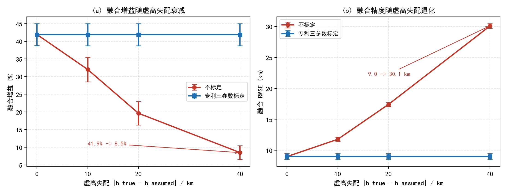{#fig:ch3_e7}

如图[@fig:ch3_e7]所示，差异的全部来源是标称虚高是否被重新估计：标定从数据中解出 $h$ 并覆盖标称值，初始虚高假设因此被完全消除，即使标称给到 280 km 也能拉回 320 km。逐种子看，三个种子的增益都随 $d$ 单调下降，没有例外，说明该趋势不是种子效应。

引用这组结果时有两点纪律。第一，$d=0$ 的 41.9% 不能当作系统增益基线，它与第6章的系统基线不是同一批种子，正文只使用档间差值。第二，本实验证明的是"初始标称失配可被标定完全消除"，不是"标定后没有残差"；时变漂移与空间梯度造成的残余仍在，见下一小节。$d=40$ km 时融合误差 30.07 km 仍略优于最好的单站 32.88 km，但增益只剩 8.5%，此时的恰当表述是融合不再带来实质收益，而不是融合失效。

### 3.5.2 残余失配的三条通道

标定只能消除标称值与真值之间的常数差，三类残余无法消除：虚高随时间漂移、虚高在空间上有梯度、实际噪声强于标定假设。把这三类失配逐项注入生成侧、估计侧仍按标称处理，得到退化曲线。

虚高时间漂移按 6 h 周期注入。漂移 0、2、5、10 km 时，融合 RMSE 分别为 8.56、8.61、8.92、9.98 km，相对退化 0、+0.6%、+4.2%、+16.6%。漂移在 5 km 以内时退化小于 5%，标定可用；漂移到 10 km 时退化升到 17%，需要缩短标校窗。

噪声强度失配按 1.0、1.2、1.5、2.0 倍注入。融合 RMSE 分别为 8.56、9.41、10.06、11.75 km，相对退化 0、+9.9%、+17.5%、+37.3%；配对正确数为 56/56、56/56、54/55、47/48。噪声失配同时冲击配对，机理是协方差不匹配等价于关联门限被等效收紧：滤波器高估自身精度，判据对新息的容忍度下降，2 倍噪声下配对由 56 对掉到 47 对。

前两条通道必须分开陈述，不能合成一句话。前者是配准残差直接污染位置，后者是协方差失真收紧门限，同一条注入在不同环节上产生不同性质的退化。这一区分在第5章的门限设计与第6章的权重设计中都要用到。

空间梯度给出的教训与前两条不同。当虚高沿经向存在 2 km/° 的梯度时，常数模型无法拟合，估计器沿 $h$–$\Delta R$ 的脊线滑走：虚高估成 281.2 km、距离偏置估成 75.0 km，各自偏离真值 39 km 与 55 km，而融合误差纹丝不动，仍为 8.57 km。原因在式[@eq:ch3_first_order]：$h$ 与 $\Delta R$ 在群距离上近似可交换，错误的参数对仍能拟合观测，脊线方向即 $\mathbf F_R$ 的近零特征方向 $[1,-\overline{s}]$，沿该方向目标函数几乎平坦。由此得出一条在写作与工程上都应遵守的纪律：$\hat h$ 不能当作物理量报告，它只在电离场均匀的假设下有意义；梯度一旦存在，它会沿脊线漂走几十公里而残差看不出来。真实电离层的经向梯度量级为 0.02–0.1 km/°，在本场景下没有实质影响，但这不等于 $\hat h$ 可信，只说明它没有被激励出来。

## 3.6 本章小结

本章把天波量测中的三项系统量写进观测方程，给出参数化模型、可辨识条件、估计方法与残差传递的量化关系。

模型方面，确认每条链路三个参数、两条链路各自估计。共享虚高会把两链路的差异压进残差，代价是虚高失配 10 km 时融合退化 16.6%，远超少估计一个参数所能节省的精度。

可辨识性方面，由一阶线性化导出 Fisher 信息矩阵，闭式求逆得到 $\sigma_h$、$\sigma_{\Delta R}=\alpha\sigma_R/\sqrt{N}$ 与 $\rho_{h,\Delta R}=-1/\sqrt{1+\mathrm{CV}^2}$ 三个结果，其数值与 $3\times3$ 非线性模型的 Fisher 矩阵相差 0.4%–4%。精度由距离跨度而非航迹条数决定：单条航迹的 $\sigma_{\Delta R}$ 为 33.8 km，三条距离分层航迹降到 6.73 km，全国走廊降到 0.46 km；R2 样本多于 R1 而精度更低，是该结论的直接实证。文中还说明相关系数不能用作可辨识判据，$\alpha$ 才是。

估计方面，三参数最大似然把 90 km 量级的偏差补回到零偏差基线，融合误差由 104.73 km 降到 8.57 km，配对由 1 对且错变为 56 对全对；10 个种子的实测标准差与下界之比为 1.04–1.26，估计器有效。

残差传递方面，初始标称失配可被标定完全消除，四档失配下结果逐位重合；时变漂移、噪声失配与空间梯度造成的残余无法消除，漂移 10 km 退化 16.6%，噪声 2 倍退化 37.3%，空间梯度则沿 $h$–$\Delta R$ 脊线把参数估计拖偏几十公里而不改变残差。

至此量测已被校正到同一地理基准上，残余误差回落到随机噪声水平。但随机噪声本身并不容易对付：单站位置误差的中位数约 6–7 km，均方根却达 15–17 km，说明误差分布是重尾的。第4章将说明，单站误差不由噪声单独决定，而由机动、断点与重尾共同决定，滤波调参在其中已无余地。

# 第4章 单站航迹滤波与性能边界

第3章把量测校正到同一地理基准，残余误差回落到随机噪声水平。随机噪声本身仍然构成困难：检测概率只有 0.6，群距离噪声 10–20 km，30 s 的采样周期内目标已位移 6.9 km。三者叠加，逐帧定位再连线必然失败，滤波器必须在断续点迹上维持一条不发散、且协方差与实际误差相称的航迹。由此产生两个问题：这样的滤波能达到多准，以及是否还能更准。

第一个问题有一个确定的答案，其边界由信息量而非实现方式决定。在匀速窗口内，滤波等价于一次加权直线拟合，位置误差可以降到 $\sigma_R/\sqrt N$ 量级，20 帧时约 2.2 km；但在真实航迹上，机动段、漏检段与重尾目标使整条航迹的均方根误差停在 15 km 以上。理解这条分界线为何存在，比记住具体数值更重要，因为它决定了第二个问题的答案。

第二个问题的答案是：滤波参数的调节已不构成可利用的自由度。本章以三条负结果证明过程噪声的任何调度与自适应都不产生收益，并给出可以迁移到同类系统的判据；随后说明剩下的唯一杠杆是模型集本身，即四个转弯模型的转弯率取值；最后给出单站误差的真实形态即重尾，这一点决定了后续两章必须同时报告误差的中位数、分位数与均方根。

## 4.1 状态空间模型

### 4.1.1 坐标系选择与各向异性过程噪声

状态取经纬度及其变化率

$$\mathbf x_k=[\lambda_k,\dot\lambda_k,\varphi_k,\dot\varphi_k]^T$$ {#eq:ch4_state}

选择经纬度而非局部平面坐标，原因在量测反演的输出形式：群距离由目标至照射源与接收站的地面距离合成，方位以正北为基准，反演结果直接是经纬度。若改用平面坐标，每帧都要在投影与逆投影之间往返；而目标距离跨度达 900 km，子午线收敛使东西向尺度变化约 15%，这种形变虽小于噪声，却是确定性的，会随帧序累积为系统偏差。

代价是两个位置分量的量纲不同。1° 纬度约 111 km，1° 经度在 30.7°N 上只有约 95.5 km，二者相差 16%。若对两个方向施加同一噪声强度，经度方向的等效加速度被放大 $(111/95.5)^2\approx1.35$ 倍，滤波结果呈现方向依赖的抖动。为此先在东北平面内按公里构造过程噪声，再折算到度

$$\mathbf Q_k=\begin{bmatrix}\mathbf Q_{EN}/(R_e\cos\varphi_k)^2&\mathbf 0\\\mathbf 0&\mathbf Q_{EN}/R_e^2\end{bmatrix}, \mathbf Q_{EN}=\sigma_a^2\begin{bmatrix}dt^4/4&dt^3/2\\dt^3/2&dt^2\end{bmatrix}$$ {#eq:ch4_q_aniso}

式中 $\sigma_a$ 为等效加速度标准差，$\mathbf Q_{EN}$ 是连续时间白噪声加速度模型在一个采样周期内的离散化结果。$\sigma_a$ 的物理含义是模型允许的机动自由度：取小了跟不上转弯，取大了把噪声当机动。本文的取值由稳态归一化误差平方和目标定，取使该指标接近理想值（约为状态维数）的量级。

### 4.1.2 无迹变换与滤波递推

每条链路每帧给出群距离、方位角与多普勒，量测方程与噪声协方差为

$$\mathbf z_k=\mathbf h(\mathbf x_k)+\boldsymbol\varepsilon_k, \mathbf R_k=\operatorname{diag}(\sigma_R^2,\sigma_\theta^2,\sigma_{v_d}^2)$$ {#eq:ch4_meas}

R1 取 $\sigma_R=10\text{ km}$、$\sigma_\theta=0.35°$，R2 取 20 km 与 0.60°，两站共用 $\sigma_{v_d}=0.5\text{ m/s}$。采用无迹滤波而非扩展滤波，原因是协同转弯矩阵含 $\sin(\omega dt)/\omega$ 项，当 $\omega$ 跨越两个数量级时一阶线性化的截断误差剧变，会在模型概率更新中引入偏置；九个 sigma 点的传播对二阶项精确，五个模型共 45 次传播，计算量可以接受。

设状态维数 $n=4$，按下式生成 $2n+1$ 个 sigma 点及其权重

$$\boldsymbol\chi_0=\hat{\mathbf x}, \boldsymbol\chi_i=\hat{\mathbf x}\pm\left(\sqrt{(n+\kappa)\mathbf P}\right)_i, 
w_0^{m}=\frac{\kappa}{n+\kappa}, w_i^{m}=w_i^{c}=\frac{1}{2(n+\kappa)}$$ {#eq:ch4_sigma}

式中 $\kappa$ 为尺度参数，$(\cdot)_i$ 表示矩阵平方根的第 $i$ 列。预测与更新按标准无迹变换进行，交叉协方差 $\mathbf P_{xz}=\sum_iw_i^{c}(\boldsymbol\chi_i-\hat{\mathbf x})(\mathbf h(\boldsymbol\chi_i)-\hat{\mathbf z})^T$ 给出增益。选择无迹变换的另一个理由是它不要求量测方程可微，群距离反演在 $R_g\to4h$ 附近的强非线性因此不会引起数值问题。

三个通道的信息量极不均衡，这是本章后续全部结论的物理起点。群距离 10 km 除以 30 s 得 333 m/s 的单帧位置等效速度噪声，而多普勒噪声只有 0.5 m/s，速度信息实际由后者提供。4.4 节将说明，这一比值决定了过程噪声调参为何无效。

### 4.1.3 五模型交互多模型

单一模型无法同时描述巡航与转弯：匀速模型在转弯时系统性滞后，协同转弯模型在直飞时持续偏转。本文取五个模型，即一个匀速模型与四个协同转弯模型，后者按左右转各两档配置。左右必须分开，因为转弯率以带符号的 $\omega$ 进入转移矩阵；两档则对应缓转与急转两种强度。协同转弯矩阵在东北平面内为

$$\mathbf F_{CT}(\omega)=\begin{bmatrix}1&\frac{\sin\omega dt}{\omega}&0&-\frac{1-\cos\omega dt}{\omega}\\0&\cos\omega dt&0&-\sin\omega dt\\0&\frac{1-\cos\omega dt}{\omega}&1&\frac{\sin\omega dt}{\omega}\\0&\sin\omega dt&0&\cos\omega dt\end{bmatrix}$$ {#eq:ch4_ct}

$\omega\to0$ 时该矩阵退化为匀速模型，说明两者是同一族模型的两个端点，这是模型集可以连续调节的数学基础。

交互多模型在每个周期由混合、滤波与概率更新三步构成。记模型 $i$ 的先验概率为 $\mu_i$，转移概率矩阵为 $\boldsymbol\pi=[\pi_{ij}]$，则预测概率与混合权重为

$$c_j=\sum_{i=1}^{M}\pi_{ij}\mu_i, \mu_{i|j}=\frac{\pi_{ij}\mu_i}{c_j}$$ {#eq:ch4_mix}

混合初值与混合协方差为

$$\hat{\mathbf x}_{0j}=\sum_{i=1}^{M}\mu_{i|j}\hat{\mathbf x}_i, 
\mathbf P_{0j}=\sum_{i=1}^{M}\mu_{i|j}\left[\mathbf P_i+(\hat{\mathbf x}_i-\hat{\mathbf x}_{0j})(\hat{\mathbf x}_i-\hat{\mathbf x}_{0j})^T\right]$$ {#eq:ch4_mixstate}

各模型以混合初值独立滤波，似然取新息的多元高斯密度 $\Lambda_j=\mathcal N(\boldsymbol\nu_j;\mathbf 0,\mathbf S_j)$，模型概率更新为

$$\mu_j=\frac{\Lambda_jc_j}{\sum_{i=1}^{M}\Lambda_ic_i}$$ {#eq:ch4_prob}

总输出为 $\hat{\mathbf x}=\sum_j\mu_j\hat{\mathbf x}_j$，协方差按同样方式加权。

转移概率不直接给定，而由驻留时间生成

$$\pi_{ij}=\frac{1-\exp(-dt/\tau_i)}{M-1}, i\neq j, \pi_{ii}=\exp(-dt/\tau_i)$$ {#eq:ch4_dwell}

式中 $\tau_i$ 为模型 $i$ 的平均驻留时间，$M=5$。这一形式把无量纲概率换成有量纲的时间常数：巡航占航迹的绝大多数，取 $\tau_{CV}=2400$ s；一次程序转弯持续 1–3 min，取 $\tau_{CT}=360$ s 留有余量。代入 $dt=30$ s，匀速模型每帧离开概率 1.24%、转弯模型 8.0%，与"转弯是短时事件、直飞是常态"的先验一致。

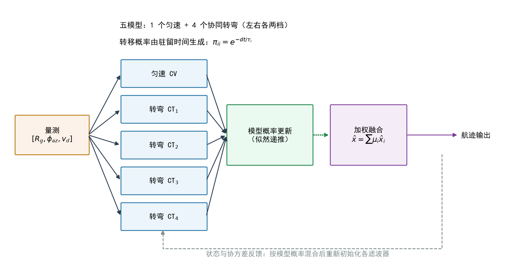{#fig:ch4_imm}

如图[@fig:ch4_imm]所示，五个模型共享同一份历史，构成一个由概率加权的估计器族，而不是五条独立航迹。反馈支路是关键：它把融合后的状态按模型概率重新分配给各滤波器，使上一步的判断影响下一步的起点。

## 4.2 航迹起始的加权最小二乘解

稳态性能由 4.3 节讨论，但稳态能否到达取决于起始几帧的初值是否可信。检测概率 0.6 意味着前几帧大概率不齐；若用前两帧差分测速，位置误差 10 km、间隔 30 s，速度误差为 $\sqrt2\times10/30\approx471\text{ m/s}$，与目标 230 m/s 的巡航速度同量级。这样的初值会让滤波器在最需要稳定的时候剧烈摆动。

本文采用窗口加权最小二乘加多普勒约束的起始方法。取窗口 $W=5$ 帧，对位置观测拟合直线

$$x_j=a+bt_j+e_j, e_j\sim\mathcal N(0,\sigma_R^2)$$ {#eq:ch4_start_ls}

权重取各帧位置协方差的逆，缺帧时按可用帧数降级而不等待补齐。拟合斜率 $b$ 作为初速，再用窗口内多普勒对速度分量做一次约束修正，相当于给斜率加一条先验收缩。起始协方差由最小二乘的解析式给出，不作人为放大，否则最初几帧的模型概率会被新息主导而随机跳变。

选择加权最小二乘而非 $m/n$ 逻辑法，原因在于低检测率下逻辑法的确认概率。四帧内出现三帧合格的概率为

$$P_{3/4}=\sum_{k=3}^{4}\binom{4}{k}P_d^k(1-P_d)^{4-k}=0.475$$ {#eq:ch4_mn}

即在 $P_d=0.6$ 时过半航迹无法在四帧内确认起批。最小二乘起始对缺帧是渐进的，少一帧只降低有效样本数，不会否决起批。

实测初速误差约 80 m/s，相对两点法的 471 m/s 改善 5.9 倍。剩余误差来自窗口内目标的真实转弯：150 s 内若发生一次缓转，拟合斜率就不再是任一时刻的瞬时速度。这一残差是结构性的，无法通过增加窗口长度消除，因为更长的窗口包含更多机动。

## 4.3 单站性能的信息量下界

### 4.3.1 位置下界

推导的关键是把稳态滤波等价为一次加权最小二乘拟合。当过程噪声相对量测噪声足够小、目标在窗口内近似匀速时，滤波器对窗口中心时刻位置的估计等价于用 $N$ 帧观测拟合直线并在中点取值。

取窗口内采样时刻关于中点对称：$t_j=j dt$，$j=-(N-1)/2,\dots,(N-1)/2$，则 $\sum t_j=0$。对式[@eq:ch4_start_ls]的正规方程求逆，截距估计为

$$\hat a=\frac{1}{N}\sum_jx_j, \operatorname{Var}(\hat a)=\frac{\sigma_R^2}{N}$$ {#eq:ch4_mid_var}

即中点处拟合值的方差恰为单帧方差除以 $N$。这一结果不依赖斜率是否被估计，是设计矩阵对称的直接后果。由此得径向位置的下界

$$\sigma_{pos}\approx\frac{\sigma_R}{\sqrt N}$$ {#eq:ch4_pos_bound}

切向通道的贡献需要单独计入。目标至接收站的地面距离为 $r$ 时，方位噪声在横向上等效为 $r\sigma_\theta$ 的位置误差，与径向误差正交独立。取两个方向标准差的均方根作为各向同性等效值，得

$$\sigma_{pos}'\approx\sqrt{\frac{\sigma_R^2+(r\sigma_\theta)^2}{2N}}$$ {#eq:ch4_pos_bound2}

径向单帧噪声即 $\sigma_R=10$ km，切向为 $r\sigma_\theta$；取 $r=1500$ km 时 R1 的 0.35° 对应 9.2 km。对 R1 而言两个方向几乎等权，式[@eq:ch4_pos_bound2]的 2.14 km 比式[@eq:ch4_pos_bound]的 2.24 km 更贴近真实；对 R2 而言切向误差达 15.7 km，下界应取 2.7 km 量级。

$N$ 是参与滤波的有效帧数，不是航迹总长。取 $N=20$ 对应 600 s 即 10 min，是工程上可用的最短稳定窗口：短于 10 min，起始段的方差尚未衰减完；长于 10 min，目标大概率已转过一次弯，匀速假设失效。该下界只依赖单帧噪声与帧数，与滤波器结构、过程噪声取值、模型集构成均无关，这是它可以作为基准的原因。

### 4.3.2 速度下界的推导与量级对比

若不用多普勒，速度只能由位置序列推断。不同的估计器给出不同的精度，四者的量级需要逐一导出。

两帧差分是最简单的一种：$\hat v=(x_2-x_1)/dt$，两端噪声独立，方差为 $2\sigma_R^2/dt^2$，

$$\sigma_v^{(2)}=\frac{\sqrt2 \sigma_R}{dt}=\frac{1.414\times10}{30}=471\text{ m/s}$$ {#eq:ch4_v2}

$N$ 帧端点差分等价于对全部相邻差分取平均，方差降为

$$\sigma_v^{(N)}=\frac{\sqrt2 \sigma_R}{N dt}=\frac{1.414\times10}{20\times30}=23.6\text{ m/s}$$ {#eq:ch4_vN}

最优线性估计是斜率拟合，其方差由设计矩阵的散布给出

$$\sigma_v^{\text{LS}}=\frac{\sigma_R}{dt}\sqrt{\frac{12}{N(N^2-1)}}=\frac{10}{30}\sqrt{\frac{12}{20\times399}}=12.9\text{ m/s}$$ {#eq:ch4_vls}

式[@eq:ch4_vls]同时是位置通道关于速度的克拉美-罗下界：任何只使用位置的线性无偏估计都不可能优于它。

四个速度信息来源及其误差量级汇总如下：单对帧差分 471 m/s，$N$ 帧端点差分 23.6 m/s，窗口斜率拟合 12.9 m/s，多普勒量测 0.5 m/s；相对多普勒分别差 942、47、26 与 1 倍。前三行是从位置推断速度，误差随位置误差线性放大；最后一行直接测量速度，误差由相干积累的相位噪声决定。这一区别规定了滤波器内部的信息流向：速度分量几乎完全由多普勒更新，位置通道真正约束的只有位置。

### 4.3.3 实测与下界的偏离

下界与实测之间差了一个量级。63 段场景、3 个种子、两站误差均在双源帧上统计，结果如表[@tbl:ch4_single]所示。

| 指标 | 种子 42 | 种子 43 | 种子 44 |
| ---- | ---- | ---- | ---- |
| R1 位置 RMSE / km | 14.76 | 17.21 | 14.28 |
| R1 误差中位数 / km | 6.44 | 6.66 | 6.00 |
| R1 误差 90 分位 / km | 15.15 | 15.93 | 15.10 |
| R2 位置 RMSE / km | 23.71 | 24.43 | 44.30 |
| R2 误差中位数 / km | 8.65 | 8.68 | 9.10 |
| R2 误差 90 分位 / km | 23.90 | 26.01 | 24.78 |

: 单站位置误差的三种统计量 {#tbl:ch4_single}

实测中位数 6.0–6.7 km 与 8.7–9.1 km，约为匀速窗口下界 2.2–2.7 km 的三倍；均方根 14.8–17.2 km 与 23.7–44.3 km，则达到下界的七到十六倍。差距的来源不在调参，而在三条前提在真实航迹上同时不成立。

其一是匀速假设。下界要求窗口内目标近似匀速，而真实航迹的机动率 90 分位为 0.23 °/s，10 min 窗口内几乎必然包含一次航向调整；一旦目标转弯，窗口拟合值不再是窗口中心的最优估计，误差转为与转弯率成正比的滞后。

其二是帧数假设。$\sigma_R/\sqrt N$ 中的 $N$ 是有效观测数，而检测概率 0.6 意味着 20 帧窗口内平均只有 12 帧有点迹，下界要放大约 $\sqrt{20/12}\approx1.29$ 倍；断点更长时有效帧数进一步下降。

其三是分布假设。均方根对尾部极其敏感，而单站误差的尾部很重，见 4.6 节。中位数与下界的差距只有三倍，均方根与下界的差距却有七倍以上，两者之差正是尾部的贡献。

由此得到本章最重要的一条认识：下界描述的是匀速窗口内的信息量，不是整条航迹的精度。前者说明滤波器没有浪费量测，后者说明航迹质量由机动与断点决定。若把两者混为一谈，就会得出"滤波器还差七倍"的错误结论，并把改进方向错误地指向调参。

## 4.4 过程噪声调节的负结果

4.3 节的下界是在某个特定过程噪声取值下达到的。自然的问题是：这个取值能否更优；若过程噪声随航迹阶段变化或随新息自适应，能否突破下界。这三个想法在文献中都有成熟形式，本文逐一检验，结果全部为负。

### 4.4.1 三项实验

第一项是三段式调度。设计动机来自航迹的阶段差异：起始段需要较大过程噪声快速吸收量测，稳态段需要较小过程噪声抑制抖动，机动段需要再次放大以跟上转弯。据此按航迹年龄与归一化新息把航迹分为三段，各段取不同倍率，段间用斜坡过渡避免突变。实测结果与设计预期相反：放大倍率 ×30 时误差变差 3.1%，×300 时变差 9.4%，×1000 时变差 19.8%，且曲线没有峰值。若是参数调过头，应当先改善后劣化；没有峰值说明调节方向本身不产生收益，而非最优点偏移。

第二项是自适应过程噪声。新息协方差匹配用滑动窗口统计新息的实际协方差，与预测值作比，比值大于 1 说明滤波器过于自信、应放大过程噪声；三个量测通道各配一个因子，再加一个总体因子，故称 3in1 结构。实测融合误差从 6.906 km 变为 6.882 km，贡献 0.3%，落在种子间波动的量级内。

第三项是自适应转移概率。模型概率由似然递推给出，本质是一阶马尔可夫过程，对机动起始的响应存在固有延迟。用 sigmoid 把归一化新息映射为概率修正量，让大新息直接把概率质量推向转弯模型。该方案已证伪：概率在机动发生时确实上升，但比机动起始晚 2–3 帧即 60–90 s，此时转弯已完成大半；平稳段被误触发的比例也不低，净效果为负。

### 4.4.2 失效机理与可迁移判据

三项负结果有一个共同的机理，可由 4.3.2 节的量级关系说明

$$\frac{\sigma_{v_d}}{\sigma_R/dt}=\frac{0.5}{333}\approx1.5\times10^{-3}$$ {#eq:ch4_doppler_ratio}

速度分量的卡尔曼增益由各通道的噪声比决定。多普勒以 0.5 m/s 直接观测速度，位置通道折算到速度上的等效噪声是每帧 333 m/s、最优估计器 12.9 m/s，二者相差三到四个量级，因此速度更新几乎完全由多普勒承担。过程噪声调节的是预测协方差，而它在速度分量上的变化相对多普勒的信息量微不足道；放大的唯一可见后果是位置分量的预测协方差增大、滤波器更相信位置量测，于是位置抖动加剧。这正好解释了 4.4.1 节的单调劣化：代价全部落在位置上，收益在速度上根本不存在。

由此得到一条可迁移的判据：当 $\sigma_{v_d}\ll\sigma_R/dt$ 时，过程噪声调度对速度精度无效，只会恶化位置精度。反过来，若无多普勒通道，或 $\sigma_{v_d}$ 与 $\sigma_R/dt$ 同量级，则过程噪声将承担表达速度不确定性的职责，调度与自适应都会有效。这条判据把调参失败从工程经验提升为结构性结论，可以在设计阶段预判，是本章对同类系统的可迁移贡献。

## 4.5 模型集与真实机动分布的匹配

过程噪声被排除后，剩下的自由度是模型集本身，即四个协同转弯模型的转弯率取值。原设计取 0.7 与 1.5 °/s，对应战斗机量级的机动。本文的目标是巡航段的民航客机，需要检验这一取值与真实分布是否匹配。

### 4.5.1 机动率的经验分布

从筛选后的 ADS-B 数据中提取 20.9 万个位置点，按 30 s 间隔差分求航向变化率，得转弯率的经验分布：中位数 0.012 °/s，90 分位 0.229 °/s，99 分位 0.660 °/s，最大值 1.51 °/s。

中位数意味着 30 s 内航向只变 0.36°，几乎是一条直线；90 分位对应 6.9°，是一次缓慢的航路调整；99 分位对应 19.8°，接近标准进场程序的转弯速率。分布极度右偏，中位数与 99 分位相差 55 倍，说明机动是罕见事件。模型集因此不能用均值配置，否则等于假设目标一直在转弯；也不能只按极端值配置，否则 99% 的时间模型都在空转。30 s 差分得到的是窗口平均转弯率，真实瞬时分布的上尾应比统计值更重。

### 4.5.2 失配的后果

把 0.7 与 1.5 °/s 放回上述分布，其位置一目了然：0.7 略高于 99 分位，1.5 接近最大值。原设计的两档转弯模型对应的是极端机动强度，在 90% 的时间里四个转弯模型没有一个与真实运动匹配。

失配的后果是结构性偏差。交互多模型的输出是五个估计的概率加权，即便某个模型与真实运动不符，它仍分得一部分概率质量；而协同转弯模型在外推时持续偏转，其预测位置与匀速模型逐渐分离，加权之后产生一个方向确定、幅度随失配增大的偏移。更关键的是，这个偏移对两条链路是同向的：两站共用同一套模型集与转移概率，对同一真实运动施加了同一个错误约束。这一共同模型误差是第6章误差相关性的来源，此处只需指出它是系统性偏移，而不是常被误认为的随机抖动。

### 4.5.3 匹配后的单站精度

按 4.5.1 节的分布重新配置，上界取机动率的 90 分位附近、下界取其四分之一，即 0.05 与 0.2 °/s。在近共视布设的 47 对在线蒙特卡洛配对上比较两档模型集，单站结果如表[@tbl:ch4_modelset]所示。

| 指标 | 0.7 / 1.5 | 0.05 / 0.2 | 变化 | $p$ 值 |
| ---- | ---- | ---- | ---- | ---- |
| R1 单站 RMSE / km | 12.23 | 10.61 | −13.2% | $3.7\times10^{-13}$ |
| R2 单站 RMSE / km | 13.85 | 12.97 | −6.4% | 0.265 |

: 两档模型集的单站精度（47 对在线配对，adsb_0002） {#tbl:ch4_modelset}

R1 的改善高度显著，R2 的改善则不显著。这一不对称不是偶然。R2 的群距离噪声是 R1 的两倍，其误差主要由滤波滞后与少数离群航迹贡献，而不是由模型失配贡献；模型集匹配改变的是两站犯同一个错的程度，对两站各自的滞后无能为力。这一点在第3章 R2 标定后仍有 30 km 量级残差时已经出现，此处再次得到印证：把配准与滤波的问题分开记账，是分析这类系统的基本纪律。

模型集匹配带来的主要收益不在单站而在融合。它的作用是让两站不再犯同一个错，单站精度的改善只是副产品。这部分内容属于第6章，此处只记下一个待解释的量：R1 的 13.2% 与 R2 的不显著，与第6章融合端的改善幅度不成比例，差额的来源就是误差相关性的下降。

## 4.6 重尾误差与离群目标的统计处理

均方根把两类完全不同的目标混在一起。逐目标统计能把它们拆开：在 63 段场景、3 个种子上，R1 每种子有 58 个目标实例，R2 有 55–56 个。

R1 的逐目标均方根中位数为 11.0 km，最大值 61.4 km；R2 的中位数为 11.5 km，最大值 156.8 km。按中位数加三倍稳健标准差判据（稳健标准差取 $\mathrm{MAD}/0.6745$），R1 每种子有 3–7 个离群目标，R2 有 2–6 个，约占总数的 5%–12%。剔除这些目标后，全队误差回落三分之一左右，结果如表[@tbl:ch4_outlier]所示。

| 指标 | 种子 42 | 种子 43 | 种子 44 |
| ---- | ---- | ---- | ---- |
| R1 逐目标均值（全部 / 剔除离群）/ km | 17.88 / 12.01 | 15.32 / 12.99 | 14.85 / 12.09 |
| R2 逐目标均值（全部 / 剔除离群）/ km | 17.21 / 14.13 | 18.18 / 14.82 | 28.72 / 13.64 |
| 融合（全部 / 剔除离群）/ km | 9.03 / 8.28 | 10.50 / 10.50 | 8.94 / 7.60 |

: 离群目标对误差统计的贡献 {#tbl:ch4_outlier}

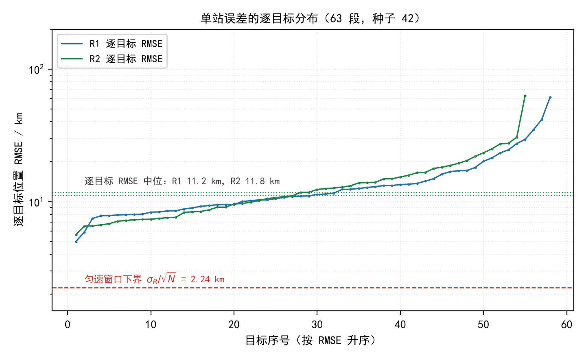{#fig:ch4_tail}

如图[@fig:ch4_tail]所示，逐目标误差在对数坐标上呈一条近乎直线的长尾：多数目标落在 5–10 km 之间，尾端却有目标超过 60 km（R1）与 150 km（R2）。差异不在中段，而在尾部的长度：R1 的最坏目标约为中位数的 5.6 倍，R2 达 13.6 倍。离群由具体事件触发：一次长断点后重新捕获、一次急转未被跟上、一段低仰角多径污染。这些事件的概率不高，一旦发生却足以主导均方根。

表[@tbl:ch4_outlier]还有一个容易被忽略的细节：融合的离群目标数与单站不同，且融合对离群的敏感度更低（种子 42 由 9.03 降到 8.28，降幅 8.3%，而单站 R1 降幅 32.8%）。原因是融合在两个源上做加权，单一源被污染时还有另一个源约束。这一性质在第6章会再次出现：融合的主要价值不在典型精度，而在尾部的抑制。

由此得出一条贯穿全文的口径纪律：单站精度必须同时报告中位数、分位数与均方根。只报均方根会把个别失败目标的影响放大成整体结论，只报中位数则掩盖尾部风险；两者之差本身就是信息，它度量的是系统在最坏情况下的可用性。

## 4.7 本章小结

本章回答了单站能到多准、是否还能更准两个问题。

模型与结构方面，建立了按纬度余弦缩放各向异性过程噪声的经纬度状态空间模型，给出无迹变换的 sigma 点构造与五模型交互多模型的混合、似然与概率更新方程，转移概率由驻留时间生成；采用窗口加权最小二乘加多普勒约束起始，把初速误差从两帧差分的 471 m/s 压到 80 m/s。

边界方面，由设计矩阵的对称性导出匀速窗口下的位置下界 $\sigma_R/\sqrt N$（20 帧时 2.24 km，计入切向通道 2.14 km），并给出速度的四级量级：两帧差分 471 m/s、$N$ 帧端点差分 23.6 m/s、斜率拟合 12.9 m/s（即位置通道的克拉美-罗下界）、多普勒 0.5 m/s。实测单站位置误差中位数 6.0–9.1 km、均方根 14.8–44.3 km，与下界分别相差三倍与七倍以上。差距来自匀速假设、漏检与重尾三条前提同时不成立，而不是滤波器浪费了量测。这一区分决定了改进方向：调参无法弥补，因为差距不在参数上。

负结果方面，三段式过程噪声调度、3in1 自适应过程噪声与 sigmoid 自适应转移概率三条路径全部失效，共用判据是 $\sigma_{v_d}\ll\sigma_R/dt$：多普勒已承担全部速度信息，过程噪声的调节只能恶化位置。模型集方面，从 20.9 万个 ADS-B 点统计出真实机动分布（中位 0.012 °/s、90 分位 0.229 °/s），指出原设计 0.7/1.5 对应 99 分位与极端机动；改成 0.05/0.2 后 R1 单站改善 13.2%，R2 改善 6.4% 但不显著。

本章的产出有两项：一批达到匀速窗口下界的单站航迹，以及一个尚未使用的事实，即两站共用同一套模型集、因而承受同一个模型误差。前者是第5章配对的输入，后者是第6章融合的起点。重尾问题则贯穿两章：配对的门限与融合的权重都必须对重尾有抵抗力。

# 第5章 跨照射源在线航迹配对

跨照射源配对的任务，是判定分别由两条链路形成的两条局部航迹是否对应同一物理目标。两站各报出一条位置相差 4 km 的航迹时，仅凭几何邻近无法给出判定：在目标间距远大于量测误差的稀疏空域，最近邻准则通常正确；而当多条航迹同时落入同一小片空域，最近的候选可能只是恰好路过。位置接近既不是同一性的充分条件，也不是必要条件。

本章建立配对问题的形式化描述，给出判定层与指派层的分层结构，并以受控实验分离各成分的贡献。在线验证得到一个需要如实记录的结果：三种带门限的方法在同一批在线航迹上给出逐位相同的配对，方法之间的差异只在密集场景的受控实验中可观测。这一结果限定了本章结论的适用范围，也决定了第6章应当如何归因融合增益。

## 5.1 配对问题的形式化

### 5.1.1 二分图匹配与候选规模

设第一条照射源在观测窗内的航迹集合为 $\mathcal A=\{a_1,\dots,a_{N_1}\}$，第二条为 $\mathcal B=\{b_1,\dots,b_{N_2}\}$，配对即求一个一对一映射 $\mathcal M\subseteq\mathcal A\times\mathcal B$，使每一对尽可能对应同一物理目标。以二值变量 $x_{ij}\in\{0,1\}$ 表示 $a_i$ 与 $b_j$ 是否配对，问题写作

$$\min_{\{x_{ij}\}}\sum_{i=1}^{N_1}\sum_{j=1}^{N_2}c_{ij}x_{ij}, 
\text{s.t.} \sum_{j}x_{ij}\le1, \sum_{i}x_{ij}\le1, x_{ij}\in\{0,1\}$$ {#eq:ch5_ilp}

式中 $c_{ij}$ 为配对的代价。式[@eq:ch5_ilp]是经典的指派问题，其约束矩阵全单模，线性松弛的最优解自动取整，因此可由多项式时间的匈牙利算法求得全局最优。

在没有先验信息时，候选组合数为

$$N_{\text{cand}}=N_1N_2$$ {#eq:ch5_cand_count}

平方律意味着歧义随目标数急剧恶化：两站各 6 条航迹时只有 36 种组合，各 28 条时升至 784 种。同一套判据在稀疏场景下足够严格，到了密集场景就可能同时犯两种错误：该配的没配上，不该配的配上了。这是本章全部实验必须覆盖密度梯度的原因。只在稀疏场景上报出的零误配，度量的是场景的性质，不是算法的性质。

### 5.1.2 歧义的三个来源

第一个来源是密度。目标数与候选数成平方关系，而可用证据只随共现帧数线性增长，密度升高时判决的置信度必然下降。

第二个来源是短共现。两站的波束指向、距离窗与目标航路各不相同，同一目标被两站同时看到的时间未必长。覆盖互补布设下共现段只有 21–24 帧，扣除两条航迹各自的起始成熟段后，可用于判别证据的帧数只剩十余帧。配对面对的始终是两段部分重叠的记录：同一目标可能先进入南站视场、飞越共视带、最后从北站视场离开，它在 R2 上的航迹比在 R1 上的早十几分钟开始。这带来一个容易被忽略的要求：任何"位置接近"的证据都只在重叠段上有定义。本文因此把全部判据的统计域限定在共现帧集合 $T_{ij}$ 上，配对成功后允许两条航迹各自保留其非重叠段的量测。

第三个来源是平行航路。同一航路上前后相继或并排飞行的两架飞机，位置、速度、航向几乎一致，仅凭运动学特征无法区分，唯一可用的信息是哪一对的距离更小。

后两个来源指向同一件事：单帧信息不足以判定配对，只能在有限帧数内累积证据，再在候选之间做全局取舍。这一认识决定了后续的方法结构。

## 5.2 评价口径与配对池构造

配对结果是一个集合，其正确性通过与参考真值比对判定：一对配对的两条航迹真值编号相同且非空，则判为正确。在此基础上定义查准率（正确配对数与总配对数之比）、查全率（正确配对数与双站共现真实目标数之比）、误配数与漏配数。

不采用 $F_1$ 是刻意的。误配会把两个不同目标合成一条错误航迹，其后果在后续融合中被放大：两个目标的量测被强行平均，得到的航迹既不属于这一个也不属于那一个；漏配只是少融一对，系统退化为单站输出，仍然可用。二者代价不对等，而 $F_1$ 把它们视为等价，会奖励配得多而配错也多的方法。本文因此采用加权代价

$$C=5N_{\text{wrong}}+N_{\text{missed}}$$ {#eq:ch5_cost}

系数 5 体现误配的相对代价，本章所称"最优"一律指该代价最小。

查全率的分母必须是配对池，即两站曾同时有确认航迹的目标数，而不是场景内的目标总数；后者会把几何上从未共视的目标算成漏配，这在本文场景中占到了一成。63 段航迹中只有 57 段曾同时进入两站视场，其余 6 段全程只有单站可见，配对池因此取 57。这样处理是为了把"没有配对机会"与"有配对机会却没配上"分开：前者是布设的几何后果，计入查全率只会惩罚一个算法无法控制的因素。同理，两个目标即使都在池内，共现帧数也可能只有几帧；本文对此不设额外门槛，而让证据的累积方式（全共现区间平均而非连续帧否决）去适应它，这正是 5.4 节的设计动机。

## 5.3 既有方法及其失效机理

### 5.3.1 最近邻关联

最近邻对每一条航迹，在另一站找共现区间内平均地面距离最小者，再以一对一为约束做贪心指派

$$d(a_i,b_j)=\frac{1}{|T_{ij}|}\sum_{k\in T_{ij}}d_{\text{hav}}\left(a_i^k,b_j^k\right)$$ {#eq:ch5_nn}

它不含任何门限，因此在目标间距远大于量测误差时恰好总是正确的。但它对密集空域没有防护：一旦存在另一条距离更近的错误航迹，最近邻会无条件选中它。5.5 节的受控实验显示，这一无条件性在密集场景中付出的代价是每场景 16.40 个误配。

### 5.3.2 连续帧门限的偏置与方差权衡

为抑制误配，既有方法引入门限与多判据：位置门限、马氏距离检验、速度一致性，三条判据同时满足的帧计入通过计数，连续通过 $M$ 帧才判定关联。直观上 $M$ 越大越可靠，实测并非如此。在密集场景上扫描 $M$：$M$ 从 4 增到 10，误配数由 10.40 单调降到 7.60，漏配数却由 25.40 单调升到 56.40，查全率从 0.9156 跌到 0.8175。两个方向同时恶化，不存在使两者同时最优的取值。

这一权衡的根源在判据的组织方式。三判据只检验最近 $M$ 帧构成的滑动窗口，窗口一通过即终止判定；而"证据是否充分"与"连续帧数是否达标"在短共现条件下并不等价。对密集场景 200 个真实目标对的统计给出了直接证据：共现帧数均值 26.7 帧，其中距离小于门限的帧均值 25.9 帧，占 96.8%，说明位置门限本身几乎不构成瓶颈。真正的瓶颈是最长连续合格段的长度，其中位数为 22 帧、最小值为 0；取 $M=8$ 只能覆盖 88% 的目标，取 $M=5$ 可覆盖 96%。漏配因此集中于双站重叠时间本就很短的目标，与门限宽严无关。这一结论在 5.4.3 节将以判别力的形式重新出现：当 $M$ 逼近窗口长度 $N$ 时，确认规则退化为连续帧否决，其检出概率按 $p^N$ 衰减。

### 5.3.3 成对交换

如果说漏配来自短共现，误配则来自另一个机制。把密集场景中残余的错误配对逐一拆解，呈现出高度一致的形态：六条错误配成三组互换，t152 与 t164 互相配反，t142 与 t194 互相配反，t80 与 t181 互相配反。

误配的实质，是在两架运动学特征几乎相同的目标之间选错了对应关系，而不是配到一个毫不相干的目标。这类目标沿同一航路平行飞行，距离、马氏、速度、连续性四项证据同时都很高，任何加权综合都难以区分；唯一可用的信息是哪一对的距离更小。问题在于，三判据把"要不要配"与"配给谁"混在同一个综合分里，以航迹质量系数作为唯一排序键，当两个候选的综合分接近时即退化为随机。

排序键的消融给出佐证：以综合分为排序键时误配 11.60，以欧氏距离为排序键时 11.20，以协方差归一化的马氏距离为排序键时降到 8.40。把判定与指派混在一起，反而不如直接用马氏距离排序。

## 5.4 判定与指派的分层结构

上述分析表明，既有方法的缺陷不在判据本身，而在判据的组织方式：连续性被当作必须满足的否决门槛，导致 $M$ 退化为偏置与方差之间的权衡参数；判定与指派共用同一个综合分，导致成对交换。针对这两点，本章把两件事拆开：判定层回答是否值得配对，指派层回答配给谁，两层的分工与数据流如图[@fig:ch5_mewf]所示。

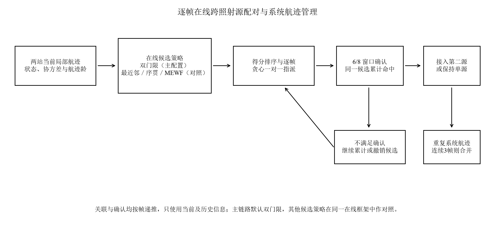{#fig:ch5_mewf}

### 5.4.1 证据的连续化与软门限

判定层把每项判据从否决门槛降级为可加权的证据，并在全部共现区间上累积，而不是只看最近若干帧。距离证据取负二次型指数在共现帧上的均值，是连续加权而非零一截断；马氏证据取马氏距离合格帧的比例

$$E_m=\frac{1}{|T_{ij}|}\sum_{k\in T_{ij}}\mathbb 1\left[\left(\boldsymbol\nu_{ij}^k\right)^T\left(\mathbf S_{ij}^k\right)^{-1}\boldsymbol\nu_{ij}^k<\gamma\right]$$ {#eq:ch5_maha}

式中 $\boldsymbol\nu$ 为两条航迹的位置差，$\mathbf S$ 为两站位置协方差之和；门限 $\gamma$ 取 $\chi^2_2$ 的 95% 分位 5.99，依据是匹配协方差下该二次型服从自由度为 2 的卡方分布。速度证据取速度差合格帧的比例；连续证据取最长合格连续段长度与共现帧数之比，它是连续 $M$ 帧这一硬约束的软化形式，不再要求凑齐 $M$ 帧，而按最长合格段占共现时长的比例计分。

四项证据都归一化到零一区间，加权平均后与门限比较

$$S=\frac{w_dE_d+w_mE_m+w_vE_v+w_cE_c}{w_d+w_m+w_v+w_c}\geq S_{\text{thr}}$$ {#eq:ch5_score}

等权 $w_i=1$ 不是随意选择：四项证据已经同尺度，等权等价于不预设哪项证据更重要，把调节的负担交给门限。5.6 节会说明，这个看似省事的决定恰好是本文实测的最优点。

### 5.4.2 指派层的全局最优

指派层在候选集上求解式[@eq:ch5_ilp]。贪心指派按分数降序依次选取，一旦航迹被占用就跳过，这在成对交换场景下必然失效：两对候选分数接近时，先选中的那对未必正确，而一旦选中，正确的那对就因航迹被占用而被排除。全局指派在全部候选上同时优化总代价，把局部的先到先得换成全局的最小代价匹配。

代价函数取马氏距离均值而非综合得分，理由是两层的信息不应重复：综合得分已在判定层用于筛选，指派层再用它排序，等于把同一份信息用了两遍。马氏距离用两站协方差之和归一化

$$c_{ij}=\frac{1}{|T_{ij}|}\sum_{k\in T_{ij}}\sqrt{\left(\boldsymbol\nu_{ij}^k\right)^T\left(\mathbf S_{ij}^k\right)^{-1}\boldsymbol\nu_{ij}^k}$$ {#eq:ch5_cost_maha}

自动惩罚"距离虽近但不确定度大"的候选，这正是区分平行航路目标所需要的。

### 5.4.3 确认帧数的判别力约束

在线链路保留了一个硬参数：最近 $N$ 帧内累计 $M$ 帧落在门限内，才把第二个源并入系统航迹。它与 5.3.2 节被批判的连续帧门限不是一回事：后者是判据本身，前者是判据通过之后的确认动作。但确认动作同样需要依据，其依据是判别力。

单帧判据为新息马氏距离平方 $T=\boldsymbol\nu^T\mathbf S^{-1}\boldsymbol\nu$。协方差匹配且均值偏移为零时 $T\sim\chi^2_2$；当两航迹存在标准化偏移 $\delta/\sigma$ 时，$T$ 服从自由度为 2、非中心参数为 $\lambda=(\delta/\sigma)^2$ 的非中心卡方分布。门限取 $g=5.99$ 时，同源帧的通过率为

$$p_1=F_{\chi^2_2}(g)=1-e^{-g/2}=0.950$$ {#eq:ch5_p1}

异源帧的通过率 $p_0(\lambda)=F_{\chi^2_2(\lambda)}(g)$ 随 $\lambda$ 单调下降。$N$ 帧内通过帧数服从二项分布，确认规则 $K\ge M$ 的假确认概率与检出概率分别为

$$\alpha(\lambda)=\sum_{k=M}^{N}\binom{N}{k}p_0^k(1-p_0)^{N-k}, 
\beta=\sum_{k=M}^{N}\binom{N}{k}p_1^k(1-p_1)^{N-k}$$ {#eq:ch5_bin}

要求 $\alpha\le0.05$，可反解出允许的最大异源单帧通过率 $p_0^*$，再反解 $\lambda$，得最小可分辨的标准化偏移 $\delta_{\min}/\sigma=\sqrt\lambda$。取 $N=8$ 的数值结果为：$M=4$ 时 $p_0^*=0.193$、$\delta_{\min}=3.13\sigma$、$\beta\approx1$；$M=5$ 时 $2.81\sigma$；$M=6$ 时 $p_0^*=0.400$、$\delta_{\min}=2.49\sigma$、$\beta=0.994$；$M=8$ 时判别力最强（$1.70\sigma$），但 $\beta=0.663$。

最后一行的结果决定了 $M$ 的上界。当 $M=N$ 时，确认规则退化为"最近 $N$ 帧全部通过"，即 5.3.2 节所批判的连续帧否决，其检出概率按 $p_1^N=0.663$ 衰减，三分之一的真实配对会被拒绝。$M$ 的下界则由判别力决定：$M=4$ 只能分辨 $3.13\sigma$ 的偏移，弱于 $M=6$ 的 $2.49\sigma$。取 $M=6$ 是 $N=8$ 时同时满足 $\beta>0.99$ 与判别力最强的取值。

窗口长度 $N$ 本身也受共视长度约束。若把 $N$ 放宽到 10 而取 $M=8$，可得 $2.25\sigma$ 与 $\beta=0.989$，判别力优于 6/8；代价是确认需要更长的观测，且所需共视帧数由 8 增至 10。本文场景的共视段只有 21–24 帧，扣掉两条航迹各自的起始成熟段（各不少于 5 帧）与确认窗，余量不足以支撑 $N=10$。$M/N=6/8$ 因而是判别力、检出率与共视长度三条约束的交点，其取值由这三条约束共同确定。

判别力的数值由脚本 `_analysis/diag_confirm_frames.py` 复现，其计算只依赖卡方分布与二项分布，不含任何调参。

## 5.5 方法成分贡献的正交分解

方法的三个成分（全局指派、放宽门限、证据软融合）需要正交对照才能归因。实验在密集场景上进行（并发均值 28.1 与 63.1，峰值 65 与 79，每组 200 个共现真目标，5 组场景与种子的组合），同一批航迹、同一套阈值定义，只切换配置。四种方法的结果如表[@tbl:ch5_dense]所示。

| 方法 | 误配数 | 漏配数 | 查准率 | 查全率 | 加权代价 |
| ---- | ---- | ---- | ---- | ---- | ---- |
| 最近邻 | 16.40 | 15.60 | 0.947 | 0.950 | 97.6 |
| 序贯最近邻 | 7.40 | 30.20 | 0.974 | 0.902 | 67.2 |
| 三判据 $M=8$ | 8.20 | 45.80 | 0.970 | 0.852 | 86.8 |
| 多证据加权+全局指派 | 6.20 | 19.00 | 0.979 | 0.939 | 50.0 |

: 密集场景下四种方法的配对质量（5 组场景与种子平均） {#tbl:ch5_dense}

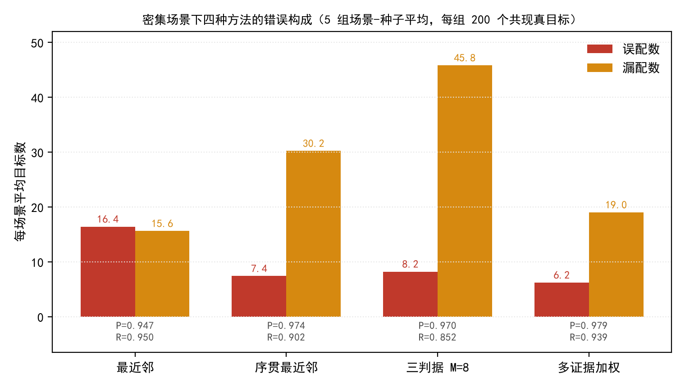{#fig:ch5_compare}

如表[@tbl:ch5_dense]与图[@fig:ch5_compare]所示，三种带门限的方法把误配从 16.40 压到 6–8，量化了设置门限这一基本判断的必要性；漏配的差别则更大，三判据 $M=8$ 因连续帧约束损失了 45.80 个目标，多证据加权把这一数字压到 19.00。后者在查准与查全两个方向上同时优于序贯最近邻，构成帕累托支配。

对各成分作正交分解后，归因结果与方法的表述重心并不一致。加权代价从原方案的 67.2 依次降到 56.0、51.4 与 49.4，三段降幅 11.2、4.6 与 2.0，分别占总降幅 17.8 的 63%、26% 与 11%。

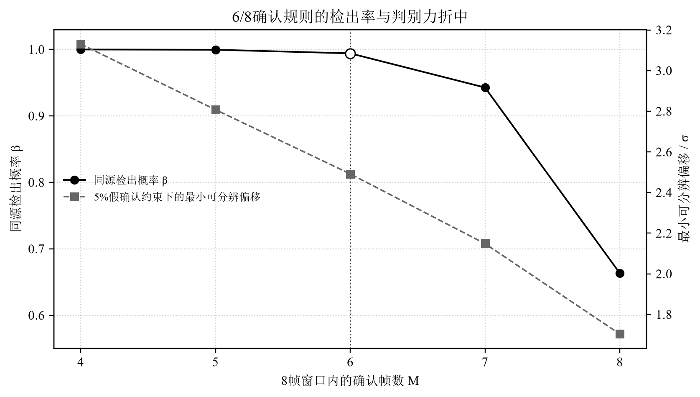{#fig:ch5_decompose}

如图[@fig:ch5_decompose]所示，最大的一段收益来自更换指派算法，其次来自放宽门限，而多证据融合这一最像本章贡献的部分只贡献了 11%。更严格的对照是：在同样采用全局指派、漏配数同为 18.40 的条件下，极限放松的硬门限方案加权代价 51.4，多证据加权 49.4，两者查准率之差 0.0009、查全率之差 0.0006。

机理在 5.4.2 节已经给出：工作点取在宽松一侧时，判定层几乎不执行筛选，进入指派的候选集很大，最终结果主要由指派层按马氏距离的排序决定；此时替换任何一项证据都不改变哪些对进入候选、谁配给谁。只有当门限收紧时，各证据的筛选价值才显现：在严格工作点上，去掉马氏证据使漏配从 28.00 增至 36.00，去掉速度证据增至 39.40。这一结果如实削弱了多证据融合的表述强度，本章因此把它定位为框架而非性能来源。

还有一组对照需要说明。"软融合只贡献 11%"并不等于四项证据无用。在本文工作点上逐项移除证据：去掉速度证据，误配由 6.20 升至 8.20、漏配由 19.00 升至 23.20；去掉连续性证据，误配升至 8.40、漏配 22.00。四项证据都在起作用，只是作用方式与指派方式不同：证据决定哪些对进入候选，指派决定候选之间如何取舍，而后者在宽松门限下承担了几乎全部筛选工作。门限扫描也印证了这一点：$S_{\text{thr}}$ 从 0.50 放宽到 0.65，误配由 8.40 降到 8.20，漏配由 21.40 升到 24.20，是一条很平缓的曲线，取 0.55 落在平台的中间。

## 5.6 在线链路验证

受控实验回答的是方法之间有无差别，在线系统回答的是这些差别在真实链路中是否可观测。在线链路的配对是在已有系统航迹上增加一个源：链路开机即工作，局部航迹到达即挂接，每条系统航迹在任一时刻可以挂一站、两站或零站。判别用马氏门限 5.99，确认规则 6/8，证据起算前要求两条航迹寿命均不少于 5 帧。

覆盖互补布设的 63 段中，只有 57 段曾同时进入两站视场，构成配对池；三个种子分别配出 57、53、57 对，池内查全 98.3%、93.0%、98.3%，均值 96.5%。配准注入 A/B 那一组（标定后）为 56 对且全部正确。把噪声强度放大到标称值的两倍，配对由 56 对掉到 47 对，说明门限对噪声标定的准确性敏感，这与第3章协方差失配等价于门限被等效收紧是同一条机理。

在线链路上，两门限、序贯与多证据加权三种方法的配对结果逐位相同，只有最近邻出现误配。其原因是场景的密度：覆盖互补布设下并发数均值 6.0、峰值 12，远低于受控实验的 28 与 63，平行航路造成的歧义很少被同时触发，三种带门限的方法因此给出同一组配对，差异被场景抹平。

这一结果限定了本章结论的适用范围：方法之间的优劣只在密集场景中可测，而本文的在线场景是稀疏的。配对方法的设计应以密集场景为准，因为密集场景是危险的那一端；在线结果的作用是证明整条链路在其目标场景中可用，而不是证明方法更优。

在线链路的挂接机制决定了几条工程约束。局部航迹到达时，先在门限内寻找可挂接的系统航迹，找到则更新，找不到则以自身为起点新建；连续 $K_{\text{loss}}=8$ 帧没有任何源供给即删除。由于一条真实航迹会依次穿过仅 R2、共视、仅 R1 三段，系统航迹的来源必然在运行中切换，切换点就是共视段的两个端点。另设一条合并规则：两条各持一站源的单源系统航迹，若连续 3 帧落在同一门限内，判为同一目标并合并，保留出生早的编号。这条规则处理的是配对晚于建轨的情形：两条航迹各自先独立成形，等到证据攒够才合并，避免系统航迹在共视段开头被拆成两条。

## 5.7 本章小结

本章把配对拆成两个问题并分别处理。判定层把位置、马氏、速度、连续性四项判据从否决门槛降级为可加权证据，在全部共现区间上累积，消去了连续帧门限的偏置与方差权衡；指派层以马氏距离为代价求解全局最优一对一匹配，把成对交换交还给最擅长的环节。

确认帧数的选择被还原为判别力计算。以 $\chi^2_2$ 的 95% 分位为单帧门限时，同源帧通过率 0.950，异源帧通过率随标准化偏移单调下降；要求假确认概率不超过 0.05，6/8 规则可分辨 $2.49\sigma$ 的偏移而检出概率保持 0.994，8/8 规则虽可分辨 $1.70\sigma$，检出概率却跌到 0.663，退化为被批判的连续帧否决。窗长放宽到 10 帧可进一步改善判别力，但受共视长度约束不可用。

这里有一条边界必须交代。稀疏场景的对照是反例而非支持：在并发均值 4.2–6.2 架的八个场景上，四种方法的误配数全为零，最近邻的漏配也为零，反而是三种带门限的方法各漏配 0.6–2.1 个。若只看稀疏场景，结论会变成最近邻最优。这不是算法优劣的反转，是场景的性质：目标间距远大于量测误差时，最近邻恰好总是正确的，门限与多证据只带来额外筛选。真正能区分方法的是密集场景，本章的结论因此一律限定在密集条件下。

受控实验给出了本章最诚实的结论：相对既有方法，加权代价由 67.2 降到 49.4，但收益的 63% 来自更换指派算法、26% 来自放宽门限，多证据软融合本身只占 11%。在线链路上三种带门限的方法逐位相同，只有最近邻会误配，差别在稀疏场景中不可观测。这两条合起来说明，配对环节的正确表述是用分层与全局指派消除结构性错误，而不是用多证据融合提高精度。

本章的产出是一组可信的配对及其边界：池 57/63、查全 96.5%、噪声加倍时掉到 47 对。第6章将在此基础上回答最后一个问题：给定这样一组配对，融合能把误差压到多少，压下去的部分又来自哪里。

# 第6章 航迹融合与增益机理

第5章给出一组可信的配对：哪些局部航迹属于同一物理目标，以及这组判定的适用边界。配对成功只是融合的前提，并不保证融合有效。两条航迹即使确实属于同一目标，融合后的误差仍可能大于其中较差的一条，甚至大于较好的一条。融合是否有益，取决于两站误差的相关系数，而相关系数由第4章指出的共同模型误差决定。本章沿这条链条把问题推到可以计算的层面。

融合带来两类性质不同的收益。第一类是长度收益：两站的观测并集长于任一单站，系统的持续跟踪时间因此延长。这是一个几何量，由覆盖区与航迹方向的夹角决定，与两站的误差无关，其上限可以写出闭式。第二类是精度收益：两站对同一目标给出两个独立或部分独立的估计，加权后方差下降。这是一个统计量，由两站误差的相关系数 $\rho$ 与两站方差之比 $k$ 决定。两类收益的口径不同，评估方法也不同，混在一起陈述会使结论无法核对。

本章的结论有四条。线性融合的方差可以写成 $\rho$ 与 $k$ 的闭式，融合有效的条件因此是一个不等式，而不是经验判断；相关系数的主要来源是两站共用的模型集，模型集与真实机动分布匹配后，池化 $\rho$ 由 0.520 降到 0.224，融合从经常有害变为几乎总是有益；长度收益的上限由两站覆盖帧数的并集决定，四个工况的实现度为 91.6% 至 98.3%；在覆盖互补布设的 63 段场景上，系统航迹长度比 1.314，双源帧的融合误差为 8.94 km，而单源帧仍是 15.34 km 的单站水平。

## 6.1 两类收益与统计口径

### 6.1.1 长度收益的几何性质

设两条链路对某目标分别有 $F_1$、$F_2$ 帧确认航迹，二者同时可见的帧数为 $O$。系统航迹在任一时刻至少有一路供给即维持，因而其有源覆盖帧数等于两站的并集

$$F_{\text{union}}=F_1+F_2-O$$ {#eq:ch6_union}

以较长单站为基准，长度比的几何上界为

$$\frac{L_{\text{sys}}}{\max(F_1,F_2)}\le\frac{F_1+F_2-O}{\max(F_1,F_2)}$$ {#eq:ch6_bound}

式[@eq:ch6_bound]是恒等式而非估计：并集是确定的，任何实现都不可能超过它，只能逼近。$F_1=F_2=F$ 时该式退化为 $2-O/F$，重叠越少，可延长的比例越大。这解释了一个容易被误读的现象：延长比例由重叠度决定，而不由算法决定。覆盖互补布设通过波束偏转把 $O$ 压低，因此它的价值在于几何，与融合规则无关，这与 2.1.3 节的分工一致。

### 6.1.2 精度收益的统计性质

精度收益不是推导出来的必然结果。两条航迹属于同一目标，只保证它们估计的是同一个真值；融合后方差是否下降，取决于两个误差之间的相关性。若两站误差完全相关（$\rho=1$），融合不提供任何新信息，加权平均只是把同一个误差按比例分配给两个源；若两站误差独立（$\rho=0$），融合方差按调和平均下降，两源等方差时为一半。

因此精度收益的讨论必须以 $\rho$ 为中心。这也决定了本文对两类收益的评估口径：长度用覆盖帧数计，精度用双源帧的误差计，两者不合并成一个数。

### 6.1.3 单源段与双源段必须分段报告

在覆盖互补布设下，一条南北向航迹依次经过仅南站、共视、仅北站三段，系统航迹的来源在运行中切换。63 段场景的统计显示，多数帧只有单源供给，双源帧只占少数。若只报告双源段的融合精度，等于只描述了航迹的两成，其余八成被留在了没有交代的位置。

本文因此对系统航迹统一分段报告：单源段的精度与单站同量级，双源段为融合结果，两段合起来才是系统航迹的真实形态。这一口径还带出一条结论：航迹延长段不带来精度收益。延长段的量测与单站完全相同，融合无从发生，其误差水平因此不随航迹变长而改善。长度收益与精度收益在时空上是分开的，前者发生在单源段，后者只发生在共视段。

## 6.2 线性融合的方差与有效条件

### 6.2.1 逆方差加权的精确方差

设两站对同一目标的位置估计为 $\hat{\mathbf x}_1$、$\hat{\mathbf x}_2$，误差零均值，协方差为 $P_1$、$P_2$，互协方差为 $P_{12}=\rho\sqrt{P_1P_2}$。线性融合取

$$\hat{\mathbf x}_f=w\hat{\mathbf x}_1+(1-w)\hat{\mathbf x}_2,,  w+(1-w)=1$$ {#eq:ch6_lin}

无偏约束使权重之和为一，融合方差为

$$V(w)=w^2P_1+(1-w)^2P_2+2w(1-w)\rho\sqrt{P_1P_2}$$ {#eq:ch6_var}

系统实现的是逆方差加权，即 $w=P_2/(P_1+P_2)$，它等价于在两源独立的假设下取最优。代入式[@eq:ch6_var]得

$$V_{\text{SCC}}=\frac{P_1P_2}{P_1+P_2}+\frac{2\rho P_1P_2\sqrt{P_1P_2}}{(P_1+P_2)^2}$$ {#eq:ch6_scc}

第一项是独立假设下的融合方差，即两方差的调和平均；第二项是相关性带来的附加项，与 $\rho$ 成正比。记方差比 $k=\sigma_2/\sigma_1\ge1$，则

$$\frac{V_{\text{SCC}}}{\sigma_1^2}=\frac{k^2}{1+k^2}+\frac{2\rho k^3}{(1+k^2)^2}$$ {#eq:ch6_scc_k}

式[@eq:ch6_scc_k]表明，融合的方差由方差比与相关系数共同决定，而非"两站误差各减一半"。相关性不改变第一项，它只在第二项上叠加一个正偏移，该偏移的系数 $2k^3/(1+k^2)^2$ 在 $k\in[1,3]$ 上介于 0.50 与 0.65 之间。第一项则随 $k$ 增大而趋近 1，可用的余量随之变小，有效上界的收紧因此源于两源方差的差距，而非该系数的增大。

### 6.2.2 最优权重与等方差的特殊性

对式[@eq:ch6_var]关于 $w$ 求极小，得最优权重与对应方差

$$w^*=\frac{P_2-\rho\sqrt{P_1P_2}}{P_1+P_2-2\rho\sqrt{P_1P_2}},, 
V^*=\frac{P_1P_2(1-\rho^2)}{P_1+P_2-2\rho\sqrt{P_1P_2}}$$ {#eq:ch6_blue}

当两源等方差时，式[@eq:ch6_blue]给出 $w^*=1/2$，与 $\rho$ 无关，融合方差退化为经典的

$$V^*=\frac{(1+\rho)P}{2}$$ {#eq:ch6_equal}

这说明等方差情形下逆方差加权就是最优加权，相关性只降低增益的幅度，不改变权重。反过来说，逆方差加权的失误只发生在两源方差不等且 $\rho>0$ 时：此时它按方差的倒数分配权重，把过大的权重给了较差的一源，而真实的相关性又使这一源的误差无法被另一源抵消。系统在 63 段场景上的两源中位误差为 6.37 km 与 8.81 km，$k\approx1.4$，正落在会犯这类错误的一侧。

式[@eq:ch6_blue]还有一个必须说明的边界：当 $\rho$ 接近 1 时，$w^*$ 可能落在 $[0,1]$ 之外，此时的"最优"是靠负权重外推实现的，工程上不可用。约束 $w\in[0,1]$ 后，最优解在边界上取得，即退化为选择较好的单站。这也是融合在强相关下应当退出的数学依据。

### 6.2.3 融合有效的闭式条件

有了式[@eq:ch6_scc_k]，融合是否有益可以写成一个不等式。融合有效指融合方差小于两源中较好者，即 $V_{\text{SCC}}\le\min(P_1,P_2)=P_1$（不妨设 $P_1\le P_2$）。代入并整理，得

$$\rho\le\frac{1+k^2}{2k^3}$$ {#eq:ch6_cond}

式[@eq:ch6_cond]是本章的核心判据，它把"融合何时有益"从经验问题变成可计算问题。几个取值可以直接读出：$k=1$ 时右端为 1，等方差融合永远有效（$\rho=1$ 的退化情形除外）；$k=1.4$ 时右端为 0.54；$k=2$ 时为 0.31；$k=3$ 时降到 0.19。两源差距越大，允许的相关系数越低，这与 6.2.2 节的解释一致。

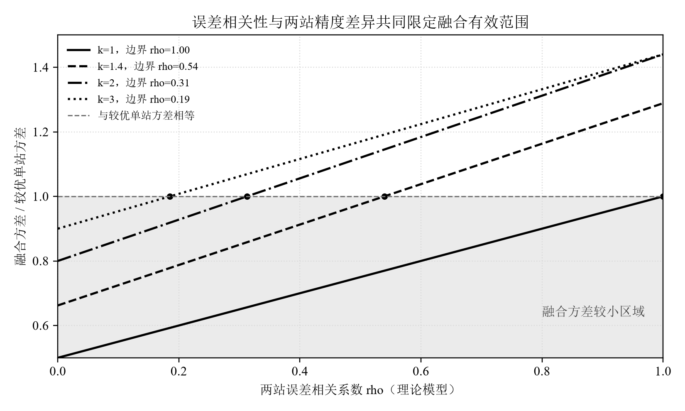{#fig:ch6_region}

如图[@fig:ch6_region]所示，四条曲线对应 $k=1.0$ 至 3.0，虚线为无增益界线 $V=\sigma_1^2$。曲线与虚线的交点给出每个方差比下的有效上界：0.54、0.31、0.19。63 段场景的池化 $\rho$ 为 0.172、$k\approx1.4$，工作点落在界内且余量充分。10 对实验的两源方差比更接近 1（1.18 与 1.26），其有效上界分别为 0.73 与 0.64；$\rho$ 由 0.520 降至 0.224 后，$\rho$ 与上界之间的余量由 0.21 增至 0.42，这与实测增益由 1.70% 升至 17.4% 的方向一致。

式[@eq:ch6_cond]还能解释一个反直觉的结果。若把工作点移到 $k$ 较大的区域（例如某站因配准残差而显著变差），有效上界随之收紧，融合会从有益转为有害。这提示工程上的一个纪律：配准不良时不应通过调整融合权重去挽救，而应先消除系统偏差，因为偏差同时抬高 $\rho$ 与 $k$，两个因素都朝不利方向作用。

### 6.2.4 协方差交叉的适用前提

在 $\rho$ 完全未知时，常用协方差交叉（covariance intersection）保守地组合两个估计

$$P_{\text{CI}}^{-1}=\omega P_1^{-1}+(1-\omega)P_2^{-1},, 
\omega\in[0,1]$$ {#eq:ch6_ci}

$\omega$ 按使 $\operatorname{tr}P_{\text{CI}}$ 或 $\det P_{\text{CI}}$ 极小选取。该方法的一致性保证是：无论 $\rho$ 取何值，融合协方差都不小于真实方差。其代价也由此而来，$\omega$ 按照最坏情形选取，当真实 $\rho$ 已知时，该权重与最优权重一般不同，方差因此高于式[@eq:ch6_blue]给出的 $V^*$。

本文的立场是：$\rho$ 可以通过 6.3 节的方法从数据中估计，估计值本身就是判断融合是否有效的依据（式[@eq:ch6_cond]），因此没有必要为未知相关性付出保守代价；CI 的适用场合是 $\rho$ 不可估或两源异质到无法建立互协方差的情形，本文场景不属于此类。

另一个实现层面的问题需要交代。Bar-Shalom–Campo 递推要求传播两站的互协方差 $P_{12}$，本文的滤波器未传播该项，实现中将其置零，于是 BC 分支在数值上退化为与 SCC 完全相同。这是实现状态的如实陈述，而非两种方法的比较结果；若要评估 BC 的独立价值，需要先补齐互协方差的状态方程，本文未做。

## 6.3 误差相关性的来源与测量

### 6.3.1 共同模型误差

第4章已经指出，两站共用同一套运动模型与转移概率。对同一段真实机动，两站的滤波器以相同的模型失配方式外推，其预测误差因此同向。这种同向性的来源是模型误差，与量测噪声无关；它不会被增加观测消除，只能通过让模型与真实运动匹配来减小。

这一机理给出了一个可检验的预测：若把模型集从 0.7/1.5 改为与实测机动分布匹配的 0.05/0.2，则两站的共同模型误差应同时减小，$\rho$ 应显著下降，而单站精度只应有小幅改善。6.4 节的实验正是按这一预测设计的。

### 6.3.2 池化相关系数的定义

两站误差的相关系数需要先定义统计域。逐目标计算再取中位数，会把目标之间的共同偏差去掉，剩下的只是各目标内部的时序相关，量级偏小且对模型集不敏感。本文采用池化口径

$$\rho=\frac{\sum_{t}\boldsymbol\delta_1(t)^T\boldsymbol\delta_2(t)}
{\sqrt{\left(\sum_t\|\boldsymbol\delta_1(t)\|^2\right)\left(\sum_t\|\boldsymbol\delta_2(t)\|^2\right)}}$$ {#eq:ch6_rho}

式中 $\boldsymbol\delta_i(t)$ 为第 $i$ 站在 $t$ 时刻的位置误差，求和遍历全部双源帧。池化口径保留了目标之间的共同偏差，而这正是模型误差相关的主体。三个口径在同一批数据上可以相差三倍：在 5 种子的全口径诊断中，池化 $\rho$ 由 0.430 降到 0.146 且 5/5 一致下降，逐目标中位数只由 0.242 降到 0.149 且有 1 个种子反升。口径不同，结论的显著性随之不同，因此正文一律使用池化值，其余口径进附录。

### 6.3.3 协方差一致性的校验

$\rho$ 描述两个误差的线性关系，不描述滤波器对自身精度的判断是否可信。后者由归一化误差平方（NEES）检验

$$\epsilon=\frac{1}{n}\sum_{t=1}^{n}\boldsymbol\delta(t)^T\mathbf P(t)^{-1}\boldsymbol\delta(t)$$ {#eq:ch6_nees}

对二维位置误差，协方差一致时 $\mathbb E[\epsilon]=2$。实测值大于 2 说明滤波器低估了自身误差，协方差偏乐观。这一量在本文中有独立意义：3.5.2 节已表明，协方差偏乐观等价于关联门限被等效收紧，因此 NEES 既是融合权重的可信度指标，也是配对环节的输入质量指标。

## 6.4 模型集匹配的增益机理

实验在近共视布设的场景 adsb_0002 上完成，使用当前在线管线，取种子 1 至 10 的配对。只改模型集一个变量，其余配置、场景与种子全部固定。结果如表[@tbl:ch6_mech]所示，其中三口径增益分别对应均方根、中位数与 90 分位。

| 指标 | 基线 0.7/1.5 | 匹配 0.05/0.2 | 变化 | $p$ |
| ---- | ---- | ---- | ---- | ---- |
| 池化 $\rho$ | 0.520 | 0.224 | −0.297 | $9\times10^{-11}$ |
| NEES（R1 / R2） | 4.49 / 2.94 | 2.87 / 1.53 | −1.62 / −1.41 | $\sim0$ |
| R1 单站 RMSE / km | 11.47 | 9.88 | −13.8% | $6\times10^{-9}$ |
| R2 单站 RMSE / km | 13.56 | 12.47 | −8.1% | 0.59 |
| 融合 RMSE / km | 11.23 | 7.92 | −29.5% | $2.2\times10^{-5}$ |
| 融合中位 / km | 5.90 | 4.45 | −24.5% | $\sim0$ |
| 融合 90 分位 / km | 18.78 | 11.54 | −38.6% | $\sim0$ |
| RMSE 增益 | 1.70% | 17.43% | +15.7 pp | 0.063 |
| 中位增益 | 7.29% | 15.58% | +8.3 pp | $7\times10^{-4}$ |
| 90 分位增益 | −2.57% | 14.80% | +17.4 pp | $2.4\times10^{-9}$ |

: 模型集匹配前后的机理量（近共视场景，种子 1–10） {#tbl:ch6_mech}

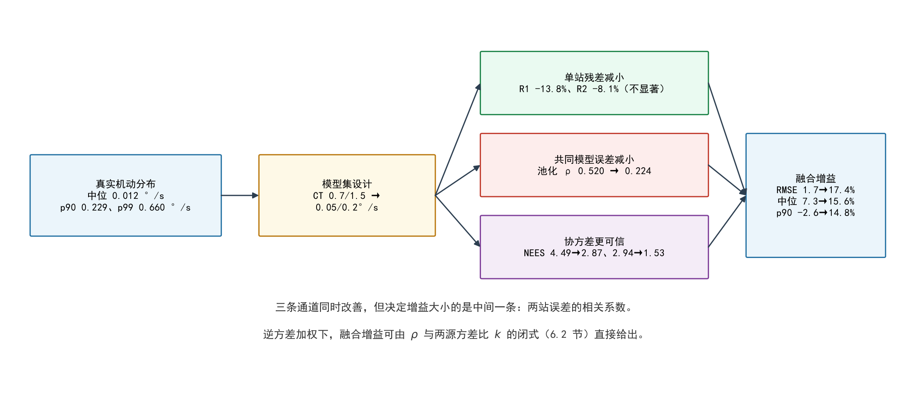{#fig:ch6_mech}

如表[@tbl:ch6_mech]与图[@fig:ch6_mech]所示，三条通道同时改善，但量的关系并不对称。单站只改善 13.8% 与 8.1%，且 R2 的变化不显著；池化 $\rho$ 下降 0.297，显著性达到 $10^{-11}$ 量级；融合误差在三个口径上分别下降 29.5%、24.5% 与 38.6%。单站改善与融合改善不成比例，差额可由式[@eq:ch6_scc_k]定量核对。以本节两源 RMSE 之比作 $k$：基线 $k=13.56/11.47=1.18$，代入得方差比 0.882，预测增益 6.1%，实测 RMSE 增益 1.70%；匹配后 $k=12.47/9.88=1.26$，方差比 0.748，预测 13.5%，实测 RMSE 与中位增益 17.4% 与 15.6%。两端的预测与实测分别相差 4.4 与 2 至 4 个百分点，方向一致、量级相同。

三个统计口径的差异本身是信息。基线下的 RMSE 口径增益只有 1.70%，显著性 0.063，处在边界；中位与 90 分位口径分别达到 15.58% 与 14.80%，均高度显著。原因是 RMSE 由极少数发散种子主导，均值因此接近零，而中位与 90 分位对少数发散样本不敏感，反映的是多数目标的改善。这一点的工程含义比均值更重要：融合的价值不在于把典型误差再压几个百分点，而在于抑制少数会让航迹不可用的偏离。

逐种子的相关性给出趋势律的直接证据。10 对样本中，$\rho$ 的下降量与增益的提升量之间的相关系数为 $-0.51$；剔除一个 RMSE 增益为 $-51\%$ 的灾难样本后升到 $-0.87$（$n=9$）。方向与预测一致：$\rho$ 降得越多，增益上升越多。但单个灾难样本足以把 RMSE 口径的相关性拉低一半，这说明该关系只能作为群体趋势，不能写成确定性公式。

47 对样本给出了同一结论在稳健性上的版本，如图[@fig:ch6_neg]所示。负增益的种子数在三个口径上分别由 13/47 降到 5/47、由 4/47 降到 0/47、由 27/47 降到 1/47；三口径的平均增益由 $-0.75\%$ 升到 $14.67\%$、由 $7.64\%$ 升到 $14.18\%$、由 $-1.74\%$ 升到 $15.99\%$。

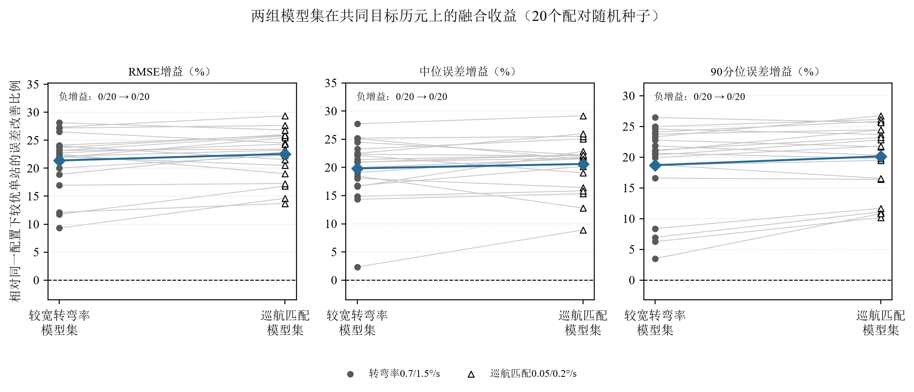{#fig:ch6_neg}

图[@fig:ch6_neg]的读法与表[@tbl:ch6_mech]不同。表回答的是"平均改善了没有"，图回答的是"最坏情况下还坏不坏"。90 分位口径下负增益种子由 27/47 降到 1/47，意味着融合从"超过一半的场合有害"变为"几乎总是有益"。这个转变比平均增益的提高更能说明模型集匹配的作用：它把工作点从式[@eq:ch6_cond]的边界外移到了边界内。

关于增益与相关性之间的定量关系，必须给出边界。式[@eq:ch6_blue]与式[@eq:ch6_scc_k]都是静态加权界：两个估计各用一次、权重固定。系统航迹则是有记忆的动态滤波，每个周期在上一次的基础上重新加权，误差在帧间自相关，逐点吻合因此不是必然的，本节 4 个百分点的偏差即属此类。更重要的是，在另一组配置上曾观察到实测增益超过等方差闭式界的情形，因此本文只把"增益随 $\rho$ 单调下降"作为趋势律使用，不写成上限。若要给出上限，需要建立带状态递推的动态界，本文不做，相关可行性在 7.4 节作为后续工作列出。

另一处需要说明的是参数口径。式[@eq:ch6_cond]以方差比 $k$ 为参数，而表[@tbl:ch6_mech]报告的是 RMSE。RMSE 在重尾分布下不是方差的稳健估计：按两源 RMSE 算得的 $k$ 为 1.18 与 1.26，而按 63 段场景的中位误差 6.37 km 与 8.81 km 算得 1.38。本节的数量级核对用前者，以保持与实验同一数据集；解释趋势时用后者，因为中位口径对尾部不敏感。两个数都出现在文中，但不相对于同一个统计量，引用时须随口径注明。

## 6.5 航迹长度的几何上界

式[@eq:ch6_bound]给出的是上界，实际能吃到多少需要单独测量。为此设计四个工况的扫掠：目标沿不同方位穿越走廊，布设固定为覆盖互补，检测概率 0.6，单种子 42。四个工况的覆盖帧数、几何上界与实测长度比见表[@tbl:ch6_ceiling]。

| 工况 | $F_1$ | $F_2$ | $O$ | 几何上界 | 实测长度比 | 实现度 |
| ---- | ---- | ---- | ---- | ---- | ---- | ---- |
| 垂直穿越 | 53 | 54 | 20 | 1.611 | 1.569 | 97.4% |
| 45° 斜穿 | 35 | 65 | 28 | 1.108 | 1.015 | 91.6% |
| 近距（106.0°E） | 49 | 49 | 18 | 1.633 | 1.528 | 93.6% |
| 远距（108.6°E） | 57 | 59 | 24 | 1.559 | 1.533 | 98.3% |

: 四个穿越工况下的长度上界与实现度 {#tbl:ch6_ceiling}

四个工况的实现度落在 91.6% 至 98.3% 之间，说明在线链路能够接近几何给出的上限。差额有确定来源：起始段的确认延迟、切换点的配对滞后与 $K_{\text{loss}}=8$ 的删除机制都会损失若干帧。这些损失不改变几何上界，只降低实现度，属于链路实现的固定开销。

45° 斜穿工况的比值只有 1.015，容易被误读为链路失效。实际上该工况的几何上界本身只有 1.108：一条链路覆盖了 65 帧，另一条只补充 7 帧，可延长的空间本来就窄。这一条必须与上界一起引用，否则"延长五成"会被误读为普遍可达。延长比例是重叠度的函数，不是系统的固有指标；可以横向比较的是实现度，它对重叠度不敏感。

覆盖互补布设的 63 段场景上，系统航迹的长度比为 1.314，逐段的几何上界不同，整体落在四个工况的实测区间之内。该数字与 2.1.2 节的覆盖带几何一致：并集比单站长约六成，但一条航迹未必贯穿整个并集，实际比值低于并集比是正常的。

## 6.6 覆盖互补布设的系统基线

把前五节的口径合起来，给出覆盖互补布设的系统基线，如表[@tbl:ch6_base]所示。三个种子的统计在双源帧上完成。

| 指标 | 均值 ± 标准差 |
| ---- | ---- |
| 融合 RMSE / 中位 / 90 分位（双源帧） | 8.94 ± 0.46 / 5.39 ± 0.11 / 13.95 ± 0.86 km |
| 双源帧 R1（RMSE / 中位 / 90 分位） | 15.42 ± 1.51 / 6.37 / 15.40 km |
| 双源帧 R2（RMSE / 中位 / 90 分位） | 30.81 ± 11.61 / 8.81 / 24.79 km |
| 融合增益（RMSE / 中位 / 90 分位） | 41.8% / 14.3% / 9.4% |
| 系统航迹·单源段 | 15.34 ± 0.99 km |
| 系统航迹·双源段 | 8.94 ± 0.46 km |
| 长度比 | 1.314 ± 0.004 |
| 配对池 / 池内查全 | 57 / 63 段入池，池内 96.5 ± 3.0% |
| 池化 $\rho$ | 0.172 ± 0.126 |

: 覆盖互补布设的系统基线（63 段，种子 42/43/44） {#tbl:ch6_base}

表[@tbl:ch6_base]有四处需要交代，都是口径问题而非结果问题。

其一，精度只在双源帧上统计。覆盖互补布设不改变两站的量测精度，本节报告的是共视段内的融合精度；单源段的 15.34 km 是单站水平，两者不能合并成一个"系统精度"。这也是 6.1.3 节分段口径的落点。

其二，三个增益口径必须并列。RMSE 口径的 41.8% 反映尾部抑制，中位口径的 14.3% 反映典型精度，90 分位口径的 9.4% 反映次尾部的改善。三者的数值方向并不一致，RMSE 口径最高而 90 分位口径最低，因此任何单一数字都不能代表融合增益。只报其中任何一个，都可以被另一个反驳。

其三，R2 的种子离散极大（RMSE 30.81 ± 11.61 km）。本文将其归因于少数目标在长断点后的重捕，与第4章的重尾结论一致；融合的 RMSE 离散反而小（8.94 ± 0.46 km），说明当一个源被污染时，另一个源的约束起了作用，这正是融合抑制尾部的作用机制。

其四，池化 $\rho=0.172$ 与 6.4 节的 0.224 来自不同场景。前者为覆盖互补布设的 63 段、3 个种子；后者为近共视布设的 10 对种子，且 0.224 是模型集匹配后的值（匹配前为 0.520）。两者同量级，但不可互替，引用时必须带场景。

## 6.7 本章小结

本章把融合拆成两类收益并分别给出判据。

精度收益方面，导出逆方差加权的精确方差式[@eq:ch6_scc_k]，说明融合方差是方差比与相关系数的二元函数；由该式得到融合有效的闭式条件 $\rho\le(1+k^2)/(2k^3)$，其数值含义是两源等方差时恒有效、差两倍时要求 $\rho\le0.31$、差三倍时要求 $\rho\le0.19$。等方差情形下逆方差加权就是最优加权，权重失误只发生在两源不等且相关时，这解释了负增益的成因。

相关性的来源方面，机理链为真实机动分布决定模型集、模型集同时作用于单站残差、共同模型误差与协方差一致性。10 对在线配对的实验显示，模型集匹配使池化 $\rho$ 由 0.520 降到 0.224（$p=9\times10^{-11}$），融合 RMSE、中位与 90 分位分别下降 29.5%、24.5% 与 38.6%，而单站只改善 13.8% 与 8.1%。47 对的稳健性统计显示，负增益种子数在 90 分位口径上由 27/47 降到 1/47，融合从经常有害变为几乎总是有益。增益与 $\rho$ 的关系只作为趋势律使用，静态界不作为上限。

长度收益方面，系统航迹的有源覆盖帧数等于两站覆盖的并集，长度比的上界为 $(F_1+F_2-O)/\max(F_1,F_2)$。四个穿越工况的实现度为 91.6% 至 98.3%，斜穿工况的低比值由上界本身较低解释，不是链路失效。

系统基线方面，覆盖互补布设 63 段的长度比 1.314，双源帧融合误差 8.94 km，单源段 15.34 km，三口径增益 41.8%/14.3%/9.4%，池内查全 96.5%。单源段不带来精度收益，长度收益与精度收益在时空上是分开的，这一结论与 2.1.3 节的分工一致。

至此，量测、配准、滤波、配对、融合五个环节的结论已经闭合。第7章将把这条链上的判断汇总，并交代它未覆盖的部分。

# 第7章 总结与展望

本文研究天波短波外辐射源体制下双照射源的航迹关联与融合。单站雷达已经解决的检测、跟踪与点迹关联不是本文的问题；本文面对的是两站之间的三个判断：同一目标的量测是否落在同一地理与时间基准上，两条局部航迹是否属于同一物理目标，以及配对之后的融合是否必然带来收益。三个判断的答案分别是可标定、可判定、不必然，全文的工作即围绕这三条展开。

## 7.1 主要结论

其一，双照射源的价值有两种，其分工不可混用。误差分集要求两站覆盖高度重合，其作用是降低位置误差；覆盖分集要求两站覆盖彼此错开，其作用是延长航迹、扩大探测范围。二者对布设的要求相反，本文因此设置近共视与覆盖互补两种布设，并固定其使用范围：精度类结论一律取共视段，长度类结论取并集。覆盖互补布设经波束偏转补偿后在走廊上形成 366 km 与 373 km 的两条覆盖带，重叠 142 km，并集 597 km；它不改变量测精度，这一条在 2.1.3 节与 6.6 节分别从模型与数据两侧交代。

其二，天波量测的系统偏差是结构性的，只能参数化，不能折成常数。群距离是两条单程路径之和，虚高以非线性方式进入其中：按直线几何反演，1400 km 处将高估目标距离 123 km，且高估量随距离减小而增大；虚高的灵敏度在近端为 3.11、远端为 1.20，相差二点六倍。三参数模型可辨识的条件由标校集的距离跨度给出，放大因子 $\alpha=\sqrt{1+\mathrm{CV}^2(s)}/\mathrm{CV}(s)$ 把精度写成样本数与几何离散度的乘积效应。单条 50 帧航迹的下界为 33.8 km，三条距离分层航迹降到 6.73 km，全国走廊降到 0.46 km；10 个种子的实测标准差与下界之比为 1.04 至 1.26。端到端对照中，标定把 90 km 量级的偏差补回到零偏差基线：融合误差由 104.73 km 降到 8.57 km，配对由 1 对且错变为 56 对全对，航迹长度比由 1.006 恢复到 1.291。

其三，单站精度的边界由信息量决定，滤波参数已不构成可利用的自由度。匀速窗口下的位置下界为 $\sigma_R/\sqrt N$，20 帧时 2.24 km；速度的四级量级为两帧差分 471 m/s、端点差分 23.6 m/s、斜率拟合 12.9 m/s、多普勒 0.5 m/s。实测单站误差的中位数为 6.0 至 9.1 km、均方根为 14.8 至 44.3 km，与下界分别相差三倍与七倍以上，差距来自匀速假设、漏检与重尾三条前提同时不成立，不受调参影响。过程噪声调度、自适应过程噪声与自适应转移概率三条路径全部为负，共同判据是 $\sigma_{v_d}\ll\sigma_R/dt$：多普勒已承担全部速度信息，过程噪声的调节只能恶化位置。模型集是唯一有效的杠杆，与真实机动分布匹配后 R1 单站改善 13.2%（$p=3.7\times10^{-13}$），R2 改善 6.4% 但不显著。

其四，跨照射源配对的问题可以拆成判定与指派两层。判定层把位置、马氏、速度、连续性四项判据从否决门槛降级为可加权证据，在全部共现区间上累积；指派层以马氏距离为代价求全局最优。密集场景下加权代价由 67.2 降到 49.4，但正交分解显示其中 63% 来自更换指派算法、26% 来自放宽门限，多证据软融合本身只占 11%。确认帧数不是经验参数：以 $\chi^2_2$ 的 95% 分位为单帧门限时，6/8 规则可分辨 $2.49\sigma$ 的偏移且检出概率为 0.994，8/8 规则虽可分辨 $1.70\sigma$，检出概率却跌到 0.663，退化为被批判的连续帧否决。在线链路上三种带门限的方法给出逐位相同的配对，方法差异只在密集场景中可测。

其五，融合是否有效由误差相关性决定，可以写成闭式判据。逆方差加权的融合方差为方差比 $k$ 与相关系数 $\rho$ 的二元函数，令其不超过较好单源的方差，得 $\rho\le(1+k^2)/(2k^3)$：两源等方差时恒有效，差两倍时要求 $\rho\le0.31$，差三倍时要求 $\rho\le0.19$。相关系数的主要来源是两站共用的模型集，模型集匹配使近共视场景的池化 $\rho$ 由 0.520 降到 0.224（$p=9\times10^{-11}$），融合的 RMSE、中位与 90 分位分别改善 29.5%、24.5% 与 38.6%，而单站只改善 13.8% 与 8.1%。47 对样本上，融合劣于最优单站的种子数由 27/47 降到 1/47。覆盖互补布设的 63 段上，系统航迹长度比 1.314，双源帧融合误差 8.94 km，单源段 15.34 km，三口径增益 41.8%、14.3% 与 9.4%，池内查全 96.5%。

表[@tbl:ch7_sum]把五个环节的决定性量、结论与边界并列，便于对照引用。

| 环节 | 决定性量 | 结论 | 边界 |
| ---- | ---- | ---- | ---- |
| 量测 | 虚高灵敏度 $s$ | 偏差随距离变化，必须参数化 | 标量虚高、单跳传播 |
| 配准 | 距离跨度 $\mathrm{CV}(s)$ | $\sigma_{\Delta R}=\alpha\sigma_R/\sqrt N$ | 标校集与评估集分离 |
| 滤波 | 多普勒与位置噪声比 | 过程噪声不是杠杆，模型集是 | 二维巡航段 |
| 配对 | 判别力 $\delta/\sigma$ | 6/8 由判别力与共视长度确定 | 密集场景才可测 |
| 融合 | 相关系数 $\rho$ 与方差比 $k$ | $\rho\le(1+k^2)/(2k^3)$ | 静态界只作趋势律 |

: 五个环节的决定性量、结论与适用边界 {#tbl:ch7_sum}

## 7.2 方法性贡献

其一是配准的可辨识性刻画。把 $h$ 与 $\Delta R_{\text{sync}}$ 的耦合写成 Fisher 信息矩阵，闭式求逆得到参数下界、放大因子与耦合系数的解析表达，并指出相关系数不能用作可辨识判据、$\mathrm{CV}(s)$ 才是。由此得到的工程准则是：标校集应按距离分层采集，而不是尽可能多地采集参考航迹；这一准则在本文数据上由 R2 的样本多于 R1 而精度更低给出了实证。

其二是配对的分层结构与确认帧数的判别力界。把"是否值得配对"与"配给谁"分开，消去了连续帧门限的偏置与方差权衡，也消去了成对交换这一结构性误配。确认帧数由二项分布与非中心卡方分布联合确定，使 $M/N$ 从经验取值变为可计算的交点；同时给出了该方法在稀疏场景下不如最近邻的适用边界。

其三是融合有效性的闭式条件与增益的传导链。逆方差加权的方差可写成 $k$ 与 $\rho$ 的二元函数，由此得到 $\rho\le(1+k^2)/(2k^3)$ 这一判据，把"融合何时有益"从经验判断变为可计算问题；配套的传导链（真实机动分布到模型集、模型集到相关性、相关性到增益）把单站滤波与融合两个环节用同一个物理量连起来，解释了单站改善 13.8% 而融合改善 29.5% 的不对称。

其四是覆盖互补布设的工程构造。两站南北错开 100 km、波束各偏转 4.6°，在 15° 视场下形成约 9.8° 的重叠带，走廊上的并集比单站延长六成。长度收益的上界为 $(F_1+F_2-O)/\max(F_1,F_2)$，四个穿越工况的实现度为 91.6% 至 98.3%，说明在线链路能够接近几何给出的上限。这条工作的意义在于把"延长"从一个百分比换算为一个可核算的实现度。

## 7.3 适用边界

第一，数据层为半实物仿真。目标状态取自实测 ADS-B，水平精度约 30 m，相对 10 km 量级的雷达误差为 0.3%；但群距离、方位与多普勒由模型仿真生成，检测层亦为仿真。本文因此不称实测验证。所有结论在"量测模型正确"这一前提下成立，模型误差本身未被检验。

第二，模型层限于巡航段二维平面。筛选条件取高度 20000 ft 以上，起降段不在范围内；等效虚高按标量处理，只在一定的距离段与时间段内成立；站内点—航迹关联按假设 A0 视为理想。三条限制中，A0 的放松会同时影响配对与融合，是最需要优先处理的。

第三，统计层存在样本量限制。机理表用 10 对配对，长度上界用单种子，两者只能支撑量级与方向的结论，不足以支撑精确百分比。63 段基线与 47 对稳健性统计的样本量相对充足，但 RMSE 在重尾下不是方差的稳健估计，三口径的排序在不同数据集上可以相反，任何单一数字都不能代表增益。

第四，方法层有两条未闭合的线。融合的静态加权界在动态滤波下会被越过，本文只把它作为趋势律使用，未建立带状态递推的动态界；Bar-Shalom–Campo 分支因互协方差未被传播而退化为简单凸组合，其独立价值未被评估。这两条都是实现层面的边界，不影响主结论的方向，但限定了它的解释力。

第五，覆盖互补布设的结论只涉及长度与连续性。该布设不改变量测精度，其价值在于让系统在目标穿越走廊时不断轨、让并集覆盖更长的航段；凡以该布设为前提的精度结论，本文一概未写，也不应被读出。

## 7.4 后续工作

其一，动态融合界。静态界的越界现象说明系统航迹的记忆使等效自由度增加，若能把融合写成带状态递推的形式并给出 Riccati 型方差演化，增益就有上限可依，而不只是趋势。这是本文留给后续工作最直接的一条。

其二，放松 A0。本文把站内点—航迹关联视为理想，从而把问题收缩到站间；若前端存在误配，其误差会以与系统偏差相似的形式进入配对门限与融合权重。把站内关联与站间配对纳入同一个优化，是双照射源体制的完整形式。

其三，虚高的时空建模。本文把虚高处理为一个可估的标量，并指出空间梯度会使估计沿 $h$–$\Delta R$ 脊线漂移。把虚高写成随经纬度与时间缓变的场，可以同时改善长航迹的配准精度与标定窗口的长度选择。

其四，多于两个照射源的扩展。两个源时，配对是指派问题；三个以上时，一对一约束不再成立，需要处理同一目标被多个源同时确认、以及部分源缺失的情形，代价函数与一致性判据都要重写。

其五，实测数据验证。本文的检测层为仿真，若能在真实短波回波上复现同一链路，量测模型的误差、电离层扰动的实际强度与多径的影响才可被定量评估。这是从半实物走向工程系统的必经一步。

本文的主线可以概括为一句话：双照射源的融合增益不来自"多一路量测"，而来自两站误差相关性的下降，以及覆盖并集带来的航迹延续；前者可以标定、可以判据化，后者是几何的必然。把这两件事分开记账，是分析此类系统的基本纪律。
