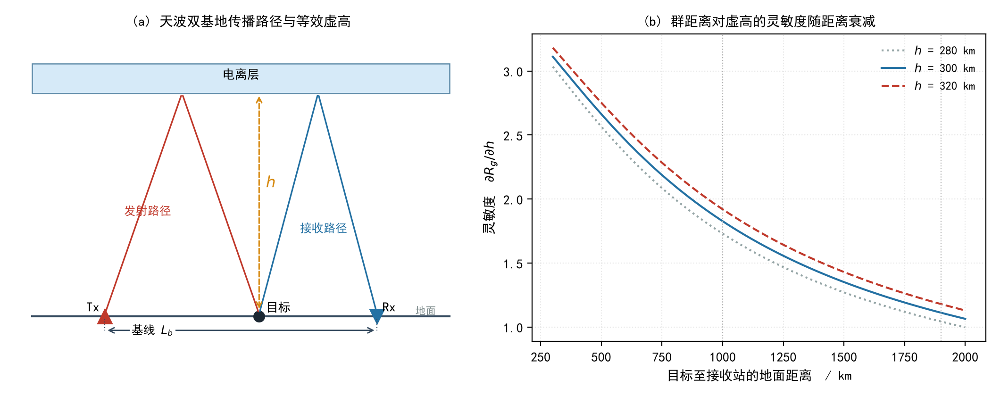
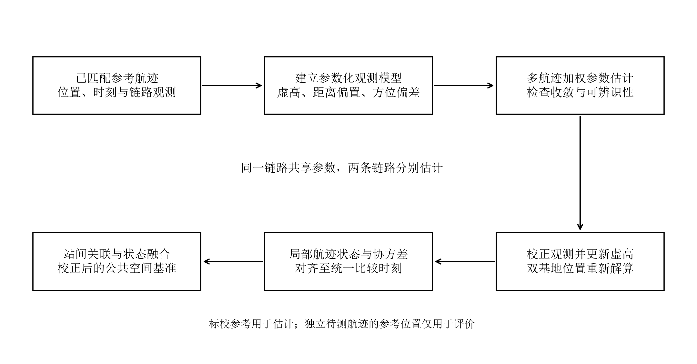
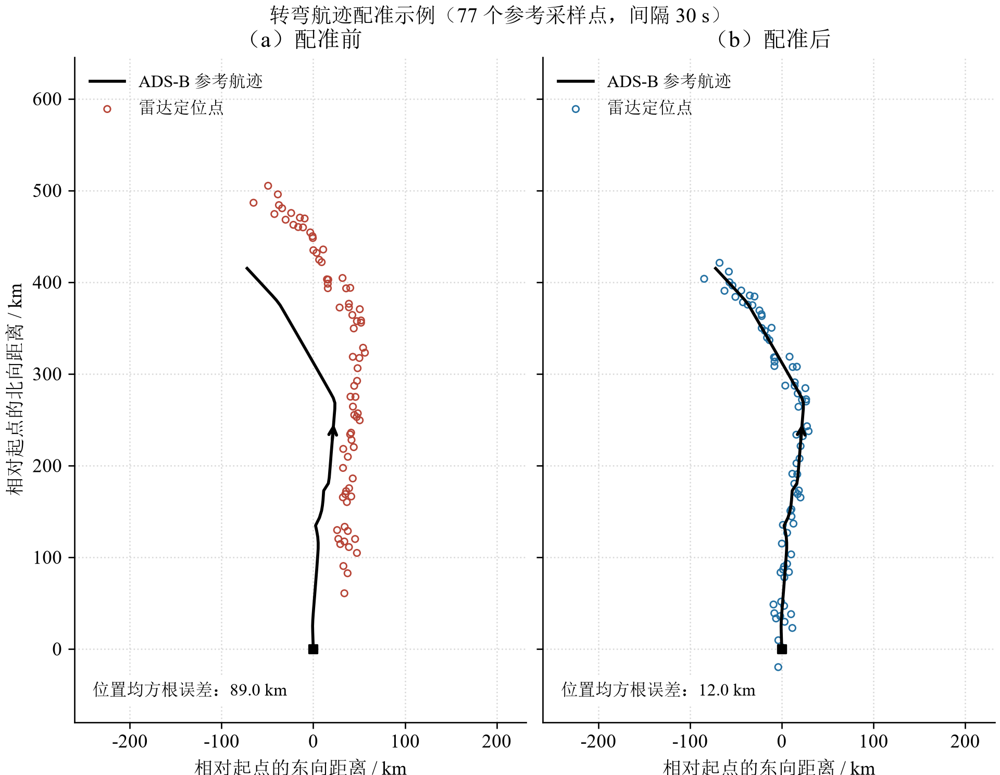
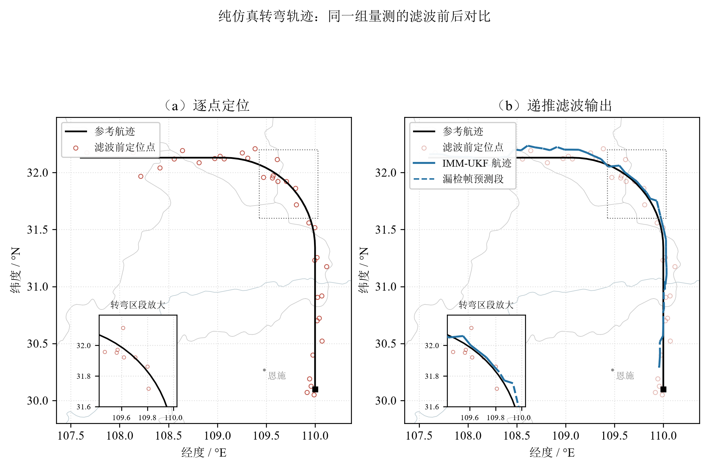
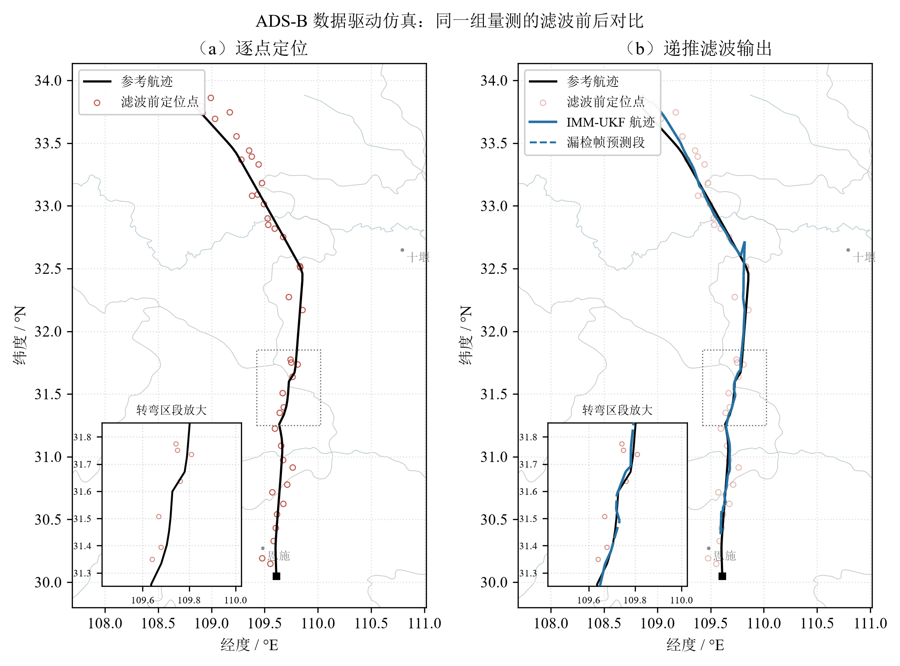
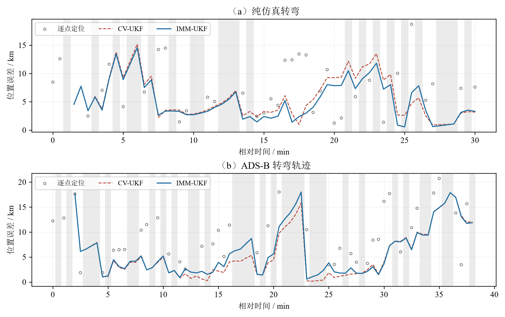

# 第1章 绪论

## 1.1 课题来源、研究背景及意义

### 1.1.1 课题来源与研究背景

本课题来源于短波外辐射源雷达双照射源联合处理中的航迹关联与融合研究需求，在已有单站航迹跟踪程序的基础上，研究不同观测链路之间的信息协同处理。研究面向低量测精度、低检测概率和低数据率条件，关注单站航迹如何稳定形成、不同照射源的局部航迹如何正确配对，以及多源信息能否改善位置估计和持续跟踪能力。

远距离、隐蔽和持续的目标监视是海空态势感知的重要需求。地基微波雷达的覆盖受到视距传播、地球曲率和地形等因素制约，短波雷达则可以利用电离层传播实现超视距探测。短波外辐射源雷达进一步利用广播、通信等非合作信号照射目标，由接收端获取目标散射回波，无需自行建设专用雷达发射设施，具有被动接收和利用既有照射资源的特点，为广域目标监视提供了一种技术途径[5,6,39]。

双照射源被动探测的基本关系如图[@fig:ch1_principle]所示。不同照射源发出的信号经传播照射同一目标，接收端通过相应参考信号和目标回波获取目标信息，再将不同链路的处理结果送入融合中心。图中以共用接收端说明双源信号的利用原理；本文考虑的是分别形成局部航迹的两条收发观测链路，具体站点配置与覆盖范围在量测模型中定义。

{#fig:ch1_principle}

短波体制的覆盖优势伴随着复杂的观测条件。电离层随时间和空间变化，使传播路径与群时延具有不确定性，目标定位因而依赖传播参数及其估计。非合作信号的带宽、调制方式和发射功率不由雷达接收端控制，弱目标回波还需要与强直达波、多径及杂波分离[6,8,9]。这些因素可能造成量测误差较大、点迹更新间隔较长和漏检较多，进而影响单站状态估计和航迹维持。

单个照射源的观测范围与可用信息有限，多源联合处理因而具有研究价值。在公共覆盖区域内，两条观测链路可以提供互补的目标状态信息；在覆盖范围部分错开的情况下，目标离开一条链路视场后，另一条链路仍可能继续提供航迹信息，有助于延长系统航迹和有效观测时间。但两条局部航迹并不能直接合并：时间与空间偏差可能使同源航迹错开，定位误差和目标密集可能造成错误配对，局部估计误差的相关性又会影响加权融合结果[20,25,42,43]。

因此，本文的总体研究目的，是通过时空配准统一局部航迹的比较基准，通过单照射源滤波改善断续观测下的状态估计，通过跨照射源关联建立可靠的航迹对应关系，并利用双源信息研究位置估计改善与持续跟踪。滤波、关联和融合分别承担局部估计、同源判别与信息合成的任务，共同服务于可靠、连续的目标监视。

### 1.1.2 理论意义

短波双照射源航迹处理同时包含传播参数不确定性、非线性状态估计、多目标关联和相关误差融合等问题。将这些问题置于统一框架中分析，有助于明确传播参数与常值量测偏差的区别，说明标校样本的几何分布如何影响参数估计，并辨析运动模型、观测缺失及局部误差相关性对系统性能的作用。

本文通过参数可辨识性分析、理想条件下的估计误差基准、多帧判别分析和简化融合模型下的有效条件，研究不同环节的性能约束及其联系。这些分析能够为同类观测条件下的标校集选择、运动模型配置和关联融合规则设计提供参考，也有助于解释某项局部改进为何能够或不能转化为系统收益。

### 1.1.3 实际意义

对短波外辐射源雷达而言，获得少量有效点迹之后仍需形成可以持续使用的目标航迹。提高单站估计稳定性、减少跨源误配和漏配，并合理利用两条链路的覆盖互补，能够为目标位置判断和持续监视提供更可靠的信息。航迹延长的实际价值在于增加目标有效观测时间，减少因单源覆盖受限造成的信息中断；公共观测段的估计融合则用于改善位置精度，两者需要分别评价。

本文建立从量测建模、偏差标定、局部跟踪到在线配对与融合的处理流程，通过仿真考察算法选择和参数配置对系统输出的影响，可为双照射源处理方案及观测配置设计提供依据。相关结果的适用范围受量测模型、传播等效和观测条件限制，其工程应用还需要真实短波回波与外场条件的进一步检验。

## 1.2 国内外研究现状

### 1.2.1 短波外辐射源雷达及多源联合探测研究

借用第三方信号探测目标的思想在雷达早期发展中已经出现。1935 年 Watson-Watt 利用 BBC 广播开展飞机探测试验，二战期间 Klein Heidelberg 系统利用英国 Chain Home 雷达网的信号进行预警，分别体现了早期被动探测和双基地探测的探索[1,2]。这些工作为外辐射源探测提供了历史基础，但其工作频段、信号和传播条件与现代短波天波系统并不完全相同。

随着接收、计算和数字信号处理能力的发展，外辐射源雷达逐步拓展到多种广播与通信照射源。Silent Sentry 系统开展了基于广播信号的被动监视，多频段多基地系统进一步研究不同照射源和观测链路的联合利用[3,4]。这类研究说明，照射源选择和收发几何是被动探测系统的重要组成部分，多源观测的作用需要结合各链路的覆盖和量测特性进行分析。

国内在高频外辐射源体制、数字调幅广播利用和信号处理方面也形成了相关研究。万显荣等开展了基于 DRM 数字调幅广播的高频外辐射源雷达实验，赵志欣围绕高频外辐射源体制和关键处理技术进行了研究[5,6]。在目标点迹形成之前，强直达波、多径和杂波抑制是基础环节。Colone 等研究多级干扰消除与目标检测处理，Palmarini 等进一步研究滑动扩展相消方法，为改善被动雷达的点迹输入提供了途径[8,9]。

上述研究覆盖了系统体制、照射资源和信号级处理等方面，但不同频段的传播机理与量测条件存在明显差异。将视距被动雷达或一般多传感器方法用于短波天波场景时，还需要检验传播参数失配、低精度和断续观测的影响。本文以形成点迹后的航迹处理为研究对象，重点关注两条观测链路之间的配准、滤波、关联与融合。

### 1.2.2 时间对齐与空间配准研究

时间与空间基准的一致性是多源航迹比较的前提。对于采样时刻不一致的状态序列，可以借助插值或运动外推构造共同参考时刻的状态；若存在未知时间偏差，则还需要建立相应观测关系进行估计。非均匀采样下的插值外推和基于最小二乘的时延估计研究，为理解这类问题提供了基础[45,46]。其中，已知采样时刻差与未知时钟偏差属于不同问题，不能混为同一个待估量；在线处理中还应保证所使用的信息在输出时刻已经可获得。

空间配准通常包含坐标基准统一和系统误差估计。前者解决不同位置表达之间的转换，后者校正测距、测角和平台参数等偏差。相关研究采用最小二乘、广义最小二乘及极大似然等方法，将传感器偏差与目标观测联系起来，并讨论噪声和几何配置对估计结果的影响[47,48]。这类方法为本文的离线偏差标定提供了估计思路。

天波量测还包含传播介质的影响。采用等效虚高描述传播路径后，虚高通过非线性几何关系进入群距离，其误差在不同目标距离上产生的残差并不相同。因此，常值距离偏置与传播参数误差需要在模型中区分，坐标转换也不能替代这类误差的估计。当标校航迹的距离范围较窄时，不同参数对观测的作用还可能近似重合。

由此，适用于本文的配准研究需要同时回答模型和数据两个层面的问题：如何对传播参数与测距、测角偏差进行联合描述，以及参考航迹能否提供足够的几何变化来区分这些参数。进一步还需要分析，标定结果进入位置反演后，残余偏差如何影响局部航迹和跨源关联。

### 1.2.3 单照射源航迹滤波研究

航迹滤波通过运动模型与量测信息估计目标状态，是分布式融合的输入基础。对于非线性量测，扩展卡尔曼滤波通过局部线性化进行递推，无迹卡尔曼滤波则使用确定性采样传播分布的均值和协方差。Julier 与 Uhlmann 对无迹滤波和非线性估计进行了系统讨论，Wan 与 Van Der Merwe 给出了无迹卡尔曼滤波的实现研究[7,54]。这些方法降低了处理非线性观测的难度，但滤波精度仍依赖运动模型、噪声描述和初始条件。

国内外辐射源雷达跟踪研究围绕大观测误差和机动目标开展了多种改进。陈书恒等研究去相关无偏转换量测跟踪方法，程瑞等研究改进自适应扩展卡尔曼滤波与交互多模型的结合，王鹏等研究基于迭代扩展卡尔曼滤波的目标跟踪[12,13,40]。这些工作分别从量测变换、噪声适应和非线性更新等角度改善状态估计。多目标数据关联和多平台异构信息跟踪研究也提供了相关参考[41,55]。

交互多模型方法通过多个运动模型及其概率更新描述目标运动模式变化，适合将直飞与转弯等行为置于同一估计器中[20,25]。但增加模型数量并不必然改善结果，模型所覆盖的机动范围需要与目标实际运动相匹配；自适应噪声调整的效果也取决于新息是否能够区分机动、量测异常和模型误差。

在本文较低检测概率和较长更新周期下，缺帧会增加预测时段，真实机动与模型偏差可能持续累积。需要区分量测噪声抑制、缺测期间的航迹维持和机动响应等不同目标，并同时评价误差和协方差可信度。单站滤波的影响也不能止于局部轨迹是否平滑，其输出误差及不确定性将直接参与后续跨源判别和加权融合。

### 1.2.4 跨照射源航迹关联研究

航迹关联判断不同观测链路提供的局部航迹是否属于同一物理目标。统计方法通常利用状态差、距离或似然构造判据。Singer 与 Kanyuck 研究多站航迹相关处理，何友等研究利用历史判决和双门限的航迹相关算法，并在后续工作中讨论多目标多传感器关联方法[17-19,50,51]。这类方法结构清晰，能够将位置接近程度和多帧确认结合起来，其判决结果同时受到门限、误差统计和历史长度影响。

模糊方法通过隶属度或综合相似度描述多个属性，把单一距离判据扩展为多属性关联决策。何友等研究模糊双门限航迹相关，Aziz 讨论分布式多传感器多目标多属性条件下的关联与融合[52,53]。其价值在于能够组织不同来源的证据，但属性尺度、权重和判决规则仍需与数据条件相匹配。

近年来，航迹间的结构关系与学习型特征也被用于关联。Sönmez 与 Hocaoğlu 研究基于参考拓扑特征的异步航迹关联，王威等研究拓扑增强和灰色理论的分层方法，丁振平与郭徽东研究图谱特征关联[21,29,31]。陈毓研究 CNN-BiLSTM 多源航迹关联，Xu 等研究带智能航迹评分的多假设算法，其他机器学习方法也被用于构造关联判别[22,26,28]。这些方法提供了利用空间、运动和时序结构的不同途径。

不同关联方法各有适用条件。目标稀疏时，简单距离判别可能已经能够提供可靠结果；当定位误差与目标间距接近时，多对候选航迹可能同时满足局部条件，有限的公共观测又会限制多帧证据。此时除了判断某一对是否同源，还需要处理不同候选之间的竞争。本文据此将同源判定与全局指派分别考察，并通过同条件对照分析历史证据、门限和指派结构的作用。

### 1.2.5 航迹融合研究

航迹级融合由各节点先形成局部状态估计，再在融合中心合成目标信息。相对于传输全部原始量测，分布式结构能够减少通信需求，但需要处理局部估计之间的信息相关与重复使用[20,25]。误差独立时，协方差加权可以得到相应的最优线性估计；误差相关时，互协方差成为确定权重和融合不确定性的重要信息。

简单凸组合融合、Bar-Shalom-Campo 方法与协方差交叉代表了不同的相关性处理思路。前者以独立误差为基本条件分配权重；Bar-Shalom-Campo 方法通过互协方差修正融合计算，其应用需要与局部滤波过程相容的相关信息[20]。Julier 与 Uhlmann 提出的协方差交叉用于处理未知相关性，在输入估计及其协方差满足一致性等前提下形成保守融合，Niehsen 则研究了快速协方差交叉方法[32,33]。保守协方差与实际位置误差改善是不同性质的评价，不能相互替代。

国内外还在均值融合、有限视域标签一致性和学习型融合等方面开展了研究。李天成等对均值融合跟踪的概念与方法进行了综述，李诚等讨论有限视域下的分布式多目标跟踪，Qi 等研究并行航迹融合模型[34-36]。分布式大气波导雷达、外辐射源组网及多接收站检测跟踪研究，则为不同传播环境和节点配置下的信息联合提供了应用参考[37,42,43]。

对于本文的双照射源观测，同一目标运动、运动模型失配及未充分补偿的传播误差均可能形成相关误差。误差相关程度、单站精度差异以及协方差信息的可信度共同影响融合结果。另一方面，覆盖互补带来的航迹延长还受到公共观测长度、关联确认和航迹管理制约。因此，需在明确相关性处理方式的前提下比较融合表现，并将公共覆盖段的精度改善与联合覆盖范围内的持续跟踪分开评价。

## 1.3 现有研究不足与理论分析框架

### 1.3.1 现有研究不足与本文关注的问题

上述研究为配准、滤波、关联和融合提供了较丰富的方法基础，但在本文所关注的短波观测条件下，仍有若干需要进一步分析的衔接问题。

首先，天波传播参数与设备量测偏差对群距离的作用不同。仅进行坐标统一或常值偏差校正，不能完整描述传播失配在不同目标距离上的影响。需要将传播参数纳入配准模型，分析参数可分离的条件，并说明标校集几何分布与样本数量各自的作用。

其次，断续量测下的滤波误差可能同时来自量测噪声、运动模型失配和预测时段延长。某一参数在特定条件下改善局部误差，并不意味着在不同机动和漏检条件下仍然有效。需要结合真实目标机动特征，区分过程噪声调整和模型集配置的效果，并考察局部协方差能否合理描述实际误差。

再次，低精度与有限公共观测使关联判据面临误配、漏配和确认延迟之间的取舍。将多项特征共同引入关联时，还需要分离特征组织、门限变化和指派方式的贡献，说明何种场景能够区分方法，而不是将全部性能差异归因于综合得分。

最后，正确关联只是有效融合的必要前提。已有融合方法提供了不同的相关性处理工具，但在给定短波链路中，误差相关从何而来、前端模型改变如何影响相关性，以及精度收益与覆盖收益如何区分，仍需要在同一处理链中检验。本文据此关注系统误差、局部估计质量、配对判别与最终融合收益之间的联系。

### 1.3.2 理论分析框架

本文采用以观测误差和信息可用性为主线的分析框架，如图[@fig:ch1_analysis]所示。传播几何和量测模型决定观测约束及偏差的作用形式，配准影响后续估计使用的量测基准，单站滤波提供局部状态及其协方差，关联判断不同局部状态是否对应同一目标，融合则在关联成立的前提下合成信息。各环节既有各自的估计或判别问题，也通过输入误差和可用数据发生联系。

{#fig:ch1_analysis}

精度分析关注三个相互联系的因素：传播和量测偏差是否得到合理补偿，局部滤波模型是否与真实运动相适应，以及两站误差相关性和精度差异是否允许有效加权。本文据此分析参数可辨识性、理想条件下的估计误差基准和简化条件下的融合有效性，并通过对照实验检验这些关系的解释范围。

持续跟踪分析关注信息在时间和空间上的可获得性。漏检会减少量测更新，有限公共覆盖会限制配对确认，覆盖互补则可能使目标由一条链路转入另一条链路时仍保有系统航迹。本文分析覆盖几何所提供的观测机会，以及滤波维持、配对延迟和航迹管理对实际持续跟踪时间的影响。由覆盖并集带来的潜在航迹延长，不能直接等同于算法已经实现的长度收益。

研究对象限定为双照射源配置下两条收发观测链路的航迹级处理，以二维目标运动和等效虚高描述相应几何。为集中研究跨源关联与融合，站内点迹与目标航迹的对应关系视为理想条件；局部航迹的漏检、预测和估计误差仍保留。这一边界使本文能够分析后端处理机制，但不能据此评价真实虚警环境下完整点迹关联和目标检测系统的性能。

## 1.4 主要研究内容

### 1.4.1 天波双基地量测与目标运动建模

建立含等效虚高的收发总群距离、方位和多普勒量测关系，描述量测噪声、检测及观测范围约束，并构建局部状态估计所需的运动模型。在真实 ADS-B 航迹基础上形成不同目标密度和机动条件的仿真场景，使各处理环节能够在一致的数据与量测条件下比较。

设置近共视和覆盖互补两类布设。前者用于公共目标观测段内的局部误差及融合精度分析，后者用于考察目标跨越不同覆盖区时的系统航迹维持与延长。具体站点参数、量测数值和样本筛选规则在模型部分统一定义。

### 1.4.2 传播参数与量测偏差的时空配准

区分接收站共同授时、采样时刻差和站源时基残差，分别处理状态时间对齐与量测距离零点偏移。在空间基准统一的基础上，将等效虚高、距离偏置和方位偏差纳入观测模型，通过参考航迹进行离线加权最大似然估计，并将结果反馈至量测校正和位置反演。

研究参数可辨识性及估计精度与标校集几何分布的关系，比较标定前后局部定位和关联融合结果，并考察传播参数残余失配的影响。重点回答可校正哪些偏差、参考数据需要满足什么条件，以及校正对后续处理有何作用。

### 1.4.3 断续观测下的单照射源航迹滤波

采用交互多模型无迹卡尔曼滤波处理非线性量测和目标机动，研究航迹起始估计、缺测预测与观测恢复更新。结合目标实际机动特征配置匀速和转弯模型，并分析过程噪声调整及模型集匹配对状态估计的影响。

以理想条件下的信息量基准为参照，区分噪声抑制、机动跟踪和断点后的恢复能力。通过误差分布及协方差一致性评价局部航迹质量，分析局部模型配置对两站误差共同变化的影响，为跨源关联和融合提供状态与不确定性信息。

### 1.4.4 有限公共观测下的跨照射源航迹配对

围绕同源判别与候选竞争，将配对处理划分为候选判定和全局指派。候选判定利用位置、马氏距离、速度及连续性等多帧信息，全局指派在候选集合中满足一对一约束。比较最近邻、序贯、门限类及多证据加权方案，分别分析门限、证据和指派结构的作用。

研究关联确认所需的公共观测长度与误配、漏配之间的关系，考察不同目标密度、噪声水平和航迹成熟度条件下的表现，并通过逐帧处理检验配对能否在可用时间内建立。关联评价同时考虑正确与错误配对以及未被确认的同源航迹。

### 1.4.5 相关误差下的航迹融合与持续跟踪

以简单凸组合、Bar-Shalom-Campo、协方差交叉及其快速形式为方法参照，在明确各自假设及相关信息处理方式的基础上分析航迹融合。重点研究局部误差相关性和单站精度差异如何影响逆方差加权，并检验运动模型配置改变后，局部误差、协方差可信度及融合表现的共同变化。

在公共覆盖段评价融合位置精度，在覆盖互补条件下评价系统航迹长度和有效观测时间。通过系统航迹的建立、关联确认、单源维持和删除过程，分析覆盖几何与处理延迟对实际收益的限制，为持续监视条件下的双源信息利用提供依据。

## 1.5 研究程序与方法

### 1.5.1 研究程序与技术路线

本文按照问题分析、模型建立、离线标定、在线处理和性能验证的程序开展研究，技术路线如图[@fig:ch1_route]所示。首先通过文献与观测条件分析确定处理对象和评价目标，建立传播、运动及检测模型，并构造标校数据和评估场景。标校集用于估计传播参数及量测偏差，评估集用于检验处理性能，两者按时段分离，避免用同一数据同时完成标定与效果评价。

{#fig:ch1_route}

离线阶段根据标校集估计各链路的参数，得到后续量测校正和位置反演所需的信息。在线阶段按观测周期生成两条链路的量测，分别完成偏差校正和局部状态估计，再将可用局部航迹对齐至共同参考时刻，进行跨源候选判定、关联确认与状态融合。系统航迹可以由单源建立，在满足确认条件后接入另一源，并在仅有一源提供信息时继续维持。

处理过程中区分状态所对应的参考时刻与数据实际可获得的时刻，时间对齐只使用当前已获得的局部估计及其运动模型，不调用未来观测。仿真参考身份仅用于量测生成、站内理想关联和事后指标核算，不作为跨照射源配对的判决依据。

性能验证既考察各环节的单独作用，也考察它们在共同链路中的表现。采用相同目标轨迹和配对随机条件比较不同配置，分别设置无偏差与有偏差、不同模型集、不同候选规则和融合方法等对照，再改变目标密度、噪声及覆盖条件，分析结论的稳定性与适用范围。

### 1.5.2 研究方法与验证方式

理论分析采用量测几何、统计估计和判别分析相结合的方法。通过量测方程分析参数作用，利用 Fisher 信息矩阵讨论可辨识性与估计下界，以非线性状态估计描述局部滤波，并在相应分布假设下分析多帧确认规则；对简化的相关误差加权模型推导融合有效条件。上述结果均需要保留其假设和分析对象，不能直接作为任意动态系统的通用性能界。

算法研究围绕各环节承担的任务展开：以最大似然方法估计系统参数，以多模型非线性滤波完成局部状态估计，以多帧证据和全局指派建立跨源对应关系，以不同相关性处理方式形成融合输出。通过控制变量和消融比较，区分模型选择、门限设置及结构改变的贡献，不预设增加算法复杂度必然带来改善。

实验采用可控模型仿真与真实航迹驱动仿真。前者便于单独改变偏差、噪声及运动条件，检验理论关系；后者利用 ADS-B 提供的目标位置与运动状态，保留真实航路、目标密度和机动特征，再由天波量测模型与检测模型生成雷达观测。ADS-B 数据属于实测目标状态资料，但本文的雷达群距离、方位、多普勒及检测过程仍为仿真，因此不能将该验证称为真实短波回波实测。

评价分别围绕估计精度、配对可靠性和持续跟踪能力展开。精度分析在可比的公共观测段进行，结合均方根误差、中位数和高分位误差反映典型表现及尾部失效；配对分析明确可关联目标集合，分别统计误配与漏配；持续跟踪分析比较系统与单站的有效覆盖帧数和观测时间。重复随机试验用于考察波动，敏感性分析用于识别退化条件，最终结论限定在已验证的模型、场景和统计范围内。

# 第2章 天波双基地量测模型与场景构建

短波外辐射源雷达利用已有照射源和电离层传播实现超视距探测。照射源与接收站分置时，观测群距离包含发射路径与接收路径的贡献；电离层传播又使路径长度不同于地面距离。因此，目标定位需要结合传播模型与双基地几何进行反演。

双照射源系统既可以利用共视区内的多源信息改善状态估计，也可以利用覆盖区互补增加潜在观测范围。两者具有不同的评价重点：前者关注共视条件下的关联与融合精度，后者关注系统航迹的持续时间及覆盖范围。覆盖重叠程度影响两类能力的取舍，实际效果还取决于检测、航迹形成和站间关联。

本章介绍两种站点布设，建立天波双基地量测模型，说明定位反演、噪声设定以及 ADS-B 数据驱动场景的构造方法，并给出模型假设与适用范围。

## 2.1 两种布设及其分工

### 2.1.1 近共视布设的隔离条件

第一种布设使两条链路的覆盖区几乎重合，平面几何如图[@fig:ch2_layout]的(a)所示。北站 R1 位于 104.0°E、30.7°N，其照射源 Tx1 位于 100.0°E、30.7°N；南站 R2 位于 106.5°E、29.6°N，照射源 Tx2 位于 102.5°E、29.6°N。两对收发站均按东西向布置且同纬度，经度相差 4°，在 30°N 附近对应收发基线约 385 km；两站本身相距约 270 km。两站波束中心同为 93°，视场全宽 45°，单跳地面距离窗取 1000–2000 km。

近共视布设使两站能够对较多相同目标进行观测，有利于比较不同滤波和融合方法。两条链路仍具有不同的站位、观测几何和噪声水平，覆盖近似重合并不意味着量测函数相同；比较时应说明共同样本及具体实验条件。

仿真将单跳地面距离限制在 1000–2000 km，用于限定研究区域和生成量测。该窗口是模型及场景设定，不能仅凭窗口边界断定实际传播模式或排除多跳回波。

### 2.1.2 覆盖互补布设的视差补偿

第二种布设使两条链路的覆盖区沿南北方向错开，几何如图[@fig:ch2_layout]的(b)所示。北站 R1 位于 92.50°E、31.45°N，南站 R2 位于 92.50°E、30.55°N，两站的照射源均在正西 4°、与本站同纬度，两站南北相距约 100 km，波束总体朝东，视场全宽 15°。

波束指向不能按对称方式摆放，原因在于视差。两站相距 $\Delta y=100\text{ km}$，对同一条走廊上的目标，两站的方位角必然不同。取走廊参考点 107.40°E、31.00°N，该点距 R1 的地面距离为 1413.7 km，距 R2 为 1420.4 km，自 R1 观测的方位为 88.13°，自 R2 为 84.17°，视差为

$$\Delta\theta_{\text{par}}\approx\arctan\frac{\Delta y}{\rho}=\arctan\frac{100}{1414}=4.05°$$ {#eq:ch2_parallax}

实测 3.96° 与式[@eq:ch2_parallax]的一阶估计相差 0.09°，说明在该距离上平面小角近似已经够用。若两束平行指向正东，二者的重叠区将整体偏向视场一侧，有效重叠角由 15° 降为 $15°-\Delta\theta_{\text{par}}\approx11°$，且偏离走廊经线。补偿方式是以各自的参考方位为基准向相反方向偏转同一角度，得两束中心 83.53° 与 88.77°，中心间隔 5.24°，在 15° 视场下形成约 9.76° 的重叠。

补偿后的覆盖带沿走廊经线统计如下：R1 覆盖 30.36–33.66°N，南北跨度约 366 km；R2 覆盖 28.28–31.64°N，跨度约 373 km；两者在 30.36–31.64°N 之间重叠约 142 km，并集自 28.28°N 延伸至 33.66°N，约 597 km。一条南北向航迹因此依次经过仅 R2 覆盖、两站共视、仅 R1 覆盖三个区段，区段的边界即两条覆盖带的两条端点纬线。

在覆盖互补场景下，目标可能依次经过单站可见、两站共视和另一站可见的区域。系统航迹是否能够跨区段延续，取决于局部航迹的形成与维持、站间配对以及航迹管理；覆盖并集只能描述潜在观测机会，不能直接等同于实际航迹长度。

### 2.1.3 两种布设的能力边界

覆盖互补布设主要用于研究持续跟踪能力。在共视区内，两条航迹仍可进行关联与融合，其精度受量测噪声、观测几何、误差相关性及配对结果等因素影响。本文分别报告覆盖和航迹持续性指标与共视段的关联、融合指标，不以其中一项替代其他指标。

表[@tbl:ch2_sysparam]汇总两种布设的全部系统参数。

| 参数 | 符号 | 近共视 | 覆盖互补 |
| ---- | ---- | ---- | ---- |
| R1 位置 | — | 104.0°E, 30.7°N | 92.50°E, 31.45°N |
| R2 位置 | — | 106.5°E, 29.6°N | 92.50°E, 30.55°N |
| 照射源 | — | 站正西 4° | 站正西 4° |
| 视场全宽 | — | 45° | 15° |
| 波束中心 | — | 93.0° / 93.0° | 83.53° / 88.77° |
| 单跳地面距离窗 | $\rho$ | 1000–2000 km | 1000–2000 km |
| 采样周期 | $dt$ | 30 s | 30 s |
| 检测概率 | $P_d$ | 0.6 | 0.6 |
| 虚警率 | $P_{fa}$ | $10^{-3}$ | $10^{-3}$ |
| R1 群距离噪声 | $\sigma_{R1}$ | 10 km | 10 km |
| R2 群距离噪声 | $\sigma_{R2}$ | 20 km | 20 km |
| R1 方位噪声 | $\sigma_{\theta1}$ | 0.35° | 0.35° |
| R2 方位噪声 | $\sigma_{\theta2}$ | 0.60° | 0.60° |
| 等效虚高（真值/标称） | $h$ | 320 / 300 km | 320 / 320 km |
| 目标巡航速度 | $v$ | 230 m/s | 230 m/s |

: 两种布设的系统参数 {#tbl:ch2_sysparam}

{#fig:ch2_layout}

如图[@fig:ch2_layout]所示，两种布设的差别在于覆盖的形态而非站的数目。(a) 中两站覆盖区大体重合，并集宽度与单站几乎相同；(b) 中两束有意错开，并集扩展到 597 km，相对单站的 366 km 与 373 km 增加六成，代价是共视段只有 142 km，约占并集的四分之一。视场宽度决定单站覆盖带的南北跨度，波束偏转决定两条带的相对位置，偏转越大并集越长、共视段越短。这一取舍在第5章讨论配对所需的共同观测长度时成为主要约束。

## 2.2 天波传播的折线等效模型

### 2.2.1 等效虚高与单程路径长度

短波信号在电离层中被连续折射，路径为弧线，光程大于收发两点之间的直线距离。严格求解需要电子密度剖面，而剖面随昼夜、季节与空间位置变化，不可预报，不能作为已知量进入观测模型。工程上改用等效参数把弯曲路径折算为折线：假设电离层在某一高度对射线作镜面反射，该高度称为电离层等效虚高 $h$。其作用是把不可观测的剖面信息压缩为一个可估的标量，代价是该标量只在一定的时空范围内保持恒定。

设目标与接收站之间的地面距离为 $\rho$，反射点位于该段中点正上方、高 $h$。由镜面反射的对称性，上下行两段斜距相等，各为 $\sqrt{(\rho/2)^2+h^2}$，单程等效路径为二者之和

$$L(\rho,h)=2\sqrt{\left(\frac{\rho}{2}\right)^2+h^2}=\sqrt{\rho^2+4h^2}$$ {#eq:ch2_oneway}

式[@eq:ch2_oneway]表明，单程等效路径由地面距离和两倍虚高共同决定。取 $h=300\text{ km}$、$\rho=1400\text{ km}$，得 $L=1523.2\text{ km}$，比地面距离长约 123 km；在 1000 km 和 1900 km 处，相对增量分别约为 16.6% 和 4.9%。若忽略虚高，距离反演将产生随几何变化的系统偏差。

双基地体制下，照射源到目标、目标到接收站的地面距离分别为 $\rho_0$ 与 $\rho_1$，两条路径各有一次电离层反射，群距离是两条单程路径之和

$$R_g=L(\rho_0,h)+L(\rho_1,h)=\sqrt{\rho_0^2+4h^2}+\sqrt{\rho_1^2+4h^2}$$ {#eq:ch2_group_range}

地球曲率的影响以球面弦长代替平面弧长处理。取地球半径 $R_e=6371\text{ km}$，弧长 $\rho$ 对应的弦长为

$$\rho_c=2R_e\sin\frac{\rho}{2R_e}$$ {#eq:ch2_chord}

1000 km 处弦长比弧长短约 1.0 km，2000 km 处短约 8.2 km。该差异虽小于设定的群距离噪声标准差，仍可能引入随距离变化的系统误差；项目中的正演模型采用球面弦长。式[@eq:ch2_oneway]至式[@eq:ch2_group_range]也可视作以弦长代替平面距离的工程近似。

### 2.2.2 群距离的几何等值线与单基地近似的适用性

当 $h\to0$ 时，$L\to\rho$，平面几何下的等值线 $\rho_0+\rho_1=R_g$ 是以照射源与接收站为焦点的椭圆。有限虚高时，等值线一般不再是标准椭圆。对 $4h^2/\rho^2$ 作泰勒展开可得

$$L(\rho,h)=\rho\sqrt{1+\frac{4h^2}{\rho^2}}\approx\rho+\frac{2h^2}{\rho}-\frac{2h^4}{\rho^3}$$ {#eq:ch2_expand}

在 $\rho=1000\text{ km}$ 处二阶展开的残差为 $-2.4\text{ km}$（0.2%），$\rho=1900\text{ km}$ 处为 $-0.1\text{ km}$。残差虽小，但与第3章给出的标定下界同量级，故本文不采用展开式，一律使用式[@eq:ch2_group_range]的闭式。

单基地近似是另一条常用简化，它把双基地群距离按平均地面距离折算为 $2L(\overline{\rho},h)$，$\overline{\rho}=(\rho_0+\rho_1)/2$。由泰勒展开，双基地路径和与单基地近似之差为

$$L(\overline{\rho}+d)+L(\overline{\rho}-d)-2L(\overline{\rho})=L''(\overline{\rho}) d^2+\mathcal O(d^4), L''=\frac{4h^2}{L^3}$$ {#eq:ch2_monostatic}

式中 $d=(\rho_0-\rho_1)/2$，在平面几何下其绝对值不超过基线的一半。基线、目标方位和距离共同决定近似误差；因此后续定位使用双基地模型，并以展开式说明近似的局限。

### 2.2.3 群距离对虚高的灵敏度

虚高是待估参数，其对群距离的作用强度决定了该参数能否从数据中分离。对式[@eq:ch2_group_range]求偏导，得

$$s(\rho_0,\rho_1,h)=\frac{\partial R_g}{\partial h}=\frac{4h}{\sqrt{\rho_0^2+4h^2}}+\frac{4h}{\sqrt{\rho_1^2+4h^2}}=\frac{4h}{L_0}+\frac{4h}{L_1}$$ {#eq:ch2_sens}

灵敏度随两条路径的长度分别衰减，衰减规律为 $4h/\rho$（$\rho\gg2h$ 时）。取 $h=300\text{ km}$：$\rho_0=680\text{ km}$、$\rho_1=300\text{ km}$ 时 $s=3.11$；$\rho_0=\rho_1=1000\text{ km}$ 时 $s=2.06$；$\rho_0=\rho_1=1900\text{ km}$ 时 $s=1.20$。近端与远端的灵敏度相差约二点六倍，说明同一虚高偏差在不同距离上留下的群距离偏差不同，任何常数偏置都无法把它吸收干净。

{#fig:ch2_group_range}

如图[@fig:ch2_group_range]所示，灵敏度自近端的 3.1 单调降至远端的 1.1，曲线在 1000 km 以内的下降最陡。两个后果在后续章节中反复出现：其一，距离信息在近距段对虚高最敏感，标校集必须包含近距样本，否则虚高与距离偏置的耦合无法解开；其二，灵敏度的离散度本身就是可辨识性的来源，其量化形式是第3章的 Fisher 信息矩阵。

## 2.3 定位反演与量测噪声

### 2.3.1 反演方程的可解性

由群距离反演位置需先解出目标到接收站的地面距离。设 $\psi$ 为目标方向与基线方向的夹角，$L_b$ 为收发基线，由余弦定理 $\rho_0^2=\rho_1^2+L_b^2-2\rho_1L_b\cos\psi$，代入式[@eq:ch2_group_range]得标量方程

$$\sqrt{\rho_1^2+L_b^2-2\rho_1L_b\cos\psi+4h^2}+\sqrt{\rho_1^2+4h^2}-R_g=0$$ {#eq:ch2_inverse}

式[@eq:ch2_inverse]是平面几何下的说明性方程。其导数为 $(\rho_1-L_b\cos\psi)/L_0+\rho_1/L_1$；仅由三角不等式不能保证第一项恒为正。当 $\rho_1>L_b$ 时，两项均为正，方程在该区间严格递增，区间内若存在零点则零点唯一。其他几何条件下需要单独检查可行解。

由每条单程路径不小于 $2h$ 可知，$R_g\ge4h$ 是存在解的必要条件，但并非固定方位下的充分条件。实际程序采用经典双基地近似给出初值，再根据球面正算和天波模型预测值按比例迭代修正距离，最多迭代 30 次；收敛还需结合残差和搜索范围判断。

### 2.3.2 方位与多普勒量测

单条链路在每个采样时刻输出群距离、方位角与多普勒速度，量测向量为 $\mathbf z=[R_g,\phi_{az},v_d]^T+\boldsymbol\varepsilon_z$。多普勒是群距离对时间的导数，由链式法则

$$v_d=\frac{\mathrm dR_g}{\mathrm dt}=\sum_{i=0}^{1}\frac{\rho_i}{L_i} \dot\rho_i=\frac{\rho_0}{L_0}\left(\mathbf e_0\cdot\mathbf v\right)+\frac{\rho_1}{L_1}\left(\mathbf e_1\cdot\mathbf v\right)$$ {#eq:ch2_doppler}

式中 $\mathbf e_0$、$\mathbf e_1$ 为平面近似下从照射源和接收站指向目标的单位向量，目标远离时相应投影为正。$h=300\text{ km}$、距离为 1000–1900 km 时，$\rho_i/L_i$ 约为 0.857–0.954。该式用于说明平面几何关系；程序的球面弦长模型还考虑弧长与弦长变化率之间的系数。

该权重随虚高变化。对 $h$ 求导得 $\partial(\rho/L)/\partial h=-4h\rho/L^3$；在 $\rho=1400\text{ km}$、$h=300\text{ km}$ 附近，虚高变化 20 km 对权重的影响约为 1%。因此在这一示例中，多普勒权重对虚高相对不敏感，但不能认为其完全不受虚高误差影响。

### 2.3.3 三通道噪声的量级与几何稀释

三个通道的噪声相互独立且近似零均值高斯，协方差取对角阵

$$\mathbf R=\operatorname{diag}(\sigma_R^2,\sigma_\theta^2,\sigma_{vd}^2)$$ {#eq:ch2_cov}

仿真中采用独立高斯噪声以便控制各通道的误差强度。实际距离、方位和多普勒误差可能受到共同传播环境或设备误差影响，其相关性需要实测数据进一步验证。

仿真中两条链路的群距离噪声标准差分别取 10 km 和 20 km，方位噪声标准差分别取 0.35° 和 0.60°，多普勒速度噪声标准差取 0.5 m/s。这些数值用于构造异构链路的对照场景，不能直接视作真实系统的实测精度。

距离、方位和速度残差的单位及尺度不同，不能直接比较其数值平方。第3章按各通道的噪声方差对残差进行归一化，使不同量纲的观测能够进入同一估计准则。

量测噪声对位置的作用还受观测几何调制。设位置矢量为 $\mathbf p=[x,y]^T$，量测方程对位置的雅可比为

$$\mathbf H_k=\begin{bmatrix}\dfrac{\rho_0}{L_0}\mathbf e_0^T+\dfrac{\rho_1}{L_1}\mathbf e_1^T\\[6pt] \dfrac{1}{\rho_1}\mathbf u^T\end{bmatrix}$$ {#eq:ch2_jac}

式中 $\mathbf u$ 为与视线正交的单位向量。记距离与方位的二维协方差为 $\mathbf R_{R\theta}=\operatorname{diag}(\sigma_R^2,\sigma_\theta^2)$，方位角以弧度计。对同一静态位置的独立观测，在信息矩阵可逆时，位置估计的克拉美-罗下界为

$$\mathbf P_{\text{pos}}=\left(\sum_k\mathbf H_k^T\mathbf R_{R\theta}^{-1}\mathbf H_k\right)^{-1}$$ {#eq:ch2_gdop}

以两条传播方向近似平行为例，群距离对径向位置的导数约为 $2\rho/L$。当 $\rho=1400\text{ km}$、$h=300\text{ km}$ 时，单次群距离标准差 10 km 对应的径向位置标准差约为 $10/(2\times0.919)=5.4\text{ km}$；方位标准差 0.35° 对应的切向标准差约为 8.6 km。实际结果随双基地夹角和噪声设定变化。

## 2.4 数据驱动的场景构建

### 2.4.1 数据来源与筛选准则

人工合成航迹的交叉形态、转弯时机与目标密度全部由设计者指定，算法在真实交通流下的表现因此无从判断，而这三项恰是跨照射源配对最敏感的因素。本文改用实测广播式自动相关监视数据构造场景，把航迹的真实性交给实测数据，只保留雷达量测由物理模型生成。

数据源为 2026 年 10 月 24 日全天中国全境的 ADS-B 记录，原始 776 MB、约 670 万行，剔除越界与缺项后有效约 590 万行。筛选准则有五条：区域限定在走廊经度 104–112.5°E、纬度 22–40°N；高度不低于 20000 ft 以只保留巡航段；每段不少于 10 帧；地速 120–620 kt；相邻点时间间隔超过 120 s 即断开为两条航迹，避免插值在缺口处凭空生成目标。通过筛选的航迹重采样到严格 30 s 网格，其原始采样间隔的中位数恰为 30 s，与本文采样周期天然匹配。

本文使用 ADS-B 位置构造参考航迹，通过量测模型生成群距离、方位和多普勒，检测与虚警也由仿真产生。因此实验属于 ADS-B 数据驱动仿真，不能视为真实短波回波实测。站内量测到局部航迹的关联使用参考身份，相关限制见 2.5 节。

### 2.4.2 场景规模与覆盖结构

按上述准则得到的场景记为 adsb_ns_all，规模如表[@tbl:ch2_scene]所示，包含 57 条航迹、2 033 帧、12 281 个目标帧，时段为 07:03–23:59 UTC。57 条航迹由两部分构成：37 条穿越走廊的南北向航迹，以及 20 条远距航迹；后者用于检验距离窗边缘的行为，并为标校集提供距离跨度。航迹经预处理按时间断点与视场进出切成 63 段，其中 57 段曾同时进入两站视场，构成第5章配对的候选池，其余 6 段只有单站可见。

| 场景 | 航迹数 | 帧数 | 目标帧 | 并发均值 | 并发峰值 | 时段(UTC) |
| ---- | ---- | ---- | ---- | ---- | ---- | ---- |
| adsb_ns_all | 57（63 段） | 2 033 | 12 281 | 6.0 | 12 | 07–24 |

: 主场景规模 {#tbl:ch2_scene}

{#fig:ch2_density}

图[@fig:ch2_density]将全部 12 281 个目标帧按覆盖状态分为四类：两站均不可见 7 270 个，仅 R1 可见 1 710 个，仅 R2 可见 1 903 个，两站同时可见 1 398 个。落入 R1、R2 视场的目标帧分别为 3 108 和 3 301 个；共视目标帧约占全部目标帧的 11%。此统计描述几何可见性，不等同于检测成功或系统航迹输出。

{#fig:ch2_tracks}

图[@fig:ch2_tracks]展示了各航迹点的覆盖状态。部分穿越覆盖带的航迹依次经过单站、共视和另一单站区域；具体区段长度还取决于航向、路径位置及有限覆盖边界。若近似将共视区视作宽度为 $W$ 的平行带，航迹与垂直于覆盖带边界的方向夹角为 $\alpha$，则穿越长度近似为

$$L_{\text{cov}}\approx\frac{W}{\cos\alpha}$$ {#eq:ch2_covlen}

式[@eq:ch2_covlen]只适用于穿过两条边界的直线近似，不能替代按实际航迹和视场逐帧统计的共同观测长度。共同观测帧数影响站间配对确认，具体统计口径在第5章说明。

## 2.5 模型边界与显式假设

本文的全部实验建立在下述显式假设之上，它划定了研究内容与非研究内容的边界。

**A0（站内关联理想假设）**：单站内的点—航迹关联，即量测到局部航迹的分配，视为理想；局部航迹的位置误差只来自量测噪声、检测损失与滤波器，不含量测误配。

本文重点研究跨照射源航迹关联与融合，因此将站内量测关联作理想化处理。该假设有助于隔离站间处理的影响，但不能反映实际多目标环境中站内误配、虚警和航迹碎片对整体性能的全部影响。

在这一假设下，实验仍受到量测噪声、漏检、机动模型失配和航迹管理等因素影响。两站误差可能因共同目标机动、共同模型或其他共享因素相关；站间配对也仍需处理不同目标之间的关联歧义。相关结果应限定在仿真模型及实验设定内解释。

模型采用二维目标状态与等效虚高近似，不直接模拟高度变化、电离层空间非均匀性和多跳回波。筛选巡航高度的目的是构造适合二维近似的场景；等效参数的时间与空间适用范围需要根据传播条件和标校数据检验。

## 2.6 本章小结

本章确定了两种布设的几何，建立了天波双基地量测模型，并构造了数据场景。

几何方面，近共视布设用于比较共视条件下的算法性能；覆盖互补布设通过调整站位和波束方向增加潜在覆盖范围。共视长度和系统航迹持续时间需分别统计。

量测方面，建立含等效虚高的双基地群距离模型，讨论其对虚高的灵敏度、定位反演和噪声设定。平面方程用于解释几何关系，程序采用球面正算与迭代修正；模型结论以所列条件为前提。

数据方面，利用 ADS-B 航迹构造场景并仿真雷达量测，明确几何覆盖与实际航迹输出的区别。站内理想关联、二维目标和简化传播模型共同限定了实验结论的适用范围。

第3章将在此基础上研究系统偏差的参数估计与配准，分析其对后续航迹关联和融合的影响。

# 第3章 双照射源时空配准

双照射源系统中，同一目标经不同传播链路获得的航迹可能存在系统性位置差异。其来源既包括距离和方位的零点偏移，也包括电离层传播参数与定位模型之间的失配。若直接对这些航迹进行关联和融合，系统偏差可能被误认为目标差异，或被带入融合结果。因此，在开展站间航迹处理之前，需要建立与传播机理一致的参数模型，将各链路的观测校正到可比较的空间基准。

本章以外部参考航迹为已知位置约束，将等效虚高、时基失配的等效距离偏置与方位偏差纳入同一观测模型，利用同一链路的多条参考航迹估计公共参数，再更新传播模型并重新解算位置。在此基础上，分析参数可辨识性与标校数据的几何条件，通过 ADS-B 转弯航迹示例、重复仿真和既有失配对照验证方法，并讨论其适用范围。

## 3.1 配准问题与参考信息

### 3.1.1 时间基准与观测时刻

时间因素在本系统中有两种不同作用。接收站与照射源之间的时基失配会改变传播时延的参考零点，因而在群距离中表现为附加偏置。若残余时差为 $\Delta t$，按总传播路径长度定义群距离时，其等效偏置为

$$\Delta R_{\text{sync}}=c\Delta t$$ {#eq:ch3_tr_sync}

式中 $c$ 为电磁波传播速度。式[@eq:ch3_tr_sync]中的系数由群距离定义决定，此处不采用单基地往返距离中的二分之一系数。在一个标校窗口内，将该偏置近似视为常数。

两站航迹的采样时刻不一致则属于另一类问题。即使不存在时基零点误差，两条航迹仍需指向同一比较时刻，才能计算位置差异与融合状态。对于局部平面状态 $\mathbf x=[p_E,v_E,p_N,v_N]^T$，短时匀速对齐可写为

$$\mathbf x(t)=\mathbf F(\Delta\tau)\mathbf x_k,\mathbf F(\Delta\tau)=\begin{bmatrix}1&\Delta\tau&0&0\\0&1&0&0\\0&0&1&\Delta\tau\\0&0&0&1\end{bmatrix}$$ {#eq:ch3_time_align}

式中 $\Delta\tau=t-t_k$。协方差应随状态一同传播，并根据运动不确定性计入过程噪声。式[@eq:ch3_time_align]描述状态所属时刻的统一，不保证不同来源的信息在同一时刻可用；发生机动或外推间隔较长时，其近似误差也会增大。本文将已知采样偏移与待估站源时基偏置区分处理，前者在航迹比较前对齐，后者通过标校估计。

### 3.1.2 参考航迹与链路参数

参考航迹提供目标在相应时刻的位置，链路观测提供群距离和方位，两者形成参数估计的观测对。这里假设参考航迹与用于标校的雷达观测已经正确匹配，且参考位置误差相对于设定的雷达量测误差足够小；参考身份未知时的联合匹配与标校不属于本章的求解范围。参考位置若具有不可忽略的不确定性，应将其经观测函数映射后的协方差纳入权重。

以第2章的模型为基础，省略链路下标，群距离和方位观测写为

$$R_{g,k}^{\text{obs}}=\sqrt{D_{0,k}^2+4h^2}+\sqrt{D_{1,k}^2+4h^2}+\Delta R_{\text{sync}}+\varepsilon_{R,k}$$ {#eq:ch3_obs_range}

&#8203;

$$\phi_{az,k}^{\text{obs}}=\phi_k^{\text{ref}}+\Delta\theta+\varepsilon_{\theta,k}$$ {#eq:ch3_obs_az}

式中 $D_{0,k}$、$D_{1,k}$ 分别为照射源、接收站至参考位置的球面弦长；$\phi_k^{\text{ref}}$ 为接收站指向参考位置的大圆初始方位角。待估参数为 $\boldsymbol\eta=[h,\Delta R_{\text{sync}},\Delta\theta]^T$。等效虚高改变传播路径，距离偏置改变群距离零点，方位偏差改变观测方向。三者在定位中的作用不同，通常不能以固定二维平移代替。

同一链路在标校窗口内的多条参考航迹共享一组参数。两条链路可能经过不同电离层区域，设备偏差也不相同，因此分别估计各自的三参数，而不预先约束虚高相等。分别估计允许传播条件存在差异，但并不意味着两站后续定位误差相互独立；共享参考信息、共同模型假设等仍可能引入相关性。

## 3.2 多航迹联合参数估计与位置校正

### 3.2.1 加权估计准则

设同一链路有 $M$ 条标校参考航迹，第 $m$ 条包含 $N_m$ 个有效观测对。将观测值减去由参考位置与参数预测的值，得到群距离残差 $r_{R,k}^{(m)}$ 和方位残差 $r_{\theta,k}^{(m)}$。方位残差按角度周期归一化至以零为中心的区间，避免跨越角度边界时产生虚假的大残差。加权目标函数为

$$J(\boldsymbol\eta)=\sum_{m=1}^{M}\sum_{k=1}^{N_m}\left[\frac{\left(r_{R,k}^{(m)}\right)^2}{\left(\sigma_R^{(m)}\right)^2}+\frac{\left(r_{\theta,k}^{(m)}\right)^2}{\left(\sigma_\theta^{(m)}\right)^2}\right]$$ {#eq:ch3_cost}

在参考位置视为已知、各观测噪声独立且服从零均值高斯分布、方差已知的条件下，最小化式[@eq:ch3_cost]等价于最大似然估计。方差归一化既统一不同量纲的尺度，也反映观测可靠性的差异。若各通道或时刻之间存在相关性，应改用完整协方差矩阵构造二次型，不能继续沿用独立噪声的权重。

本文采用非线性最小二乘求解，并将参数限制在物理可行区间内。为在无约束变量上进行列文伯格—马夸尔特迭代，对每个参数作映射

$$\eta_j=\eta_{j,\min}+\frac{\eta_{j,\max}-\eta_{j,\min}}{1+\exp(-u_j)},j=1,2,3$$ {#eq:ch3_logistic}

式[@eq:ch3_logistic]保证有限 $u_j$ 对应的物理参数位于区间内部。当前实现的虚高范围为 200–500 km，距离偏置范围为 −100–100 km，方位偏差范围为 −10°–10°；初始虚高取 300 km，初始距离与方位偏差取零。边界及初值均属于具体实现设定，不能替代观测数据对参数的约束。解靠近边界或对初值敏感时，还需检查模型、数据与可辨识性。

### 3.2.2 传播参数更新与位置重解算

得到参数估计后，先校正观测零点

$$\widehat R_{g,k}=R_{g,k}^{\text{obs}}-\widehat{\Delta R}_{\text{sync}},\widehat\phi_{az,k}=\phi_{az,k}^{\text{obs}}-\widehat{\Delta\theta}$$ {#eq:ch3_correct}

再以 $\hat h$ 替换标称虚高，利用第2章的球面正算与双基地群距离模型重新求解目标位置。式[@eq:ch3_correct]仅扣除了常数偏置；若后续定位或滤波仍采用原标称虚高，传播模型失配仍会保留。由此，参数估计、观测校正与传播参数更新需要作为同一处理过程衔接，流程如图[@fig:ch3_registration_flow]所示。

{#fig:ch3_registration_flow}

虚高误差经反演传递为位置误差的关系，可用平面局部近似说明。记目标到接收站的距离为 $\rho_1$，群距离对沿观测方向位置变化的导数为 $G_\rho$，则在群距离保持不变时有

$$\delta\rho_1\approx-\frac{\partial R_g/\partial h}{G_\rho}\delta h,G_\rho=\frac{\partial R_g}{\partial\rho_1}$$ {#eq:ch3_h2pos}

式[@eq:ch3_h2pos]说明，参数误差对位置的影响由虚高灵敏度与反演几何共同决定，不能仅根据参数的绝对误差判断定位质量。当 $G_\rho$ 较小时，相同的传播参数误差可能引起更大的位置变化。实际定位采用球面模型，局部关系用于解释误差传播。

## 3.3 参数可辨识性与标校数据条件

### 3.3.1 距离参数的耦合

等效虚高与距离偏置均作用于群距离。记标校观测处的虚高灵敏度为

$$s_k=\frac{\partial R_g}{\partial h}=\frac{4h}{\sqrt{D_{0,k}^2+4h^2}}+\frac{4h}{\sqrt{D_{1,k}^2+4h^2}}$$ {#eq:ch3_sens}

在参数真值附近，群距离对参数变化的一阶响应为

$$\delta R_{g,k}\approx s_k\delta h+\delta(\Delta R_{\text{sync}})$$ {#eq:ch3_first_order}

若所有观测的 $s_k$ 几乎相同，虚高变化与常数距离偏置就能相互补偿，难以仅凭残差将两者区分。为量化这种局部耦合，设独立观测对总数为 $N=\sum_mN_m$，距离噪声方差均为 $\sigma_R^2$，记 $\overline s=N^{-1}\sum_ks_k$、$\overline{s^2}=N^{-1}\sum_ks_k^2$。距离参数的 Fisher 信息矩阵为

$$\mathbf F_R=\frac{N}{\sigma_R^2}\begin{bmatrix}\overline{s^2}&\overline s\\\overline s&1\end{bmatrix}$$ {#eq:ch3_fisher}

其行列式与 $\overline{s^2}-\overline{s}^2$ 成正比。在本模型中，该量大于零时距离两参数在一阶意义下可辨识；趋于零时信息矩阵趋于奇异。方位角不依赖虚高或距离零点，因而在参考位置已知、通道独立的条件下，方位偏差与距离两参数在信息矩阵中解耦。该结论不意味着方位误差对最终位置没有影响。

### 3.3.2 估计下界与观测几何

记灵敏度的总体方差为 $v_s=N^{-1}\sum_k(s_k-\overline s)^2$。当 $v_s>0$ 时，对式[@eq:ch3_fisher]求逆可得

$$\mathbf F_R^{-1}=\frac{\sigma_R^2}{Nv_s}\begin{bmatrix}1&-\overline s\\-\overline s&\overline{s^2}\end{bmatrix}$$ {#eq:ch3_finv}

式[@eq:ch3_finv]给出局部模型下的协方差下界。对角元开方，得到相应的标准差下界

$$\sigma_{h,\mathrm{LB}}=\frac{\sigma_R}{\sqrt{Nv_s}},\sigma_{\Delta R,\mathrm{LB}}=\frac{\sigma_R}{\sqrt N}\frac{\sqrt{\overline{s^2}}}{\sqrt{v_s}}$$ {#eq:ch3_crlb}

定义灵敏度变异系数 $\mathrm{CV}(s)=\sqrt{v_s}/\overline s$，距离偏置下界可进一步写为 $\sigma_{\Delta R,\mathrm{LB}}=\alpha\sigma_R/\sqrt N$，其中

$$\alpha=\frac{\sqrt{1+\mathrm{CV}^2(s)}}{\mathrm{CV}(s)}$$ {#eq:ch3_alpha}

式[@eq:ch3_crlb]与式[@eq:ch3_alpha]表明，估计精度同时受到独立样本数和观测几何的影响。保持几何分布不变时，增加独立样本带来 $N^{-1/2}$ 的标准差改善；增大灵敏度的相对离散程度，则减小虚高与距离偏置相互补偿造成的放大效应。$\alpha$ 是这里定义的标准差放大因子，不等同于完整信息矩阵的条件数。

由协方差下界还可得到参数误差的相关系数

$$\rho_{h,\Delta R}=-\frac{\overline s}{\sqrt{\overline{s^2}}}=-\frac{1}{\sqrt{1+\mathrm{CV}^2(s)}}$$ {#eq:ch3_corr}

式[@eq:ch3_corr]中的相关系数接近 −1 表示较强的参数耦合，但不能单凭它判定精度是否满足要求，还需结合噪声、样本数和实际下界。图[@fig:ch3_crlb]按上述解析关系展示几何变化和样本积累的不同作用，图中曲线为条件化的理论结果。

{#fig:ch3_crlb}

### 3.3.3 多航迹标校集的构造

多航迹联合估计的作用在于积累有效观测，并利用不同位置的几何差异提供参数分离条件。对本章模型而言，参考航迹的远近分布影响 $s_k$ 的变化范围。因此应检查标校样本的距离覆盖和灵敏度分布，而不宜仅以航迹条数衡量标校集规模。将相同观测人为切分成更多航迹，或重复使用同一观测，并不增加独立信息。

上述下界还依赖窗口内参数近似恒定及观测噪声独立。延长标校窗口虽然可能增加样本，也可能引入传播参数漂移；相邻观测存在相关性时，名义样本数也不再等于独立信息量。窗口长度需要结合传播稳定性、有效样本和应用允许的残余误差确定，不能仅以最大化样本数为目标。

## 3.4 ADS-B 数据驱动仿真验证

### 3.4.1 转弯航迹的位置配准

为观察参数校正对不同航向区段的作用，从第2章主场景选择一段具有明显转弯的 ADS-B 航迹作为待测参考。该段编号为 T06677，时段为 07:55:28—08:33:28 UTC，包含 77 个间隔 30 s 的采样点；依据相隔五点的位置计算平滑航向，首尾航向变化约为 43°。选段时仅考察覆盖、连续性和转弯形态，不使用配准误差作为筛选条件。

示例采用覆盖互补布设中的 R1 链路，等效虚高真值为 320 km，距离偏置为 +20 km，方位偏差为 −3°，群距离与方位噪声标准差分别为 10 km 和 0.35°。标校参数由单独的 12—18 时参考位置表估计，该表不含待测航迹身份。这里固定传播参数，进行离线方法验证，并不假设跨时段的实际电离层始终稳定。

待测航迹每个参考时刻均生成一对仿真量测，固定随机种子；配准前后使用完全相同的量测。配准前按 300 km 标称虚高定位且不扣除系统偏置，配准后使用独立估计参数校正并调用现有双基地定位程序。为单独观察位置校正，本例不加入漏检、滤波或站间关联；待测 ADS-B 位置仅用于生成仿真观测和评价误差，不参与参数拟合。

图[@fig:ch3_registration_demo]中两幅子图采用相同坐标范围和等比例距离轴。配准前的定位点整体偏离参考航迹，偏离方向随航向及观测几何变化；配准后的定位点较接近参考轨迹，同时保留随机散布。该次仿真的逐点位置均方根误差由 89.0 km 降至 12.0 km，说明参数化校正在这一示例中减小了系统性定位偏移。该数值属于单次逐点定位结果，不作为滤波精度或系统融合增益。

{#fig:ch3_registration_demo}

### 3.4.2 参数估计与理论下界的比较

在相同站点、固定传播参数和噪声设定下，保持标校参考位置不变，以 10 个随机种子重复生成观测并估计两条链路的参数。R1 与 R2 分别使用 4 215 和 5 454 个有效观测对，这些数值是位置—量测样本数，不是独立航迹条数。表[@tbl:ch3_mc]给出重复仿真的估计均值、样本标准差及程序计算的标准差下界均值。

| 链路 | 参数 | 真值 | 估计均值 | 样本标准差 | 标准差下界 |
| ---- | ---- | ---- | ---- | ---- | ---- |
| R1 | $h$ / km | 320 | 320.230 | 1.027 | 0.921 |
| R1 | $\Delta R_{\text{sync}}$ / km | 20 | 19.625 | 1.343 | 1.286 |
| R1 | $\Delta\theta$ / ° | −3 | −2.999 | 0.0068 | 0.0054 |
| R2 | $h$ / km | 320 | 319.962 | 1.872 | 1.538 |
| R2 | $\Delta R_{\text{sync}}$ / km | −15 | −14.916 | 2.533 | 2.157 |
| R2 | $\Delta\theta$ / ° | 3.5 | 3.504 | 0.0088 | 0.0081 |

: 固定标校几何下 10 次独立噪声实现的参数估计统计 {#tbl:ch3_mc}

表中样本标准差约为相应下界的 1.04–1.26 倍，估计均值也接近设定真值，表明该实现的误差量级与当前模型下的信息量分析基本一致。但 10 次重复的统计不确定性较大，且非线性估计器的下界比较依赖局部近似及无偏性条件，不能据此严格证明其无偏或达到估计效率极限。R2 的样本数较多而标准差仍较大，也说明样本数量需要与噪声和几何条件共同解释。

### 3.4.3 初始虚高失配对后续处理的影响

为说明传播参数更新与后续关联、融合的联系，使用既有覆盖互补场景的虚高失配对照结果。真实虚高固定为 320 km，标称值与真值的差取 0、10、20、40 km；两条链路的距离和方位常数偏置均为零，分别采用不配准与三参数配准，每档包含 3 个随机种子。该对照与前述非零偏置转弯示例具有不同用途，指标不作直接混合比较。

图[@fig:ch3_e7]中，不配准时的融合位置均方根误差均值从 8.98 km 增至 30.07 km；相同统计口径下的融合增益由 41.9% 降至 8.5%。三参数配准支路在四种初始失配下的融合误差均约为 8.99 km，增益约为 41.9%。误差条表示三个种子之间的样本标准差，不是置信区间。

{#fig:ch3_e7}

这些结果支持如下有限结论：在生成与估计采用一致的传播模型、真实参数保持不变的设定下，重新估计虚高可减小初始标称失配对后续处理的影响。它不说明实际传播误差能被完全消除，也不能将该场景的增益数值直接推广到其他布设或样本。主场景覆盖全天，其与 12—18 时标校窗口存在时间交集，因此这一既有对照不作为严格的独立时段泛化证据；前述转弯示例另行控制了标校身份和待测样本的分离。

## 3.5 模型适用范围与残余误差

本章将等效虚高和设备偏置视为标校窗口内的常量。真实传播条件可能随时间和空间变化，一组参数只能近似代表相应范围内的平均效应。窗口外使用估计参数时，应检查观测残差、可用参考信息和传播条件是否发生变化，必要时重新标校或采用更合适的时变参数模型。

虚高与距离偏置具有较强的耦合，这还限制了参数的物理解释。出现空间梯度或其他未建模误差时，不同的虚高与距离偏置组合可能给出接近的残差；拟合良好并不保证每个参数都接近真实物理值。因而，标校质量需要同时考察残差、参数稳定性、独立待测定位误差及信息矩阵，不能只根据优化收敛或训练残差判断。

参数估计的不确定性也会传递到后续状态。相同估计参数用于一段时间内的多个观测时，残余误差可能具有时间相关性；两条链路使用共同参考信息时，还可能出现跨源相关性。本文的仿真比较主要考察校正结果的变化，并未完整建模这些相关项，后续融合的协方差解释应受这一条件限制。

此外，本章假定标校观测对已经正确对应。参考身份误配、粗差和参考位置系统偏差均可能使加权最小二乘结果产生偏移，而独立高斯噪声下的理论下界不能覆盖这些影响。将方法应用于实际短波回波时，还需结合观测质量控制、稳健估计和独立验证检验其适用性。

## 3.6 本章小结

本章建立了以参考航迹为约束的双照射源配准方法。各链路分别估计等效虚高、距离偏置与方位偏差，通过多航迹加权参数估计、观测零点校正和传播参数更新，将量测重新映射到公共空间基准。时间对齐用于统一状态比较时刻，与站源时基偏置估计具有不同作用。

可辨识性分析表明，虚高与距离偏置的局部分离取决于观测处灵敏度的变化，估计下界同时受独立样本数、噪声及几何分布影响。ADS-B 转弯航迹示例展示了系统性位置偏移的减小，重复仿真与下界的比较及初始虚高失配对照进一步支持了方法在当前模型条件下的有效性。参数时空变化、参考误差及残余相关性仍是应用边界。在此基础上，第4章研究校正后断续量测的单站滤波与航迹质量。

# 第4章 单站机动目标航迹滤波

第三章通过观测偏置校正与传播参数更新减小链路间的系统性位置差异，但校正后的量测仍具有随机误差，并可能因漏检而不连续。逐点定位只能描述有量测时刻的位置，无法直接给出稳定的运动状态和缺测期间的预测。单站跟踪需要在观测精度与运动模型之间进行权衡，递推估计位置、速度及其不确定性，为后续站间航迹关联提供连续的状态信息。

本章采用交互多模型无迹卡尔曼滤波，将匀速与不同方向、强度的转弯模型结合，说明非线性观测更新、模型交互以及断续观测下的航迹初始化与维持方法。验证部分分别采用受控运动轨迹和 ADS-B 转弯轨迹，先用地图对比展示估计过程，再以相同量测条件下的蒙特卡洛统计分析精度、连续输出和协方差一致性。实验结论限定于既定模型、参数及场景，不将单次曲线的平滑程度作为精度改善的依据。

## 4.1 单站跟踪问题与状态模型

### 4.1.1 状态定义与运动描述

单站滤波的输入为已校正的群距离、方位角及多普勒路径变化率，输出为公共地理坐标下的状态与协方差。状态定义为

$$\mathbf x_k=[\lambda_k,\dot\lambda_k,\varphi_k,\dot\varphi_k]^T$$ {#eq:ch4_state}

式中 $\lambda$、$\varphi$ 分别为经度和纬度，变化率以度每秒表示。采用经纬度状态便于与球面观测模型和站间航迹表达衔接；它是一种实现选择，并不意味着局部平面坐标不能用于滤波。计算速度、过程噪声和评价误差时，需要按纬度对经度尺度进行换算，避免直接将角度分量视为等长距离。

匀速模型在一个采样周期内保持局部东、北速度近似不变。机动模型采用给定转弯率的协调转弯形式，在局部状态 $[p_E,v_E,p_N,v_N]^T$ 下，其转移矩阵为

$$\mathbf F_{CT}(\omega)=\begin{bmatrix}1&\dfrac{\sin(\omega\Delta t)}{\omega}&0&-\dfrac{1-\cos(\omega\Delta t)}{\omega}\\0&\cos(\omega\Delta t)&0&-\sin(\omega\Delta t)\\0&\dfrac{1-\cos(\omega\Delta t)}{\omega}&1&\dfrac{\sin(\omega\Delta t)}{\omega}\\0&\sin(\omega\Delta t)&0&\cos(\omega\Delta t)\end{bmatrix}$$ {#eq:ch4_ct}

在本坐标约定中，$\omega>0$ 表示左转，$\omega<0$ 表示右转；$\omega\to0$ 时式[@eq:ch4_ct]趋于匀速形式。程序先在局部东北方向计算位移和速度变化，再经球面正算更新经纬度，并将速度转换为新的经纬度变化率。转弯率是候选模型参数，不作为已知真实机动输入滤波器。

### 4.1.2 量测与噪声模型

观测方程沿用第二章的球面天波双基地模型

$$\mathbf z_k=\mathbf h(\mathbf x_k;h)+\boldsymbol\varepsilon_k,\mathbf z_k=[R_{g,k},\phi_{az,k},v_{d,k}]^T,\mathbf R=\operatorname{diag}(\sigma_R^2,\sigma_\theta^2,\sigma_{v_d}^2)$$ {#eq:ch4_meas}

多普勒量约束的是目标速度在传播几何方向上的组合投影，单帧一个标量观测通常不足以确定二维速度。因此，即使 $\sigma_{v_d}$ 很小，横向速度仍需通过连续位置观测、几何变化和运动模型共同估计，不能将多普勒量测噪声直接解释为二维速度估计精度。

过程噪声采用连续白噪声加速度模型。在一个方向的位置—速度子状态下，谱密度为 $q$ 时的离散协方差为

$$\mathbf Q_1=q\begin{bmatrix}\Delta t^3/3&\Delta t^2/2\\\Delta t^2/2&\Delta t\end{bmatrix},\mathbf Q_{EN}=\operatorname{blkdiag}(\mathbf Q_1,\mathbf Q_1)$$ {#eq:ch4_q_metric}

将式[@eq:ch4_q_metric]换算到经纬度状态，得到

$$\mathbf Q_{geo}=\mathbf T\mathbf Q_{EN}\mathbf T^T,\mathbf T=\operatorname{diag}(a_\lambda,a_\lambda,a_\varphi,a_\varphi),a_\lambda=\frac{180}{\pi R_e\cos\varphi},a_\varphi=\frac{180}{\pi R_e}$$ {#eq:ch4_q_aniso}

该模型中的 $q$ 单位为 $\mathrm{m^2/s^3}$，表示运动模型未能描述的随机加速度强度，与离散时刻随机恒加速度模型的加速度方差含义不同。较小的 $q$ 增强运动约束，有利于抑制随机位置波动，但可能在转弯时产生较大滞后；增大 $q$ 则允许状态更快响应机动，同时增加预测不确定性。因此，需要结合位置误差与不确定性统计分析其取值，具体参数通过4.4节的蒙特卡洛敏感性试验确定。

## 4.2 IMM-UKF 航迹估计方法

### 4.2.1 无迹变换与递推更新

群距离和方位与状态之间存在非线性关系。无迹卡尔曼滤波通过有限组采样点传播均值与协方差，避免显式推导观测雅可比[7,54]。它仍属于近似高斯递推，并不保证任意非线性条件下的精确性或数值稳定性。

对 $n=4$ 维状态，定义缩放量 $\ell=\alpha^2(n+\kappa)-n$，构造 $2n+1$ 个采样点

$$\boldsymbol\chi_0=\hat{\mathbf x},\boldsymbol\chi_i=\hat{\mathbf x}+\left[\sqrt{(n+\ell)\mathbf P}\right]_i,\boldsymbol\chi_{i+n}=\hat{\mathbf x}-\left[\sqrt{(n+\ell)\mathbf P}\right]_i,i=1,\ldots,n$$ {#eq:ch4_sigma}

相应权重为

$$W_0^m=\frac{\ell}{n+\ell},W_0^c=\frac{\ell}{n+\ell}+1-\alpha^2+\beta,W_i^m=W_i^c=\frac{1}{2(n+\ell)},i=1,\ldots,2n$$ {#eq:ch4_weights}

本章取 $\alpha=0.3$、$\beta=2$、$\kappa=0$。式[@eq:ch4_sigma]中的矩阵平方根采用 Cholesky 分解；状态传播后按式[@eq:ch4_weights]计算预测均值与协方差，并加入过程噪声协方差。随后根据完整的预测均值与协方差重新构造采样点，经观测函数计算量测统计并加入量测噪声协方差，使过程噪声的不确定性进入量测变换。方位均值和新息按圆周变量处理，避免跨越 0°/360° 边界产生不合理差值。

记预测状态、预测量测、新息协方差与状态—量测互协方差分别为 $\hat{\mathbf x}_k^-$、$\hat{\mathbf z}_k$、$\mathbf S_k$、$\mathbf P_{xz,k}$，则更新为

$$\mathbf K_k=\mathbf P_{xz,k}\mathbf S_k^{-1},\hat{\mathbf x}_k=\hat{\mathbf x}_k^-+\mathbf K_k\boldsymbol\nu_k,\mathbf P_k=\mathbf P_k^--\mathbf K_k\mathbf S_k\mathbf K_k^T$$ {#eq:ch4_update}

式中 $\boldsymbol\nu_k$ 为观测与预测量测之差。无有效量测时，保留预测状态及预测协方差，不以插值位置代替一次观测更新。协方差对称化与正定性处理用于数值维护，不能代替统计一致性验证。

### 4.2.2 多模型交互与概率更新

匀速模型适合直线飞行，固定转弯模型可以描述特定方向和强度的机动；单一模型难以在两者之间兼顾。交互多模型方法以候选模型及其转移概率描述这种运动模式变化[20]。本章模型集由一个匀速模型与左右各两档转弯模型组成，转弯率绝对值取 0.05°/s 和 0.2°/s。这组值用于覆盖缓慢航向调整，不表示能够精确描述所有 ADS-B 机动，也不预设为最优配置。

记上一时刻模型概率为 $\mu_i$，模型转移概率为 $\pi_{ij}$，预测模型概率和条件混合概率为

$$c_j=\sum_{i=1}^{M}\pi_{ij}\mu_i,\mu_{i|j}=\frac{\pi_{ij}\mu_i}{c_j}$$ {#eq:ch4_mix}

每个目标模型的混合初始状态与协方差为

$$\hat{\mathbf x}_{0j}=\sum_i\mu_{i|j}\hat{\mathbf x}_i,\mathbf P_{0j}=\sum_i\mu_{i|j}\left[\mathbf P_i+(\hat{\mathbf x}_i-\hat{\mathbf x}_{0j})(\hat{\mathbf x}_i-\hat{\mathbf x}_{0j})^T\right]$$ {#eq:ch4_mixstate}

各模型从式[@eq:ch4_mixstate]给出的不同混合初值独立预测和更新。以模型新息的高斯似然 $\Lambda_j$ 更新概率，再合成总体估计

$$\mu_j^+=\frac{\Lambda_jc_j}{\sum_i\Lambda_ic_i},\hat{\mathbf x}=\sum_j\mu_j^+\hat{\mathbf x}_j,\mathbf P=\sum_j\mu_j^+\left[\mathbf P_j+(\hat{\mathbf x}_j-\hat{\mathbf x})(\hat{\mathbf x}_j-\hat{\mathbf x})^T\right]$$ {#eq:ch4_prob}

总体协方差包含各模型内部的不确定性以及模型估计之间的离散程度。下一周期保留各模型后验，重新计算条件混合；不能用总体合成状态覆盖所有模型后验，否则会丢失模型间差异。处理结构见图[@fig:ch4_imm]。

{#fig:ch4_imm}

当前实现以驻留时间设定离开匀速模型和返回匀速模型的概率，分别取 $1-\exp(-\Delta t/2400)$ 与 $1-\exp(-\Delta t/360)$。前者作为匀速至四个转弯模型的总概率并均分，后者为每个转弯模型返回匀速的概率；转弯候选之间另分配总概率 0.003，剩余概率留在原模型。每行概率归一化，并对递推模型概率设置数值限幅。该实现近似式[@eq:ch4_prob]的贝叶斯递推，概率本身仍需结合观测与模型失配解释。

## 4.3 断续观测下的航迹初始化与维持

### 4.3.1 确认逻辑与窗口初始化

航迹确认与状态初始化解决不同问题。确认逻辑判断是否具有足够命中以形成航迹；状态初始化根据已获得的量测估计起始位置、速度及协方差。本文沿用第二章的站内理想关联假设，以已知仿真身份将命中点迹归入同一候选航迹，因此该环节不评价杂波条件下的真实数据关联能力。

当前确认条件为最近 7 个物理帧内至少出现 3 次真实命中，并在当前帧有命中时起始。漏检帧作为空记录进入窗口，不补造量测。确认后，以窗口内可用位置与多普勒共同构造加权线性初值。局部单方向的位置约束可表示为

$$p_j=p_0+v(t_j-t_0)+e_j$$ {#eq:ch4_start_ls}

式中 $t_0$ 为最新可用量测时刻。两方向位置约束与由传播几何形成的多普勒速度投影约束共同求解位置、速度四个未知量，权重取实现中采用的位置和多普勒误差尺度。这里的位置权重是近似尺度，并非完整非线性定位协方差的精确表达。

窗口解通过可逆性、有限值与速度范围检查后用于初始化；条件不足时回退至两点初始化。初始协方差来自加权信息矩阵的逆，并叠加位置和速度不确定性下限。整个过程只使用当时已获得的观测，不将参考速度作为滤波初值。窗口增加可降低随机起始误差，但也可能混入机动，不能无条件认为窗口越长越好。

### 4.3.2 漏检预测与局部航迹输出

航迹建立后，有关联量测时执行预测与校正，无量测时仅保留预测。连续漏检达到 8 帧时终止该航迹；随后再次获得足够命中时重新起始，而不是将新观测强行接到已终止状态上。航迹质量随命中与漏检调整，用于区分可靠和维持状态。本章对照关闭依赖参考航迹结束时刻的终止方式，避免利用未来信息决定航迹存续。

因此，连续输出并不等于连续检测。图中预测段需要与更新段区分，发生终止和重起时也不能跨空缺画成一条连续线。单站向后续模块提供的内容包括局部航迹标识、状态时刻、位置、速度、协方差和更新标记；跨站身份判定及系统航迹延续由第五章进一步处理。

## 4.4 参数影响与滤波性能分析

### 4.4.1 仿真场景与评价方法

本节采用覆盖互补布设的 R1 站位与视场，量测生成与滤波使用的虚高均为 300 km，距离与方位残余偏置置零，以单独考察运动估计的影响。群距离、方位和多普勒噪声标准差分别为 10 km、0.35° 和 0.5 m/s，采样间隔为 30 s。各组采用4.2节的递推方法，初始化、量测噪声和航迹管理条件保持相同。

纯仿真包括直线与转弯两种运动。目标速度为 230 m/s，初始位置为 110°E、30.1°N，时长 1800 s，共 61 个采样点。直线场景保持初始北向运动；转弯场景在 600–1200 s 以 0.15°/s 左转，前后为直线。参考轨迹按 1 s 步长球面正算生成，再按观测周期采样。

ADS-B 数据驱动仿真采用第三章的 T06677 转弯轨迹，共 77 个采样点；另取 T14342 作为附加验证轨迹，时段为 10:50:28—11:22:58 UTC，共 66 个采样点。两条轨迹均按覆盖与运动形态选取，参考位置及其差分变化率用于生成仿真雷达量测和评价状态误差。本文的 ADS-B 验证属于真实航迹驱动的雷达量测仿真。

试验分为参数敏感性分析与选定参数下的性能评价。前者在 T06677 上对每个过程噪声取值进行 20 次蒙特卡洛试验；后者采用另外 50 个随机种子，分别在四个场景、检测概率 0.6 和 0.9 下评价 CV-UKF 与 IMM-UKF，共得到 800 条方法结果。参数选择与性能评价使用不重叠的种子，T14342 不参与参数选择。相同种子的各方法和参数组共用噪声及命中序列，低检测概率的命中为高检测概率命中的子集，滤波器内部检测先验保持为 0.6。

逐点定位指仅利用当前帧群距离与方位量测反演位置，不使用历史观测或运动模型。比较其与滤波的位置精度时，取两种滤波器均有输出且存在量测的共同帧；评价连续估计时，取两种滤波器均有输出的全部时刻，包括漏检预测帧。位置误差按球面距离计算，速度误差为局部东北二维速度误差向量的模。每次随机试验先计算自身的均方根误差，再跨试验计算均值与样本标准差；未输出帧单独计入输出比例。

不确定性评价采用归一化新息平方 NIS 与归一化估计误差平方 NEES。记状态误差为 $\tilde{\mathbf x}_k$，有

$$\mathrm{NIS}_k=\boldsymbol\nu_k^T\mathbf S_k^{-1}\boldsymbol\nu_k,\mathrm{NEES}_k=\tilde{\mathbf x}_k^T\mathbf P_k^{-1}\tilde{\mathbf x}_k$$ {#eq:ch4_consistency}

在相应高斯与模型匹配条件下，三维观测和四维状态的理论参考均值分别为 3 和 4。NIS 在更新帧统计，NEES 在状态与协方差有效的输出帧统计。采用 NIS 的 0.2158–9.3484 区间与 NEES 的 0.4844–11.1433 区间作为单时刻名义 95% 参考区间，先计算每次试验的均值及区间覆盖率，再对重复试验取平均。该统计用于考察所报不确定性与实际误差是否相称，时间相关帧不作为额外独立重复。

### 4.4.2 过程噪声参数的影响与选择

过程噪声谱密度 $q$ 调节运动约束与观测修正之间的权衡。由式[@eq:ch4_q_metric]可知，一个采样周期内的单方向速度过程噪声标准差为 $\sqrt{q\Delta t}$。当 $q=0.02\mathrm{m^2/s^3}$、$\Delta t=30\mathrm{s}$ 时，该值约为 0.77 m/s，对较快的航向变化约束较强；增大 $q$ 则提高预测协方差，使量测能够更充分地修正机动引起的预测偏差。

固定检测概率为 0.6、转弯率候选为 ±0.05°/s 和 ±0.2°/s，在 $q\in\{0.02,0.2,1,2,3,4,5,6,8,10,12,16,20,30\}$ 上开展配对蒙特卡洛试验。各组采用相同递推方法与随机序列，每组重复 20 次；其中 2—20 区间加密取点，用于观察位置精度与不确定性统计的变化。表[@tbl:ch4_q]列出 IMM-UKF 的结果，位置误差按共同有量测帧计算。

| $q$ / $\mathrm{m^2/s^3}$ | 位置 RMSE / km | NIS 均值 | NEES 均值 |
| ---- | ---- | ---- | ---- |
| 0.02 | 14.86 ± 4.03 | 15.97 | 20.63 |
| 0.2 | 7.49 ± 1.41 | 9.57 | 12.71 |
| 1 | 6.25 ± 1.37 | 5.59 | 8.06 |
| 2 | 6.19 ± 1.22 | 4.43 | 6.56 |
| 3 | 6.21 ± 1.10 | 4.00 | 5.89 |
| 4 | 6.26 ± 1.02 | 3.67 | 5.44 |
| 5 | 6.30 ± 0.97 | 3.42 | 5.11 |
| 6 | 6.34 ± 0.93 | 3.22 | 4.86 |
| 8 | 6.39 ± 0.88 | 2.94 | 4.49 |
| 10 | 6.42 ± 0.85 | 2.76 | 4.22 |
| 12 | 6.45 ± 0.82 | 2.62 | 4.01 |
| 16 | 6.50 ± 0.79 | 2.45 | 3.71 |
| 20 | 6.55 ± 0.77 | 2.34 | 3.50 |
| 30 | 6.64 ± 0.74 | 2.18 | 3.20 |

: 过程噪声谱密度对 ADS-B 转弯航迹估计的影响（每组20次试验） {#tbl:ch4_q}

图[@fig:ch4_improvement]给出全范围趋势及 2—20 区间的局部结果。$q$ 从 0.02 增至 2 时，位置均方根误差由 14.86 km 降至 6.19 km；继续增大 $q$ 后，误差缓慢上升，$q=6$、10 和 20 时分别为 6.34、6.42 和 6.55 km。与此同时，NIS 与 NEES 均值持续下降。各组逐点定位平均误差均为 11.03 km，说明滤波结果的差异来自参数变化，而非量测样本变化。

{#fig:ch4_improvement}

为兼顾位置精度与不确定性描述，参数筛选采用统一的工程准则：将 NIS、NEES 均值分别限定在理论参考值的 ±25% 范围，即 [2.25,3.75] 和 [3,5]，再在满足范围的参数中选择平均位置误差最低者。该容差用于参数间的工程取舍，不属于卡方显著性检验，也不代表完整协方差已经通过一致性检验。

在所扫描的网格中，$q=6$、8、10、12、16 和 20 满足上述均值范围，其中 $q=6$ 的位置误差最低，为 6.34 km，NIS 与 NEES 均值分别为 3.22 和 4.86。因此，后续单站评价取 $q=6\mathrm{m^2/s^3}$，转弯率候选保持不变。$q=2$ 的位置误差为本组最低，但 NEES 均值仍为 6.56；两者的差异体现精度与不确定性描述之间的权衡，选定值仅是既定网格与准则下的结果。

### 4.4.3 滤波航迹的空间与时序特征

图[@fig:ch4_sim_tracks]与图[@fig:ch4_adsb_tracks]分别展示选定参数下的纯仿真与 ADS-B 转弯航迹，均采用预先固定的首个性能评价种子，检测概率为 0.6。每幅图的两幅子图具有相同地理范围与距离比例，左图为参考航迹和逐点定位，右图叠加 IMM-UKF 递推输出；虚线表示到达漏检帧的预测段，方块标示参考起点。放大窗的位置由参考轨迹的转弯区段确定，淡色地理线条仅用于空间索引。

{#fig:ch4_sim_tracks}

纯仿真场景中，逐点定位围绕参考航迹随机散布，滤波利用历史量测与运动约束形成较平顺的输出。转弯区段的局部放大有助于观察航向调整期间的位置偏移和响应过程，漏检预测段则反映运动模型对连续输出的支撑。

{#fig:ch4_adsb_tracks}

ADS-B 场景保留了真实航路中的非均匀航向变化。滤波结果在抑制定位散布的同时随参考轨迹改变运动方向，其局部偏差仍受观测几何、机动强度与漏检时序影响。图中的状态仅由当前及过去观测递推得到，空间平顺性由滤波过程形成。

{#fig:ch4_error_time}

图[@fig:ch4_error_time]将空间对比转化为误差随时间的变化，便于观察转弯与漏检区间中的估计波动。地图与时序图用于展示递推过程，精度改善程度由下节蒙特卡洛结果评价。

### 4.4.4 位置精度与断续观测下的连续输出

表[@tbl:ch4_single]列出选定参数下、检测概率为 0.6 时的共同有量测帧位置误差。滤波列为 50 次试验均方根误差的均值与样本标准差，逐点定位列为相同帧上的均方根误差均值。

| 场景 | 逐点定位 / km | CV-UKF / km | IMM-UKF / km |
| ---- | ---- | ---- | ---- |
| 纯仿真直线 | 11.28 | 6.12 ± 1.66 | 6.15 ± 1.62 |
| 纯仿真转弯 | 10.96 | 7.23 ± 2.00 | 6.78 ± 1.82 |
| ADS-B T06677 | 11.05 | 6.48 ± 1.68 | 6.56 ± 1.53 |
| ADS-B T14342 | 12.09 | 7.26 ± 1.64 | 7.01 ± 1.49 |

: 选定参数下共同有量测帧的位置估计误差 {#tbl:ch4_single}

四个场景中，IMM-UKF 相对逐点定位的平均位置误差分别降低约 45.4%、38.2%、40.6% 和 42.0%。两条 ADS-B 航迹的结果表明，利用历史量测与运动约束能够在所考察的转弯条件下抑制随机定位误差。以种子为单位进行配对自助抽样，T06677 上 IMM-UKF 减逐点定位的均值差为 −4.48 km，95% 区间约为 [−4.85,−4.11] km；T14342 上为 −5.08 km，区间约为 [−5.36,−4.79] km，两个区间均低于零。

在本节选定的过程噪声下，CV-UKF 与 IMM-UKF 的位置误差较接近。较大的过程噪声也使匀速模型具有一定的机动响应能力，因此，本组结果主要反映时间递推与过程噪声选择带来的位置估计效果，尚不足以说明多模型结构在各场景中均具有显著精度优势。

表[@tbl:ch4_continuity]进一步统计包含漏检预测帧的连续输出。位置和速度列依次为 CV-UKF、IMM-UKF 的跨试验均值；输出比例以参考总帧数为分母，包含初始化等待与中断的影响。

| 场景 | 检测概率 | 全输出帧位置误差 / km | 二维速度误差 / m/s | 输出比例 |
| ---- | ---- | ---- | ---- | ---- |
| 纯仿真直线 | 0.6 | 6.88 / 6.89 | 42.5 / 42.8 | 93.1% |
| 纯仿真直线 | 0.9 | 5.70 / 5.72 | 49.3 / 49.5 | 96.2% |
| 纯仿真转弯 | 0.6 | 8.51 / 7.85 | 66.1 / 60.3 | 93.1% |
| 纯仿真转弯 | 0.9 | 6.82 / 6.57 | 66.0 / 64.0 | 96.2% |
| ADS-B T06677 | 0.6 | 7.07 / 7.30 | 50.5 / 52.9 | 93.9% |
| ADS-B T06677 | 0.9 | 5.31 / 5.55 | 45.9 / 48.5 | 97.0% |
| ADS-B T14342 | 0.6 | 8.16 / 7.80 | 60.4 / 56.9 | 93.0% |
| ADS-B T14342 | 0.9 | 6.57 / 6.30 | 58.0 / 54.4 | 96.5% |

: 包含漏检预测帧的状态误差与局部航迹输出比例 {#tbl:ch4_continuity}

检测概率从 0.6 提高到 0.9 后，四个场景的输出比例均提高，IMM-UKF 的全输出帧位置误差均下降。检测概率为 0.6 时，四个场景的输出比例约为 93.0%–93.9%，说明确认后的航迹可在断续观测下持续提供状态估计；提高观测可用性后，该比例增至约 96.2%–97.0%。两方法采用相同的确认与终止规则，输出比例相同，精度差异由滤波过程决定。

400 组场景、检测概率与种子组合均形成局部航迹。少量低检测概率试验出现终止后重新起始，统计中保留这些情况。预测帧能够扩展状态输出的时间范围，其误差水平仍需与有量测帧分别解释。

### 4.4.5 状态不确定性与适用范围

表[@tbl:ch4_consistency]给出检测概率 0.6 下 IMM-UKF 的不确定性统计。位置 95% 误差椭圆根据二维位置误差及其对应协方差计算，采用自由度 2 的卡方分布上界 5.991，其覆盖率表示参考位置落入所报误差椭圆的比例。

| 场景 | NIS 均值 | NEES 均值 | 名义区间覆盖率（NIS / NEES） | 位置95%椭圆覆盖率 |
| ---- | ---- | ---- | ---- | ---- |
| 纯仿真直线 | 1.93 | 3.42 | 86.7% / 86.3% | 96.4% |
| 纯仿真转弯 | 2.34 | 4.39 | 91.8% / 88.5% | 94.0% |
| ADS-B T06677 | 3.21 | 5.27 | 87.3% / 87.4% | 91.7% |
| ADS-B T14342 | 2.91 | 3.53 | 89.2% / 89.5% | 95.4% |

: 选定参数下 IMM-UKF 的不确定性统计 {#tbl:ch4_consistency}

两条 ADS-B 航迹的位置误差椭圆覆盖率分别约为 91.7% 和 95.4%，前者低于名义 95% 水平。完整四维状态的 NEES 名义区间覆盖率分别约为 87.4% 和 89.5%，说明选参时的均值筛选不足以保证各场景的误差分布均与协方差相符。位置精度得到改善，但局部协方差仍需结合机动与漏检条件进一步校准。

本节结论适用于观测模型匹配、站内关联理想化及所选固定轨迹的条件。ADS-B 参考的有限采样、差分速度近似以及更强机动均可能改变参数选择与状态统计。后续站间关联和融合还需结合各自的局部参数、门限及输入协方差评价，系统收益不能仅由单站位置误差推定。

## 4.5 本章小结

本章建立了校正量测下的单站机动目标状态估计方法，通过经纬度与局部物理尺度转换统一运动及噪声模型，利用 IMM-UKF 的条件混合、并行递推和概率更新形成状态与协方差，并以滑窗确认、观测驱动初始化及漏检预测维持局部航迹。

过程噪声敏感性分析表明，$q$ 对机动响应与不确定性描述具有明显影响，需要综合位置精度和归一化统计量选择。取 $q=6\mathrm{m^2/s^3}$ 后，独立随机试验中四个场景的有量测帧位置误差相对逐点定位降低约 38.2%–45.4%，两条 ADS-B 航迹的均方根误差分别为 6.56 km 和 7.01 km。连续输出统计说明滤波能够在漏检间隔内维持状态估计；完整状态的一致性与更广泛机动条件下的参数适应性仍需进一步考察。

# 第5章 跨照射源在线航迹配对

跨照射源配对的任务，是判定分别由两条链路形成的两条局部航迹是否对应同一物理目标。两站各报出一条位置相差 4 km 的航迹时，仅凭几何邻近无法给出判定：在目标间距远大于量测误差的稀疏空域，最近邻准则通常正确；而当多条航迹同时落入同一小片空域，最近的候选可能只是恰好路过。位置接近既不是同一性的充分条件，也不是必要条件。

本章建立配对问题的形式化描述，给出判定层与指派层的分层结构，并以受控实验分离各成分的贡献。在线验证得到一个需要如实记录的结果：三种带门限的方法在同一批在线航迹上给出逐位相同的配对，方法之间的差异只在密集场景的受控实验中可观测。这一结果限定了本章结论的适用范围，也决定了第6章应当如何归因融合增益。

## 5.1 配对问题的形式化

### 5.1.1 二分图匹配与候选规模

设第一条照射源在观测窗内的航迹集合为 $\mathcal A=\{a_1,\dots,a_{N_1}\}$，第二条为 $\mathcal B=\{b_1,\dots,b_{N_2}\}$，配对即求一个一对一映射 $\mathcal M\subseteq\mathcal A\times\mathcal B$，使每一对尽可能对应同一物理目标。以二值变量 $x_{ij}\in\{0,1\}$ 表示 $a_i$ 与 $b_j$ 是否配对，问题写作

$$\min_{\{x_{ij}\}}\sum_{i=1}^{N_1}\sum_{j=1}^{N_2}c_{ij}x_{ij}, 
\text{s.t.} \sum_{j}x_{ij}\le1, \sum_{i}x_{ij}\le1, x_{ij}\in\{0,1\}$$ {#eq:ch5_ilp}

式中 $c_{ij}$ 为配对的代价。式[@eq:ch5_ilp]是经典的指派问题，其约束矩阵全单模，线性松弛的最优解自动取整，因此可由多项式时间的匈牙利算法求得全局最优。

在没有先验信息时，候选组合数为

$$N_{\text{cand}}=N_1N_2$$ {#eq:ch5_cand_count}

平方律意味着歧义随目标数急剧恶化：两站各 6 条航迹时只有 36 种组合，各 28 条时升至 784 种。同一套判据在稀疏场景下足够严格，到了密集场景就可能同时犯两种错误：该配的没配上，不该配的配上了。这是本章全部实验必须覆盖密度梯度的原因。只在稀疏场景上报出的零误配，度量的是场景的性质，不是算法的性质。

### 5.1.2 歧义的三个来源

第一个来源是密度。目标数与候选数成平方关系，而可用证据只随共现帧数线性增长，密度升高时判决的置信度必然下降。

第二个来源是短共现。两站的波束指向、距离窗与目标航路各不相同，同一目标被两站同时看到的时间未必长。覆盖互补布设下共现段只有 21–24 帧，扣除两条航迹各自的起始成熟段后，可用于判别证据的帧数只剩十余帧。配对面对的始终是两段部分重叠的记录：同一目标可能先进入南站视场、飞越共视带、最后从北站视场离开，它在 R2 上的航迹比在 R1 上的早十几分钟开始。这带来一个容易被忽略的要求：任何"位置接近"的证据都只在重叠段上有定义。本文因此把全部判据的统计域限定在共现帧集合 $T_{ij}$ 上，配对成功后允许两条航迹各自保留其非重叠段的量测。

第三个来源是平行航路。同一航路上前后相继或并排飞行的两架飞机，位置、速度、航向几乎一致，仅凭运动学特征无法区分，唯一可用的信息是哪一对的距离更小。

后两个来源指向同一件事：单帧信息不足以判定配对，只能在有限帧数内累积证据，再在候选之间做全局取舍。这一认识决定了后续的方法结构。

## 5.2 评价口径与配对池构造

配对结果是一个集合，其正确性通过与参考真值比对判定：一对配对的两条航迹真值编号相同且非空，则判为正确。在此基础上定义查准率（正确配对数与总配对数之比）、查全率（正确配对数与双站共现真实目标数之比）、误配数与漏配数。

不采用 $F_1$ 是刻意的。误配会把两个不同目标合成一条错误航迹，其后果在后续融合中被放大：两个目标的量测被强行平均，得到的航迹既不属于这一个也不属于那一个；漏配只是少融一对，系统退化为单站输出，仍然可用。二者代价不对等，而 $F_1$ 把它们视为等价，会奖励配得多而配错也多的方法。本文因此采用加权代价

$$C=5N_{\text{wrong}}+N_{\text{missed}}$$ {#eq:ch5_cost}

系数 5 体现误配的相对代价，本章所称"最优"一律指该代价最小。

查全率的分母必须是配对池，即两站曾同时有确认航迹的目标数，而不是场景内的目标总数；后者会把几何上从未共视的目标算成漏配，这在本文场景中占到了一成。63 段航迹中只有 57 段曾同时进入两站视场，其余 6 段全程只有单站可见，配对池因此取 57。这样处理是为了把"没有配对机会"与"有配对机会却没配上"分开：前者是布设的几何后果，计入查全率只会惩罚一个算法无法控制的因素。同理，两个目标即使都在池内，共现帧数也可能只有几帧；本文对此不设额外门槛，而让证据的累积方式（全共现区间平均而非连续帧否决）去适应它，这正是 5.4 节的设计动机。

## 5.3 既有方法及其失效机理

### 5.3.1 最近邻关联

最近邻对每一条航迹，在另一站找共现区间内平均地面距离最小者，再以一对一为约束做贪心指派

$$d(a_i,b_j)=\frac{1}{|T_{ij}|}\sum_{k\in T_{ij}}d_{\text{hav}}\left(a_i^k,b_j^k\right)$$ {#eq:ch5_nn}

它不含任何门限，因此在目标间距远大于量测误差时恰好总是正确的。但它对密集空域没有防护：一旦存在另一条距离更近的错误航迹，最近邻会无条件选中它。5.5 节的受控实验显示，这一无条件性在密集场景中付出的代价是每场景 16.40 个误配。

### 5.3.2 连续帧门限的偏置与方差权衡

为抑制误配，既有方法引入门限与多判据：位置门限、马氏距离检验、速度一致性，三条判据同时满足的帧计入通过计数，连续通过 $M$ 帧才判定关联。直观上 $M$ 越大越可靠，实测并非如此。在密集场景上扫描 $M$：$M$ 从 4 增到 10，误配数由 10.40 单调降到 7.60，漏配数却由 25.40 单调升到 56.40，查全率从 0.9156 跌到 0.8175。两个方向同时恶化，不存在使两者同时最优的取值。

这一权衡的根源在判据的组织方式。三判据只检验最近 $M$ 帧构成的滑动窗口，窗口一通过即终止判定；而"证据是否充分"与"连续帧数是否达标"在短共现条件下并不等价。对密集场景 200 个真实目标对的统计给出了直接证据：共现帧数均值 26.7 帧，其中距离小于门限的帧均值 25.9 帧，占 96.8%，说明位置门限本身几乎不构成瓶颈。真正的瓶颈是最长连续合格段的长度，其中位数为 22 帧、最小值为 0；取 $M=8$ 只能覆盖 88% 的目标，取 $M=5$ 可覆盖 96%。漏配因此集中于双站重叠时间本就很短的目标，与门限宽严无关。这一结论在 5.4.3 节将以判别力的形式重新出现：当 $M$ 逼近窗口长度 $N$ 时，确认规则退化为连续帧否决，其检出概率按 $p^N$ 衰减。

### 5.3.3 成对交换

如果说漏配来自短共现，误配则来自另一个机制。把密集场景中残余的错误配对逐一拆解，呈现出高度一致的形态：六条错误配成三组互换，t152 与 t164 互相配反，t142 与 t194 互相配反，t80 与 t181 互相配反。

误配的实质，是在两架运动学特征几乎相同的目标之间选错了对应关系，而不是配到一个毫不相干的目标。这类目标沿同一航路平行飞行，距离、马氏、速度、连续性四项证据同时都很高，任何加权综合都难以区分；唯一可用的信息是哪一对的距离更小。问题在于，三判据把"要不要配"与"配给谁"混在同一个综合分里，以航迹质量系数作为唯一排序键，当两个候选的综合分接近时即退化为随机。

排序键的消融给出佐证：以综合分为排序键时误配 11.60，以欧氏距离为排序键时 11.20，以协方差归一化的马氏距离为排序键时降到 8.40。把判定与指派混在一起，反而不如直接用马氏距离排序。

## 5.4 判定与指派的分层结构

上述分析表明，既有方法的缺陷不在判据本身，而在判据的组织方式：连续性被当作必须满足的否决门槛，导致 $M$ 退化为偏置与方差之间的权衡参数；判定与指派共用同一个综合分，导致成对交换。针对这两点，本章把两件事拆开：判定层回答是否值得配对，指派层回答配给谁，两层的分工与数据流如图[@fig:ch5_mewf]所示。

{#fig:ch5_mewf}

### 5.4.1 证据的连续化与软门限

判定层把每项判据从否决门槛降级为可加权的证据，并在全部共现区间上累积，而不是只看最近若干帧。距离证据取负二次型指数在共现帧上的均值，是连续加权而非零一截断；马氏证据取马氏距离合格帧的比例

$$E_m=\frac{1}{|T_{ij}|}\sum_{k\in T_{ij}}\mathbb 1\left[\left(\boldsymbol\nu_{ij}^k\right)^T\left(\mathbf S_{ij}^k\right)^{-1}\boldsymbol\nu_{ij}^k<\gamma\right]$$ {#eq:ch5_maha}

式中 $\boldsymbol\nu$ 为两条航迹的位置差，$\mathbf S$ 为两站位置协方差之和；门限 $\gamma$ 取 $\chi^2_2$ 的 95% 分位 5.99，依据是匹配协方差下该二次型服从自由度为 2 的卡方分布。速度证据取速度差合格帧的比例；连续证据取最长合格连续段长度与共现帧数之比，它是连续 $M$ 帧这一硬约束的软化形式，不再要求凑齐 $M$ 帧，而按最长合格段占共现时长的比例计分。

四项证据都归一化到零一区间，加权平均后与门限比较

$$S=\frac{w_dE_d+w_mE_m+w_vE_v+w_cE_c}{w_d+w_m+w_v+w_c}\geq S_{\text{thr}}$$ {#eq:ch5_score}

等权 $w_i=1$ 不是随意选择：四项证据已经同尺度，等权等价于不预设哪项证据更重要，把调节的负担交给门限。5.6 节会说明，这个看似省事的决定恰好是本文实测的最优点。

### 5.4.2 指派层的全局最优

指派层在候选集上求解式[@eq:ch5_ilp]。贪心指派按分数降序依次选取，一旦航迹被占用就跳过，这在成对交换场景下必然失效：两对候选分数接近时，先选中的那对未必正确，而一旦选中，正确的那对就因航迹被占用而被排除。全局指派在全部候选上同时优化总代价，把局部的先到先得换成全局的最小代价匹配。

代价函数取马氏距离均值而非综合得分，理由是两层的信息不应重复：综合得分已在判定层用于筛选，指派层再用它排序，等于把同一份信息用了两遍。马氏距离用两站协方差之和归一化

$$c_{ij}=\frac{1}{|T_{ij}|}\sum_{k\in T_{ij}}\sqrt{\left(\boldsymbol\nu_{ij}^k\right)^T\left(\mathbf S_{ij}^k\right)^{-1}\boldsymbol\nu_{ij}^k}$$ {#eq:ch5_cost_maha}

自动惩罚"距离虽近但不确定度大"的候选，这正是区分平行航路目标所需要的。

### 5.4.3 确认帧数的判别力约束

在线链路保留了一个硬参数：最近 $N$ 帧内累计 $M$ 帧落在门限内，才把第二个源并入系统航迹。它与 5.3.2 节被批判的连续帧门限不是一回事：后者是判据本身，前者是判据通过之后的确认动作。但确认动作同样需要依据，其依据是判别力。

单帧判据为新息马氏距离平方 $T=\boldsymbol\nu^T\mathbf S^{-1}\boldsymbol\nu$。协方差匹配且均值偏移为零时 $T\sim\chi^2_2$；当两航迹存在标准化偏移 $\delta/\sigma$ 时，$T$ 服从自由度为 2、非中心参数为 $\lambda=(\delta/\sigma)^2$ 的非中心卡方分布。门限取 $g=5.99$ 时，同源帧的通过率为

$$p_1=F_{\chi^2_2}(g)=1-e^{-g/2}=0.950$$ {#eq:ch5_p1}

异源帧的通过率 $p_0(\lambda)=F_{\chi^2_2(\lambda)}(g)$ 随 $\lambda$ 单调下降。$N$ 帧内通过帧数服从二项分布，确认规则 $K\ge M$ 的假确认概率与检出概率分别为

$$\alpha(\lambda)=\sum_{k=M}^{N}\binom{N}{k}p_0^k(1-p_0)^{N-k}, 
\beta=\sum_{k=M}^{N}\binom{N}{k}p_1^k(1-p_1)^{N-k}$$ {#eq:ch5_bin}

要求 $\alpha\le0.05$，可反解出允许的最大异源单帧通过率 $p_0^*$，再反解 $\lambda$，得最小可分辨的标准化偏移 $\delta_{\min}/\sigma=\sqrt\lambda$。取 $N=8$ 的数值结果为：$M=4$ 时 $p_0^*=0.193$、$\delta_{\min}=3.13\sigma$、$\beta\approx1$；$M=5$ 时 $2.81\sigma$；$M=6$ 时 $p_0^*=0.400$、$\delta_{\min}=2.49\sigma$、$\beta=0.994$；$M=8$ 时判别力最强（$1.70\sigma$），但 $\beta=0.663$。

最后一行的结果决定了 $M$ 的上界。当 $M=N$ 时，确认规则退化为"最近 $N$ 帧全部通过"，即 5.3.2 节所批判的连续帧否决，其检出概率按 $p_1^N=0.663$ 衰减，三分之一的真实配对会被拒绝。$M$ 的下界则由判别力决定：$M=4$ 只能分辨 $3.13\sigma$ 的偏移，弱于 $M=6$ 的 $2.49\sigma$。取 $M=6$ 是 $N=8$ 时同时满足 $\beta>0.99$ 与判别力最强的取值。

窗口长度 $N$ 本身也受共视长度约束。若把 $N$ 放宽到 10 而取 $M=8$，可得 $2.25\sigma$ 与 $\beta=0.989$，判别力优于 6/8；代价是确认需要更长的观测，且所需共视帧数由 8 增至 10。本文场景的共视段只有 21–24 帧，扣掉两条航迹各自的起始成熟段（各不少于 5 帧）与确认窗，余量不足以支撑 $N=10$。$M/N=6/8$ 因而是判别力、检出率与共视长度三条约束的交点，其取值由这三条约束共同确定。

判别力的数值由脚本 `_analysis/diag_confirm_frames.py` 复现，其计算只依赖卡方分布与二项分布，不含任何调参。

## 5.5 方法成分贡献的正交分解

方法的三个成分（全局指派、放宽门限、证据软融合）需要正交对照才能归因。实验在密集场景上进行（并发均值 28.1 与 63.1，峰值 65 与 79，每组 200 个共现真目标，5 组场景与种子的组合），同一批航迹、同一套阈值定义，只切换配置。四种方法的结果如表[@tbl:ch5_dense]所示。

| 方法 | 误配数 | 漏配数 | 查准率 | 查全率 | 加权代价 |
| ---- | ---- | ---- | ---- | ---- | ---- |
| 最近邻 | 16.40 | 15.60 | 0.947 | 0.950 | 97.6 |
| 序贯最近邻 | 7.40 | 30.20 | 0.974 | 0.902 | 67.2 |
| 三判据 $M=8$ | 8.20 | 45.80 | 0.970 | 0.852 | 86.8 |
| 多证据加权+全局指派 | 6.20 | 19.00 | 0.979 | 0.939 | 50.0 |

: 密集场景下四种方法的配对质量（5 组场景与种子平均） {#tbl:ch5_dense}

{#fig:ch5_compare}

如表[@tbl:ch5_dense]与图[@fig:ch5_compare]所示，三种带门限的方法把误配从 16.40 压到 6–8，量化了设置门限这一基本判断的必要性；漏配的差别则更大，三判据 $M=8$ 因连续帧约束损失了 45.80 个目标，多证据加权把这一数字压到 19.00。后者在查准与查全两个方向上同时优于序贯最近邻，构成帕累托支配。

对各成分作正交分解后，归因结果与方法的表述重心并不一致。加权代价从原方案的 67.2 依次降到 56.0、51.4 与 49.4，三段降幅 11.2、4.6 与 2.0，分别占总降幅 17.8 的 63%、26% 与 11%。

{#fig:ch5_decompose}

如图[@fig:ch5_decompose]所示，最大的一段收益来自更换指派算法，其次来自放宽门限，而多证据融合这一最像本章贡献的部分只贡献了 11%。更严格的对照是：在同样采用全局指派、漏配数同为 18.40 的条件下，极限放松的硬门限方案加权代价 51.4，多证据加权 49.4，两者查准率之差 0.0009、查全率之差 0.0006。

机理在 5.4.2 节已经给出：工作点取在宽松一侧时，判定层几乎不执行筛选，进入指派的候选集很大，最终结果主要由指派层按马氏距离的排序决定；此时替换任何一项证据都不改变哪些对进入候选、谁配给谁。只有当门限收紧时，各证据的筛选价值才显现：在严格工作点上，去掉马氏证据使漏配从 28.00 增至 36.00，去掉速度证据增至 39.40。这一结果如实削弱了多证据融合的表述强度，本章因此把它定位为框架而非性能来源。

还有一组对照需要说明。"软融合只贡献 11%"并不等于四项证据无用。在本文工作点上逐项移除证据：去掉速度证据，误配由 6.20 升至 8.20、漏配由 19.00 升至 23.20；去掉连续性证据，误配升至 8.40、漏配 22.00。四项证据都在起作用，只是作用方式与指派方式不同：证据决定哪些对进入候选，指派决定候选之间如何取舍，而后者在宽松门限下承担了几乎全部筛选工作。门限扫描也印证了这一点：$S_{\text{thr}}$ 从 0.50 放宽到 0.65，误配由 8.40 降到 8.20，漏配由 21.40 升到 24.20，是一条很平缓的曲线，取 0.55 落在平台的中间。

## 5.6 在线链路验证

受控实验回答的是方法之间有无差别，在线系统回答的是这些差别在真实链路中是否可观测。在线链路的配对是在已有系统航迹上增加一个源：链路开机即工作，局部航迹到达即挂接，每条系统航迹在任一时刻可以挂一站、两站或零站。判别用马氏门限 5.99，确认规则 6/8，证据起算前要求两条航迹寿命均不少于 5 帧。

覆盖互补布设的 63 段中，只有 57 段曾同时进入两站视场，构成配对池；三个种子分别配出 57、53、57 对，池内查全 98.3%、93.0%、98.3%，均值 96.5%。配准注入 A/B 那一组（标定后）为 56 对且全部正确。把噪声强度放大到标称值的两倍，配对由 56 对掉到 47 对，说明门限对噪声标定的准确性敏感，这与第3章协方差失配等价于门限被等效收紧是同一条机理。

在线链路上，两门限、序贯与多证据加权三种方法的配对结果逐位相同，只有最近邻出现误配。其原因是场景的密度：覆盖互补布设下并发数均值 6.0、峰值 12，远低于受控实验的 28 与 63，平行航路造成的歧义很少被同时触发，三种带门限的方法因此给出同一组配对，差异被场景抹平。

这一结果限定了本章结论的适用范围：方法之间的优劣只在密集场景中可测，而本文的在线场景是稀疏的。配对方法的设计应以密集场景为准，因为密集场景是危险的那一端；在线结果的作用是证明整条链路在其目标场景中可用，而不是证明方法更优。

在线链路的挂接机制决定了几条工程约束。局部航迹到达时，先在门限内寻找可挂接的系统航迹，找到则更新，找不到则以自身为起点新建；连续 $K_{\text{loss}}=8$ 帧没有任何源供给即删除。由于一条真实航迹会依次穿过仅 R2、共视、仅 R1 三段，系统航迹的来源必然在运行中切换，切换点就是共视段的两个端点。另设一条合并规则：两条各持一站源的单源系统航迹，若连续 3 帧落在同一门限内，判为同一目标并合并，保留出生早的编号。这条规则处理的是配对晚于建轨的情形：两条航迹各自先独立成形，等到证据攒够才合并，避免系统航迹在共视段开头被拆成两条。

## 5.7 本章小结

本章把配对拆成两个问题并分别处理。判定层把位置、马氏、速度、连续性四项判据从否决门槛降级为可加权证据，在全部共现区间上累积，消去了连续帧门限的偏置与方差权衡；指派层以马氏距离为代价求解全局最优一对一匹配，把成对交换交还给最擅长的环节。

确认帧数的选择被还原为判别力计算。以 $\chi^2_2$ 的 95% 分位为单帧门限时，同源帧通过率 0.950，异源帧通过率随标准化偏移单调下降；要求假确认概率不超过 0.05，6/8 规则可分辨 $2.49\sigma$ 的偏移而检出概率保持 0.994，8/8 规则虽可分辨 $1.70\sigma$，检出概率却跌到 0.663，退化为被批判的连续帧否决。窗长放宽到 10 帧可进一步改善判别力，但受共视长度约束不可用。

这里有一条边界必须交代。稀疏场景的对照是反例而非支持：在并发均值 4.2–6.2 架的八个场景上，四种方法的误配数全为零，最近邻的漏配也为零，反而是三种带门限的方法各漏配 0.6–2.1 个。若只看稀疏场景，结论会变成最近邻最优。这不是算法优劣的反转，是场景的性质：目标间距远大于量测误差时，最近邻恰好总是正确的，门限与多证据只带来额外筛选。真正能区分方法的是密集场景，本章的结论因此一律限定在密集条件下。

受控实验给出了本章最诚实的结论：相对既有方法，加权代价由 67.2 降到 49.4，但收益的 63% 来自更换指派算法、26% 来自放宽门限，多证据软融合本身只占 11%。在线链路上三种带门限的方法逐位相同，只有最近邻会误配，差别在稀疏场景中不可观测。这两条合起来说明，配对环节的正确表述是用分层与全局指派消除结构性错误，而不是用多证据融合提高精度。

本章的产出是一组可信的配对及其边界：池 57/63、查全 96.5%、噪声加倍时掉到 47 对。第6章将在此基础上回答最后一个问题：给定这样一组配对，融合能把误差压到多少，压下去的部分又来自哪里。

# 第6章 航迹融合与增益机理

第5章给出一组可信的配对：哪些局部航迹属于同一物理目标，以及这组判定的适用边界。配对成功只是融合的前提，并不保证融合有效。两条航迹即使确实属于同一目标，融合后的误差仍可能大于其中较差的一条，甚至大于较好的一条。融合是否有益，取决于两站误差的相关系数，而相关系数由第4章指出的共同模型误差决定。本章沿这条链条把问题推到可以计算的层面。

融合带来两类性质不同的收益。第一类是长度收益：两站的观测并集长于任一单站，系统的持续跟踪时间因此延长。这是一个几何量，由覆盖区与航迹方向的夹角决定，与两站的误差无关，其上限可以写出闭式。第二类是精度收益：两站对同一目标给出两个独立或部分独立的估计，加权后方差下降。这是一个统计量，由两站误差的相关系数 $\rho$ 与两站方差之比 $k$ 决定。两类收益的口径不同，评估方法也不同，混在一起陈述会使结论无法核对。

本章的结论有四条。线性融合的方差可以写成 $\rho$ 与 $k$ 的闭式，融合有效的条件因此是一个不等式，而不是经验判断；相关系数的主要来源是两站共用的模型集，模型集与真实机动分布匹配后，池化 $\rho$ 由 0.520 降到 0.224，融合从经常有害变为几乎总是有益；长度收益的上限由两站覆盖帧数的并集决定，四个工况的实现度为 91.6% 至 98.3%；在覆盖互补布设的 63 段场景上，系统航迹长度比 1.314，双源帧的融合误差为 8.94 km，而单源帧仍是 15.34 km 的单站水平。

## 6.1 两类收益与统计口径

### 6.1.1 长度收益的几何性质

设两条链路对某目标分别有 $F_1$、$F_2$ 帧确认航迹，二者同时可见的帧数为 $O$。系统航迹在任一时刻至少有一路供给即维持，因而其有源覆盖帧数等于两站的并集

$$F_{\text{union}}=F_1+F_2-O$$ {#eq:ch6_union}

以较长单站为基准，长度比的几何上界为

$$\frac{L_{\text{sys}}}{\max(F_1,F_2)}\le\frac{F_1+F_2-O}{\max(F_1,F_2)}$$ {#eq:ch6_bound}

式[@eq:ch6_bound]是恒等式而非估计：并集是确定的，任何实现都不可能超过它，只能逼近。$F_1=F_2=F$ 时该式退化为 $2-O/F$，重叠越少，可延长的比例越大。这解释了一个容易被误读的现象：延长比例由重叠度决定，而不由算法决定。覆盖互补布设通过波束偏转把 $O$ 压低，因此它的价值在于几何，与融合规则无关，这与 2.1.3 节的分工一致。

### 6.1.2 精度收益的统计性质

精度收益不是推导出来的必然结果。两条航迹属于同一目标，只保证它们估计的是同一个真值；融合后方差是否下降，取决于两个误差之间的相关性。若两站误差完全相关（$\rho=1$），融合不提供任何新信息，加权平均只是把同一个误差按比例分配给两个源；若两站误差独立（$\rho=0$），融合方差按调和平均下降，两源等方差时为一半。

因此精度收益的讨论必须以 $\rho$ 为中心。这也决定了本文对两类收益的评估口径：长度用覆盖帧数计，精度用双源帧的误差计，两者不合并成一个数。

### 6.1.3 单源段与双源段必须分段报告

在覆盖互补布设下，一条南北向航迹依次经过仅南站、共视、仅北站三段，系统航迹的来源在运行中切换。63 段场景的统计显示，多数帧只有单源供给，双源帧只占少数。若只报告双源段的融合精度，等于只描述了航迹的两成，其余八成被留在了没有交代的位置。

本文因此对系统航迹统一分段报告：单源段的精度与单站同量级，双源段为融合结果，两段合起来才是系统航迹的真实形态。这一口径还带出一条结论：航迹延长段不带来精度收益。延长段的量测与单站完全相同，融合无从发生，其误差水平因此不随航迹变长而改善。长度收益与精度收益在时空上是分开的，前者发生在单源段，后者只发生在共视段。

## 6.2 线性融合的方差与有效条件

### 6.2.1 逆方差加权的精确方差

设两站对同一目标的位置估计为 $\hat{\mathbf x}_1$、$\hat{\mathbf x}_2$，误差零均值，协方差为 $P_1$、$P_2$，互协方差为 $P_{12}=\rho\sqrt{P_1P_2}$。线性融合取

$$\hat{\mathbf x}_f=w\hat{\mathbf x}_1+(1-w)\hat{\mathbf x}_2,,  w+(1-w)=1$$ {#eq:ch6_lin}

无偏约束使权重之和为一，融合方差为

$$V(w)=w^2P_1+(1-w)^2P_2+2w(1-w)\rho\sqrt{P_1P_2}$$ {#eq:ch6_var}

系统实现的是逆方差加权，即 $w=P_2/(P_1+P_2)$，它等价于在两源独立的假设下取最优。代入式[@eq:ch6_var]得

$$V_{\text{SCC}}=\frac{P_1P_2}{P_1+P_2}+\frac{2\rho P_1P_2\sqrt{P_1P_2}}{(P_1+P_2)^2}$$ {#eq:ch6_scc}

第一项是独立假设下的融合方差，即两方差的调和平均；第二项是相关性带来的附加项，与 $\rho$ 成正比。记方差比 $k=\sigma_2/\sigma_1\ge1$，则

$$\frac{V_{\text{SCC}}}{\sigma_1^2}=\frac{k^2}{1+k^2}+\frac{2\rho k^3}{(1+k^2)^2}$$ {#eq:ch6_scc_k}

式[@eq:ch6_scc_k]表明，融合的方差由方差比与相关系数共同决定，而非"两站误差各减一半"。相关性不改变第一项，它只在第二项上叠加一个正偏移，该偏移的系数 $2k^3/(1+k^2)^2$ 在 $k\in[1,3]$ 上介于 0.50 与 0.65 之间。第一项则随 $k$ 增大而趋近 1，可用的余量随之变小，有效上界的收紧因此源于两源方差的差距，而非该系数的增大。

### 6.2.2 最优权重与等方差的特殊性

对式[@eq:ch6_var]关于 $w$ 求极小，得最优权重与对应方差

$$w^*=\frac{P_2-\rho\sqrt{P_1P_2}}{P_1+P_2-2\rho\sqrt{P_1P_2}},, 
V^*=\frac{P_1P_2(1-\rho^2)}{P_1+P_2-2\rho\sqrt{P_1P_2}}$$ {#eq:ch6_blue}

当两源等方差时，式[@eq:ch6_blue]给出 $w^*=1/2$，与 $\rho$ 无关，融合方差退化为经典的

$$V^*=\frac{(1+\rho)P}{2}$$ {#eq:ch6_equal}

这说明等方差情形下逆方差加权就是最优加权，相关性只降低增益的幅度，不改变权重。反过来说，逆方差加权的失误只发生在两源方差不等且 $\rho>0$ 时：此时它按方差的倒数分配权重，把过大的权重给了较差的一源，而真实的相关性又使这一源的误差无法被另一源抵消。系统在 63 段场景上的两源中位误差为 6.37 km 与 8.81 km，$k\approx1.4$，正落在会犯这类错误的一侧。

式[@eq:ch6_blue]还有一个必须说明的边界：当 $\rho$ 接近 1 时，$w^*$ 可能落在 $[0,1]$ 之外，此时的"最优"是靠负权重外推实现的，工程上不可用。约束 $w\in[0,1]$ 后，最优解在边界上取得，即退化为选择较好的单站。这也是融合在强相关下应当退出的数学依据。

### 6.2.3 融合有效的闭式条件

有了式[@eq:ch6_scc_k]，融合是否有益可以写成一个不等式。融合有效指融合方差小于两源中较好者，即 $V_{\text{SCC}}\le\min(P_1,P_2)=P_1$（不妨设 $P_1\le P_2$）。代入并整理，得

$$\rho\le\frac{1+k^2}{2k^3}$$ {#eq:ch6_cond}

式[@eq:ch6_cond]是本章的核心判据，它把"融合何时有益"从经验问题变成可计算问题。几个取值可以直接读出：$k=1$ 时右端为 1，等方差融合永远有效（$\rho=1$ 的退化情形除外）；$k=1.4$ 时右端为 0.54；$k=2$ 时为 0.31；$k=3$ 时降到 0.19。两源差距越大，允许的相关系数越低，这与 6.2.2 节的解释一致。

{#fig:ch6_region}

如图[@fig:ch6_region]所示，四条曲线对应 $k=1.0$ 至 3.0，虚线为无增益界线 $V=\sigma_1^2$。曲线与虚线的交点给出每个方差比下的有效上界：0.54、0.31、0.19。63 段场景的池化 $\rho$ 为 0.172、$k\approx1.4$，工作点落在界内且余量充分。10 对实验的两源方差比更接近 1（1.18 与 1.26），其有效上界分别为 0.73 与 0.64；$\rho$ 由 0.520 降至 0.224 后，$\rho$ 与上界之间的余量由 0.21 增至 0.42，这与实测增益由 1.70% 升至 17.4% 的方向一致。

式[@eq:ch6_cond]还能解释一个反直觉的结果。若把工作点移到 $k$ 较大的区域（例如某站因配准残差而显著变差），有效上界随之收紧，融合会从有益转为有害。这提示工程上的一个纪律：配准不良时不应通过调整融合权重去挽救，而应先消除系统偏差，因为偏差同时抬高 $\rho$ 与 $k$，两个因素都朝不利方向作用。

### 6.2.4 协方差交叉的适用前提

在 $\rho$ 完全未知时，常用协方差交叉（covariance intersection）保守地组合两个估计

$$P_{\text{CI}}^{-1}=\omega P_1^{-1}+(1-\omega)P_2^{-1},, 
\omega\in[0,1]$$ {#eq:ch6_ci}

$\omega$ 按使 $\operatorname{tr}P_{\text{CI}}$ 或 $\det P_{\text{CI}}$ 极小选取。该方法的一致性保证是：无论 $\rho$ 取何值，融合协方差都不小于真实方差。其代价也由此而来，$\omega$ 按照最坏情形选取，当真实 $\rho$ 已知时，该权重与最优权重一般不同，方差因此高于式[@eq:ch6_blue]给出的 $V^*$。

本文的立场是：$\rho$ 可以通过 6.3 节的方法从数据中估计，估计值本身就是判断融合是否有效的依据（式[@eq:ch6_cond]），因此没有必要为未知相关性付出保守代价；CI 的适用场合是 $\rho$ 不可估或两源异质到无法建立互协方差的情形，本文场景不属于此类。

另一个实现层面的问题需要交代。Bar-Shalom–Campo 递推要求传播两站的互协方差 $P_{12}$，本文的滤波器未传播该项，实现中将其置零，于是 BC 分支在数值上退化为与 SCC 完全相同。这是实现状态的如实陈述，而非两种方法的比较结果；若要评估 BC 的独立价值，需要先补齐互协方差的状态方程，本文未做。

## 6.3 误差相关性的来源与测量

### 6.3.1 共同模型误差

第4章已经指出，两站共用同一套运动模型与转移概率。对同一段真实机动，两站的滤波器以相同的模型失配方式外推，其预测误差因此同向。这种同向性的来源是模型误差，与量测噪声无关；它不会被增加观测消除，只能通过让模型与真实运动匹配来减小。

这一机理给出了一个可检验的预测：若把模型集从 0.7/1.5 改为与实测机动分布匹配的 0.05/0.2，则两站的共同模型误差应同时减小，$\rho$ 应显著下降，而单站精度只应有小幅改善。6.4 节的实验正是按这一预测设计的。

### 6.3.2 池化相关系数的定义

两站误差的相关系数需要先定义统计域。逐目标计算再取中位数，会把目标之间的共同偏差去掉，剩下的只是各目标内部的时序相关，量级偏小且对模型集不敏感。本文采用池化口径

$$\rho=\frac{\sum_{t}\boldsymbol\delta_1(t)^T\boldsymbol\delta_2(t)}
{\sqrt{\left(\sum_t\|\boldsymbol\delta_1(t)\|^2\right)\left(\sum_t\|\boldsymbol\delta_2(t)\|^2\right)}}$$ {#eq:ch6_rho}

式中 $\boldsymbol\delta_i(t)$ 为第 $i$ 站在 $t$ 时刻的位置误差，求和遍历全部双源帧。池化口径保留了目标之间的共同偏差，而这正是模型误差相关的主体。三个口径在同一批数据上可以相差三倍：在 5 种子的全口径诊断中，池化 $\rho$ 由 0.430 降到 0.146 且 5/5 一致下降，逐目标中位数只由 0.242 降到 0.149 且有 1 个种子反升。口径不同，结论的显著性随之不同，因此正文一律使用池化值，其余口径进附录。

### 6.3.3 协方差一致性的校验

$\rho$ 描述两个误差的线性关系，不描述滤波器对自身精度的判断是否可信。后者由归一化误差平方（NEES）检验

$$\epsilon=\frac{1}{n}\sum_{t=1}^{n}\boldsymbol\delta(t)^T\mathbf P(t)^{-1}\boldsymbol\delta(t)$$ {#eq:ch6_nees}

对二维位置误差，协方差一致时 $\mathbb E[\epsilon]=2$。实测值大于 2 说明滤波器低估了自身误差，协方差偏乐观。这一量在本文中有独立意义：3.5.2 节已表明，协方差偏乐观等价于关联门限被等效收紧，因此 NEES 既是融合权重的可信度指标，也是配对环节的输入质量指标。

## 6.4 模型集匹配的增益机理

实验在近共视布设的场景 adsb_0002 上完成，使用当前在线管线，取种子 1 至 10 的配对。只改模型集一个变量，其余配置、场景与种子全部固定。结果如表[@tbl:ch6_mech]所示，其中三口径增益分别对应均方根、中位数与 90 分位。

| 指标 | 基线 0.7/1.5 | 匹配 0.05/0.2 | 变化 | $p$ |
| ---- | ---- | ---- | ---- | ---- |
| 池化 $\rho$ | 0.520 | 0.224 | −0.297 | $9\times10^{-11}$ |
| NEES（R1 / R2） | 4.49 / 2.94 | 2.87 / 1.53 | −1.62 / −1.41 | $\sim0$ |
| R1 单站 RMSE / km | 11.47 | 9.88 | −13.8% | $6\times10^{-9}$ |
| R2 单站 RMSE / km | 13.56 | 12.47 | −8.1% | 0.59 |
| 融合 RMSE / km | 11.23 | 7.92 | −29.5% | $2.2\times10^{-5}$ |
| 融合中位 / km | 5.90 | 4.45 | −24.5% | $\sim0$ |
| 融合 90 分位 / km | 18.78 | 11.54 | −38.6% | $\sim0$ |
| RMSE 增益 | 1.70% | 17.43% | +15.7 pp | 0.063 |
| 中位增益 | 7.29% | 15.58% | +8.3 pp | $7\times10^{-4}$ |
| 90 分位增益 | −2.57% | 14.80% | +17.4 pp | $2.4\times10^{-9}$ |

: 模型集匹配前后的机理量（近共视场景，种子 1–10） {#tbl:ch6_mech}

{#fig:ch6_mech}

如表[@tbl:ch6_mech]与图[@fig:ch6_mech]所示，三条通道同时改善，但量的关系并不对称。单站只改善 13.8% 与 8.1%，且 R2 的变化不显著；池化 $\rho$ 下降 0.297，显著性达到 $10^{-11}$ 量级；融合误差在三个口径上分别下降 29.5%、24.5% 与 38.6%。单站改善与融合改善不成比例，差额可由式[@eq:ch6_scc_k]定量核对。以本节两源 RMSE 之比作 $k$：基线 $k=13.56/11.47=1.18$，代入得方差比 0.882，预测增益 6.1%，实测 RMSE 增益 1.70%；匹配后 $k=12.47/9.88=1.26$，方差比 0.748，预测 13.5%，实测 RMSE 与中位增益 17.4% 与 15.6%。两端的预测与实测分别相差 4.4 与 2 至 4 个百分点，方向一致、量级相同。

三个统计口径的差异本身是信息。基线下的 RMSE 口径增益只有 1.70%，显著性 0.063，处在边界；中位与 90 分位口径分别达到 15.58% 与 14.80%，均高度显著。原因是 RMSE 由极少数发散种子主导，均值因此接近零，而中位与 90 分位对少数发散样本不敏感，反映的是多数目标的改善。这一点的工程含义比均值更重要：融合的价值不在于把典型误差再压几个百分点，而在于抑制少数会让航迹不可用的偏离。

逐种子的相关性给出趋势律的直接证据。10 对样本中，$\rho$ 的下降量与增益的提升量之间的相关系数为 $-0.51$；剔除一个 RMSE 增益为 $-51\%$ 的灾难样本后升到 $-0.87$（$n=9$）。方向与预测一致：$\rho$ 降得越多，增益上升越多。但单个灾难样本足以把 RMSE 口径的相关性拉低一半，这说明该关系只能作为群体趋势，不能写成确定性公式。

47 对样本给出了同一结论在稳健性上的版本，如图[@fig:ch6_neg]所示。负增益的种子数在三个口径上分别由 13/47 降到 5/47、由 4/47 降到 0/47、由 27/47 降到 1/47；三口径的平均增益由 $-0.75\%$ 升到 $14.67\%$、由 $7.64\%$ 升到 $14.18\%$、由 $-1.74\%$ 升到 $15.99\%$。

{#fig:ch6_neg}

图[@fig:ch6_neg]的读法与表[@tbl:ch6_mech]不同。表回答的是"平均改善了没有"，图回答的是"最坏情况下还坏不坏"。90 分位口径下负增益种子由 27/47 降到 1/47，意味着融合从"超过一半的场合有害"变为"几乎总是有益"。这个转变比平均增益的提高更能说明模型集匹配的作用：它把工作点从式[@eq:ch6_cond]的边界外移到了边界内。

关于增益与相关性之间的定量关系，必须给出边界。式[@eq:ch6_blue]与式[@eq:ch6_scc_k]都是静态加权界：两个估计各用一次、权重固定。系统航迹则是有记忆的动态滤波，每个周期在上一次的基础上重新加权，误差在帧间自相关，逐点吻合因此不是必然的，本节 4 个百分点的偏差即属此类。更重要的是，在另一组配置上曾观察到实测增益超过等方差闭式界的情形，因此本文只把"增益随 $\rho$ 单调下降"作为趋势律使用，不写成上限。若要给出上限，需要建立带状态递推的动态界，本文不做，相关可行性在 7.4 节作为后续工作列出。

另一处需要说明的是参数口径。式[@eq:ch6_cond]以方差比 $k$ 为参数，而表[@tbl:ch6_mech]报告的是 RMSE。RMSE 在重尾分布下不是方差的稳健估计：按两源 RMSE 算得的 $k$ 为 1.18 与 1.26，而按 63 段场景的中位误差 6.37 km 与 8.81 km 算得 1.38。本节的数量级核对用前者，以保持与实验同一数据集；解释趋势时用后者，因为中位口径对尾部不敏感。两个数都出现在文中，但不相对于同一个统计量，引用时须随口径注明。

## 6.5 航迹长度的几何上界

式[@eq:ch6_bound]给出的是上界，实际能吃到多少需要单独测量。为此设计四个工况的扫掠：目标沿不同方位穿越走廊，布设固定为覆盖互补，检测概率 0.6，单种子 42。四个工况的覆盖帧数、几何上界与实测长度比见表[@tbl:ch6_ceiling]。

| 工况 | $F_1$ | $F_2$ | $O$ | 几何上界 | 实测长度比 | 实现度 |
| ---- | ---- | ---- | ---- | ---- | ---- | ---- |
| 垂直穿越 | 53 | 54 | 20 | 1.611 | 1.569 | 97.4% |
| 45° 斜穿 | 35 | 65 | 28 | 1.108 | 1.015 | 91.6% |
| 近距（106.0°E） | 49 | 49 | 18 | 1.633 | 1.528 | 93.6% |
| 远距（108.6°E） | 57 | 59 | 24 | 1.559 | 1.533 | 98.3% |

: 四个穿越工况下的长度上界与实现度 {#tbl:ch6_ceiling}

四个工况的实现度落在 91.6% 至 98.3% 之间，说明在线链路能够接近几何给出的上限。差额有确定来源：起始段的确认延迟、切换点的配对滞后与 $K_{\text{loss}}=8$ 的删除机制都会损失若干帧。这些损失不改变几何上界，只降低实现度，属于链路实现的固定开销。

45° 斜穿工况的比值只有 1.015，容易被误读为链路失效。实际上该工况的几何上界本身只有 1.108：一条链路覆盖了 65 帧，另一条只补充 7 帧，可延长的空间本来就窄。这一条必须与上界一起引用，否则"延长五成"会被误读为普遍可达。延长比例是重叠度的函数，不是系统的固有指标；可以横向比较的是实现度，它对重叠度不敏感。

覆盖互补布设的 63 段场景上，系统航迹的长度比为 1.314，逐段的几何上界不同，整体落在四个工况的实测区间之内。该数字与 2.1.2 节的覆盖带几何一致：并集比单站长约六成，但一条航迹未必贯穿整个并集，实际比值低于并集比是正常的。

## 6.6 覆盖互补布设的系统基线

把前五节的口径合起来，给出覆盖互补布设的系统基线，如表[@tbl:ch6_base]所示。三个种子的统计在双源帧上完成。

| 指标 | 均值 ± 标准差 |
| ---- | ---- |
| 融合 RMSE / 中位 / 90 分位（双源帧） | 8.94 ± 0.46 / 5.39 ± 0.11 / 13.95 ± 0.86 km |
| 双源帧 R1（RMSE / 中位 / 90 分位） | 15.42 ± 1.51 / 6.37 / 15.40 km |
| 双源帧 R2（RMSE / 中位 / 90 分位） | 30.81 ± 11.61 / 8.81 / 24.79 km |
| 融合增益（RMSE / 中位 / 90 分位） | 41.8% / 14.3% / 9.4% |
| 系统航迹·单源段 | 15.34 ± 0.99 km |
| 系统航迹·双源段 | 8.94 ± 0.46 km |
| 长度比 | 1.314 ± 0.004 |
| 配对池 / 池内查全 | 57 / 63 段入池，池内 96.5 ± 3.0% |
| 池化 $\rho$ | 0.172 ± 0.126 |

: 覆盖互补布设的系统基线（63 段，种子 42/43/44） {#tbl:ch6_base}

表[@tbl:ch6_base]有四处需要交代，都是口径问题而非结果问题。

其一，精度只在双源帧上统计。覆盖互补布设不改变两站的量测精度，本节报告的是共视段内的融合精度；单源段的 15.34 km 是单站水平，两者不能合并成一个"系统精度"。这也是 6.1.3 节分段口径的落点。

其二，三个增益口径必须并列。RMSE 口径的 41.8% 反映尾部抑制，中位口径的 14.3% 反映典型精度，90 分位口径的 9.4% 反映次尾部的改善。三者的数值方向并不一致，RMSE 口径最高而 90 分位口径最低，因此任何单一数字都不能代表融合增益。只报其中任何一个，都可以被另一个反驳。

其三，R2 的种子离散极大（RMSE 30.81 ± 11.61 km）。本文将其归因于少数目标在长断点后的重捕，与第4章的重尾结论一致；融合的 RMSE 离散反而小（8.94 ± 0.46 km），说明当一个源被污染时，另一个源的约束起了作用，这正是融合抑制尾部的作用机制。

其四，池化 $\rho=0.172$ 与 6.4 节的 0.224 来自不同场景。前者为覆盖互补布设的 63 段、3 个种子；后者为近共视布设的 10 对种子，且 0.224 是模型集匹配后的值（匹配前为 0.520）。两者同量级，但不可互替，引用时必须带场景。

## 6.7 本章小结

本章把融合拆成两类收益并分别给出判据。

精度收益方面，导出逆方差加权的精确方差式[@eq:ch6_scc_k]，说明融合方差是方差比与相关系数的二元函数；由该式得到融合有效的闭式条件 $\rho\le(1+k^2)/(2k^3)$，其数值含义是两源等方差时恒有效、差两倍时要求 $\rho\le0.31$、差三倍时要求 $\rho\le0.19$。等方差情形下逆方差加权就是最优加权，权重失误只发生在两源不等且相关时，这解释了负增益的成因。

相关性的来源方面，机理链为真实机动分布决定模型集、模型集同时作用于单站残差、共同模型误差与协方差一致性。10 对在线配对的实验显示，模型集匹配使池化 $\rho$ 由 0.520 降到 0.224（$p=9\times10^{-11}$），融合 RMSE、中位与 90 分位分别下降 29.5%、24.5% 与 38.6%，而单站只改善 13.8% 与 8.1%。47 对的稳健性统计显示，负增益种子数在 90 分位口径上由 27/47 降到 1/47，融合从经常有害变为几乎总是有益。增益与 $\rho$ 的关系只作为趋势律使用，静态界不作为上限。

长度收益方面，系统航迹的有源覆盖帧数等于两站覆盖的并集，长度比的上界为 $(F_1+F_2-O)/\max(F_1,F_2)$。四个穿越工况的实现度为 91.6% 至 98.3%，斜穿工况的低比值由上界本身较低解释，不是链路失效。

系统基线方面，覆盖互补布设 63 段的长度比 1.314，双源帧融合误差 8.94 km，单源段 15.34 km，三口径增益 41.8%/14.3%/9.4%，池内查全 96.5%。单源段不带来精度收益，长度收益与精度收益在时空上是分开的，这一结论与 2.1.3 节的分工一致。

至此，量测、配准、滤波、配对、融合五个环节的结论已经闭合。第7章将把这条链上的判断汇总，并交代它未覆盖的部分。

# 第7章 总结与展望

本文研究天波短波外辐射源体制下双照射源的航迹关联与融合。单站雷达已经解决的检测、跟踪与点迹关联不是本文的问题；本文面对的是两站之间的三个判断：同一目标的量测是否落在同一地理与时间基准上，两条局部航迹是否属于同一物理目标，以及配对之后的融合是否必然带来收益。三个判断的答案分别是可标定、可判定、不必然，全文的工作即围绕这三条展开。

## 7.1 主要结论

其一，双照射源的价值有两种，其分工不可混用。误差分集要求两站覆盖高度重合，其作用是降低位置误差；覆盖分集要求两站覆盖彼此错开，其作用是延长航迹、扩大探测范围。二者对布设的要求相反，本文因此设置近共视与覆盖互补两种布设，并固定其使用范围：精度类结论一律取共视段，长度类结论取并集。覆盖互补布设经波束偏转补偿后在走廊上形成 366 km 与 373 km 的两条覆盖带，重叠 142 km，并集 597 km；它不改变量测精度，这一条在 2.1.3 节与 6.6 节分别从模型与数据两侧交代。

其二，天波量测的系统偏差是结构性的，只能参数化，不能折成常数。群距离是两条单程路径之和，虚高以非线性方式进入其中：按直线几何反演，1400 km 处将高估目标距离 123 km，且高估量随距离减小而增大；虚高的灵敏度在近端为 3.11、远端为 1.20，相差二点六倍。三参数模型可辨识的条件由标校集的距离跨度给出，放大因子 $\alpha=\sqrt{1+\mathrm{CV}^2(s)}/\mathrm{CV}(s)$ 把精度写成样本数与几何离散度的乘积效应。单条 50 帧航迹的下界为 33.8 km，三条距离分层航迹降到 6.73 km，全国走廊降到 0.46 km；10 个种子的实测标准差与下界之比为 1.04 至 1.26。端到端对照中，标定把 90 km 量级的偏差补回到零偏差基线：融合误差由 104.73 km 降到 8.57 km，配对由 1 对且错变为 56 对全对，航迹长度比由 1.006 恢复到 1.291。

其三，单站滤波需要结合量测噪声、目标机动与漏检条件选择过程噪声参数。连续白噪声加速度模型中的谱密度影响运动约束与量测修正的权衡，蒙特卡洛敏感性分析表明，过小取值会增加转弯条件下的跟踪误差。综合位置精度与归一化统计量取 $q=6\mathrm{m^2/s^3}$ 后，四个单站验证场景的有量测帧位置误差相对逐点定位降低约 38.2%–45.4%，两条 ADS-B 航迹的均方根误差分别为 6.56 km 和 7.01 km。完整状态的不确定性描述仍有偏离；在上述参数条件下，CV-UKF 与 IMM-UKF 的位置结果较接近，多模型结构的作用需结合具体机动条件解释。

其四，跨照射源配对的问题可以拆成判定与指派两层。判定层把位置、马氏、速度、连续性四项判据从否决门槛降级为可加权证据，在全部共现区间上累积；指派层以马氏距离为代价求全局最优。密集场景下加权代价由 67.2 降到 49.4，但正交分解显示其中 63% 来自更换指派算法、26% 来自放宽门限，多证据软融合本身只占 11%。确认帧数不是经验参数：以 $\chi^2_2$ 的 95% 分位为单帧门限时，6/8 规则可分辨 $2.49\sigma$ 的偏移且检出概率为 0.994，8/8 规则虽可分辨 $1.70\sigma$，检出概率却跌到 0.663，退化为被批判的连续帧否决。在线链路上三种带门限的方法给出逐位相同的配对，方法差异只在密集场景中可测。

其五，融合是否有效由误差相关性决定，可以写成闭式判据。逆方差加权的融合方差为方差比 $k$ 与相关系数 $\rho$ 的二元函数，令其不超过较好单源的方差，得 $\rho\le(1+k^2)/(2k^3)$：两源等方差时恒有效，差两倍时要求 $\rho\le0.31$，差三倍时要求 $\rho\le0.19$。相关系数的主要来源是两站共用的模型集，模型集匹配使近共视场景的池化 $\rho$ 由 0.520 降到 0.224（$p=9\times10^{-11}$），融合的 RMSE、中位与 90 分位分别改善 29.5%、24.5% 与 38.6%，而单站只改善 13.8% 与 8.1%。47 对样本上，融合劣于最优单站的种子数由 27/47 降到 1/47。覆盖互补布设的 63 段上，系统航迹长度比 1.314，双源帧融合误差 8.94 km，单源段 15.34 km，三口径增益 41.8%、14.3% 与 9.4%，池内查全 96.5%。

表[@tbl:ch7_sum]把五个环节的决定性量、结论与边界并列，便于对照引用。

| 环节 | 决定性量 | 结论 | 边界 |
| ---- | ---- | ---- | ---- |
| 量测 | 虚高灵敏度 $s$ | 偏差随距离变化，必须参数化 | 标量虚高、单跳传播 |
| 配准 | 距离跨度 $\mathrm{CV}(s)$ | $\sigma_{\Delta R}=\alpha\sigma_R/\sqrt N$ | 标校集与评估集分离 |
| 滤波 | 过程噪声与运动模型 | 综合位置精度和不确定性选择参数 | 本文固定轨迹与检测条件 |
| 配对 | 判别力 $\delta/\sigma$ | 6/8 由判别力与共视长度确定 | 密集场景才可测 |
| 融合 | 相关系数 $\rho$ 与方差比 $k$ | $\rho\le(1+k^2)/(2k^3)$ | 静态界只作趋势律 |

: 五个环节的决定性量、结论与适用边界 {#tbl:ch7_sum}

## 7.2 方法性贡献

其一是配准的可辨识性刻画。把 $h$ 与 $\Delta R_{\text{sync}}$ 的耦合写成 Fisher 信息矩阵，闭式求逆得到参数下界、放大因子与耦合系数的解析表达，并指出相关系数不能用作可辨识判据、$\mathrm{CV}(s)$ 才是。由此得到的工程准则是：标校集应按距离分层采集，而不是尽可能多地采集参考航迹；这一准则在本文数据上由 R2 的样本多于 R1 而精度更低给出了实证。

其二是配对的分层结构与确认帧数的判别力界。把"是否值得配对"与"配给谁"分开，消去了连续帧门限的偏置与方差权衡，也消去了成对交换这一结构性误配。确认帧数由二项分布与非中心卡方分布联合确定，使 $M/N$ 从经验取值变为可计算的交点；同时给出了该方法在稀疏场景下不如最近邻的适用边界。

其三是融合有效性的闭式条件与增益的传导链。逆方差加权的方差可写成 $k$ 与 $\rho$ 的二元函数，由此得到 $\rho\le(1+k^2)/(2k^3)$ 这一判据，把"融合何时有益"从经验判断变为可计算问题；配套的传导链（真实机动分布到模型集、模型集到相关性、相关性到增益）把单站滤波与融合两个环节用同一个物理量连起来，解释了单站改善 13.8% 而融合改善 29.5% 的不对称。

其四是覆盖互补布设的工程构造。两站南北错开 100 km、波束各偏转 4.6°，在 15° 视场下形成约 9.8° 的重叠带，走廊上的并集比单站延长六成。长度收益的上界为 $(F_1+F_2-O)/\max(F_1,F_2)$，四个穿越工况的实现度为 91.6% 至 98.3%，说明在线链路能够接近几何给出的上限。这条工作的意义在于把"延长"从一个百分比换算为一个可核算的实现度。

## 7.3 适用边界

第一，数据层为半实物仿真。目标状态取自实测 ADS-B，水平精度约 30 m，相对 10 km 量级的雷达误差为 0.3%；但群距离、方位与多普勒由模型仿真生成，检测层亦为仿真。本文因此不称实测验证。所有结论在"量测模型正确"这一前提下成立，模型误差本身未被检验。

第二，模型层限于巡航段二维平面。筛选条件取高度 20000 ft 以上，起降段不在范围内；等效虚高按标量处理，只在一定的距离段与时间段内成立；站内点—航迹关联按假设 A0 视为理想。三条限制中，A0 的放松会同时影响配对与融合，是最需要优先处理的。

第三，统计层存在样本量限制。机理表用 10 对配对，长度上界用单种子，两者只能支撑量级与方向的结论，不足以支撑精确百分比。63 段基线与 47 对稳健性统计的样本量相对充足，但 RMSE 在重尾下不是方差的稳健估计，三口径的排序在不同数据集上可以相反，任何单一数字都不能代表增益。

第四，方法层有两条未闭合的线。融合的静态加权界在动态滤波下会被越过，本文只把它作为趋势律使用，未建立带状态递推的动态界；Bar-Shalom–Campo 分支因互协方差未被传播而退化为简单凸组合，其独立价值未被评估。这两条都是实现层面的边界，不影响主结论的方向，但限定了它的解释力。

第五，覆盖互补布设的结论只涉及长度与连续性。该布设不改变量测精度，其价值在于让系统在目标穿越走廊时不断轨、让并集覆盖更长的航段；凡以该布设为前提的精度结论，本文一概未写，也不应被读出。

## 7.4 后续工作

其一，动态融合界。静态界的越界现象说明系统航迹的记忆使等效自由度增加，若能把融合写成带状态递推的形式并给出 Riccati 型方差演化，增益就有上限可依，而不只是趋势。这是本文留给后续工作最直接的一条。

其二，放松 A0。本文把站内点—航迹关联视为理想，从而把问题收缩到站间；若前端存在误配，其误差会以与系统偏差相似的形式进入配对门限与融合权重。把站内关联与站间配对纳入同一个优化，是双照射源体制的完整形式。

其三，虚高的时空建模。本文把虚高处理为一个可估的标量，并指出空间梯度会使估计沿 $h$–$\Delta R$ 脊线漂移。把虚高写成随经纬度与时间缓变的场，可以同时改善长航迹的配准精度与标定窗口的长度选择。

其四，多于两个照射源的扩展。两个源时，配对是指派问题；三个以上时，一对一约束不再成立，需要处理同一目标被多个源同时确认、以及部分源缺失的情形，代价函数与一致性判据都要重写。

其五，实测数据验证。本文的检测层为仿真，若能在真实短波回波上复现同一链路，量测模型的误差、电离层扰动的实际强度与多径的影响才可被定量评估。这是从半实物走向工程系统的必经一步。

本文的主线可以概括为一句话：双照射源的融合增益不来自"多一路量测"，而来自两站误差相关性的下降，以及覆盖并集带来的航迹延续；前者可以标定、可以判据化，后者是几何的必然。把这两件事分开记账，是分析此类系统的基本纪律。
